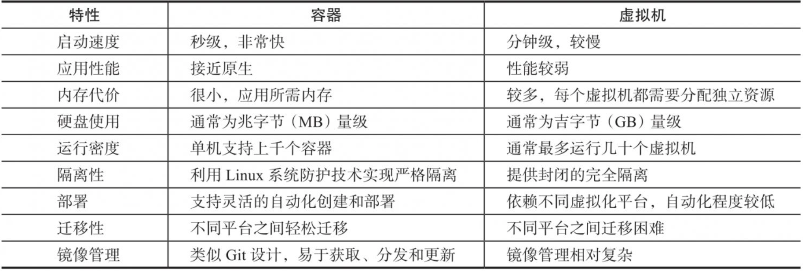
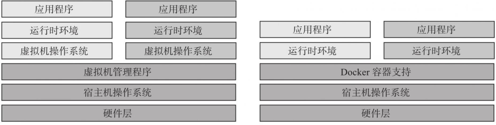

# 第一部分　基础入门
本部分共有9章，笔者将介绍Docker以及容器的相关基础知识。
第1章将介绍容器和Docker的来源以及Docker与现有的虚拟化技术，特别是Linux容器技术的关系。
第2章将介绍Docker的三大核心概念，以及如何在常见的操作系统环境中安装Docker。
第3～5章通过具体的示例，讲解Docker的常见操作，包括镜像、容器和仓库。
第6章将剖析如何在Docker中使用数据卷来保存持久化数据。
第7章将介绍如何使用端口映射和容器互联来方便外部对容器服务进行访问。
第8章将介绍如何编写Dockerfile配置文件，以及使用Dockerfile创建镜像的具体方法和注意事项。
第9章将介绍镜像的高级构建功能，包括如何使用多步骤构建、多平台构建、持续集成等。
# 第1章　初识Docker与容器
在主机时代，单个服务器的物理性能（例如CPU主频和内存）决定了竞争的胜负。而在云时代，通过虚拟化技术构建的集群处理能力变得至关重要。
随着信息技术的飞速发展，虚拟化概念已经广泛应用于众多关键场景。自20世纪60年代IBM推出的大型主机虚拟化，到后来以Xen和KVM为代表的虚拟机虚拟化，再到以Docker为代表的现代容器技术，虚拟化技术一直在不断创新和突破。
传统上，虚拟化可以通过硬件模拟或操作系统软件实现。而容器技术更为优雅，它充分利用了操作系统本身的机制和特性，实现了轻量级虚拟化，远超传统虚拟机。因此，有人将其称为“新一代虚拟化”技术，并把基于容器构建的云平台称为“容器云”​。
在众多容器技术中，Docker无疑是最流行的、最成熟的，它为容器技术发展做出了重要贡献。
那么，Docker是什么？它带来了哪些好处？与现有虚拟化技术有何关联？
本章将首先介绍Docker项目的起源和发展历程；然后深入剖析Docker以及相关容器技术，探讨其在DevOps等场景中带来的巨大便利；最后阐述Docker在整个虚拟化领域的技术定位。
## 1.1 什么是Docker
**1.Docker开源项目背景**
Docker是一个基于Go语言实现的开源容器项目。它诞生于2013年初，最初由dotCloud公司发起。自开源以来，Docker受到了业界的广泛关注和参与，目前已发展成拥有80多个相关开源项目（包括BuildKit、Compose、Containerd、Registry等）的完整生态体系。Docker引擎版本也已经更新到了v27。
随着项目的成功，dotCloud公司迅速发展壮大，于2013年年底更名为DockerInc，并专注于Docker相关技术和产品的开发，现已成为全球最大的Docker容器服务提供商，官方网站为docker.com。
Docker项目于2013年3月25日加入Linux基金会，核心代码遵循Apache2.0协议。开源代码主要通过GitHub仓库进行维护。2014年，Docker镜像下载数达到了100万次，2015年突破十亿次，到2017年更是惊人地突破百亿次。至写作本书时，Docker社区每个月的活跃开发者数量超过2000万，构建了700多万个应用，镜像获取超过200亿次。
如今，主流操作系统（如Linux各大发行版、macOS和Windows）均已支持Docker。此外，各大云服务提供商纷纷推出基于Docker的服务。Google在其PaaS平台上广泛应用Docker容器；IBM与Docker公司建立战略合作伙伴关系，在云业务上展开深入技术合作；Microsoft在其Azure云平台上支持安全可扩展的Docker集群方案；公有云提供商Amazon在其AWS云平台上集成了对Docker的支持，提供高性能快速部署。
Docker的愿景是实现“Build，Ship and Run Any App，Anywhere”​，即通过对应用的封装(Packaging)、分发(Distribution)、部署(Deployment)和运行(Runtime)生命周期的管理，实现应用组件级别的“一次封装，到处运行”​。这里的 应用组件可以是Web应用、编译环境、数据库平台服务，甚至是操作系统或集群。
借助Linux平台上的多项开源技术，Docker提供了高效、敏捷和轻量级的容器解决方案，支持部署到本地环境和多种主流云平台。可以说，Docker首次为应用的开发、运行和部署提供了“一站式”的实用解决方案。
Docker的核心优势在于其标准化、轻量化和可移植性。通过将应用和环境打包到容器中，Docker确保了应用在不同环境中的一致性和稳定性。这降低了开发和运维团队之间的摩擦，提高了软件开发的效率和可靠性。
**2.Linux容器技术—巨人的肩膀**
与大多数新兴技术的诞生一样，Docker并非“凭空而来”​，而是站在前人的肩膀上。其中最重要的就是Linux容器(Linux Container，LXC)技术。
LXC技术自身也经历了漫长的演变过程。最早的容器技术可追溯至1982年UNIX系列操作系统上的chroot工具（直至今日，主流的UNIX、Linux操作系统仍然支持并配备了该工具）​。早期的容器实现技术包括Sun Solaris操作系统上的SolarisContainers（2004年发布）​，FreeBSD操作系统上的FreeBSD jail（2000年左右出现）​，以及GNU/Linux上的Linux-VServer(http://linux-vserver.org)和OpenVZ(http://openvz.org)。
在LXC之前，这些相关技术经过多年演变已经相当成熟和稳定，但是基于各种原因，它们并未很好地集成到主流的Linux内核中，用户使用起来并不方便。例如，使用OpenVZ技术的用户需要先手动为操作系统打上特定的内核补丁，而且不同版本的补丁并不一致。类似的困境导致在很长一段时间内，这些优秀的技术仅在技术人员 的小圈子中传播。
随后，LXC项目借鉴了前人的成熟容器设计理念，并基于一系列新引入的内核特性，实现了更具扩展性的虚拟化容器方案。更为关键的是，LXC最终被集成到了主流Linux内核中，从而成为Linux系统轻量级容器技术的事实标准。
从技术层面来看，LXC已经越过绝大部分的“障碍”​，完成了容器技术实用化的大半历程。
**3.从Linux容器到Docker**
在LXC的基础上，Docker进一步优化了容器的使用体验，使其更加普及。
首先，Docker提供了各种容器管理工具（如分发、版本控制、移植等）​，让用户无须关注底层操作，可以更简单明了地管理和使用容器。其次，Docker通过引入分层文件系统和高效的镜像机制，降低了迁移难度，极大地改善了用户体验。用户操作Docker容器就像操作应用自身一样简单。
在实现方面，早期的Docker代码是直接基于LXC的。从0.9版本开始，Docker开发了libcontainer项目，并将它作为更广泛的容器驱动实现，从而取代了LXC的实现。Docker已将runC标准项目贡献给开放容器联盟，成为容器运行时事实标准。容器不再局限于Linux操作系统，而是更安全、更开放、更具扩展性。
简而言之，读者可以将Docker容器理解为一种轻量级的沙盒(Sandbox)。每个容器内运行着一个应用，不同的容器相互隔离，容器之间还可以通过网络互相通信。容器的创建和停止都十分迅速，几乎与创建和终止原生应用一致；此外，容器对系统资源的额外需求非常有限，远低于传统虚拟机。很多时候，甚至可以直接将容器视为应用本身而不会出现任何问题。
Docker技术已经在云计算和DevOps等领域得到广泛的应用，带来了更高效、可扩展和轻量级的应用部署、运维和管理方式。
## 1.2 为什么使用Docker
**1.Docker容器虚拟化的好处**
Docker项目的创始人兼前首席技术官Solomon Hykes曾指出，Docker准确地抓住了正确构建应用的趋势，恰逢其时地出现在正确的位置。在云时代，开发者所创建的应用需要能轻松地在网络中传播，摆脱底层物理硬件的束缚，同时能够在任何时间、任何地点被访问。因此，开发者需要一种新型的分布式应用程序构建方式，具备轻量级、快速分发和部署的特点，而这正是Docker的最大优势所在。
以一个简单的例子来说明。假设用户想要基于常见的LAMP(Linux+Apache+MySQL+PHP)组合构建一个网站。按照传统做法，首先需要安装Apache、MySQL和PHP及其运行所需的依赖环境，然后对它们进行配置（包括创建合适的用户、配置参数等）​。在执行大量操作后，还需要进行功能测试以确认网站是否正常运行，如果出现问题，则需要进行调试追踪，这将花费更多的时间并带来不可控的风险。可以想象，应用数量的增多会使事情变得更加复杂。
更令人担忧的是，一旦需要迁移服务器（例如从亚马逊云迁移到其他云服务）​，通常需要对每个应用重新进行部署和调试。这些烦琐且乏味的“体力活”极大地降低了工作效率。问题的根源在于，应用直接运行在底层操作系统上，无法保证在不同环境中行为的一致性。
Docker提供了一种更为智能的解决方案，通过容器对应用进行打包，从而解耦应用与运行平台。这意味着在迁移过程中，只需在新服务器上启动所需容器即可，无论新旧服务器是否为同一类型平台。这无疑将大大节省宝贵的时间并降低部署过程中出现问题的风险。
**2.Docker在开发和运维中的优势**
对于开发和运维(DevOps)人员来说，他们最梦寐以求的效果可能就是只进行一次创建或配置，之后就可以在任意平台、任意时间让应用正常运行。而Docker恰恰是可以实现这一终极目标的“瑞士军刀”​。
具体而言，Docker在开发和运维过程中具有以下几方面的优势：
❑ 更快速的交付和部署。使用Docker，开发人员可以借助镜像来快速构建一套标准的开发环境。开发完成后，测试和运维人员可以直接使用完全相同的环境来部署代码，确保经过开发和测试的代码在生产环境中无缝运行。Docker可以迅速创建和删除容器，实现快速迭代，从而大幅节省开发、测试、部署的时间。整个过程的全程可见性使团队更容易理解应用的创建和工作过程。
❑ 更高效的资源利用。Docker容器无须额外的虚拟化管理程序（Virtual MachineManager，VMM，或Hypervisor）支持，因为它是内核级的虚拟化，可以实现更高的性能，同时对资源的额外需求很低。与传统虚拟机方式相比，Docker的性能可以提高1～2个数量级。 
❑ 更轻松的迁移和扩展。Docker容器几乎可以在任意平台上运行，包括物理机、虚拟机、公有云、私有云、个人计算机、服务器等，同时支持主流的操作系统发行版本。这种兼容性使用户能够轻松地在不同平台之间迁移应用。
❑ 更简单的更新管理。利用Dockerfile，仅需进行微小的配置修改，就可以替代过去烦琐的更新工作。所有修改都以增量的方式被分发和更新，从而可以实现自动化且高效的容器管理。
**3.Docker与虚拟机比较**
作为一种轻量级的虚拟化方式，Docker在运行应用时相较传统虚拟机具有显著优势：
❑ Docker容器启动和停止速度非常快，可以在秒级实现，远快于传统虚拟机方式（数分钟）​。
❑ Docker容器对系统资源需求较少，一台主机上可以同时运行数千个Docker容器（例如，在服务器上已经实现了同时运行10K量级的容器实例）​。
❑ Docker利用类似Git设计理念的操作，便于用户获取、分发和更新应用镜像，实现存储复用和增量更新。
❑ Docker通过Dockerfile和Compose模板支持灵活的自动化创建和部署机制，可以提升工作效率并实现流程标准化。
Docker容器在运行应用时基本不消耗额外的系统资源，这既保证了应用性能，又尽可能降低了系统开销。相较于传统虚拟机方式（每个虚拟机需要单独分配独占的内存、磁盘等资源）运行N个不同应用，Docker只需启动N个隔离得“很薄的”容器，将应用放入容器即可，从而实现接近原生的运行性能。
尽管在隔离性方面，传统虚拟机提供相对封闭的隔离，但这并不意味着Docker安全性不足。Docker利用Linux系统上多种防护技术实现严格的隔离可靠性，并可整合诸多安全工具。在过去几年里，Docker不断改善容器安全控制和镜像安全机制，大幅提升了安全性。
表1-1概括了Docker容器技术与传统虚拟机技术的特性比较，可以明显看出，在许多应用场景下，容器技术具有显著的优势。

表1-1　Docker容器技术与传统虚拟机技术的特性比较

## 1.3 Docker与虚拟化
虚拟化技术在不同领域具有不同的含义，但在计算领域，通常指的是计算虚拟化(Computing Virtualization)，也称为服务器虚拟化。
简而言之，虚拟化是一种资源抽象和管理技术，它将计算机的各种实体资源（如处理器、存储器、网络等）进行抽象，使得用户可以将其重新隔离为多个独立的系统资源，以便于同时在同一主机上运行多个操作系统或应用。虚拟化的核心目标是提高系统资源的利用率，降低成本，简化管理，并提高容错和灾难恢复能力。
虚拟化技术可以分为基于硬件的虚拟化和基于软件的虚拟化。真正意义上基于硬件的虚拟化技术相对较少，例如，网卡中的单根多I/O虚拟化(Single Root I/OVirtualization and Sharing Specification，SR-IOV)技术等。
基于软件的虚拟化根据对象所在的层次，可以分为应用虚拟化和平台虚拟化。应用虚拟化通常指模拟设备或类似Wine这样的软件。平台虚拟化（通常指虚拟机技术）可细分为以下几个子类：
❑ 完全虚拟化：虚拟机模拟完整的底层硬件环境和特权指令的执行过程，无须修改客户操作系统，例如IBM P和Z系列的虚拟化、VMware Workstation、VirtualBox、QEMU等。
❑ 硬件辅助虚拟化：利用硬件（主要是CPU）辅助支持（目前x86体系结构上可用的硬件辅助虚拟化技术包括Intel-VT和AMD-V）处理敏感指令来实现完全虚拟化的功能，无须修改客户操作系统，例如VMware Workstation、Xen、KVM。
❑ 部分虚拟化：仅针对部分硬件资源进行虚拟化，需要修改客户操作系统。一些虚拟化技术的早期版本仅支持部分虚拟化。
❑ 超虚拟化(Paravirtualization)：部分硬件接口以软件的形式提供给客户操作系统，需要修改客户操作系统，例如早期的Xen。❑ 操作系统级虚拟化：内核通过创建多个虚拟的操作系统实例（内核和库）来隔离 不同的进程。Docker容器等技术属于这一范畴。
显然，Docker以及其他容器技术都属于操作系统级虚拟化范畴。操作系统级虚拟化的最大特点是不需要额外的超级管理程序(Hypervisor)支持。
Docker虚拟化方式之所以具有众多优势，是因为它的操作系统级虚拟化技术自身的设计和实现。容器通过共享相同的操作系统内核，有效降低了系统开销并提高了资源利用率。

图1-1比较了Docker和传统的虚拟化方式的不同之处。

图1-1　Docker和传统的虚拟化方式的不同之处
传统方式是在硬件层面实现虚拟化，需要有额外的虚拟机管理程序和虚拟机操作系统层。Docker容器是在操作系统层面上实现虚拟化，直接复用本地主机的操作系统，因此更加轻量级。
## 1.4 本章小结
本章介绍了容器虚拟化的基本概念、Docker的发展历程以及容器在云时代应用分发场景下的巨大优势。与传统的虚拟机方式相比，容器虚拟化方式在许多场景下具有显著优势。系统管理员、应用开发人员、测试人员以及运维管理人员都应尽快掌握Docker，以便尽早享受它带来的巨大便利。
在后续章节中，笔者将结合实践案例具体介绍Docker的安装和使用，伴读者一起踏上这场充满挑战与惊喜的现代容器之旅。