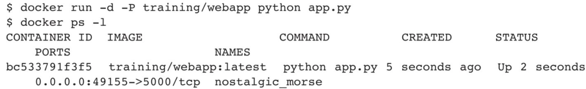
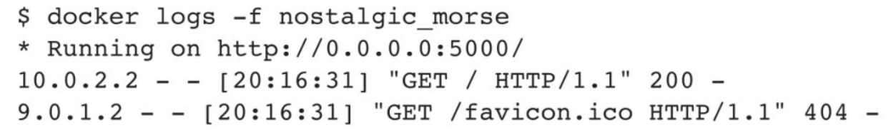
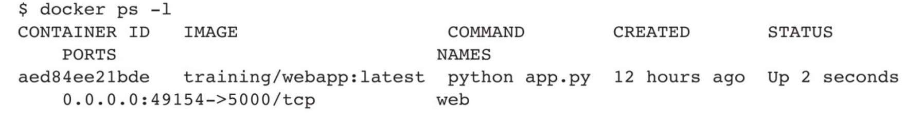
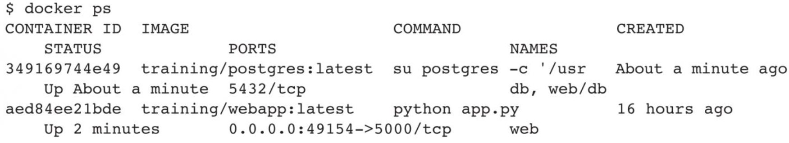
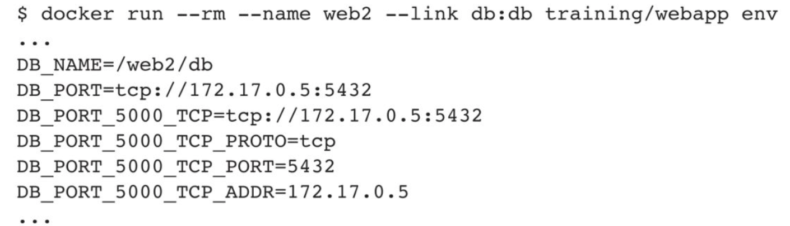
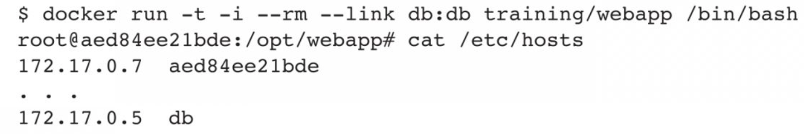
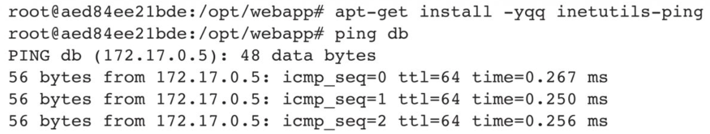

# 第七章 端口映射与容器互联
在前几章的学习过程中，相信读者已经掌握了如何管理单个容器。然而在实际应用中，经常会遇到需要多个服务组件容器共同协作的场景，这要求各个容器能够互相访问彼此的服务。
Docker不仅提供了通过网络访问的方式，还带来了两个便捷的功能，以满足基本的服务访问需求：其一是将容器内应用的服务端口映射到本地宿主机；其二是通过互联机制，使多个容器间能够快速地通过容器名访问彼此。
本章将分别详细介绍这两个实用的功能。
## 7.1 通过端口映射实现容器访问
**1.从外部访问容器应用**
在启动容器时，如果不指定对应参数，在容器外部是无法通过网络来访问容器内的应用和服务的。
当容器中运行一些网络应用，要让外部访问这些应用时，可以通过-P或-p参数来指定端口映射。当使用-P（大写的）标记时，Docker会随机映射一个49000～49900的端口到内部容器开放的网络端口：

此时，可以使用docker ps命令，本地主机的49155端口被映射到了容器的5000端口。访问宿主机的49155端口即可访问容器内Web应用提供的界面。
同样地，可以通过docker logs命令查看应用的信息：

**2.映射所有端口地址**
使用HostPort:ContainerPort格式将本地的5000端口映射到容器的5000端口，可以执行如下命令：
```shell
docker run -d -p 5000:5000 training/webapp python app.py
```
此时默认会绑定本地所有端口上的所有地址。多次使用-p标记可以绑定多个端口。例如：
```shell
docker run -d -p 5000:5000 -p 3000:80 training/webapp python app.py
```
**3.映射到指定地址的指定端口**
可以使用IP:HostPort:ContainerPort格式指定映射使用一个特定地址，比如localhost地址127.0.0.1：
```shell
docker run -d -p 127.0.0.1:5000:5000 training/weebapp python app.py
```
**4.映射到指定地址的任意端口**
使用IP::ContainerPort绑定localhost的任意端口到容器的5000端口，本地主机会自动分配一个端口：
```shell
docker run -d -p 127.0.0.1:5000 training/weebapp python app.py
```
还可以使用udp标记来指定UDP端口：
```shell
docker run -d -p 127.0.0.1:5000:5000/udp training/weebapp python app.py
```
**5.查看映射端口配置**
使用docker port命令查看当前映射的端口配置，也可以查看绑定的地址：

> [!NOTE] 注意
> 容器有自己的内部网络和IP地址，使用docker[container]inspect+容器ID可以获取容器的具体信息。
## 7.2 通过互联机制实现便捷互访
容器的互联(linking)是一种让多个容器中应用进行快速交互的方式。它会在源容器和接收容器之间创建连接关系，接收容器可以通过容器名快速访问到源容器，而不用指定具体的IP地址。
**1.自定义容器命名**
连接系统依据容器的名称来执行。因此，首先需要自定义一个好记的容器命名。虽然当创建容器时系统默认会分配一个名字，但自定义命名容器有两个好处：
❑ 自定义的命名比较好记，比如将一个Web应用容器命名为web，一目了然。
❑ 当要连接其他容器时，即使重启，也可以使用容器名描述，比如连接web容器到db容器。
使用--name标记可以为容器自定义命名：
```shell
docker run -d -P --name web training/weebapp python app.py
```
使用docker ps命令可以验证设定的命名：

也可以使用docker[container]inspect来查看容器的名称：

> [!NOTE] 注意
> 容器的名称是唯一的。如果已经命名了一个叫作web的容器，当用户要再次使用web这个名称的时候，需要先用docker rm命令删除之前创建的同名容器。

在执行docker[container]run的时候如果添加了--rm标记，则容器在终止后会立刻删除。需要注意，--rm和-d参数不能同时使用。
**2.容器互联**
使用--link参数可以让容器之间安全地进行交互。下面先创建一个新的数据库容器：
```shell
docker run -d -P --name db training/weebapp python app.py
```
删除之前创建的web容器：
```shell
docker rm -f web
```
然后创建一个新的web容器，并将它连接到db容器：
```shell
docker run -d -P --name web --link db:db training/weebapp python app.py
```
此时，db容器和web容器建立互联关系。
--link参数的格式为--link name:alias，其中name是要连接的容器的名称，alias是别名。
使用docker ps命令查看容器的连接：

可以看到自定义命名的容器—db和web。db容器的names列有db也有web/db。这表示web容器链接到db容器，web容器将被允许访问db容器的信息。
Docker相当于在两个互联的容器之间创建了一个虚机通道，而且不用映射它们的端口到宿主机上。在启动db容器时并没有使用-p和-P标记，从而避免了将数据库服务端口暴露到外部网络上。
Docker通过两种方式为容器公开连接信息：更新环境变量和更新/etc/hosts文件。
可以使用env命令查看Web容器的环境变量：

其中以DB_开头的环境变量供web容器连接db容器时使用，前缀采用大写的连接别名。
除了环境变量，Docker还添加host信息到父容器的/etc/hosts文件。下面是父容器web的hosts文件：

这里有两个hosts信息，第一个是web容器，web容器用自己的id作为默认主机名，第二个是db容器的IP和主机名。可以在web容器中使用ping命令来测试与db容器的连通情况，如下所示：

用ping命令来测试db容器，它会将db容器的IP地址解析成172.17.0.5。
用户可以连接多个子容器到父容器，比如可以连接多个web容器到同一个db容器上。
## 7.3 本章小结
毫无疑问，容器服务的访问在实际应用中至关重要。本章针对Docker容器服务访问详细阐述了两大基本操作，包括基础的容器端口映射机制和容器互联机制。
值得一提的是，Docker当前已能成熟地支持Linux系统内置的网络服务和功能。这种支持既依托现有的成熟技术确保稳定性，也能实现高速、高性能的数据转发。
在生产环境中，网络需求往往更加复杂多样，涉及跨主机甚至跨数据中心的通信。在这种情况下，通常需要借助额外的机制，如软件定义网络(SDN)或网络功能虚拟化(NFV)等相关技术。
在本书的第三部分，将深入探讨更多跨主机容器通信的方案，以及Docker网络的高级功能和配置方法。