#  第三章 使用Docker镜像
作为Docker三大核心概念之首，镜像自Docker问世以来便一直是相关社区热议的焦点。在运行Docker容器之前，如果镜像尚未存在，Docker将尝试从默认镜像仓库（如Docker Hub公共注册服务器）中下载。此外，用户还可以通过配置来使用自定义的镜像仓库。
本章将详细介绍与镜像相关的操作。首先，介绍如何使用pull命令从Docker Hub仓库中下载镜像至本地。接下来，将探讨如何查看并管理本地已有的镜像信息与标签。随后，还会演示如何在远程仓库中使用search命令进行搜索和过滤。此外，本章还将介绍如何删除镜像标签与镜像文件，以及如何创建并保存用户定制的镜像为外部文件。
最后，本章将讨论如何将自定义镜像推送至Docker Hub仓库。通过对本章的学习，读者将对Docker镜像的操作与管理有更深入的了解。
## 3.1 获取镜像
镜像是运行容器的前提，官方的Docker Hub网站已经提供了数十万个镜像供大家下载。
本节主要介绍Docker镜像的pull子命令。可以使用docker[image]pull命令直接从Docker Hub镜像源来下载镜像，该命令的格式为docker[image]pull NAME[: TAG]​。其中，NAME是镜像仓库的名称（用来区分镜像）​，TAG是镜像的标签（往往用来表示版本信息）​。通常情况下，描述一个镜像需要包括名称和标签信息。
例如，要获取一个Ubuntu 24.04系统的基础镜像，可以使用如下命令：
```shell
docker pull ubuntu:24.04
24.04:Pulling from library/ubuntu
de44b265507a:Pull complete
digest:sha256:80dd3c3b9c6cecb9f1667e9290b3bc61b78c2678c02cbdae5f0fea92cc6734ab
Status:Downloaded newer image for ubuntu:24.04
```
对于Docker镜像来说，如果不显式指定TAG，则默认会选择latest标签，这会下载仓库中最新版本的镜像。
下面的例子将从Docker Hub的Ubuntu仓库下载一个最新版本的Ubuntu操作系统的镜像：
```shell
docker pull ubuntu
Usig default tag:latest
latest:Pulling from library/ubuntu
...
Digest:sha256:67211c14fa74f070d27cc5969a7fa9aeff8e28ea118ef3babc295a0428a6d21
Status:Downloaded newer image for ubuntu:latest
```
该命令实际上下载的就是ubuntu:latest镜像。
注意，通常情况下，镜像的latest标签意味着该镜像会随着最新版本的更新而发生变化，因此内容并不稳定。为了确保生产环境的稳定性，建议避免忽略镜像的标签信息或使用默认的latest标记的镜像。
在使用docker pull命令下载镜像时，用户会发现镜像文件通常由多个层(layer)组成。类似6c953ac5d795的字符串是层的唯一ID（实际上，完整的ID由256位，即64个十六进制字符组成）​。下载过程中，命令行会显示镜像的各个层信息。若不同的镜像包含相同的层，则本地仅存储一份该层的内容，从而减少了存储空间的占用。
读者可能会关心一个问题：在不同的镜像仓库服务器上，是否会出现镜像重名的情况？
事实上，镜像的仓库名称应当包含仓库地址（registry，即注册服务器）作为前缀。然而，由于默认使用的是官方的Docker Hub服务，该前缀可以省略。
举个例子，docker pull ubuntu:24.04命令实际上等同于docker pull registry.hub.docker.com/ubuntu:24.04 命令。这表示从默认的注册服务器Docker Hub Registry中的Ubuntu仓库下载了一个标记为24.04的镜像。
如果从非官方的仓库下载，则需要在仓库名称前指定完整的仓库地址。例如，从quay.io源来下载influxdb:v2.2.0镜像，可以使用如下命令，此时下载的镜像名称为quay.io/influxdb/influxdb:v2.2.0：
```shell
docker pull quay.io/influxdb/influxdb:v2.2.0
v2.2.0:Pulling from influxdb/infulxdb
f003217c5aae:Pull complete
ec6dd42e28e2:Pull complete
2979231036f8:Pull complete
249c9896f0a0:Pull complete
Digest:sha256:077028be3651fea290cf046e259c1537eb4dd69f503a0e506d108d87a9174
Status：Downloaded newer image for quay.io/influxdb/influxdb:v2.2.0
quay.io/influxdb/influxdb:v2.2.0
```
Docker自1.3.0版本起对镜像管理引入了签名系统，加强了对镜像安全性的防护，用户可以通过比对签名来验证镜像的完整性和正确性。
pull子命令支持的选项主要包括：
❑ -a,--all-tags=true|false：是否获取仓库中的所有镜像，默认为否。
❑ --disable-content-trust：取消镜像的内容校验，默认为真。
另外，有时需要使用镜像代理服务来加速Docker镜像获取过程，可以在Docker服务启动配置中增加--registry-mirror=proxy_URL来指定镜像代理服务地址（如https://registry.docker-cn.com）​。
下载镜像到本地后，即可随时使用该镜像了，例如利用该镜像创建一个容器，在其中运行bash应用，执行打印“Hello World”的命令：
```shell
 docker run -it ubuntu:24.04 bash
 root@65663247040f:/# echo "Hello World"
 Hello World
 root@65663247040f:/# exit
```
 **使用代理服务器下载镜像**
 当需要通过代理服务器下载外网镜像时，可以通过修改Docker配置文件，重启Docker服务后实现。Ubuntu系统中的配置文件路径为/lib/systemd/system/docker.service。
```shell
Environment="HTTP_PROXY=socks5://x.x.x.x:xx"
Environment="HTTPS_PROXY=socks5://x.x.x.x:xx"
Environment="NO_PROXY=192.168.0.0/24,172.16.0.0/16,10.0.0.0/8"
# 在Execstat 行前面添加上述代理信息
ExecStart=/usr/bin/docker -H fd:// --containerd=/run/containerd/conainer.sock
ExecReload=/bin/kill -s HUP $MAINPID
```
代理协议可以使用Socks5、HTTP、HTTPS等。NO_PROXY可以指定不用代理服务器的仓库地址范围。
## 3.2 查看镜像信息
本节主要介绍Docker镜像的ls、tag和inspect子命令
**1.使用images命令列出镜像**
使用docker images或docker image ls命令可以列出本地主机上已有镜像的基本信息。例如，下面的命令列出了3.1节中下载的镜像信息：
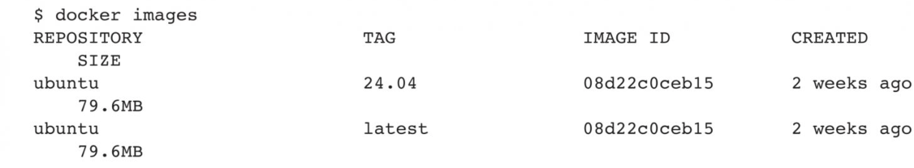
在列出的信息中，可以看到几个关键字段信息：
❑ REPOSITORY（仓库）​：显示镜像所属的仓库，例如ubuntu代表Ubuntu系列的基础镜像。
❑ TAG（标签）​：显示镜像的版本信息，如24.04或latest。需要注意的是，标签仅用于标记，并不能确切描述镜像内容。
❑ IMAGE ID（镜像ID）​：镜像的唯一标识。如果两个镜像的ID相同，则说明它们实际上指向同一个镜像，只是具有不同的标签名称而已。
❑ CREATED（创建时间）​：表示镜像最后一次更新的时间。
❑ SIZE（大小）​：显示镜像的体积大小。优秀的镜像通常具有较小的体积。
镜像ID是非常重要的信息，因为它唯一标识了一个镜像。在使用镜像ID时，通常可以使用该ID前几个字符组成的可区分子串来代替完整的ID。
标签信息用于区分来自同一个仓库的不同镜像。例如，在Ubuntu仓库中，可以通过不同的标签（如24.04、17.10等）来区分各个发行版本。
需要注意的是，镜像大小信息仅表示镜像的逻辑体积大小。实际上，由于相同的镜像层在本地只会存储一份，因此物理上占用的存储空间通常小于各镜像逻辑体积之和。
docker images子命令支持许多选项，用户可以根据需要进行尝试。以下是一些常用选项：
❑ -a,--all=true|false：列出所有（包括临时文件）镜像文件，默认为否。
❑ --digests=true|false：列出镜像的数字摘要值，默认为否。
❑ -f,--filter=[​]​：过滤要列出的镜像，例如使用dangling=true只显示未被使用的镜像，也可以指定带有特定标签的镜像等。
❑ --format="TEMPLATE"：自定义输出格式，包括table、json、Go模板格式等。
❑ --no-trunc=true|false：设置是否对过长的输出结果进行截断，例如镜像的ID信息，默认为是。❑ -q,--quiet=true|false：仅输出ID信息，默认为否。除此之外，还支持一些用于控制输出结果的选项，如-f,--filter=[​]​、--no-trunc=true|false、-q,--quiet=true|false等。
更多子命令选项还可以通过docker images--help命令查看。
**2.使用tag命令添加镜像标签**
为了方便在后续工作中使用特定镜像，还可以使用docker tag命令为本地镜像添加新的标签。例如，添加一个新的myubuntu:latest镜像标签：
```shell
docker tag ubuntu:latest myubuntu:latest
```
再次使用docker images列出本地镜像信息，可以看到多了一个myubuntu:latest标签的镜像：
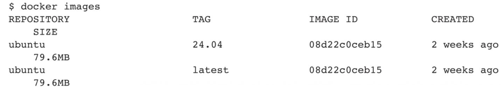
之后，用户就可以直接使用myubuntu:latest来表示这个镜像了。
注意，myubuntu:latest镜像和ubuntu:latest镜像的ID是完全一致的，它们实际上指向了同一个镜像文件，只是别名不同而已。docker tag命令添加的标签实际上起到了软链接的作用。
**3.使用inspect命令查看详细信息**
使用docker[image]inspect命令可以获取该镜像的详细信息，包括制作者、适用架构、各层的数字摘要等：
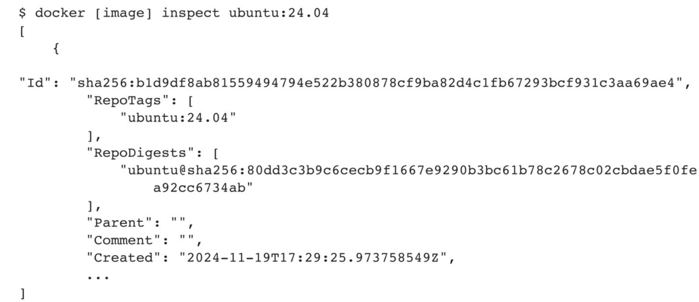
上面的代码返回的是一个JSON格式的消息，如果只需要其中一项内容时，可以使用-f来指定，例如，获取镜像的Architecture：
```shell
docker [image] inspect -f {{".Architecture"}} ubuntu:24.04
amd64
```
**4.使用history命令查看镜像历史**
既然镜像文件由多个层组成，那么怎么知道各个层的内容具体是什么？这时可以使用history子命令，该命令将列出各层的创建信息。
例如，查看ubuntu:24.04镜像的创建过程，可以使用如下命令：
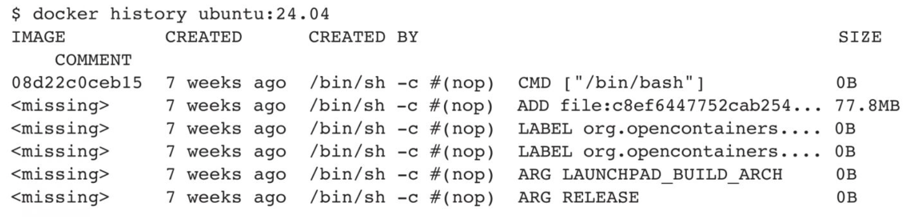
注意，过长的命令被自动截断了，可以使用--no-trunc选项来输出完整命令。
## 3.3 搜寻镜像
本节主要介绍Docker镜像的search子命令。
使用docker search命令可以搜索Docker Hub官方仓库中的镜像，命令格式为docker search[option]keyword。支持的命令选项主要包括：
❑ -f,--filter filter：过滤输出内容。
❑ --format string：格式化输出内容。
❑ --limit int：限制输出结果个数，默认为25个。
❑ --no-trunc：不截断输出结果。
例如，搜索官方提供的带nginx关键字的镜像，命令如下：
```shell
docker search --filter=is-official=true nginx
NAME DESCRIPTION STARS OFFICIAL AUTOMATED
nginx Official build of Nginx.7978 [OK]
kong Open-source Microsservice & API Management la... 159 [ok]
```
再比如，搜索所有收藏数超过4的关键词包括tensorflow的镜像，命令如下：
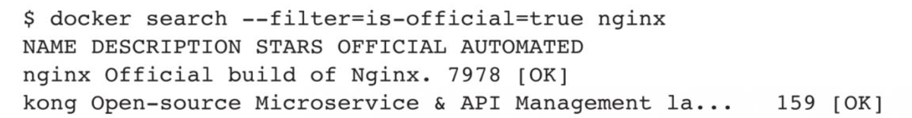
可以看到返回了很多包含关键字的镜像，其中包括镜像名字、描述、收藏数（表示该镜像的受欢迎程度）​、是否由官方创建、是否自动创建等。
默认的输出结果将按照星级评价进行排序。
## 3.4 删除和清理镜像
本节主要介绍Docker镜像的rmi/rm和prune子命令。
**1.使用标签删除镜像**
使用docker rmi或docker image rm命令可以删除镜像，命令格式为docker rmi[OPTIONS]IMAGE[IMAGE...]​，其中IMAGE可以为标签或ID。
支持的选项包括：
❑ -f,--force：强制删除镜像，即使有容器依赖它。
❑ --no-prune：不要清理未带标签的父镜像。
例如，创建一个新的myubuntu:latest镜像标签，然后删除它，可以使用如下命令：
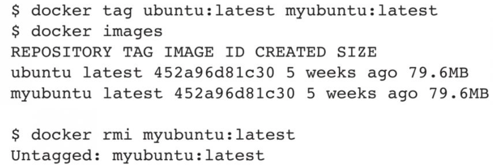
读者可能会担心，本地的ubuntu:latest镜像是否会受到此命令的影响。无须担心，当同一个镜像拥有多个标签时，docker rmi命令只是删除了该镜像多个标签中的指定标签而已，并不影响镜像文件。因此上述操作只是删除了镜像的一个标签副本。
再次查看本地的镜像，发现ubuntu:latest镜像仍然存在：
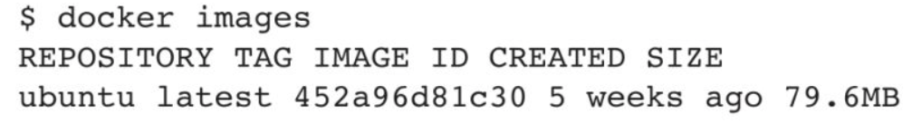
但当镜像只剩下一个标签时就要小心了，此时再使用docker rmi命令会删除镜像标签和数据文件。例如，通过执行docker rmi命令来删除只有一个标签的镜像，可以看出会删除这个镜像文件的所有文件数据层：
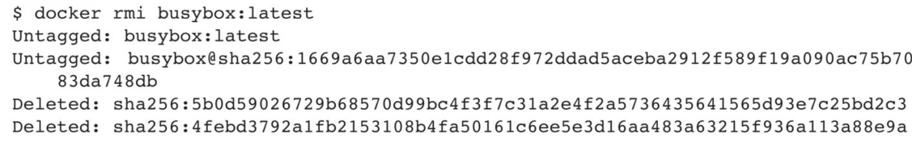
**2.使用镜像ID来删除镜像**
当使用docker rmi命令，并且后面跟上镜像的ID（也可以是能进行区分的部分串前缀）时，会先尝试删除所有指向该镜像的标签，然后删除该镜像文件本身。
注意，当存在通过该镜像创建的容器时，镜像文件默认是无法被删除的，例如，先利用ubuntu:24.04镜像创建一个简单的容器来输出一段话：
```shell
docker run ubuntu:24.04 echo 'hello! I am here!'
hello! I am here!
```
使用docker ps-a命令可以看到本机上存在的所有容器：
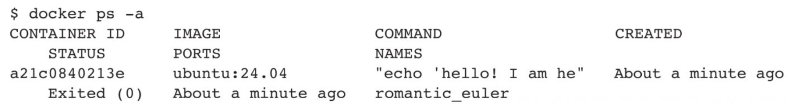
可以看到，后台存在一个退出状态的容器，是刚基于ubuntu:24.04镜像创建的。
如果试图删除该镜像，Docker会提示有容器正在运行，无法删除：
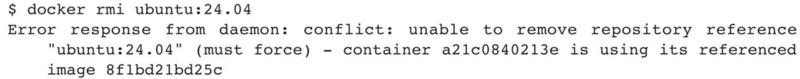
如果要想强行删除镜像，可以使用-f参数：
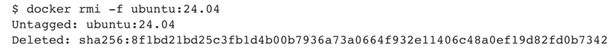
注意，通常不推荐使用-f参数来强制删除一个存在容器依赖的镜像。正确的做法是，先删除依赖该镜像的所有容器，再来删除镜像。
首先删除容器a21c0840213e：
```shell
docker rm a21c0840213e
```
然后使用镜像ID删除镜像，此时会正常打印出删除的各层信息：
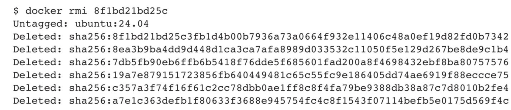
**3.清理镜像**
使用Docker一段时间后，系统中可能会遗留一些临时的镜像文件，以及一些没有被使用的镜像，此时可以通过docker image prune命令进行清理。
支持的选项包括：
❑ -a,--all：删除所有无用镜像，不仅是临时镜像。
❑ --filter filter：只清理符合给定过滤器的镜像。
❑ -f,--force：强制删除镜像，而不进行提示确认。
例如，如下命令会自动清理临时的遗留镜像文件层，最后会提示释放的存储空间：
```shell
docker image prune -f
···
Total reclaimed space:1.4G
```
## 3.5 创建镜像
创建镜像的方法主要有三种：基于已有镜像的容器创建、基于归档文件导入、基于Dockerfile创建。
本节主要介绍Docker的commit、import和build子命令。
**1.基于已有镜像的容器创建**
该方法主要是使用docker[container]commit命令，命令格式为：
```shell
docker [container] commit [OPTIONS] CONTAINER [REPOSITORY[:TAG]]
```
主要选项包括：
❑ -a,--author=""：作者信息。
❑ -c,--change=[​]​：提交的时候执行Dockerfile指令，包括CMD|ENTRYPOINT|E NV|EXPOSE|LABEL|ONBUILD|USER|VOLUME|WORKDIR等。
❑ -m,--message=""：提交消息。
❑ -p,--pause=true：提交时暂停容器运行。
下面将演示如何使用该命令创建一个新镜像。
首先，启动一个镜像，并在其中进行修改操作。例如，创建一个test文件，之后退出，代码如下：
```shell
docker run -it ubuntu:24.04 /bin/bash
root@a925cb40b3f0:/# touch test
root@a925cb40b3f0:/# exit
```
记住容器的ID为a925cb40b3f0。此时该容器与原ubuntu:24.04镜像相比，已经发生了改变，可以使用docker[container]commit命令来提交为一个新的镜像。提交时可以使用ID或名称来指定容器：
```shell
docker [container] commit -m "Added anew file" -a "Docker Newbee" 
test:0.1
a925cb40b3f09e9c814023bcffc3e67e892a235afe61b02f66a947d2747f724bd317dda02f27
```
顺利的话，会返回新创建镜像的ID信息，例如9e9c814023bcffc3e67e892a235a fe61b02f66a947d2747f724bd317dda02f27。
此时查看本地镜像列表，会发现新创建的镜像已经存在了：
```shell
docker images
REPOSITORY TAG IMAGE ID CREATED VIRTUAL SIZE
test 0.1 9e9c814023bc 4 seconds ago 188 MB
```
**2.基于归档文件导入**
用户也可以直接从一个归档文件文件导入一个镜像，主要使用docker[image]import命令，命令格式为：
```shell
docker [image] import [OPTIONS] file|URL| -[REPOSITORY[:TAG]]
```
该命令主要是从容器的归档文件中进行导入，形成一个新的镜像。例如，将任何容器导出为本地归档文件，然后使用import命令导入即可：
```shell
docker container export -o test.tar a404c6c174a2
docker image import test.tar test/ubuntu:vl
```
然后查看新导入的镜像，已经在本地存在了：
```shell
docker images
REPOSITORY TAG IMAGE ID CREATED VIRTUAL SIZE
test/ubuntu:vl 05ac7c0b9383 17 seconds ago 215.5MB
```
**3.基于Dockerfile创建**
基于Dockerfile创建镜像是最常见的方式。Dockerfile是一个文本文件，其中包括了指令，描述基于某个父镜像创建新镜像的过程。下面给出Dockerfile的一个简单示例，基于debian:stretch-slim镜像安装Python 3环境，构成一个新的python:3镜像：
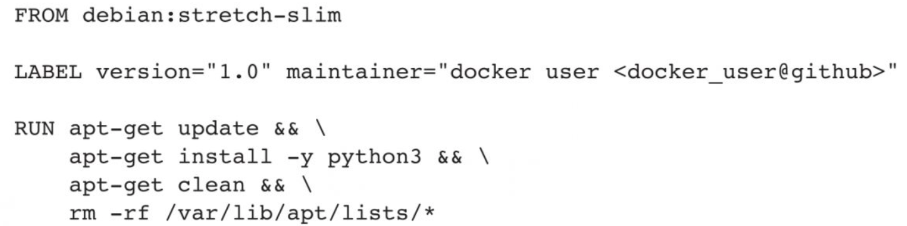
创建镜像可以使用docker[image]build命令完成，编译成功后本地将多出一个python:3镜像：
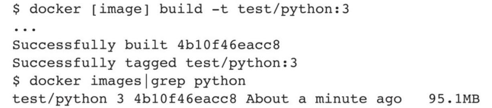
更多使用Dockerfile的技巧将在后面进行介绍。
## 3.6 导出和载入镜像
本节主要探讨Docker镜像中的save和load子命令。
用户可通过运行docker image save和docker image load命令来分别保存和加载镜像。通过这种方式，用户可以在不同的环境中传输和共享Docker镜像，为应用部署和开发提供便利。
**1.导出镜像**
若要将镜像导出到本地文件，可使用docker image save命令。此命令支持-o或--output string参数，可将镜像导出到指定文件。
例如，要将本地的ubuntu:24.04镜像导出为ubun_24.04.tar文件，请执行以下操作：
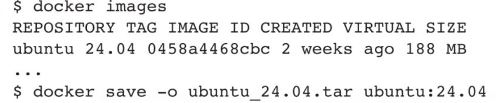
完成此操作后，用户便可通过复制ubuntu_24.04.tar文件将该镜像与他人共享。
**2.载入镜像**
可以使用docker[image]load命令将导出的tar文件再导入为本地镜像。该命令支持-i,--input string选项，允许从指定文件中读入镜像内容。
例如，若要从名为ubuntu_24.04.tar的文件导入镜像到本地镜像列表，请按照以下方式操作：
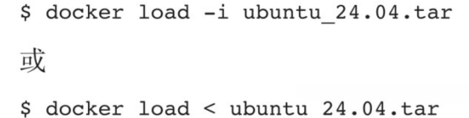
执行这些命令将导入镜像及其相关的元数据信息，包括标签等。导入成功后，可以使用docker images命令查看本地镜像列表，会发现刚刚导入的镜像与原镜像完全相同。
## 3.7 上传镜像
在本节中，笔者将重点讨论Docker镜像的push子命令。
要将镜像上传至仓库，用户可以使用docker image push命令。默认情况下，镜像将被上传至Docker Hub官方仓库。如果用户没有Docker Hub账号，需要先注册账号。
命令的格式为：
```shell
docker image push NAME[:TAG]|[REGISTRY_HOTST[:REGISTRY_PORT]/]NAME[:TAG]
```
在Docker Hub网站上注册并登录后，读者便可以上传自己创建的镜像。
以用户user为例，假设想要上传本地的test:latest镜像。首先，需要为其添加一个以用户名为前缀的标签，如user/test:latest，然后使用docker image push命令上传镜像：
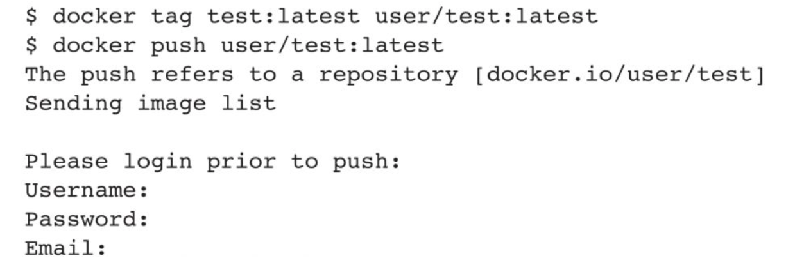
首次上传时，会提示输入自己在Docker Hub的登录信息或进行注册，之后登录信息会记录到本地的～/.docker目录下，后续上传时无须再次登录。
## 3.8 本章小结
本章详细介绍了Docker镜像的一系列关键操作命令，包括镜像的获取、查看、搜索、删除、创建、导出和导入、上传等功能。
用户可以通过输入docker image help命令查阅Docker支持的各种镜像操作子命令。
镜像是使用Docker的基础要素，也是其最核心的资源。因此，在日常的Docker使用过程中，建议用户注重积累定制化的镜像文件，同时分享自己创作的高质量镜像至社区，以造福更多开发者。
在接下来的章节中，笔者将通过更多实际案例详细讲解Docker镜像的操作技巧。