# 第九章 高级镜像构建
镜像构建是Docker引擎最常用的特性，也是软件开发生命周期中的关键环节。为了加强在多种平台上构建镜像的能力，Docker 19.03版本开始引入实验性功能DockerBuildx，它是docker build命令的扩展，用于启用和加速在多种平台上构建Docker镜像的能力。从Docker 23.0版本开始，镜像构建默认使用BuildKit构建引擎。docker build命令实际上都迁移到了docker buildx build。Docker Buildx可以支持多平台构建、构建工具接口、多种格式和高级构建能力（包括缓存控制、并行构建等）​。
本章将具体介绍如何使用多步骤构建、多平台构建、持续集成等高级镜像构建功能。

## 9.1 使用构建器
在Docker Buildx中，通过构建器(Builder)来构建镜像。构建器是一个环境，它能在其中运行构建。每个构建器都关联着一个BuildKit的实例，它可以使用不同的驱动(Driver)来运行。驱动是指定BuildKit实例运行的基础设施，决定整个构建套件在哪里运行，目前Docker Buildx支持四种驱动类型。
❑ Docker：使用默认绑定到Docker后台的构建套件。
❑ Docker-Container：创建一个专用的包含构建套件的Docker容器。
❑ Kubernetes(K8S)：创建一个在K8S集群内的构建套件Pod。
❑ Remote：连接到可管理的远程构建套件。
 不同驱动的支持功能如表9-1所示。

表9-1　不同驱动的支持功能
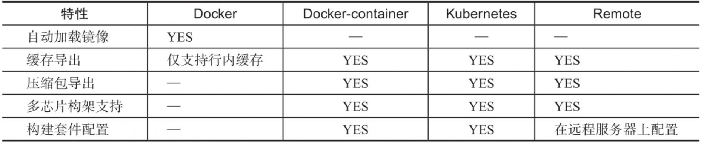
## 9.1.1 创建构建器
create命令用于创建一个新的构建器实例，该实例指向一个Docker上下文或端点。这里的“上下文”是指从docker context ls中获取的上下文名称，而“端点”则是Docker套接字的地址（例如DOCKER_HOST的值）​。
默认情况下，系统会使用当前的Docker配置来确定上下文/端点的值。支持的选项如表9-2所示。

表9-2　支持的选项
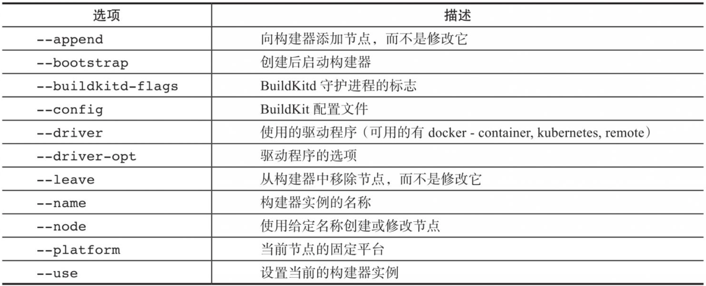
### 9.1.1 创建构建器
create命令用于创建一个新的构建器实例，该实例指向一个Docker上下文或端点。这里的“上下文”是指从docker context ls中获取的上下文名称，而“端点”则是Docker套接字的地址（例如DOCKER_HOST的值）​。
默认情况下，系统会使用当前的Docker配置来确定上下文/端点的值。支持的选项如表9-2所示。

表9-2　支持的选项

### 9.1.2 列出构建器
可以使用docker buildx ls命令查看系统上可用的构建器实例，如下所示，其中带＊的表示当前使用的构建器实例。可以查看它们的端点地址、版本和支持的多芯片构架：
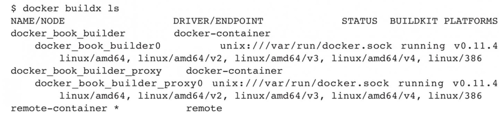
### 9.1.3 使用Remote远程构建套件驱动
当本地主机无法构建指定的芯片构架镜像或者需要提高构建性能时，可以选择使用Remote驱动。下面介绍如何创建远程构建套件驱动。
环境中包括两台主机：
❑ docker_book01：地址为172.16.100.102，用于本地构建器实例。
❑ docker_book02：地址为172.16.100.15，用于远程构建套件容器。
**1.在远程主机上创建构建器套件容器**
首先，创建create_certs.sh脚本，用来生成构建器套件证书，内容如下：
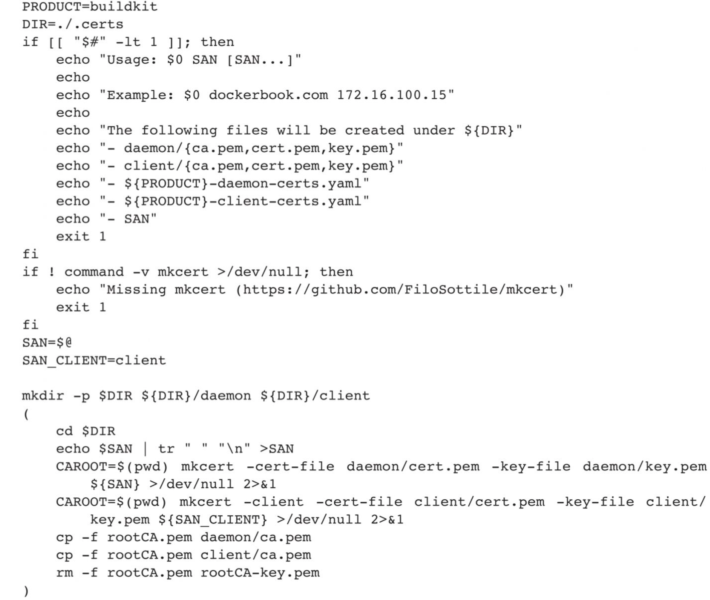
指定私有主机名，例如 dockerbook.com，读者可以在使用过程中改成自己喜欢的名字：
```shell
bash create_certs.sh dockerbook.com 172.16.100.15
```
利用生成的证书文件，创建并启动构建器套件容器：
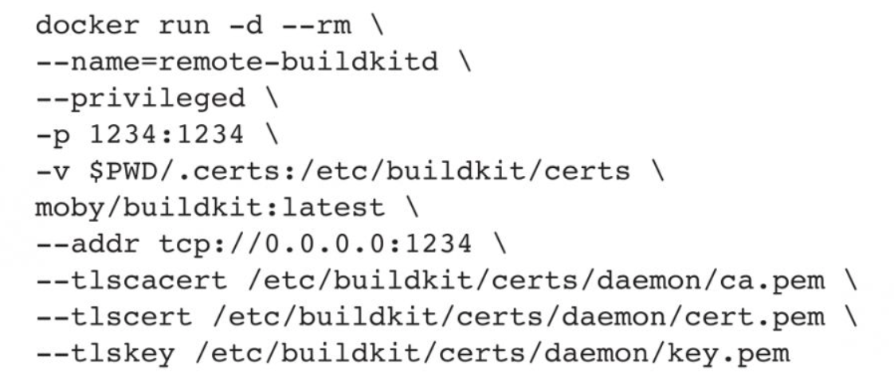
当需要在代理服务器后端使用构建器套件时，可以通过添加--enhttp_proxy=x.x.x.x:xxx来制定构建器套件容器的网络代理。例如：
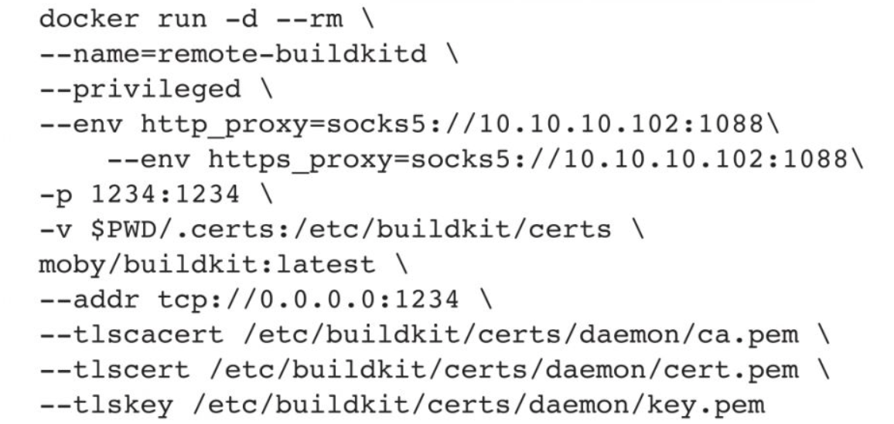
**2.创建本地构建器实例**
Docker推荐连接远程主机时使用数字证书，所以需要从远程主机处复制刚才创建的证书文件，并在创建实例时指定证书位置：
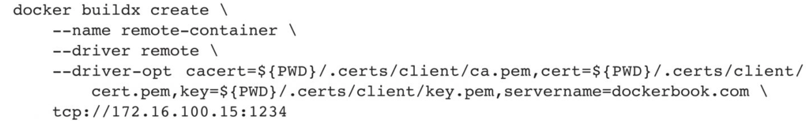
再次使用docker buildx ls命令时，就可以在输出中看到刚才创建的远程构建实例：
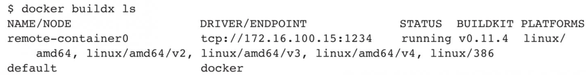
### 9.1.4 构建器磁盘清理
使用docker builder prune和docker buildx prune这两个命令可以立即清理构建器缓存占用的磁盘空间。
使用默认的Docker构建器驱动时，可以使用配置文件(/etc/docker/daemon.json)修改垃圾回收策略，示例如下：
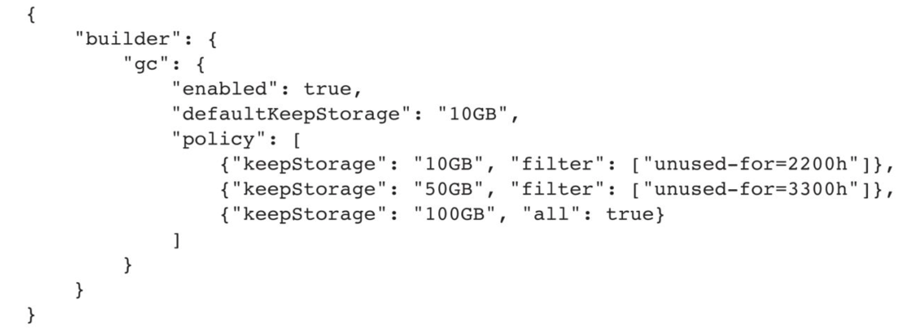
当使用其他驱动时，可以修改构建套件配置文件：
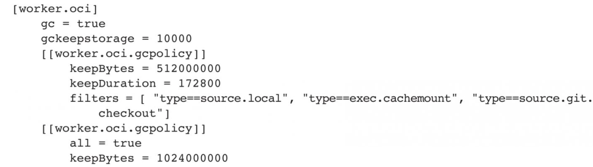
配置文件可以通过在创建构建器实例时使用--config参数设置：
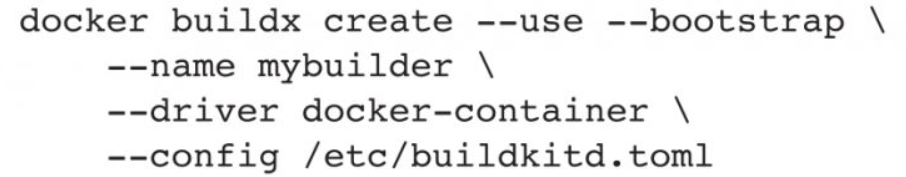
默认的构建器策略是：
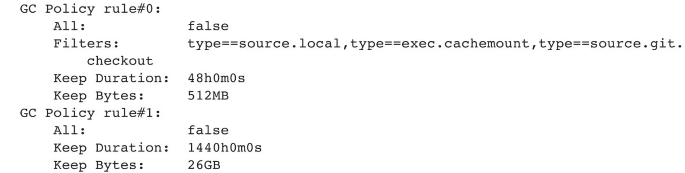
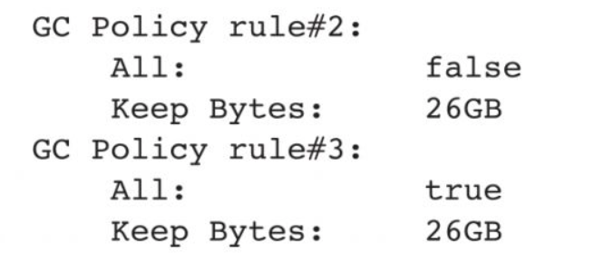
## 9.2 多步骤构建
多步骤构建(multi-stage build)是Docker 17.05版本引入的一个特性，它允许用户在单个Dockerfile中定义多个阶段，每个阶段都是从不同的基础镜像开始的，可以进行各种操作，然后只从最后一个阶段生成最终的Docker镜像。多步骤构建可以减小镜像大小、分离构建和运行环境、复用构建缓存，并且提高最终镜像的安全性。
### 9.2.1 单步骤构建的问题
在使用传统的单步骤构建时，为了减小最终的镜像大小，会把一些命令都放在一行中执行，并且使用&&符号连接在一起。比如：
```shell
RUN go get -d -v golang.org/x/net/html \
    && CGO_ENABLED=0 go build -a -installsuffix cgo -o app .
```
这样做很多时候不是很方便。例如当使用多条指令时，如果弄错格式，会导致代码出错。同时，由&&连接的语句出问题时，不知道出错的具体命令，会给调试带来困难。
如果将编译指令放到脚本中，虽然简化了Dockerfile的编写，但是整体构建过程会变得不够清晰。为了解决这些问题，Docker借鉴了复用的思想，引入了多步骤构建。
### 9.2.2 使用多步骤构建
多步骤构建和单步骤构建的区别在于，多步骤构建可以使用多个构建镜像，并且可以引用其他镜像的构建结果。例如，使用下面的Dockerfile打包前端代码。
首先使用node:10.14镜像打包前端代码，并用AS builder为打包步骤命名。最后，使用--from=builder将打包步骤中打包好的成果复制到Nginx镜像中：
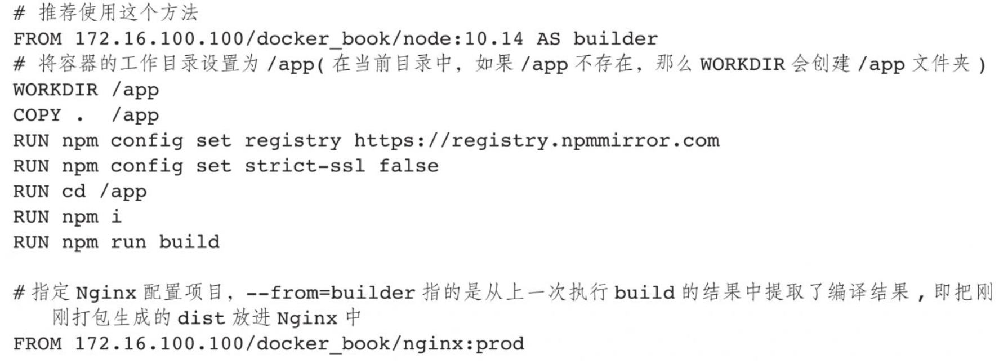
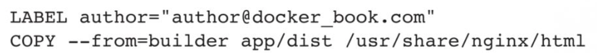
**1.在指定的构建阶段停止构建过程**
命令如下：
```shell
docker build --target builder -t 172.16.100.100/docker_book/builder/builder:builder .
```
当使用--target命令指定构建阶段时，构建过程将在完成指定阶段后停止。适用于以下场景：
❑ Debug特定的构建阶段。
❑ 在Debug阶段启用所有的Debug工具，方便输出日志，调试完成后再开始Production（生产）阶段。
❑ 在Testing（测试）阶段使用测试数据，在Production阶段使用生产数据。
**2.使用外部镜像作为stage构建阶段**
copy--from命令不仅可以使用同一个dockerfile中的构建阶段，还可以使用外部的镜像。例如：
```shell
COPY --from=nginx:latest /etc/nginx/nginx.conf /nginx.conf
```
**3.将上一个构建阶段作为新的构建阶段**
通过这种方式可以构建出多个构建阶段，如下面的示例所示：
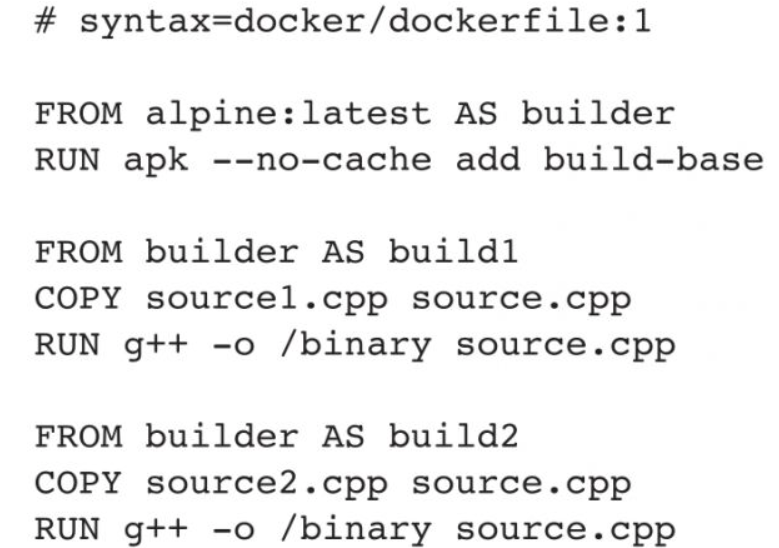
这个Dockerfile共定义了三个阶段：builder、build1和build2。
❑ builder阶段：以最新的Alpine Linux镜像为基础，然后使用Alpine的包管理工具apk安装了build-base包，该包包含了一些基本的编译工具，如gcc和g++。这个阶段的结果会被后面的阶段所引用。
❑ build1阶段：以builder阶段的结果为基础，然后将本地的source1.cpp文件复制到镜像的source.cpp，然后使用g++编译这个源文件，并生成可执行文件/binary。注意，这个阶段的/binary文件并没有包含到最终的Docker镜像中。❑ build2阶段：这个阶段与build1阶段类似，只是它复制和编译的是source2.cpp文件。和build1阶段一样，这个阶段的结果也没有包含到最终的Docker镜像中。
## 9.3 多平台镜像
Docker镜像采用的设计理念使其能够兼容多种芯片架构和操作系统。当镜像在各类芯片平台上运行时，Docker会自动选择与该操作系统和芯片架构相符合的镜像版本运行。
许多Docker Hub上的官方镜像，例如busybox，都提供了对多种芯片架构的支持，包括amd64、arm32v5、arm32v6、arm32v7、arm64v8、i386、ppc64le以及s390x。举例来说，如果用户在x86_64架构的机器上运行这个镜像，那么Docker就会自动下载并运行对应的amd64镜像版本。这样的设计大大提高了Docker镜像的通用性和适应性，使其能在不同的硬件和操作系统环境中运行。
**构建多平台镜像**
Docker可以无缝地支持构建多平台镜像，例如，当在x86_64的机器上构建arm镜像时，无须修改源码和dockerfile。可以通过以下三种方式实现多平台镜像的构建：
❑ 使用内核中的QEMU仿真支持。
❑ 在多个构建节点上构建。
❑ 使用多步骤构建交叉编译不同的芯片平台。
使用QEMU是最简单的方式，只要Linux Kernel高于4.8且binfmt-support高于2.1.7，在Docker引擎安装时一般就默认支持这种方式。如果单个节点不支持想要构建的全部平台，则可以使用多个节点同时构建，这也可以提高构建性能。
例如，笔者的机器是x86_64平台，但是默认安装的builder可以支持多平台。如下所示（使用命令docker buildx ls展示）​：
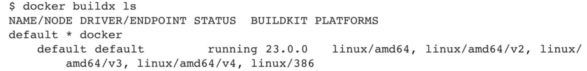
**1.创建新的构建实例**
使用docker buildx create命令创建新的构建实例，使用--driver docker-container指定实例驱动，使用--bootstrap添加当前主机所有支持的平台。
需要注意的是，当使用docker-container作为构建实例的驱动时，才可以同时构建多个平台镜像：
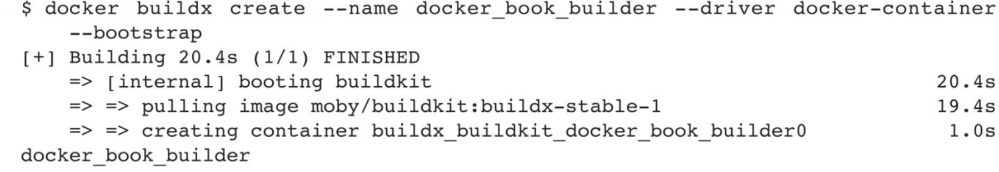
切换到新的构建实例：
```shell
docker buildx use docker_book_builder
```
再次查看构建实例列表，新的docker_book_builder已经被设置成默认的构建实例：
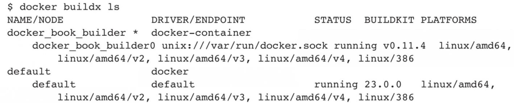
**2.构建多平台镜像实践**
下面以向alpine镜像添加一个hello_world空文件为例介绍如何构建多平台镜像。
dockerfile如下：
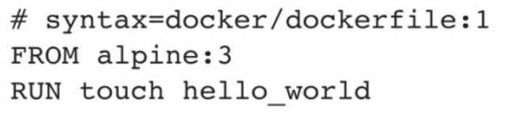
接下来使用--platform linux/amd64,linux/arm64,linux/arm/v7命令同时打包多个平台，使用-t qcpm1983/build_multi_platform:helloword命令指定镜像的名字和标签，如下所示：
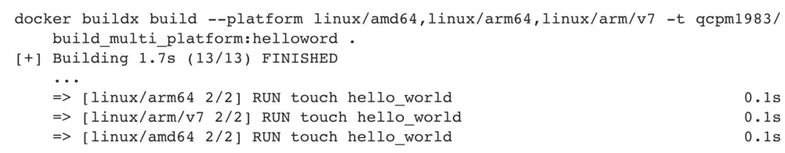
如果需要把打包后的镜像推送到镜像仓库，则需要先登录镜像仓库(docker login)，然后在打包命令后使用--push参数：
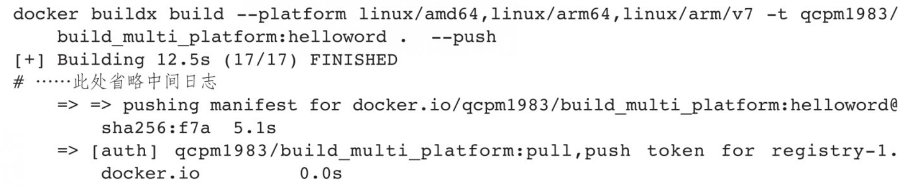
在Docker Hub上可以搜索到这个镜像，官方仓库已经列出了当前镜像可支持的平台，如图9-1所示。
当读者需要在代理服务器后面访问网络时，可在创建构建实例的时候添加--driver-opt env.http_proxy=socks5://x.x.x.x:xxx。Docker支持http、socks5等多种代理协议：
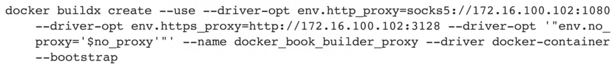
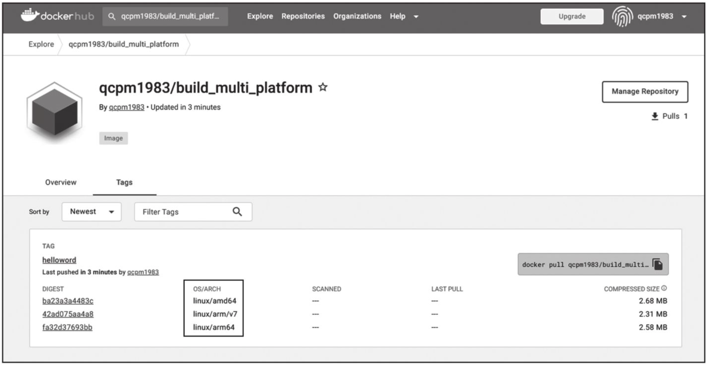
图9-1　在Docker Hub上搜索推送镜像
## 9.4 使用GitHub Action
GitHub是世界著名的代码托管平台，本章介绍如何使用GitHub提供的Action服务，将代码从代码仓库打包并推送到Docker Hub官方镜像仓库。
**1.在Docker Hub中创建访问密钥**
在Docker Hub中单击Account Setting，再单击左侧的Security，显示访问令牌管理界面，然后单击右侧的New Access Token按钮，复制弹窗显示的Token内容，如图9-2所示。
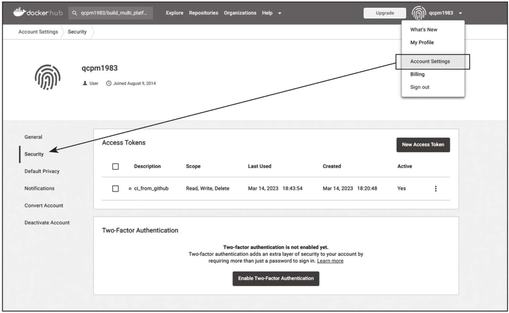
图9-2　在Docker Hub中创建访问密钥
**2.为自己的GitHub项目创建Secret**
打开项目的Settings标签页，然后单击左侧菜单Secrets and variables下的Actions，再单击New repository secret按钮，如图9-3所示。
在弹出的窗口填入刚才从Docker Hub创建的Token，记住Secret的名字。笔者设置了两个Secret，分别是DOCKER_HUB_TOKEN和DOCKER_HUB_USER，稍后会用到。
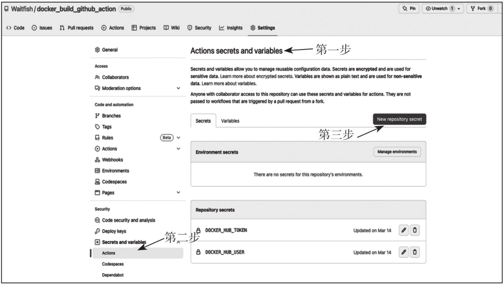
图9-3　为自己的GitHub项目创建Secret
**3.准备项目Dockerfile**
为了专注于理解如何使用GitHub Action构建镜像，这里采取的Dockerfile是使用alpine创建的一个空文件，如下所示：
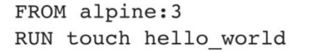
准备好Dockerfile后，提交到GitHub。
**4.配置GitHub Action**
打开GitHub项目的Actions标签页，单击New workflow按钮，在搜索框输入docker关键字进行搜索，然后选择由GitHub Action团队创建的Publish DcokerContainer，单击Configure按钮，如图9-4所示。
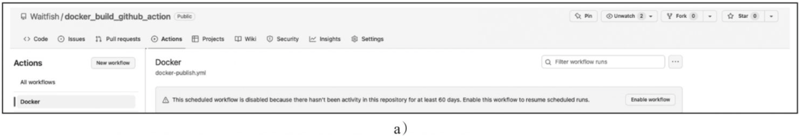
图9-4　配置GitHub Action
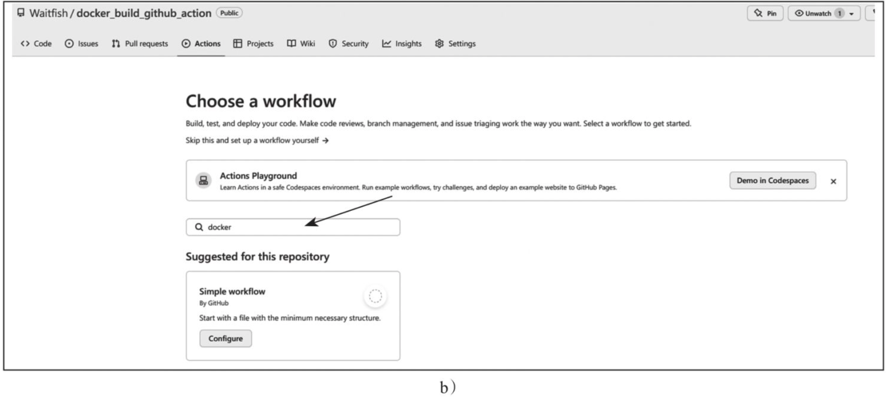
图9-4　配置GitHub Action（续）
弹出的内容是一个yml文件，简单修改基础个性化内容后，依次单击start commit和commit new file。提交成功后，依旧可以在Action标签页看到构建结果。构建成功后，可以在Docker Hub中查看镜像是否成功推送。
修改以下几处内容：
❑ REGISTRY:ghcr.io，因为要传到官方镜像，所以改成 docker.io。
❑ IMAGE_NAME:\${{github.repository}}，如果GitHub账号名和Docker Hub账号名不一致，这里可以修改成自己的名字，笔者这里修改成了\${{secrets.DOCKER_HUB_USER}}/docker_build_github_action。
❑ Log into registry \${{env.REGISTRY}}部分，username和password分别改成之前在GitHub设置的secret变量名，笔者这里分别修改成了\${{secrets.DOCKER_HUB_USER}}和\${{secrets.DOCKER_HUB_TOKEN}}。
其他地方，可以根据自己的需要修改，笔者在这里全部使用了默认值：
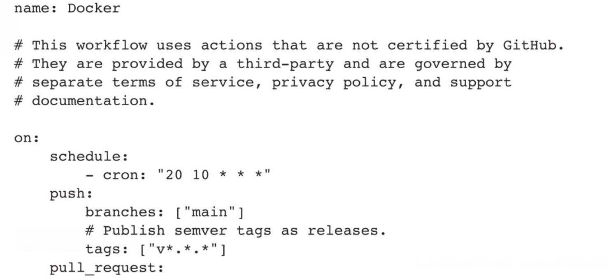
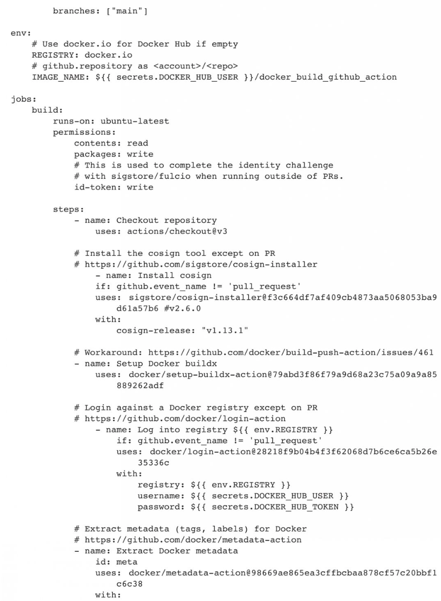
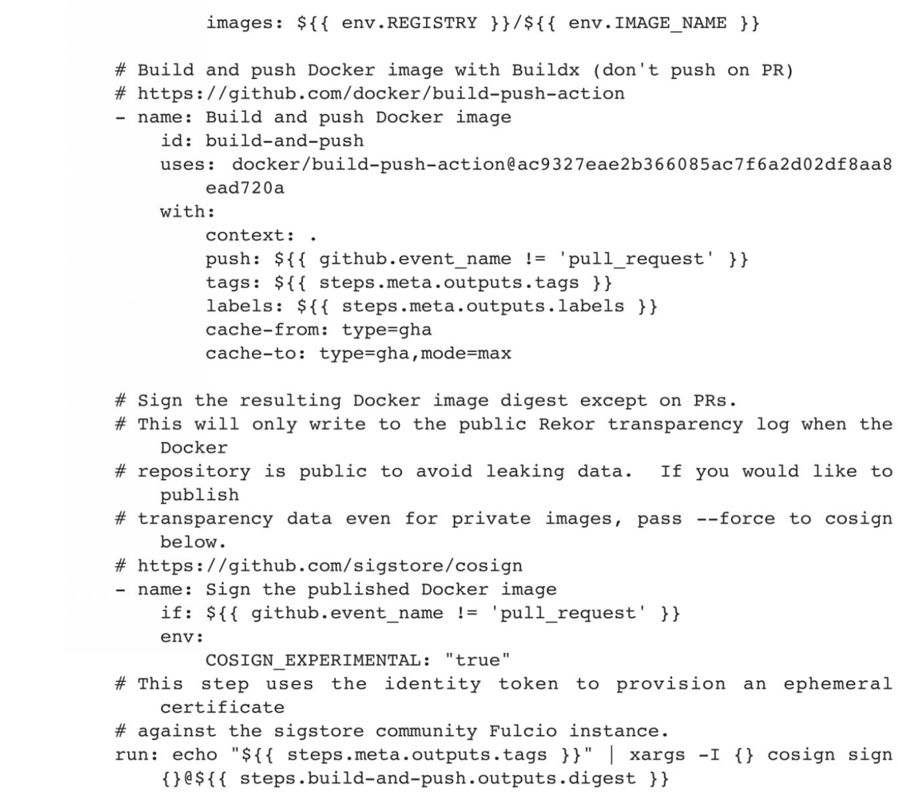
返回Docker Hub，可以发现镜像已经推送成功，如图9-5所示。
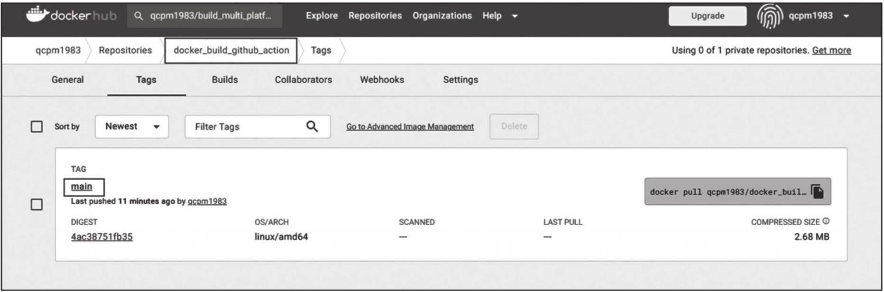
图9-5　镜像成功推送
## 9.5 本章小结
本章深入探讨了Docker构建过程中的关键操作，包括多步骤构建和多平台镜像的技巧。此外，详细介绍了如何利用GitHub上的Action服务实现一个基础的持续集成流程，将代码高效地打包成镜像并上传至Docker Hub官方镜像仓库。在其他代码托管平台（如Bitbucket）的持续集成步骤与此大致相同。读者可以根据在GitHub上的构建步骤，参考和查找对应平台的相关操作。