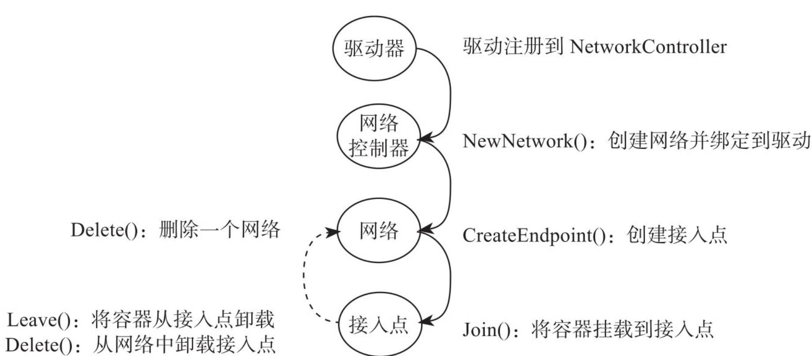
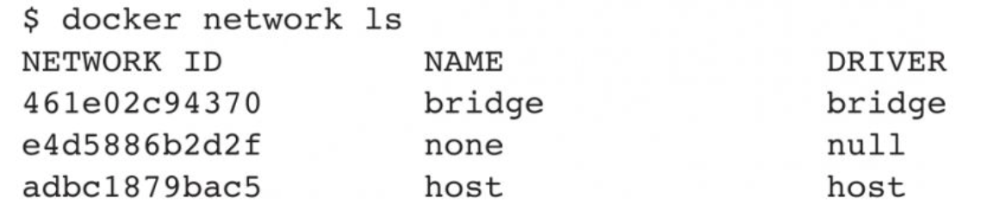
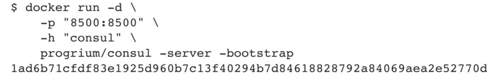
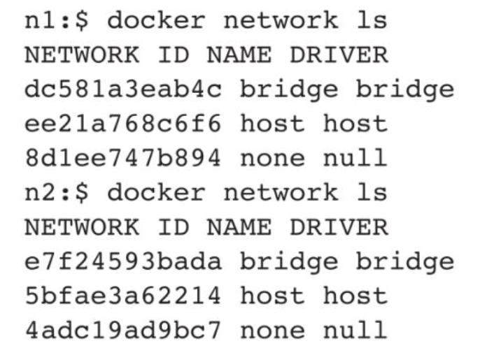
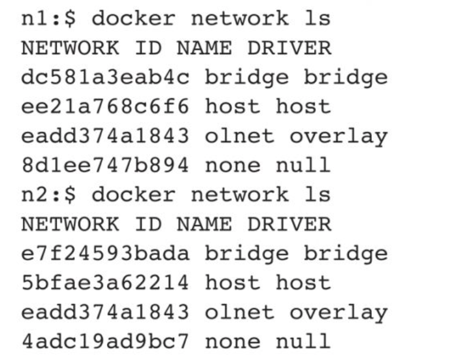
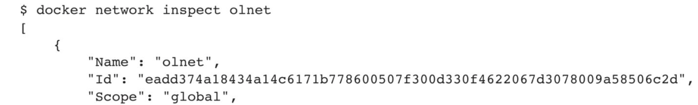
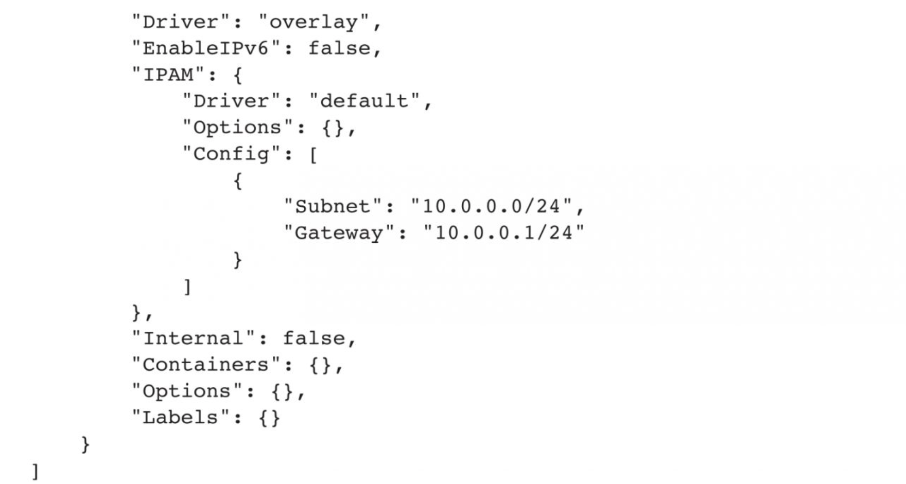
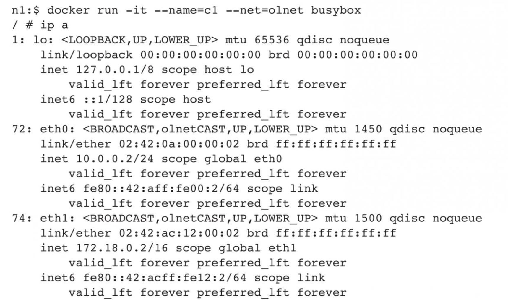
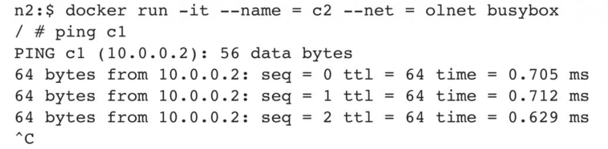
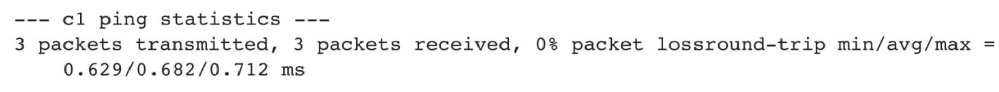

# 第21章　libnetwork插件化网络功能
自1.7.0版本起，Docker正式将网络和存储功能以插件化形式独立，为用户提供更多选择和灵活性。用户现可以通过命令来选择不同的后端实现。这次剥离出的独立容器网络项目即为libnetwork项目，该项目已经成为Docker网络的事实标准。
Docker的愿景是为各种类型的容器制定统一的网络层标准，并支持多个操作系统平台。这是Docker构建强大容器生态系统的重要尝试之一。
本章将深入探讨libnetwork的基本概念和应用，包括容器网络模型、相关操作命令以及如何借助libnetwork构建跨主机容器网络的详细步骤。
## 21.1 容器网络模型
在libnetwork中，容器网络模型(Container Networking Model，CNM)设计得极为简洁和抽象。这使得在其之上运行的容器能够充分利用网络功能，同时尽量不受底层实现细节的影响。
容器网络模型的结构图如图21-1所示，包括三种基本元素：

图21-1　容器网络模型

❑ Sandbox（沙盒）​：代表一个容器（准确地说，是其网络命名空间）​。
❑ Endpoint（接入点）​：代表网络上可以挂载容器的网络接口，会分配IP地址。
❑ Network：网络可以连通多个接入点的一个子网。
显然，对于采用CNM容器管理系统的用户而言，他们并不需要关心底层网络的具体实现、子网间如何进行隔离以及是否存在QoS等问题。只要插件能够提供网络和接入点，用户只需将容器接入或断开，剩下的部分由插件驱动自主实现。这种方式使容器和网络功能实现解耦，具有很高的灵活性。
CNM的典型生命周期如图21-2所示，并附有相应的流程图：首先，驱动向网络控制器注册自身，然后网络控制器根据驱动类型创建网络；接下来在新创建的网络上建立接口；最后将容器连接到相应的接口上。销毁过程与此正好相反，首先将容器从接入口上卸载，然后删除接入口和网络即可。

图21-2　CNM的典型生命周期

目前CNM支持的驱动类型有如下几种：
❑ None：不提供网络服务，容器启动后无网络连接。
❑ Host：直接使用宿主机上的网络栈。
❑ Bridge：默认类型，用Linux网桥和iptables实现的单机网络。
❑ Overlay：用vxlan隧道实现的跨主机容器网络，可以连接多个Docker主机。
❑ 其他扩展类型：包括ipvlan、macvlan或其他自定义的网络实现。
从架构位置来看，libnetwork向上提供了对容器的支持，同时向下屏蔽了实现层面的差异，因此它处于至关重要的中间层。对于熟悉计算机网络协议模型的读者而言，libnetwork可以类比为核心的TCP/IP层。
如今，越来越多的网络方案已开始支持libnetwork。例如，OpenStackKuryr项目通过使用libnetwork，使得Docker可以直接利用Neutron提供的网络功能。
## 21.2 Docker网络命令
在libnetwork的支持下，Docker网络相关的操作都以network子命令的形式呈现。这些操作主要围绕着CNM生命周期的管理，包括以下几个命令：
❑ create：创建一个网络。
❑ connect：将容器接入网络。
❑ disconnect：把容器从网络上断开。 
❑ inspect：查看网络的详细信息。
❑ ls：列出所有网络。
❑ prune：清理无用的网络资源。
❑ rm：删除一个网络。
1.创建网络
create命令用于创建一个全新的容器网络。Docker内置了bridge（默认使用）和overlay两种驱动，分别支持单主机和多主机场景。Docker服务在启动后，会默认创建一个bridge类型的网桥bridge。不同网络之间默认相互隔离。
创建网络命令格式为：
```shell
docker network create [OPTIONS] NETWORK
```
支持的参数包括：
❑ -attachable[=false]​：支持手动容器挂载。
❑ -aux-address=map[​]​：辅助的IP地址。
❑ -config-from=""：从某个网络复制配置数据。
❑ -config-only[=false]​：启用仅可配置模式。
❑ -d,-driver="bridge"：网络驱动类型，如bridge或overlay。
❑ -gateway=[​]​：网关地址。
❑ -ingress[=false]​：创建一个Docker Swarm可路由网络。
❑ -internal[=false]​：内部模式，禁止外部对所创建网络的访问。
❑ -ip-range=[​]​：指定分配IP地址范围。
❑ -ipam-driver="default"：IP地址管理的插件类型。
❑ -ipam-opt=map[​]​：IP地址管理插件的选项。
❑ -ipv6[=false]​：支持IPv6地址。
❑ -label value：为网络添加元标签信息。
❑ -o,-opt=map[​]​：网络驱动所支持的选项。
❑ -scope=""：指定网络范围。
❑ -subnet=[​]​：网络地址段，CIDR格式，如172.17.0.0/16。
**2.接入网络**
connect命令将一个容器连接到一个已存在的网络上。连接到网络上的容器可以与同一网络中其他容器互通，同一个容器可以同时接入多个网络。
也可以在执行docker run命令时通过-net参数指定容器启动后自动接入的网络。接入网络命令格式为：
```shell
docker network connect [OPTIONS] NETWORK CONTAINER
```
支持的参数包括：
❑ -alias=[​]​：为容器添加一个别名，此别名仅在所添加网络上可见。
❑ -driver-opt：网络驱动相关的参数。
❑ -ip=""：指定IP地址，需要注意不能与已接入的容器地址冲突。
❑ -ip6=""：指定IPv6地址。
❑ -link value：添加链接到另外一个容器。
❑ -link-local-ip=[​]​：为容器添加一个链接地址。
**3.断开网络**
disconnect命令将一个连接到网络上的容器从网络上断开连接。命令格式为：
```shell
docker network disconnect [OPTIONS] NETWORK CONTAINER
```
支持的参数包括-f,-force，用于强制把容器从网络上移除。
**4.查看网络信息**
inspect命令用于查看一个网络的具体信息（JSON格式）​，包括接入的容器、网络配置信息等。命令格式为：
```shell
docker network inspect [OPTIONS] NETWORK [NETWORK...]
```
支持的参数包括：
❑ -f,-format=""：给定一个Golang模板字符串，对输出结果进行格式化，如只查看地址配置可以用-f '{{.IPAM.Config}}'。
❑ -v,-verbose[=false]​：输出调试信息。
**5.列出网络**
列出网络的命令用法十分简单，命令格式为：
```shell
docker network ls [OPTIONS]
```
支持的参数主要有：
❑ -f,-filter=""：指定输出过滤器，如driver=bridge。
❑ -format=""：给定一个Golang模板字符串，对输出结果进行格式化。
❑ -no-trunc[=false]​：不间断地输出内容。
❑ -q,-quiet[=false]​：安静模式，只打印网络的ID。
实际上，在不执行额外网络命令的情况下，如果用户执行docker networkls命令，一般情况下可以看到已创建的三个网络：

它们分别为三种驱动的网络：null、host和bridge。
**6.清理无用网络**
prune命令可以清理已经没有容器使用的网络。命令格式为：
```shell
docker network prune [OPTIONS] [flags]
```
支持的参数包括：
❑ -filter=""：指定选择过滤器。
❑ -f,-force：强制清理资源。
**7.删除网络**
rm命令用于删除指定的网络。当网络上没有容器连接上时，才会成功删除。命令格式为：
```shell
docker network rm NETWORK [NETWORK...]
```
支持的参数包括-f,-force，用于强制删除网络。
## 21.3 构建跨主机容器网络
在这里，笔者将展示如何借助libnetwork内置的Overlay网络驱动实现跨主机的容器通信。Overlay驱动默认使用VXLAN协议，在能够相互访问IP地址的多个主机之间建立通道，实现容器间的互通。
实际上，使用Docker Swarm模式已经可以直接创建跨主机网络。了解下面的操作步骤，将有助于理解容器网络的实现原理。
**1.配置网络信息管理数据库**
在现实世界中，实现不同主机之间的连接通常需要借助交换机或路由器（在跨子网的情况下）等互联设备。这些设备不仅在物理层面提供了连接功能，更重要的是实现了网络管理。例如，主机的位置、地址等信息，均需要由网络管理平面进行维护和管理。
在libnetwork的网络解决方案中，为了实现跨主机容器网络通信，也需要引入一个类似的网络信息管理机制。不过，这种机制相较于传统设备而言简单得多，仅需一个键值型数据库即可，例如Consul、Etcd和ZooKeeper等工具都能够满足这一需求。
以Consul为例，启动一个progrium/consul容器，并映射服务到本地的8500端口：

所在主机作为数据库节点。
**2.配置Docker主机**
启动两台Docker主机n1和n2，分别安装好最新的Docker引擎。确保这两台主机之间可以通过IP地址互相访问，另外，都能访问到数据库节点的8500端口。配置主机的Docker服务启动选项如下：

重新启动Docker服务：
```shell
sudo service docker restart
```
**3.创建网络**
分别在n1和n2上查看现有的Docker网络，包括三个默认网络，分别为bridge、host和none类型：

在任意节点上创建网络olnet，例如，在n1上执行如下命令即可完成对跨主机网络的创建：

创建成功后，可以同时在n1和n2上查看到新的网络olnet的信息：

此时，还可以通过docker network inspect命令查看网络的具体信息：


4.测试网络在n1上启动一个容器c1，通过--net选项指定连接到olnet网络上。查看网络信息，其中一个接口eth0已经连接到了olnet网络上：

在n2上启动一个容器c2，同样连接到olnet网络上。
通过ping c1进行测试，可以访问到另外一台主机n1上的容器c1：


## 21.4 本章小结
本章重点探讨了Docker的网络功能以及插件化网络工具：libnetwork。在1.7.0版本之前，Docker主要关注本地主机网络。随后，它逐步加强了跨主机通信网络能力。如今，Docker借助libnetwork项目，已经从单主机上的服务场景拓展至大型集群乃至数据中心场景，为实现容器云提供了强大支持。
从架构层次来看，libnetwork位于整个容器网络栈的核心中间层。借助容器网络模型，libnetwork对底层网络实现进行了抽象，使得位于其上的容器能够无缝使用不同的底层网络技术。无论是物理网络还是虚拟网络，只要符合容器网络模型的标准，便可以轻松应用于Docker容器。
相较于传统场景，容器的动态性和高密度特点为网络技术带来了诸多挑战。后续介绍的Docker Swarm项目融合了虚拟网络支持，可以有效支持大规模的集群网络。