# 第四部分　开源项目
开源技术之所以受到越来越广泛的关注并且在实际应用中发挥关键作用，一个重要的原因在于不同的开源项目之间形成了协作与互补的关系，共同构建起了一个完善且健康的生态系统。尤其在容器技术领域，许多社区和企业推出了诸多优秀的工具和服务，这些工具极大地简化了容器技术的使用流程，并使得更多的业务场景能够从容器技术中受益。
在本部分，笔者将重点介绍一些与此相关的优秀开源项目。
在第22章，笔者将介绍开源的高可用分布式键值数据库Etcd，这个项目在分布式系统的共识实现和服务发现方面已经得到广泛应用。
在第23章和第24章，笔者将介绍由Docker公司推出的Compose和Swarm工具。这些工具不仅让Docker支持了单机虚拟化，更使其能够支持更为广泛的集群平台，提供了更为强大且灵活的功能。
第25章将深入探讨Kubernetes项目。这个项目由Google公司开源并维护，现已成为容器集群管理平台的事实标准，在业界拥有极高的声誉。
最后，第26章还将介绍一些其他的优秀项目，这些项目在持续集成、管理、开发等方面都有着独特的优势，可以帮助用户提升效率，实现更为高效的运作。
## 第22章　Etcd——高可用的键值数据库
Etcd是一个开源的分布式键值存储系统，由CoreOS团队发起，旨在为分布式系统（尤其是微服务架构）提供配置数据共享和服务发现功能。该项目实现了高可用性、一致性和容错性，被广泛应用于Kubernetes、CloudFoundry、CoreOS Fleet和Salesforce等项目中，也适用于许多其他分布式系统应用场景。
本章将详细介绍Etcd的相关知识，包括安装和使用，以及集群管理等。笔者将介绍如何使用Etcd进行数据操作，以及如何优化和维护Etcd集群，同时，还将展示Etcd提供的一些实用功能，如数据监听、快照和服务发现等。通过本章的学习，读者将能够充分了解Etcd的特性和应用场景，从而更好地应用Etcd解决分布式系统中的配置管理和服务发现等问题。
Etcd的目标是构建一个高可用的分布式键值(key-value)仓库，遵循Apachev2许可，基于Go语言实现。

对分布式系统来说，实现信息的共识是最基本的问题之一，只有在此基础 上才能实现对服务配置信息的管理、服务的发现、更新、同步等。解决这些问题需要使用一套能保证一致性的分布式数据系统，比如传统的ApacheZooKeeper项目，采用了ZooKeeper Atomic Broadcast（简化版的Paxos）算法来实现数据的强一致性。
与ZooKeeper项目类似，Etcd也是为集群环境设计的，但它采用了更为简洁的Raft[插图]共识算法，同样可以实现数据的强一致性，并支持集群节点状态管理和服务自动发现等功能。Etcd项目在github.com/coreos/etcd进行维护，最新为3.x系列版本。它已经成为Kubernetes集群配置管理的核心组件之一，并被广泛应用于其他分布式系统中。
Etcd的设计灵感来源于Apache ZooKeeper[插图]项目和doozer项目（doozer是一个一致性分布式数据库实现，主要面向少量数据）​。在设计Etcd时，团队特别考虑了以下四个方面。
❑ 简单：支持RESTful API和gRPC API，用户可以轻松地与Etcd进行交互。
❑ 安全：通过使用TLS方式实现安全连接，保障数据的安全性。
❑ 快速：支持每秒万次的并发写操作，超时时间在毫秒级别。 
❑ 可靠：支持分布式架构，基于Raft共识算法实现一致性，确保数据的可靠性和一致性。
在使用Etcd进行服务配置信息管理和服务发现时，通常需要在多个节点上启动多个Etcd实例，并将它们添加为一个集群。同一个集群中的Etcd实例之间会自动进行通信和同步，以保持彼此之间信息的一致性。这样，分布在集群节点上的应用都可以获取到一致的信息，从而保证整个分布式系统的正常运行和服务可用性。同时，Etcd还支持动态添加和移除节点，以适应集群规模的变化。
## 22.1 安装和使用Etcd
Etcd基于Go语言实现，因此，用户可以从项目主页https://github.com/coreos/etcd 下载源代码自行编译，也可以下载编译好的二进制文件，甚至直接使用制作好的Docker镜像文件来体验。
下面分别讲解基于二进制文件和Docker镜像这两种方式安装Etcd，步骤都十分简单。
### 22.1.1 二进制文件方式
**1.下载和安装**
编译好的二进制文件都可以在github.com/coreos/etcd/releases页面找到，用户可以选择需要的版本，或通过下载工具下载。例如，下面的命令使用curl工具下载压缩包，并将它解压到本地：
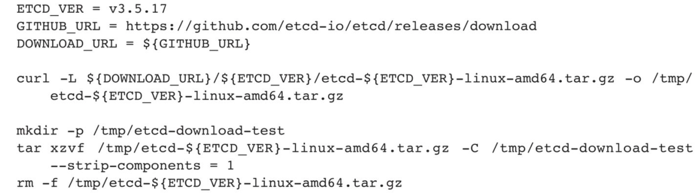
解压后，可以看到若干二进制文件和文档文件：

其中，etcd是主服务文件，etcdctl是提供给用户的命令客户端，etcdutl是工具文件，其他的都是文档文件。
> [!NOTE] 注意
>某些版本中还含有etcd-migrate二进制文件，可以协助进行旧版本的迁移。

通过下面的命令将所需要的二进制文件都放到系统可执行路径/usr/local/bin/下：
```shell
sudo cp etcd* /usr/local/bin/
```
至此，Etcd安装完成。
**2.使用Etcd**
下面将先以单节点模式为例讲解Etcd支持的功能和操作。可通过如下命令查看etcd的版本信息：
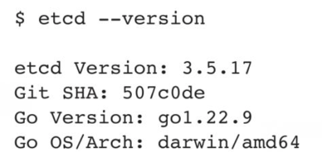
接下来，直接执行etcd命令，这将启动一个服务节点，监听本地的2379（客户端请求端口）和2380（其他节点连接端口）​，显示类似下面这样的信息：
接下来，直接执行etcd命令，这将启动一个服务节点，监听本地的2379（客户端请求端口）和2380（其他节点连接端口）​，显示类似下面这样的信息：
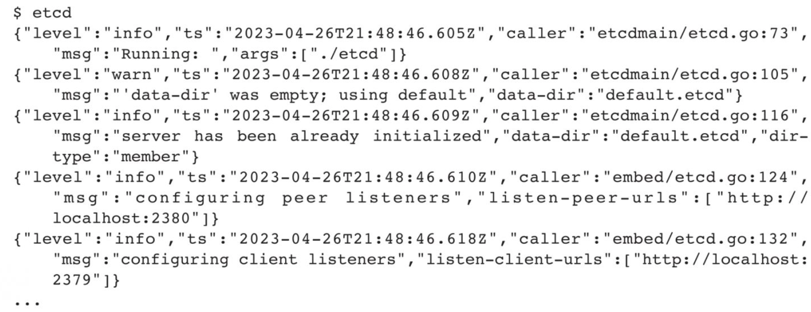
使用自带的etcdctl命令进行查看（实际上是封装了REST API调用）​：
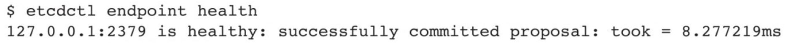
也可以通过REST API直接查看集群健康状态：
```shell
curl -L http://127.0.0.1:2379/health
{"health":"true","reason":""}
```
通过etcdctl命令设置和获取键值也十分方便，例如，设置键值对testkey:"hello world"：
```shell
$ etcdctl put testkey "hello world"
OK
$ etcdctl get testkey
testkey
hello world
```
至此，键值对已经设置成功了。
也可以通过REST API访问本地2379端口的方式来进行操作，例如，读写testkey的值，注意，此时键值需要采用base64编码格式，testkey和helloworld对应的base64编码分别为dGVzdGtleQ==和aGVsbG8gd29ybGQ=：
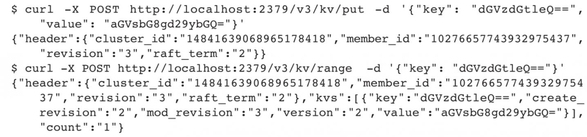
此外，Etcd还提供了gRPC API，可以通过它进行更高性能的读写操作。
### 22.1.2 Docker镜像方式下载
Etcd官方并未提供指定镜像，目前有多家厂商提供了Etcd Docker镜像，以Bitnami镜像为例，可以通过下面的命令启动Etcd服务，监听本地的2379和2380端口：
```shell
docker run \
  -p 2379:2379 \
  -p 2380:2380 \
  --name Etcd \
  bitnami/etcd
```
### 22.1.3 数据目录
作为数据库，最重要的自然是数据存放位置。
Etcd默认创建的本地数据目录为${name}.etcd，其中${name}为节点别名。默认情况下，本地数据路径为default.etcd。用户也可以通过--data-dir选项来指定本地数据存放的位置，下面的命令指定Etcd节点别名为test，数据存放目录为test.etcd：
```shell
etcd --name "test" --data-dir test.etcd
```
查看数据目录下的内容：
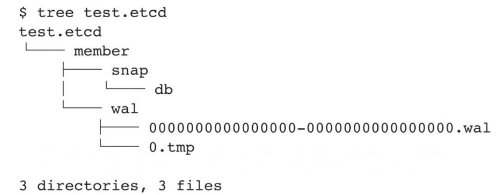
其中，snap目录下将定期记录节点的状态快照信息，wal目录下则记录数据库的操作日志信息（可以通过--wal-dir参数来指定将信息存放到特定目录）​。
### 22.1.4 服务启动参数
Etcd服务启动的时候支持一些参数，用户可以通过这些参数来调整服务和集群的行为。另外，参数可以通过环境变量的形式传入，命名全部为大写，并且加ETCD_前缀，例如ETCD_NAME='etcd-cluster'。
主要参数包括通用参数、节点参数、集群参数和安全参数。
**1.通用参数**
这些参数主要与节点自身配置有关，主要包括：
❑ -config-file：服务配置文件路径。
❑ -name 'default'：设置成员节点的别名，建议为每个成员配置可识别的名称。
❑ -data-dir '${name}.etcd'：数据存储的目录。
❑ -wal-dir ''：指定wal(write-ahead-log)目录，存有数据库操作日志。
❑ -snapshot-count '10000'：设置提交多少次事务（当前表示10000次）就出发一次快照。
❑ -max-snapshots 5：设置最多保留多少个快照，0表示无限制。
❑ -max-wals 5：设置最多保留多少个wal文件，0表示无限制。
**2.节点参数**
这些参数与节点行为有关，主要包括：
❑ -heartbeat-interval '100'：心跳时间间隔，单位为毫秒(ms)，默认为100ms。
❑ -election-timeout '1000'：​（重新）选举时间间隔，单位为毫秒。
❑ -listen-peer-urls 'http://localhost:2380'：Peer消息的监听服务地址列表。
❑ -listen-client-urls 'http://localhost:2379'：客户端请求的监听地址列表。
❑ -cors ''：跨域资源访问的控制白名单。
❑ -quota-backend-bytes '0'：后端存储报警的阈值。
❑ -max-txn-ops '128'：一次事务中允许的最多操作个数，默认为128。
❑ -max-request-bytes '1572864'：允许接收的客户端请求的最大字节数。
❑ -grpc-keepalive-min-time '5s'：客户端向服务端检测存活的最小等待时间，默认为5秒。
❑ -grpc-keepalive-interval '2h'：服务端检测客户端存活的等待时间，默认为2小时，0表示禁用。
❑ -grpc-keepalive-timeout '20s'：关闭一条不响应的gRPC连接的额外等待时间，默认为20秒，0表示禁用。
**3.集群参数**
这些参数与集群行为有关，主要包括：
❑ -initial-advertise-peer-urls 'http://localhost:2380'：广播到集群中本成员的Peer监听通信地址。
❑ -initial-cluster 'default=http://localhost:2380'：初始的集群启动配置。
❑ -initial-cluster-state 'new'：初始化集群状态，默认为new，也可以指定为existing，表示加入一个已有集群中。
❑ -initial-cluster-token 'etcd-cluster'：启动集群时指定集群口令，只有拥有相同令牌的节点才能加入同一集群。
❑ -advertise-client-urls 'http://localhost:2379'：广播到集群中本成员的监听客户端请求的地址。
❑ -discovery ''：通过自动探测方式发现集群成员的地址，指定用于探测的地址。
❑ -discovery-proxy ''：使用代理进行探测服务。
❑ -discovery-srv ''：用于启动集群的DNS服务域。
❑ -strict-reconfig-check 'true'：默认启用严格检查，当某个重新配置请求可能导致多数失败时，则拒绝。
❑ -auto-compaction-retention '0'：自动进行（键值历史）压缩的保留长度，单位为小时，0表示不启用。
❑ -auto-compaction-mode 'periodic'：自动进行压缩的模式，如periodic（定期）或revision（版本号）​。
❑ -enable-v2 'true'：是否接受v2版本的客户端接入。
❑ -debug 'false'：是否开启调试信息。
❑ -log-package-levels ''：记录日志的级别，如DEBUG或INFO。
❑ -log-output 'default'：日志输出的目标。
❑ -force-new-cluster 'false'：强制创建一个新的单节点集群。
**4.安全参数**
这些参数主要用于指定通信时的TLS证书、密钥配置，包括：
❑ -peer-trusted-ca-file ''：与节点通信时信任的TLS CA根证书文件路径。
❑ -peer-cert-allowed-cn ''：连接到节点时，客户端证书的通用名称。
❑ -peer-cert-allowed-hostname ''：对等成员访问时允许的主机名。
❑ -peer-client-cert-auth 'false'：是否启用对等成员节点客户端认证。
❑ -peer-trusted-ca-file ''：对等成员节点的信任CA文件路径。
❑ -peer-auto-tls 'false'：当-peer-key-file和-peer-cert-file未指定时，是否使用自动生成的TLS证书。
❑ -peer-crl-file ''：对等成员之间证书撤销列表文件路径。
❑ -cipher-suites ''：支持的密码学协议族。
❑ -host-whitelist '＊'：服务端不安全时，允许来自客户端的访问，默认为全部。
## 22.2 使用客户端命令
etcdctl是Etcd官方的命令行客户端，支持一些基于REST API封装好的命令，供用户直接与Etcd服务交互，无须调用API。推荐读者在刚接触Etcd时通过etcdctl命令来熟悉功能。
Etcd项目二进制发行包中包含etcdctl工具，用户也可以从github.com/coreos/etcd/releases手动下载。
etcdctl的命令格式为：
```shell
$ etcdctl [全局选项]命令[命令选项][命令参数]
```
全局选项主要包括：
❑ -cacert=""：指定用于校验服务器TLS证书的CA证书。
❑ -cert=""：使用指定的TLS证书来识别安全客户端。
❑ -command-timeout=5s：命令超时时间。
❑ -debug：输出调试信息，显示执行命令时发起的请求。
❑ -dial-timeout=2s：客户端连接的拨号超时时间。
❑ -discovery-srv value,-d value：通过域名查询来探测集群成员信息。
❑ -discovery-srv-name=""：使用DNS Discovery时需要查询的服务名称。
❑ -endpoints=[127.0.0.1:2379]​：集群中成员gRPC地址列表，多个成员用逗号隔开。
❑ -insecure-discovery[=true]​：接受非安全的集群节点。
❑ -insecure-skip-tls-verify[=false]​：跳过服务器证书验证（注意此选项仅用于测试目的）​。
❑ -insecure-transport[=true]​：禁用客户端连接的传输安全性。
❑ -keepalive-time=2s：客户端连接的心跳间隔时间。
❑ -keepalive-timeout=6s：客户端连接的心跳超时时间。
❑ -key=""：使用此TLS密钥文件标识安全客户端。
❑ -password=""：用于身份验证的密码（如果使用此选项，则-user选项不应包括密码）​。
❑ -user=""：用于身份验证的用户名和密码（如果未提供密码，则提示输入）​。
❑ -w,-write-out="simple"：设置输出格式(fields、json、protobuf、simple、table)。
支持的命令大致分为数据类操作和非数据类操作两类。
Etcd作为一个分布式数据库，采用了与ZooKeeper类似的文件目录结构，数据类操作基本围绕文件（即某个键）或目录进行。对比Linux的文件和目录操作命令，可以发现两者之间的相似性。
数据类操作命令主要包括：
❑ del：删除指定的键或键范围[key，range_end)。
❑ get：获取键或键范围。
❑ put：将给定的键放入存储中。
❑ watch：在键或前缀上观察事件流。
非数据类操作主要是Etcd提供的系统配置、权限管理等，包括如下命令：
❑ alarm：解除或列出警报。
❑ auth：身份认证相关命令。
❑ check：检查负载和性能状态。
❑ compaction：压缩Etcd中的事件历史记录。
❑ defrag：对指定端点的Etcd成员存储进行碎片整理。
❑ elect：观察和参与领导者选举。
❑ endpoint：输出指定端点的状态信息。
❑ lease：管理租约，包括创建、保持、列出、撤销等。
❑ lock：获取命名锁。
❑ make-mirror：在目标Etcd集群上创建镜像。
❑ member：添加、删除、更新、列出成员或提升成员权限。
❑ move-leader：将领导权转移给另一个Etcd集群成员。
❑ role：角色管理，包括添加、删除、获取、授权、列出。
❑ snapshot：快照管理，包括创建、恢复快照等。
❑ txn：在一个事务中处理所有请求。
❑ user：用户的添加、删除、获取、角色授予、列出、密码更新、撤销。
下面分别介绍各个操作命令的主要用法和功能。
### 22.2.1 数据类操作
数据类操作主要涉及对键值和目录的生命周期管理。Etcd为用户提供了非常灵活的键组织方式。用户可以指定单层级的键，例如testkey，这些键会直接存储在根目录/下面。同时，用户也可以指定层次化的目录结构，例如cluster1/node2/testkey，Etcd会创建相应的目录结构，并在其中存储键值。这种方式类似于ZooKeeper的目录结构。
**1.put**
该命令用于将某个键的值存储为给定值。命令格式为etcdctl put[options]<key><value>[flags]​，其中<value>也可通过标准输入给出。示例如下：
```shell
etcdctl put /testdir/testkey "Hello world"
OK
```
支持的选项包括：
❑ -ignore-lease[=false]​：使用当前的租约更新键。
❑ -ignore-value[=false]​：使用当前的值更新键。
❑ -lease="0"：要附加到键的租约ID（用十六进制表示）​。
❑ -prev-kv[=false]​：在修改之前返回前一个键值对。
**2.get**
该命令用于获取指定键或一组范围内的键的值。命令格式为etcdctl get[options]<key>[range_end]​[flags]​，示例如下：
```shell
etcdctl get /testdir /testkey
/testdir/testkey
Hello world
```
支持的选项为：
❑ -consistency="l"：线性化(l)或可串行化(s)。
❑ -count-only[=false]​：仅获取数量。
❑ -from-key[=false]​：获取大于或等于给定键的键。
❑ -h,-help[=false]​：获取帮助。
❑ -keys-only[=false]​：仅获取键。
❑ -limit=0：限制返回结果的个数。
❑ -order=""：结果的顺序，如ASCEND（升序）或DESCEND（降序）​（默认为ASCEND）​。
❑ -prefix[=false]​：获取匹配前缀的键的值。
❑ -print-value-only[=false]​：在使用simple输出格式时仅输出值。
❑ -rev=0：指定键值修订版本。
❑ -sort-by=""：指定排序指标，包括CREATE、KEY、MODIFY、VALUE或VERSION。
**3.del**
该命令用于删除某个键值或给定范围内的键值，成功则结果返回1。命令格式为del[options]<key>[range_end]​[flags]​，示例如下：
```shell
etcdctl del testkey
```
支持的选项为：
❑ -from-key[=false]​：删除大于或等于给定键的键。
❑ -h,-help[=false]​：获取del命令的帮助信息。
❑ -prefix[=false]​：删除匹配给定前缀的键。
❑ -prev-kv[=false]​：在删除前返回被删除的键值对。
❑ -range[=false]​：删除一段范围内的键。
**4.watch**
该命令用于监测一个键值的变化，一旦键值发生更新，就会输出最新的值并退出。
命令格式为etcdctl watch[options]​[key or prefix]​[range_end]​[--]​[exec-command arg1 arg2...]​[flags]​，例如，当用户更新testkey键值为Hello world时，通过watch监测到对应事件：
```shell
etcdctl watch testkey
Hello world
```
支持的选项包括：
❑ -i,-interactive[=false]​：交互模式。
❑ -prefix[=false]​：如果设置了前缀，则监测前缀。
❑ -prev-kv[=false]​：获取事件发生前的前一个键值对。
❑ -progress-notify[=false]​：从服务器获取周期性的监测进度通知。
❑ -rev=0：开始监测的版本号。
### 22.2.2 非数据类操作
非数据类操作不直接对数据本身进行管理，而是负责围绕集群自身的一些配置。
**1.alarm**
该命令用于管理警报，包括2个子命令：
❑ disarm：解除所有警报。
❑ list：列出所有警报。
**2.auth**
该命令用于设置是否启用访问验证，包括3个子命令：
❑ disable：禁用认证。
❑ enable：启用认证。
❑ status：返回认证状态。
例如，在root用户创建后，启用认证：
```shell
etcdctl auth enable
```
**3.check**
该命令用于检查Etcd集群的负载和性能，包括2个子命令：
❑ datascale：检查给定服务器端点上不同工作负载的数据存储器使用情况。
❑ perf：检查Etcd集群的性能。
例如，下面的命令会运行一分钟的性能测试，给出结果：
```shell
etcdctl check perf
PASS:Throughput is 150 writes/s
PASS:Slowest request took 0.059459s
PASS:Stddev is 0.002523s
PASS
```
**4.endpoint**
该命令用于输出指定端点的状态信息，包括3个子命令：
❑ hashkv：为-endpoints中的每个端点输出键值历史哈希。
❑ health：检查-endpoints标志中指定的端点的健康状况。
❑ status：输出-endpoints标志中指定的端点的状态。
例如，下面的命令可以获取默认节点的状态：

**5.lease**
该命令用于管理租约，包括创建、保持、列出、撤销等，有5个子命令：
❑ grant：创建租约。
❑ keep-alive：保持租约活动（更新）​。
❑ list：列出所有活动租约。
❑ revoke：撤销租约。
❑ timetolive：获取租约信息。
例如，下面的命令将获取默认节点的状态：
```shell
etcdctl grant list
found 2 leases
```
6.member
该命令用于添加、删除、更新、列出节点成员或提升集群中节点成员的权限，包括5个子命令：
❑ add：将成员添加到集群中。
❑ list：列出集群中的所有成员。
❑ promote：在集群中提升非投票成员权限。
❑ remove：从集群中删除成员。
❑ update：更新集群中的成员。
例如，下面的命令将获取集群中的所有节点：
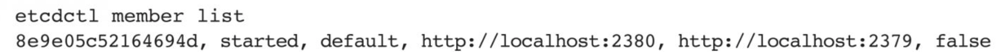
**7.role**
该命令用于角色管理，包括添加、删除、获取、授权、列出，有5个子命令：
❑ add：添加新角色。
❑ delete：删除角色。
❑ get：获取角色的详细信息。
❑ grant-permission：将键授权给角色。
❑ list：列出所有角色。
默认带有root、user、guest三种角色。root为全局最高权限，user可以对其拥有的前缀空间进行读写，guest可以对其拥有的前缀空间进行读操作。
例如：
```shell
etcdctl role add testrole
etcdctl role grant-permission testrole readwrite mykey
```
**8.snapshot**
该命令用于快照管理，包括恢复、存储，有2个子命令：
❑ snapshot restore：将Etcd成员快照恢复到Etcd目录。
❑ snapshot save：将Etcd节点后端快照存储到给定文件中。
例如，下面的命令将保存快照到指定数据文件：
```shell
etcdctl snapshot save /path/to/snapshot.db
```
**9.user**
该命令用于进行用户的添加、删除、获取、角色授予、列出、密码更新、撤销，包括一系列子命令：
❑ add：添加新用户。
❑ delete：删除用户。
❑ get：获取用户的详细信息。
❑ grant-role：将角色授予用户。❑ list：列出所有用户。❑ passwd：更改用户密码。❑ revoke-role：从用户中撤销角色。默认情况下，需要先创建（启用）root用户作为Etcd集群的最高权限管理员：
```shell
etcdctl user add root
New password:
```
创建一个testuser用户，会提示输入密码：
```shell
etcdctl user add testuser
New password:
```
分配某些已有角色给用户：
```shell
etcdctl user grant-role testuser testrole
```
**10.其他命令**
❑ compaction：压缩Etcd中的事件历史记录。
❑ defrag：对指定端点的Etcd成员存储进行碎片整理。
❑ elect：观察和参与领导者选举。
❑ lock：获取命名锁。
❑ make-mirror：在目标Etcd集群上创建镜像。
❑ move-leader：将领导权转移给另一个Etcd集群成员。
❑ txn：在一个事务中处理所有请求。
## 22.3 Etcd集群管理
Etcd的集群采用典型的主-从模型，通过Raft协议来保证在一段时间内有一个节点为主节点，其他节点为从节点。一旦主节点发生故障，其他节点就可以自动重新选举出新的主节点。
与其他分布式系统类似，集群中的节点个数推荐为奇数个，最少为3个。此时，quorum为2，节点数越多，可提供的冗余性越多，但同时会带来写数据性能的下降。
> [!NOTE] 注意
>quorum是分布式系统中很重要的概念，代表一个集群工作需要正常投票的节点个数的最小值，通常为集群的一半再加1。

### 22.3.1 构建集群
构建集群的关键是让节点知道自己加入的集群信息，以及其他节点的访问信息。Etcd支持两种模式来构建集群：静态配置和动态发现。
**1.静态配置**
顾名思义，静态配置就是提取、写好集群中的有关信息。
例如，假设读者想要用三个节点来构建一个集群，地址如表22-1所示。

表22-1　集群节点及地址

首先，在各个节点上将地址和别名信息添加到/etc/hosts：
```shell
10.0.0.1 Node1
10.0.0.2 Node2
10.0.0.3 Node3
```
可以通过如下命令启动各个节点上的Etcd服务，分别命名为n1、n2和n3。
在节点1上，执行：
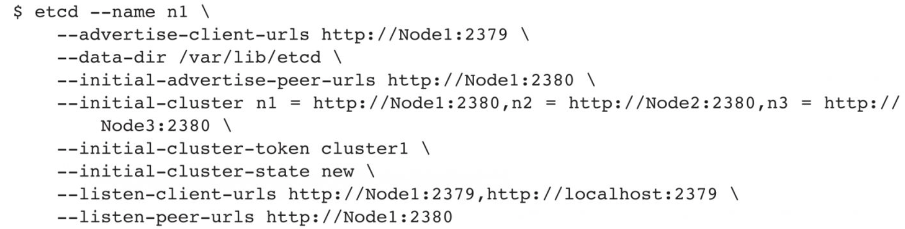
在节点2上，执行：
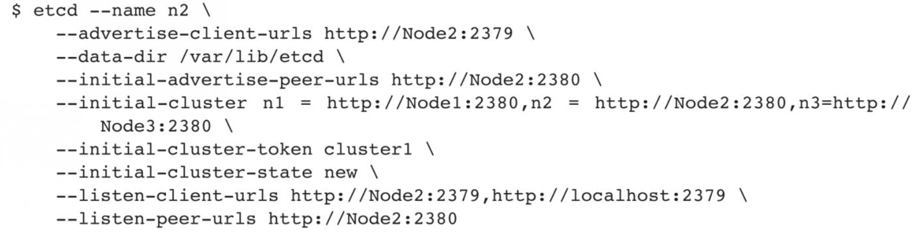
在节点3上，执行：

用户也可以将这些配置信息加入本地配置文件（例如/etc/etcd/etcd.conf.yml）​，Etcd启动时会自动读取：
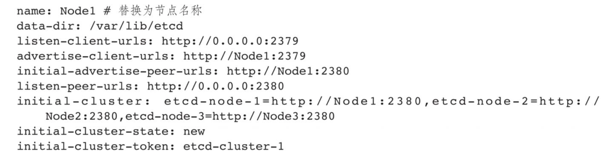
成功后，可以在任一节点上通过etcdctl来查看当前集群中的成员信息：
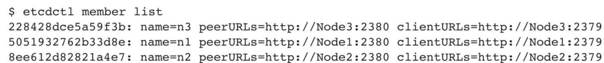
**2.动态发现**
静态配置的方法虽然简单，但是如果节点信息需要变动，就需要手动进行修改。很自然地，可以通过动态发现的方法，让集群自动更新节点信息。
CoreOS提供了一个公开的Etcd发现服务，地址为https://discovery.etcd.io 。使用该服务十分简单。
首先，为要创建的集群申请唯一的发现地址，需要提供集群中的节点个数作为参数：
```shell
curl https://discovery.etcd.io/new?size=3
https://discovery.etcd.io/7f66dc8d468alc940969a8c329ee329a
```
返回的地址就是该集群要实现动态发现的唯一地址。
然后，分别在各个节点上指定服务发现地址信息，替代原先动态指定的节点列表。在节点1上，执行：
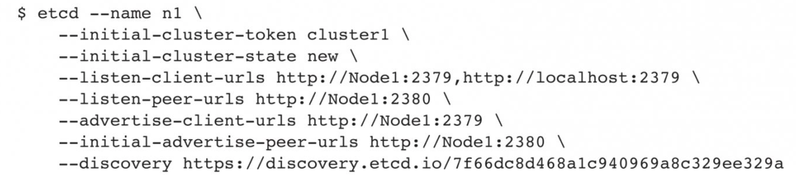
在节点2上，执行：
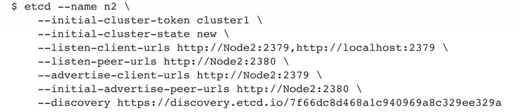
在节点3上，执行：
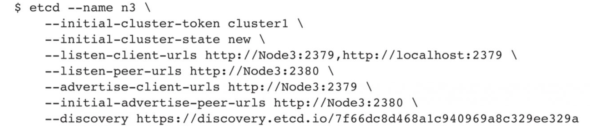
当然，用户也可以配置私有的服务。
另外一种实现动态发现的机制是为每个节点指定同一个子域的域名，然后通过域名发现来自动注册。例如，三个节点的域名分别为n1.mycluster.com、n2.mycluster.com和n3.mycluster.com，则启动参数中的集群节点列表信息可以替换为--discovery-srv mycluster.com。
### 22.3.2 集群配置优化
影响集群性能的因素可能有很多，包括时钟同步、心跳消息间隔和选举间隔、快照频率、修改节点、节点恢复、重启集群等，需要通过优化配置尽量减少这些因素的影响。
**1.时钟同步**
对于分布式集群来说，各个节点上的时钟同步十分重要，过大的时钟误差可能会导致Raft协议的异常。因此，各个节点要启动同步时钟协议。以Ubuntu系统为例，可以启动NTP服务：
```shell
sudo aptitude install ntp
sudo service ntp restart
```
用户也可以修改/etc/ntp.conf文件来指定NTP服务器地址，建议对多个节点采用统一的配置。
**2.心跳消息间隔和选举间隔**
Etcd集群配置中的心跳消息间隔和选举间隔是两个关键因素。
心跳消息间隔表示主节点发送心跳消息通知从节点自己的存活状态的时间间隔。选举间隔表示从节点没有收到心跳消息时等待超时后发起选举成为主节点的时间间隔。通常，选举间隔应该比心跳消息间隔长，一般建议设置为心跳消息间隔的5倍以上。时间间隔越短，节点恢复的速度越快，但会占用更多的计算和网络资源。
在默认情况下，Etcd集群的心跳消息间隔为100ms，选举间隔为1s。选举间隔的上限为50s，但完全没必要设置得这么长。这个配置适用于本地局域网环境，但对于跨网段的情况，需要根据节点之间的网络延迟(RTT)进行适当的调整。
可以在启动服务时通过-heartbeat-interval和-election-timeout参数来指定。例如，一般情况下，跨数据中心的集群可以配置为：
```shell
etcd --heartbeat-interval = 200 --election-timeout = 2000
```
也可以通过环境变量指定：
```shell
ETCD_HEARTBEAT_INTERVAL = 100 ETCD_ELECTION_TIMEOUT = 500 etcd
```
对于跨地域的网络（例如，东西半球的数据中心的网络延迟往往在数百毫秒）​，还可以适当延长。
**3.快照频率**
Etcd会定期地将数据的修改存储为快照，默认情况下每进行10000次修改才会存储一个快照。在存储的时候会有大量数据进行写入，影响Etcd的性能。
建议将这个值调整得小一些，例如每提交2000个事务就做一次快照：
```shell
etcd --snapshot-count = 2000
```
也可通过环境变量指定：
```shell
ETCD_SNAPSHOT_COUNT = 2000 etcd
```
**4.修改节点**
无论是添加、删除还是迁移节点，都要一个一个地进行，并且确保先修改配置信息（包括节点广播的监听地址、集群中节点列表等）​，然后再进行操作。例如，要删除多个节点，当有主节点要被删除时，需要先删除一个，等集群中状态稳定（新的主节点重新生成）后，再删除另外的节点。
在迁移或替换节点时，先将节点从集群中删除，等集群状态重新稳定后，再添加新的节点。当然，使用旧节点的数据目录文件会加快新节点的同步过程，但是要保证这些数据是完整的，且是比较新的。
**5.节点恢复**
Etcd集群中的节点会通过数据目录来存放修改信息和集群配置。
一般来说，当某个节点出现故障时，本地数据已经过期甚至格式被破坏。如果只是简单地重启进程，则容易造成数据不一致。
这个时候，保险的做法是先删除该节点，清空数据目录，再重新作为空节点加入。
Etcd提供了--strict-reconfig-check选项，确保当集群状态不稳定时拒绝对配置状态的修改。例如，工作中节点数没达到quorum，或者同时提交多个集群成员变更操作。
**6.重启集群**
极端情况下，集群中大部分节点都出现问题时，需要重启整个集群。这个时候，最保险的做法是先找到一个数据记录完整且比较新的节点，以它为唯一节点创建新的集群，随后，将其他节点逐个添加进来，在添加过程中注意随时检查状态，保证集群的稳定性。
这样做的好处是可以确保数据记录的完整性，同时还可以避免数据冲突和丢失等问题。
## 22.4 本章小结
本章介绍了Etcd—一个功能丰富、易用性高、性能优越、可靠性强的分布式键值存储系统，广泛应用于微服务架构中的配置管理、服务发现、分布式锁等方面。
通过学习本章，读者掌握了如何利用Etcd进行分布式数据管理的相关操作，以及Etcd集群管理和优化的一些要点。Etcd提供了许多有用的功能，例如，数据监听、定期快照和访问安全管理等。
通过实践案例，可以看出Etcd的功能类似于ZooKeeper，但相对于ZooKeeper，Etcd在REST接口支持、访问权限管理、共识稳定性和高性能数据存储方面表现更为优秀。此外，Etcd还提供了多种语言实现的客户端支持，目前包括Python、Go、Java等。基于Etcd，用户可以很容易实现集群中的配置管理和服务发现等复杂功能