# 第二十章 高级网络功能
本章将深入探讨Docker中与网络相关的高级知识，包括网络的启动和配置参数、DNS的使用配置，以及容器访问和端口映射的实现方式。
针对不同的使用场景，本章将介绍Docker支持的网络定制配置，以及如何使用Linux命令来调整、补充甚至替换Docker默认的网络配置。
此外，笔者还将介绍一些关于Docker网络的工具和项目，以帮助读者更深入地理解和使用Docker网络。
## 20.1 启动与配置参数
**1.网络启动过程**
Docker服务启动时会自动在主机上创建一个名为docker0的虚拟网桥，实际上这是一个Linux网桥。这个网桥可以被理解为一个软件交换机，负责在挂载其上的接口之间进行网包转发。
同时，Docker会在本地未被占用的私有网段中随机分配一个地址给docker0接口，例如常见的172.17.0.0/16网段，掩码为255.255.0.0。此后，启动的容器的网口也会自动分配一个该网段的地址。
创建Docker容器时，Docker会自动创建一对vethpair互联接口，一端位于容器内部的eth0接口，另一端位于本地，并被挂载到docker0网桥上，名称以veth开头（例如vethAQI2QT）​。当网包发送到其中任意一个接口时，另一个接口将自动接收到相同的网包。通过这种方式，主机可以与容器通信，容器之间也可以相互通信。如此一来，Docker就在主机和所有容器之间创建了一个虚拟共享网络，如图20-1所示。
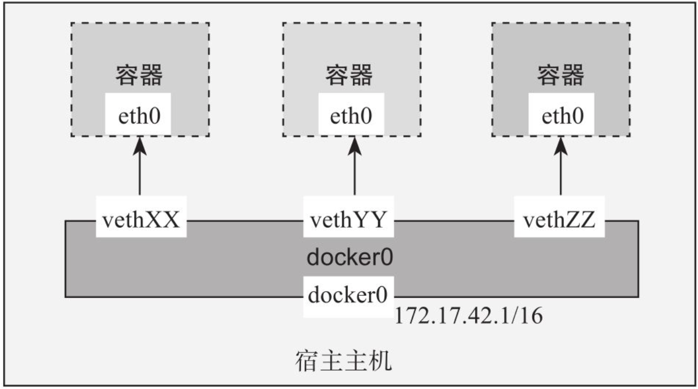
图20-1　Docker网络连接原理示意图
**2.网络相关参数**
下面是与Docker网络相关的命令参数，其中部分命令选项只有在Docker服务启动的时候才能配置，修改后重启生效，包括：
❑ --bip=CIDR：定制docker0的掩码。
❑ -b BRIDGE or--bridge=BRIDGE：指定容器挂载的网桥。
❑ -default-address-pool pool-options：设置Docker的默认地址池。
❑ -default-gateway ip：容器的默认网关IPv4地址。
❑ -default-gateway-v6 ip：容器的默认网关IPv6地址。
❑ -fixed-cidr string：固定IP的IPv4子网。
❑ -fixed-cidr-v6 string：固定IP的IPv6子网。
❑ -H,--host list：指定Docker服务端监听地址。
❑ -host-gateway-ip ip：指定容器使用主机的网关IP地址，而不是默认的docker0网桥地址，从而实现与主机在同一网络段内的通信。
❑ --icc=true|false：是否支持容器之间进行通信。
❑ -ip ip：绑定容器端口时的默认IP（默认为0.0.0.0）​。
❑ --ip-forward=true|false：启用net.ipv4.ip_forward，即打开转发功能。
❑ -ip-masq：启用IP伪装（默认为true）​。
❑ -iptables：启用添加iptables规则（默认为true）​。
❑ -ip6tables：启用添加ip6tables规则。
❑ -ipv6：启用IPv6网络。
❑ --mtu=BYTES：容器网络中的MTU。
❑ -network-control-plane-mtu int：网络控制平面MTU（默认为1500）​。
❑ -swarm-default-advertise-addr string：设置swarm的默认公告地址。
下面的命令选项既可以在启动服务时指定，也可以在Docker容器启动（使用docker[container]run命令）时指定。在Docker服务启动的时候指定则会成为默认值，后续执行docker[container]run时可以覆盖设置的默认值：
❑ --dns=IP_ADDRESS：使用指定的DNS服务器。
❑ --dns-opt=""：指定DNS选项。
❑ --dns-search=DOMAIN：指定DNS搜索域。
还有一些选项只能在docker[container]run命令执行时使用，因为它针对容器的配置：
❑ -add-host list：在容器内添加自定义的主机名和IP地址的映射关系。
❑ -h HOSTNAME or--hostname=HOSTNAME：指定容器的主机名。
❑ -ip string：指定容器内接口的IP地址。
❑ -ip6 string：指定容器内接口的IPv6地址。
❑ --link=CONTAINER_NAME:ALIAS：添加到另一个容器的连接。
❑ -mac-address string：指定容器内接口的MAC地址。
❑ --network=bridge|none|container:NAME_or_ID|host|user_defined_network：配置容器的桥接模式。
❑ --network-alias：容器在网络中的别名。
❑ -p,--publish list：映射容器端口到宿主机。
❑ -P,--publish-all：映射容器所有端口到宿主机上随机端口。
其中，--network选项支持如下类型：
❑ bridge：默认配置。为容器创建独立的网络命名空间，分配网卡、IP地址等网络配置，并通过veth接口将容器挂载到一个虚拟网桥上（默认为docker0）​，实现容器之间的通信以及与主机的网络通信。
❑ none：为容器创建独立的网络命名空间，但不进行网络配置，即容器内没有创建网卡、IP地址等，容器无法进行网络通信。
❑ container:NAME_or_ID：新创建的容器共享指定的已存在容器的网络命名空间，两个容器内的网络配置共享，但其他资源（如进程空间、文件系统等）还是相互隔离的，适用于容器间需要相互通信的场景。
❑ host：不为容器创建独立的网络命名空间，容器内看到的网络配置（网卡信息、路由表、iptables规则等）均与主机上的保持一致，即容器共享主机的网络，适用于需要最高网络性能和最小的网络隔离的场景。
❑ user_defined_network：用户自行用Docker network相关命令创建一个自定义的网络，同一个网络内的容器彼此可见，可以采用更多类型的网络插件，适用于需要自定义网络配置和网络隔离的场景。
## 20.2 配置容器DNS和主机名
Docker服务启动后会默认启用一个内嵌的DNS服务来自动解析同一个网络中的容器主机名和地址，如果无法解析，则通过容器内的DNS相关配置进行解析。
用户可以通过命令选项自定义容器的主机名和DNS配置。
**1.相关配置文件**
容器中的主机名和DNS配置信息可以通过三个系统配置文件来管理：/etc/resolv.conf、/etc/hostname和/etc/hosts。
启动一个容器，在容器中使用mount命令可以看到这三个文件挂载信息：
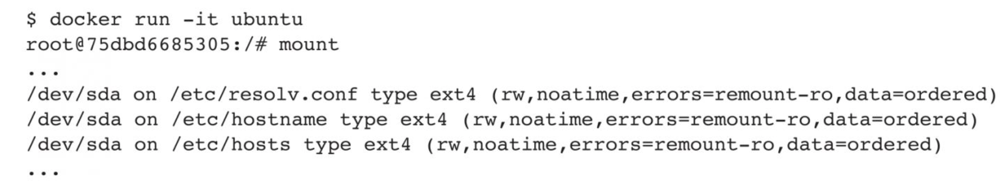
Docker启动容器时，会从宿主机上复制/etc/resolv.conf文件，并删除其中无法连接到的DNS服务器：

/etc/hosts文件中默认只记录了容器自身的地址和名称：
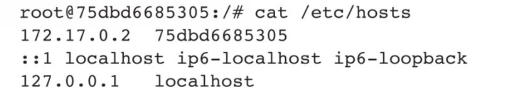
/etc/hostname文件则记录了容器的主机名：

**2.容器内修改配置文件**
容器运行时，可以在运行中的容器里直接编辑/etc/hosts、/etc/hostname和/etc/resolve.conf文件，但是这些修改是临时的，只在运行的容器中保留，容器终止或重启后并不会被保存下来，也不会被docker commit命令提交。
**3.通过参数指定**
如果用户想要自定义容器的配置，可以在创建或启动容器时利用下面的参数指定，注意一般不推荐与-net=host一起使用，因为会破坏宿主机上的配置信息：
❑ 指定主机名-h HOSTNAME或者--hostname=HOSTNAME：设定容器的主机名。容器主机名会被写到容器内的/etc/hostname和/etc/hosts。但这个主机名只在容器内能看到，在容器外部则看不到，既不会在docker ps中显示，也不会在其他容器的/etc/hosts看到。
❑ --link=CONTAINER_NAME:ALIAS：记录其他容器主机名。在创建容器的时候，添加一个所连接容器的主机名到容器内的/etc/hosts文件中。这样，新创建的容器可以直接使用主机名来与所连接的容器通信。
❑ --dns=IP_ADDRESS：指定DNS服务器。添加DNS服务器到容器的/etc/resolv.conf中，容器会用指定的服务器来解析所有不在/etc/hosts中的主机名。
❑ --dns-option list：指定DNS相关的选项。
❑ --dns-search=DOMAIN：指定DNS搜索域。设定容器的搜索域，当设定搜索域为.example.com时，在搜索一个名为host的主机时，DNS不仅搜索host，还会搜索host.example.com。
## 20.3 容器访问控制
在Linux系统中，容器的访问控制主要通过系统自带的iptables防火墙软件来管理和实现。iptables是Linux系统中广泛使用的防火墙软件，几乎所有的Linux发行版都已默认安装。
通过iptables可以对容器进行网络流量控制，例如限制容器对外部网络的访问，只允许特定的IP地址或端口进行访问。同时，也可以通过iptables设置端口映射规则，将容器内部的服务映射到主机的端口上，从而使得容器服务可以被主机和其他网络设备访问。
**1.容器访问外部网络**
在前面的描述中，容器默认指定了网关为docker0的网桥上的docker0内部接口。docker0内部接口同时也是宿主机的一个本地接口。因此，容器在默认情况下可以访问宿主机的本地网络。
如果容器需要访问外部网络，则需要进行额外的配置。宿主机需要进行辅助转发，以便将容器内的流量转发到外部网络。通常情况下，宿主机的IP转发功能默认是关闭的，需要手动进行配置。
在宿主机的Linux系统中，检查转发是否打开：
```shell
sudo sysctl net.ipv4.ip_forward
net.ipv4.ip_forward = 1
```
如果为0，则说明没有开启转发，需要手动打开：
```shell
sudo sysctl -w net.ipv4.ip_forward = 1
```
Docker服务启动时会默认开启--ip-forward=true，自动配置宿主机系统的转发规则。
**2.容器之间的访问**
容器之间的相互访问需要两方面的支持：
❑ 网络拓扑必须是连通的。默认情况下，所有容器都会连接到docker0网桥上，这意味着默认情况下拓扑是互通的。除了使用默认的网桥网络，用户还可以通过创建自定义的网络来实现容器之间的连通性。
❑ 宿主机系统的防火墙软件iptables是否允许容器之间相互访问也非常重要，这取决于防火墙的默认规则是允许（大部分情况）还是禁止。
(1)访问所有端口
当启动Docker服务时，默认会添加一条“允许”转发策略到iptables的FORWARD链上。通过配置--icc=true|false（默认值为true）参数可以控制默认的策略。
出于安全考虑，可以在Docker配置文件中配置DOCKER_OPTS=--icc=false来默认禁止容器之间的相互访问。同时，如果启动Docker服务时手动指定--iptables=false参数，则不会修改宿主机系统上的iptables规则。
(2)访问指定端口
在通过-icc=false禁止容器间相互访问后，仍可以通过--link=CONTAINER_NAME:ALIAS选项来允许访问指定容器的开放端口。
例如，在启动Docker服务时，可以同时使用icc=false--iptables=true参数来配置容器间禁止访问，并允许Docker自动修改系统中的iptables规则。
此时，系统中的iptables规则可能是类似如下规则，禁止所有转发流量：

之后，启动容器(docker[container]run)时使用--link=CONTAINER_NAME:ALIAS选项。Docker会在iptable中为两个互联容器分别添加一条ACCEPT规则，允许相互访问开放的端口（取决于Dockerfile中的EXPOSE行）​。
此时，iptables的规则可能包括类似如下规则：
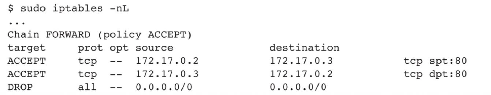
> [!NOTE] 注意
>--link=CONTAINER_NAME:ALIAS中的CONTAINER_NAME目前必须是Docker自动分配的容器名，或使用--name参数指定的名字。不能为用容器的-h参数配置的主机名。

**3.防火墙规则**
Docker服务后默认会添加iptables链规则。用户可以通过iptables-L-nv命令进行查看。
(1)DOCKER链
这个链用于将容器与主机的端口映射连接起来，以实现容器与外部网络的通信。示例规则如下所示：
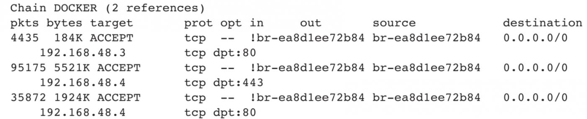
其中，规则允许从宿主机的网络接口（非Docker网桥）送到容器指定端口的网络流量通过。
(2)DOCKER-USER链
如果用户使用自定义网络，那么会由DOCKER-USER链进行管理，其iptables规则在所有Docker链之前被应用。示例规则如下所示：

其中，RETURN目标动作允许网络包绕过后续规则，返回到之前的规则或者链，继续处理该网络包。
(3)DOCKER-ISOLATION-STAGE-1链
DOCKER-ISOLATION-STAGE-1链可以用于隔离Docker容器网络，主要是限制容器与宿主机之间的网络通信。示例规则如下所示：
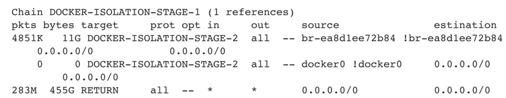
这些规则将从Docker默认网桥发出的流量转发到DOCKER-ISOLATION-STAGE-2链进行处理。
(4)DOCKER-ISOLATION-STAGE-2链
该链用于更严格地限制容器与宿主机之间的网络通信。示例规则如下所示：
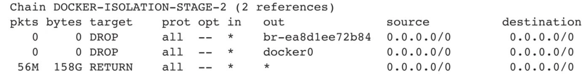
这些规则确保容器之间的网络流量不会流到宿主机的网络接口中。
## 20.4 映射容器端口到宿主机的实现
默认情况下，容器可以主动访问到外部网络的连接，但是外部网络无法访问到容器。
**1.容器访问外部实现**
假设容器内部的网络地址为172.17.0.2，本地网络地址为10.0.2.2。容器要能访问外部网络，源地址不能为172.17.0.2，需要进行源地址映射(SourceNAT，SNAT)，修改为本地系统的IP地址10.0.2.2。
映射是通过iptables的源地址伪装操作实现的。
查看主机NAT表上POSTROUTING链的规则。该链负责网包要离开主机前，改写其源地址：
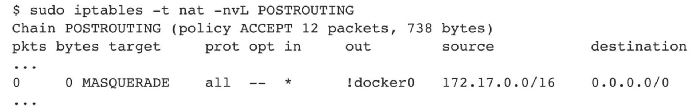
其中，上述规则将所有源地址在172.17.0.0/16网段，且不是从docker0接口发出的流量（即从容器中出来的流量）​，动态伪装为从系统网卡发出。 MASQUERADE行动与传统SNAT行动相比，好处是能动态地从网卡获取地址。
**2.外部访问容器实现**
容器允许外部访问，可以在执行docker[container]run时通过-p或-P参数来启用。
不管用哪种办法，其实也是在本地的iptable的NAT表中添加相应的规则，将访问外部IP地址的网包进行目标地址的DNAT操作，将目标地址修改为容器的IP地址。
以一个开放80端口的Web容器为例，当使用-P时，会自动映射本地49000～49900范围内的随机端口到容器的80端口：
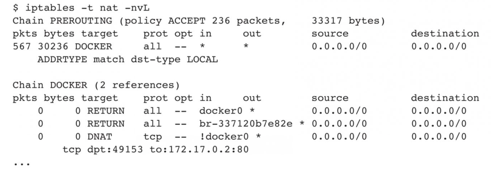
可以看到，nat表中涉及两条链：PREROUTING链负责当包到达网络接口时，改写其目标地址，其中规则将所有流量都转发到DOCKER链；而DOCKER链将所有不是从docker0进来的网包（意味着不是本地主机产生）​，同时目标端口为49153的，修改其目标地址为172.17.0.2，修改目标端口为80。
使用-p 80:80时，与上面类似，只是本地端口也为80：
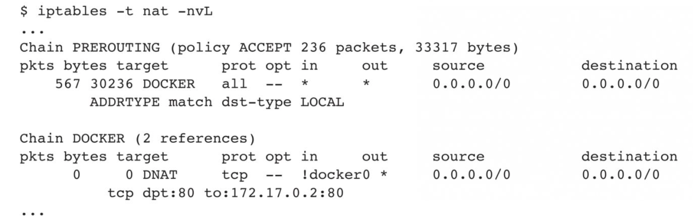
这里有两点需要注意：
❑ 规则映射地址为0.0.0.0，意味着将接受主机来自所有网络接口上的流量。用户可以通过-p IP:host_port:container_port或-p IP::port来指定绑定的外部网络接口，以制定更严格的访问规则。
❑ 如果希望映射绑定到某个固定的宿主机IP地址，可以在Docker配置文件中指定DOCKER_OPTS="--ip=IP_ADDRESS"，之后重启Docker服务即可生效。
## 20.5 配置容器网桥
在默认情况下，Docker服务会创建一个名为docker0的Linux网桥（带有一个名为docker0的内部接口）​，该网桥在内核层将其他物理或虚拟网卡连接在一起，从而将所有容器和本地主机统一至同一物理网络。当用户使用Docker创建多个自定义网络时，可能会产生多个容器网桥。
Docker默认为docker0接口指定IP地址和子网掩码，使主机和容器能够通过网桥进行通信。同时，它还设置了MTU（接口允许接收的最大传输单元，通常为1500B）​，或根据宿主机网络路由支持的默认值。在服务启动时，可以对这些值进行配置：
❑ --bip=CIDR：指定IP地址和子网掩码，例如192.168.1.5/24。
❑ --mtu=BYTES：覆盖默认的Docker MTU配置。
此外，用户还可以在配置文件中设置这些值，然后重启服务。由于当前Docker网桥采用Linux网桥，因此用户可以使用brctl show命令查看网桥和端口连接信息。
> [!NOTE] 注意
>如果系统中没有安装brctl命令，可以安装bridge-utils工具包。

每当创建一个新容器时，Docker会从可用地址段中挑选一个未被占用的IP地址，将其分配给容器的eth0端口。同时，Docker使用本地主机上docker0接口的IP地址作为容器的默认网关：
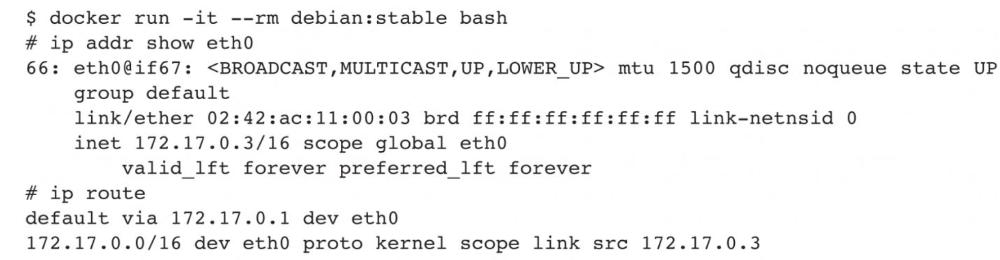
## 20.6 自定义网桥
除了默认的docker0网桥之外，用户还可以选择自定义的网桥来连接各个容器。在启动Docker服务时，可以通过使用-bridge=BRIDGE选项来指定所需的网桥。
若服务已在运行中，需要先停止服务，然后删除原有的网桥：
```shell
sudo service docker stop
sudo ip link set dev docker0 down
sudo brctl delbr docker0
```
之后创建一个网桥bridge0：
```shell
sudo brctl addbr bridge0
sudo ip addr add 192.168.5.1/24 dev bridge0
sudo ip link set dev bridge0 up
```
查看确认网桥创建并启动：
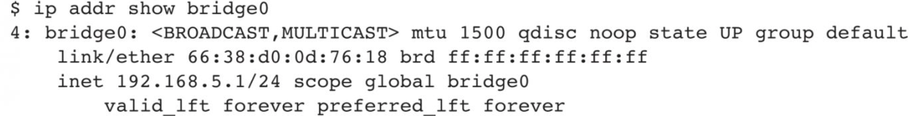
配置Docker服务，将默认网桥指定到刚创建的网桥上：
```shell
echo 'DOCKER_OPTS="-b=bridge0"' >> /etc/default/docker
sudo service docker start
```
之后，启动Docker服务。
此时，新建一个容器，可以看到它已经桥接到了bridge0上。可以继续用brctl show命令查看桥接的信息。另外，在容器中可以使用ip addr和iproute命令来查看IP地址配置和路由信息。
## 20.7 使用OpenvSwitch网桥
Docker默认使用的是Linux自带的网桥实现，可以使用功能更强大的OpenvSwitch虚拟交换机实现。
**1.环境**
下面在debian:stable系统中进行操作。操作流程也适用于RedHat系列系统，但少数命令和配置文件可能略有差异。
**2.安装Docker**
安装最近版本的Docker并启动服务。
默认情况下，Docker服务会创建一个名为docker0的Linux网桥，作为连接容器的本地网桥。可以通过如下命令查看：

网桥上内部接口的默认地址一般为172.17.0.1：
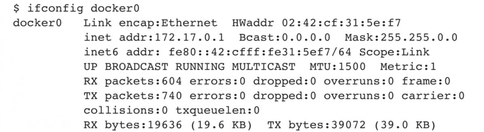
**3.安装OpenvSwitch**
通过如下命令安装OpenvSwitch：
```shell
sudo aptitude install openvswitch-switch
```
测试添加一个网桥br0并查看：
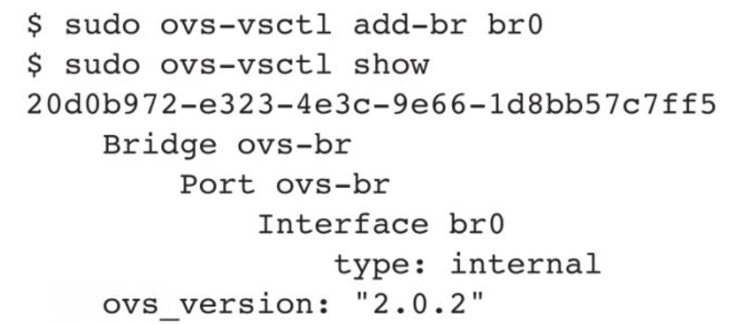
**4.配置容器连接到OpenvSwitch网桥**
目前OpenvSwitch网桥还不能直接支持挂载容器，需要手动在OpenvSwitch网桥上创建虚拟网络接口并挂载到容器中。
(1)创建无网络接口容器
启动一个容器，指定不创建网络，以便后面手动添加网络。较新版本的Docker默认不允许在容器内修改网络配置，需要在执行run指令的时候指定参数-privileged=true：

记住这里容器的ID为298bbb17c244。此时在容器内查看网络信息，只能看到一个本地网卡lo：
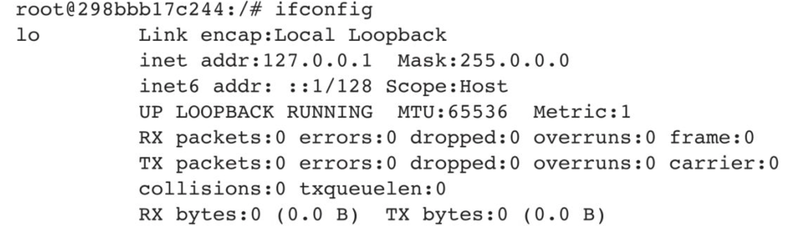
(2)手动为容器添加网络
下载OpenvSwitch项目提供的支持Docker容器的辅助脚本ovs-docker：
```shell
wget https://github.com/openswitch/ovs/raw/master/utilities/ovs-docker
sudo chmod a+x ovs-docker
```
为容器添加网卡，并挂载到br0上，命令为：
```shell
sudo ./ovs-docker add-port br0 eth0 298bbb17c244 --opaddress=172.17.0.2/16
```
添加成功后，在容器内查看网络信息，多了一个新添加的网卡eth0，以及对应添加的IP地址：
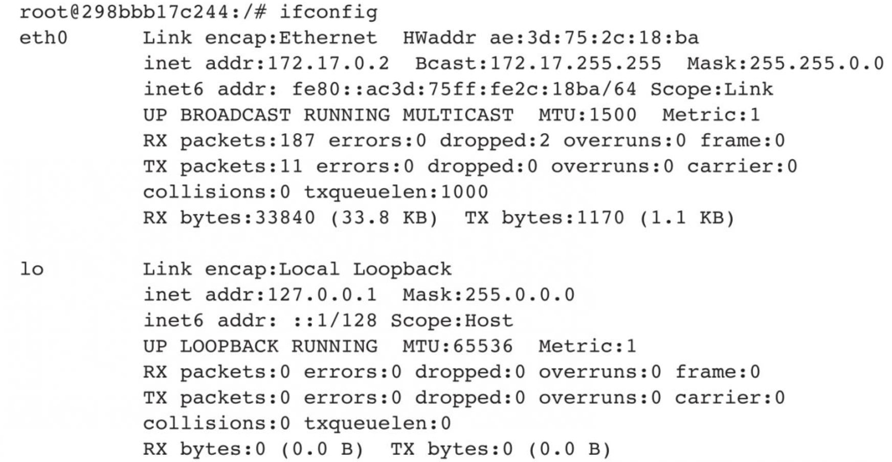
在容器外，配置OpenvSwitch的网桥br0内部接口地址为172.17.0.1/16（只要与所挂载容器IP在同一个子网内即可）​：
```shell
sudo ifconfig br0 172.17.0.1/16
```
(3)测试连通
经过上面的步骤，容器已经连接到了网桥br0上了，拓扑如下所示：

此时，在容器内测试是否已连通到网桥br0上了：
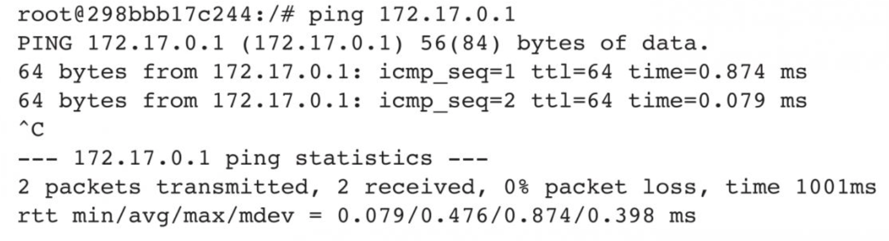
在容器内也可以配置默认网关为br0接口地址：
```shell
root@298bbb17c244:/# route add default gw 172.17.0.1
```
另外，删除该接口的命令为：
```shell
sudo ./ovs-docker del-port br0 eth0 <CONTAINER_ID>
```
另外，用户也可以直接使用支持OpenvSwitch的容器云平台（如Kubernetes、OpenStack等）来自动化这一过程。
## 20.8 创建一个点到点连接
通常情况下，Docker会将所有容器连接到docker0网桥或用户自定义网桥所在的虚拟网络中。
那么，如何实现两个容器之间的直连通信，而不用通过主机网桥进行连接呢？办法很简单：创建一对peer接口，分别放到两个容器中，配置成点到点链路类型即可。下面这个过程将通过手动操作完成Docker配置容器网络的过程。
首先启动两个容器，如下所示：
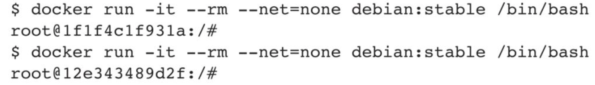
找到进程号，然后创建网络命名空间的跟踪文件，如下所示：
```shell
docker [container] inspect -f '{{State.Pid}}' 1f1f4c1f931a
2989
docker [container] inspect -f '{{State.Pid}}' 12e343489d2f
3004
sudo mkdir -p /var/run/netns
sudo ln -s /proc/2989/ns/net /var/run/netns/2989
sudo ln -s /proc/3004/ns/net /var/run/netns/3004
```
创建一对peer接口，如下所示：
```shell
sudo ip link add A type veth peer name B
```
添加IP地址和路由信息，如下所示：
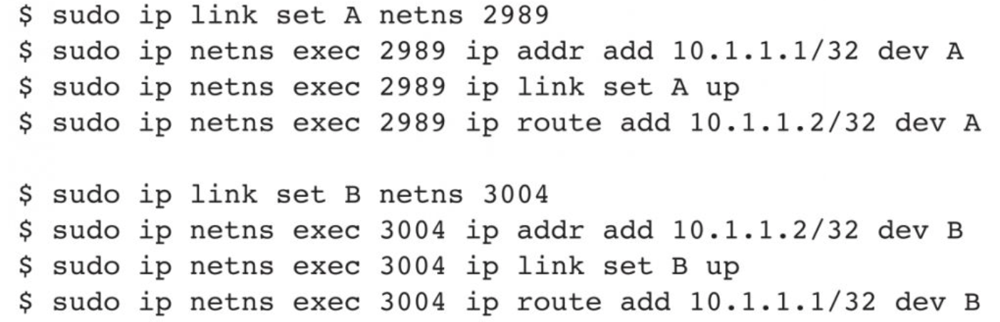
现在这两个容器就可以相互通信，并成功建立连接。点到点链路不需要子网和子网掩码。
此外，也可以不指定--net=none来创建点到点链路。这样，容器还可以通过原先的网络来通信。利用类似办法，还可以创建一个只与主机通信的容器。
## 20.9 本章小结
在本章中，笔者深入探讨了Docker网络的高级部署和操作配置，包括配置启动参数、DNS、容器访问控制管理等方面。同时，还介绍了与Docker网络相关的一些实用工具和项目。
网络是一个极为复杂的领域，涉及众多学科和技术类别，如软件、硬件、系统和协议等。为了在大规模复杂场景中提供稳定的网络服务，运营者必须精通整个网络栈的管理。
Docker最初是基于操作系统的本地网络支持技术而发展起来的，迅速提供了基本的网络支持。随着Docker被越来越广泛地应用于各种分布式环境，网络需求变得越来越复杂，容器网络已经成为云计算领域的核心技术。
如何将现有的网络虚拟化技术与容器网络相结合以解决问题，将是未来云计算领域持续探讨的关键技术话题。