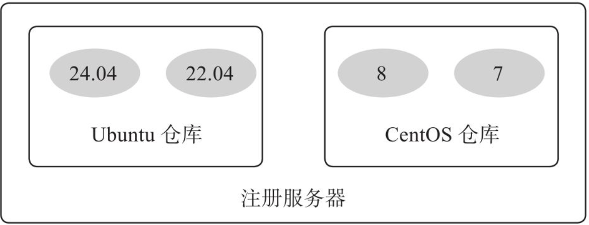
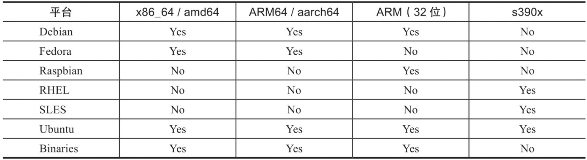
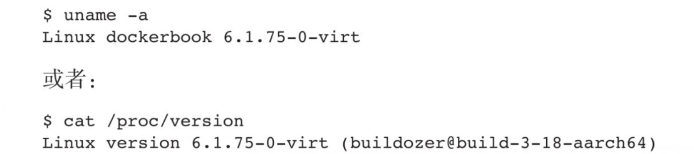
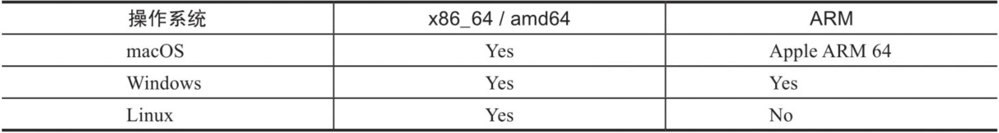
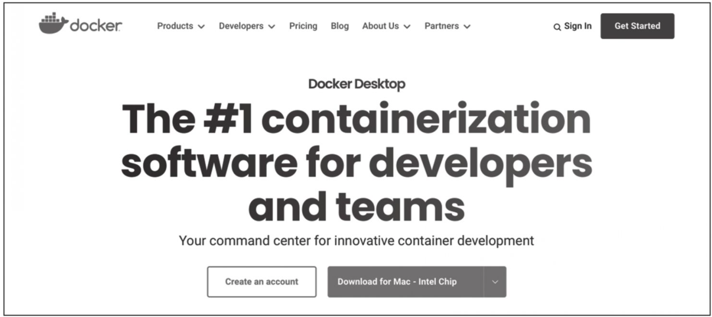
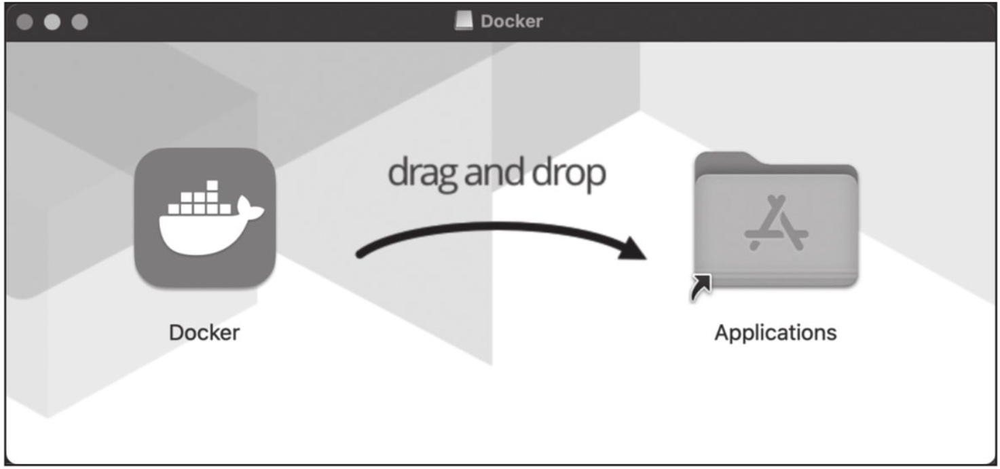
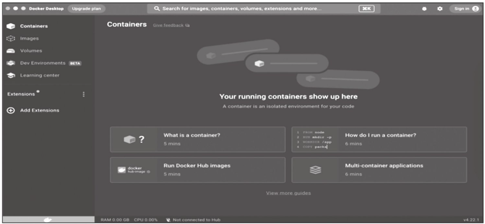
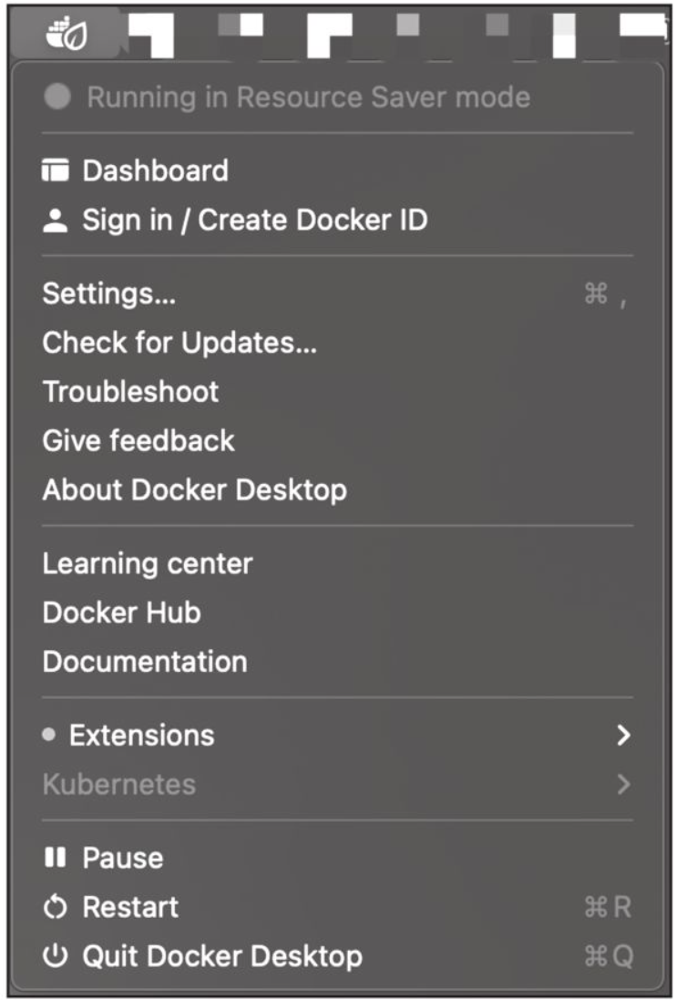

# 第二章 核心概念和安装配置 
本章首先介绍Docker的三个基本概念：镜像(image)、容器(container)和仓库(repository)。通过学习，读者将初步理解Docker容器的基本操作和生命周期。接下来，笔者将介绍如何在各种主流操作系统平台上安装Docker，包括Ubuntu、MacOS和Windows等。最后，讲解如何配置Docker服务，以便在各种环境下实现高效的容器管理。
## 2.1 核心概念
Docker的大部分操作都紧密围绕三大核心概念：镜像、容器和仓库。因此，准确把握这三大核心概念对于掌握Docker技术尤为重要。
**1.Docker镜像**
Docker镜像类似虚拟机镜像，包含运行某个应用所需的所有内容，如代码、运行时环境、系统库、环境变量以及配置文件等。镜像非常轻量级，可以被视为创建容器的基础模板。
例如，一个镜像可以仅包含Nginx软件和它的运行时依赖环境，这样的镜像就是一个Nginx镜像。
镜像由多个只读层组成，这些层在构建过程中被叠加在一起。相同的层可以在多个镜像中共享，从而实现高效存储和传输，因为它们仅需要下载一次。用户可以轻松地从官方仓库中下载一个预构建的应用镜像使用。
**2.Docker容器**
Docker容器可被视为一个轻量级的沙箱，它允许应用在隔离的环境中运行。Docker利用容器技术来实现应用程序的隔离和高效部署。
容器是基于镜像创建的应用运行实例，它们可以被启动、暂停、停止和删除。这些容器彼此相互隔离，互不干扰，确保了应用程序之间的安全性和独立性。
可以将容器理解为一个包含了简化版Linux系统环境（包括root用户权限、进程空间、用户空间和网络空间等）以及运行在其中的应用程序的封装盒子。通过使用容器，可以轻松地在不同环境中部署和管理应用，实现快速、可靠和可复用的软件交付。

> [!NOTE] 注意
> 镜像是只读的。从镜像创建容器时，会在镜像的最上层新建一个可写层。

**3.Docker仓库**
Docker仓库类似于代码仓库，作为一个集中存放镜像文件的平台。
有时，人们可能会将Docker仓库和仓库注册服务器(Registry)混淆，而实际上它们是有所区别的。仓库注册服务器是托管仓库的地方，通常会包含多个仓库。每个仓库专门用于存放某一类镜像，其中可能包含多个镜像文件，通过不同的标签(tag)进行区分。例如，用于存放Ubuntu操作系统镜像的仓库称为Ubuntu仓库，它可能包括多个不同版本的镜像。仓库注册服务器的示例如图2-1所示。


图2-1　仓库注册服务器
根据所存储的镜像是否公开分享，Docker仓库可分为公开(Public)仓库和私有(Private)仓库两种形式。
目前，最大的公开仓库是由官方提供的Docker Hub，其中包含了大量的镜像供用户下载和使用。在国内，一些云服务提供商（如腾讯云、阿里云等）也提供了仓库的本地源等，以确保稳定、快速的国内访问体验。
对于那些不希望公开分享自己的镜像文件的用户，Docker也支持在本地网络内创建仅供自己访问的私有仓库。
当用户创建自己的镜像后，可以使用push命令将其上传到指定的公有或私有仓库。这样，在下次需要在另一台机器上使用该镜像时，用户只需从仓库中拉取下载即可。这种方式简化了镜像的共享和部署流程，提高了工作效率。

> [!NOTE] 注意
> 可以看出，Docker利用仓库管理镜像的设计理念与Git代码仓库的概念非常相似，实际上Docker在设计上借鉴了Git的很多优秀思想。

## 2.2 安装Docker引擎
Docker引擎(Docker Engine)是一个用于构建、运行和管理容器化应用的开源软件平台。它是Docker架构的核心组件，负责实现容器的创建、运行和监控等功能。Docker引擎由以下三个主要部分组成：
- Docker服务器（也称为Docker Daemon，或dockerd）​：一个长期运行的后台进程，负责处理Docker API请求并管理Docker对象，如镜像、容器、网络和存储卷等。
- RESTful API：提供与Docker服务器进行交互的接口。用户和应用程序可以通过发送RESTful请求来执行Docker操作，例如创建、运行和管理容器等。
- 客户端：用户可以在终端中输入各种命令，CLI将这些命令转换为RESTAPI请求并发送给Docker服务器以执行相应操作。
目前，主流的操作系统都已经支持Docker，表2-1中给出了服务器操作系统对Docker的支持情况。
表2-1　服务器操作系统支持列


### 2.2.1 Docker引擎版本
Docker引擎目前分为两个版本：社区版本(Community Edition，CE)和企业版本(Enterprise Edition，EE)。这两个版本针对不同的用户需求和场景进行了优化。
社区版本免费且开源，由开源社区进行支持和维护，主要面向开发者和小型团队。它提供了基本的Docker功能，允许用户快速地构建、运行和管理容器化应用。
企业版本按照订阅模式收费，由Docker公司进行商业支持，针对大型企业和生产环境进行了优化。企业版本通过付费形式提供认证支持、镜像管理、容器托管、安全扫描等高级服务。
通常情况下，个人或小型团队用户可以使用社区版本满足大部分需求；对于大型企业或更严格的生产需求，可以购买企业版本服务获得更安全和更稳定的体验。
社区版本每个季度（三、六、九、十二月份）会发行一次稳定(Stable)版本。版本号命名格式为“年份.月份”​，如2023年10月发布的版本号为V23.10。同时，也会不定期地发布补丁更新和边缘(Edge)版本，以修复已知问题和提供新功能预览。
本书为了介绍最新的Docker功能，选用Docker V23版本，使用的操作系统环境是Ubuntu 24.04。
### 2.2.2 在Linux环境下安装Docker引擎
下面以Ubuntu操作系统为例，讲解在Linux环境下如何安装Docker引擎。
**1.操作系统要求**
Ubuntu操作系统对Docker的支持非常成熟，兼容多种系统架构，包括x86_64、armhf、s390x(IBM Z)和ppc64le等，只需确保为64位系统即可。
Docker当前支持的最低Ubuntu版本为18.04 LTS，然而，为了获得更好的稳定性和性能，推荐使用24.04 LTS版本。此外，更新的系统内核有助于充分利用Docker最新特性。
用户可以通过如下命令检查自己的内核版本详细信息：


> [!NOTE] 注意
>在Ubuntu发行版中，LTS(Long-Term-Support)意味着更稳定的功能和更长期（目前为5年）的升级支持，生产环境中应当使用LTS版本。

**2.删除旧版本**
在安装新版本的Docker之前，可能需要先卸载旧版本。旧版本的Docker在系统中可能以docker、docker.io或docker-engine等名称存在。为确保顺利安装新版本，可以把它们卸载，命令如下：
```shell
sudo apt-get remove docker docker-engine docker.io containerd runc
```
卸载软件不会自动清理镜像、容器、存储卷、网络等数据，如果想要一个全新的Docker环境，可以把/var/lib/docker/目录下的内容清理干净。
**3.安装依赖**
首先需要安装apt-transport-https等软件包来支持HTTPS的源：
```bash
sudo apt-get update
sudo apt-get install \
  ca-certificates \
  curl \
  gnupg \
  lsb-release
```
添加Docker官方GPG密钥：
```shell
sudo mkdir -m 0755 -p /etc/apt/keyrings
curl -fsSL https://download.docker.com/linux/ubuntu/gpg | sudo gpg --dearmor
  -o /etc/apt/keyrings/docker.gpg
```
添加Docker稳定版的官方软件源：
```shell
echo \
  "deb [arch=$(dpkg --print-architecture) signed-by=/usr/share/keyrings/docker-archive-keyring.gpg] https://download.docker.com/linux/ubuntu \ $(lsb_release -cs) stable" | sudo tee /etc/apt/sources.list.d/docker.list > /dev/null
```
添加成功后，再次更新软件包缓存：
```shell
sudo apt-get update
```
**4.开始安装**
安装最新社区版本的Docker引擎：
```shell
sudo apt-get install docker-ce docker-ce-cli containerd.io docker-buildx-plugin docker-compose-plugin
```
安装指定版本的Docker引擎：
```shell
# 列出当前可用的版本
apt-cache madison docker-ce | awk '{ print $3 }'
5:23.0.0-1~ubuntu.24.04-jammy
5:20.10.23~3-1~ubuntu-jammy
5:20.10.22~3-1~ubuntu-jammy
5:20.10.21~3-1~ubuntu-jammy
5:20.10.20~3-1~ubuntu-jammy
···
# 笔者选择的是5:23.0.0-1~ubuntu.24.04-jammy
VERSION_STRING=5:23.0.0-1~ubuntu.24.04-jammy
sudo apt-get install docker-ce=$VERSION_STRING docker-ce-cli=$VERSION_STRING
    conttainerd.io docker-buildx-plugin docker-compose-plugin
```
安装成功后，会自动启动Docker服务。可以通过如下命令来验证Docker是否安装成功：
```shell
sudo docker --version
```
## 2.3 安装Docker桌面版
Docker桌面版(Docker Desktop)是一款方便用户快速使用Docker相关组件的工具包，它提供了一个图形化界面和一套集成工具，方便用户直观地管理镜像、容器、网络、应用、配置等。Docker桌面版包括Docker引擎、Docker Build、Docker Compose和Kubernetes等组件，个人用户或小规模企业（雇员少于250且年营收不超过1000万美金）可以免费使用。
Docker桌面版支持macOS、Windows、Linux等主流操作系统，其中Linux系统仅支持x86_64/amd64架构，macOS和Windows系统上还支持ARM架构，如表2-2所示。

表2-2　Docker桌面版支持的系统和架构


### 2.3.1 在macOS环境下安装Docker桌面版
**1.操作系统要求**
Docker桌面版支持macOS 11(Big Sur)或以上版本，推荐使用最新版本的macOS来安装Docker桌面版。
**2.安装步骤**
首先，访问Docker桌面版下载页面：https://www.docker.com/products/docker-desktop ，如图2-2所示。按照系统信息下载对应版本，下载完成后，本地将存在一个名为Docker.dmg的安装包。

图2-2　Docker桌面版下载页面
双击Docker.dmg文件开始安装。将Docker.app图标拖放到Applications文件夹中即可完成安装，如图2-3所示。


图2-3　将Docker.app图标拖放到Applicaitons文件夹
在Applications文件夹中找到Docker.app并双击以启动Docker Desktop。在首次运行时，可能需要授权应用程序访问系统资源，如图2-4所示，随后进入客户端主页面，如图2-5所示。

图2-4　授权应用程序访问系统资源

图2-5　客户端主页面
完成启动后，用户将在macOS的菜单栏上看到一个小鲸鱼形状的Docker图标。单击这个图标可以访问Docker桌面版的设置、管理容器和查看日志等，如图2-6所示。

图2-6　Docker桌面版操作
### 2.3.2 在Windows环境下安装Docker桌面版
**1.操作系统要求**
目前支持Docker的Windows版本要求为：
❑ Windows 10（64位）​：家庭版或者专业版，版本大于等于21H2；企业版或者教育版，版本大于等于21H2。
❑ Windows 11（64位）​：家庭版或者专业版，版本大于等于21H1(19043)；企业版或者教育版，版本大于等于21H1(19042)。
❑ 支持SLAT特性的64位CPU。
❑ 4GB以上的系统内存。
❑ BIOS打开支持虚拟化功能。
如果读者在VMWare Esxi或者Azure VM中运行Docker桌面版，则需要在对应的Hypervisor管理平台上打开再次虚拟化支持。
**2.安装步骤**
首先，访问Docker桌面版下载页面https://www.docker.com/products/docker-desktop 。按照系统信息下载对应版本，如图2-2所示。下载完成后，本地将存在一个名为DockerDesktop Installer.exe的安装包。
双击Docker Desktop Installer.exe文件开始安装。在安装过程中，根据提示选择需要的组件和设置，如果提示，选择Use WSL 2 instead of Hyper-V选项。单击Install按钮开始安装过程。
完成安装后，安装程序可能会提示重启计算机。请按照提示操作，以确保 Docker桌面版正确设置并准备运行。
重启计算机后，用户将在Windows的系统托盘中看到一个小鲸鱼Docker图标。单击这个图标可以访问Docker桌面版进行设置、管理容器和查看日志等。
如果用户不是操作系统管理员，需要使用管理员账号将自己的账号添加到系统的docker-users组。
## 2.4 配置Docker服务
为了避免每次使用docker命令需要切换到特权身份，可以将当前用户加入安装中自动创建的docker用户组，命令如下：
```shell
sudo usermod -aG docker USER_NAME
```
更新用户组信息后，退出并重新登录后即可生效。Docker服务启动时实际上调用了dockerd命令，支持多种启动参数。因此，用户可以直接通过执行dockerd命令来启动Docker服务，如下面的命令启动了Docker服务，开启Debug模式，并监听在本地的2376端口。
```shell
dockerd -D -N tcp://127.0.0.1:2376
```
这些选项可以写入/etc/docker/路径下的daemon.json文件中，被dockerd服务启动时读取。
```json
{
"debug":true,
"hosts":{"tcp://127.0.0.1:2376"}
}
```
当然，操作系统也对Docker服务进行了封装，以使用Upstart来管理启动服务的Ubuntu系统为例，Docker服务的默认配置文件为/etc/default/docker，可以通过修改其中的DOCKER_OPTS来修改服务启动的参数，例如让Docker服务开启网络2375端口的监听：
```shell
DOCKER_OPTS="$DOCKER_OPTS -H tcp://0.0.0.0:2375 -H unix:///var/run/docker.sock"
```
修改之后，通过service命令来重启Docker服务：
```shell
sudo servive docker restart
```
RedHat等系统会通过systemd来管理Docker服务，对应配置文件路径为/etc/systemd/system/docker.service.d/docker.conf。更新配置后需要通过systemctl命令来管理Docker服务：
```shell
sudo systemctl daemon-reload
sudo systemctl start docker.service
```
此外，如果服务工作不正常，可以通过查看Docker服务的日志信息来确定问题，例如在RedHat系统上日志文件可能为/var/log/messages，在Ubuntu系统上可以执行命令journalctl-u docker.service。
每次重启Docker服务后，可以通过docker info命令查看Docker信息，确保服务已经正常运行。
## 2.5 推荐实践环境
考虑到稳定性，本书推荐的实践环境是Ubuntu 24.04 LTS或Debian稳定版本系统，并使用Linux 6.0以上的内核。由于Docker中不同版本的API可能存在差异，请根据需求选择较新的稳定版本。
如果没有特殊说明，本书中默认的数据网段地址范围为10.0.0.0/24，管理网段地址范围为192.168.0.0/24。
此外，在执行命令代码时，以$开头的命令表示普通用户，以#开头的命令表示特权用户(root)。如果用户已添加到docker用户组（参考2.4节）​，大部分情况下不需要管理员权限。否则，需要在命令前使用sudo临时提升权限。
对于输出结果较长的部分命令，仅展示关键部分。
对于非Linux系统用户，建议在本地使用虚拟机创建Linux环境，并在其中执行Docker相关命令。
## 2.6 本章小结
本章介绍了Docker的三大核心概念：镜像、容器和仓库，以及如何安装和配置Docker引擎服务。
在后面的实践中，读者会感受到基于三大核心概念所构建的高效工作流程，这是Docker从众多容器虚拟化方案中脱颖而出的重要原因。实际上，Docker和Docker Hub的工作流也并非凭空创造的，在很大程度上参考了Git和GitHub的设计理念，从而为应用分发和团队合作带来了众多优势。
在后续章节，笔者将具体讲解围绕这三大核心概念的Docker操作命令。