# 第五章 访问Docker仓库
仓库(repository)是用于集中存储镜像的地方，分为公共仓库和私有仓库两种类型。有时，读者可能会将仓库与注册服务器(registry)混淆。实际上，注册服务器是托管仓库的具体服务器。一个注册服务器可以包含多个仓库，而每个仓库下可以有多个镜像。
从这个角度来看，仓库可被视为一个特定的项目或目录。例如，在仓库地址private-docker.com/ubuntu中，private-docker.com是注册服务器地址，而ubuntu是仓库名称。
在本章中，笔者将分别介绍如何使用Docker Hub官方仓库进行登录、下载等基本操作，以及如何创建和使用私有仓库。
## 5.1 Docker Hub公共镜像市场
Docker Hub是Docker官方提供的最大的公共镜像仓库，目前包括了数百万个镜像，地址为https://hub.docker.com。
大部分应用镜像都可以在Docker Hub中找到，如图5-1所示。
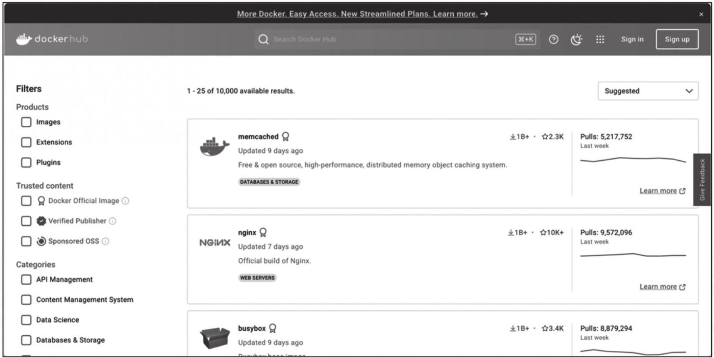
图5-1　Docker Hub上的公共镜像
**1.登录**
可以通过命令行执行docker login命令来输入用户名、密码和邮箱来完成注册和登录。注册成功后，本地用户目录下会自动创建.docker/config.json文件，以保存用户的认证信息。
登录成功的用户可以上传个人制造的镜像到Docker Hub。
**2.基本操作**
用户无须登录即可通过docker search命令查找官方仓库中的镜像，并利用docker[image]pull命令将它下载到本地。例如，以alpine为关键词进行搜索：
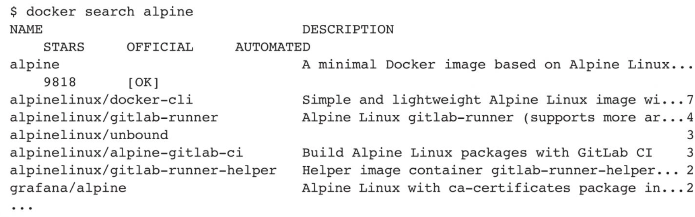
根据是否由官方提供，镜像资源可分为两大类：
第一类是官方镜像，如alpine。这些镜像由Docker公司创建、验证、支持并提供。通常，这类镜像的名称简洁，不带用户名前缀。
第二类是非官方用户创建的镜像，例如grafana/alpine。这类镜像由Docker用户（如grafana）创建并维护，镜像名称以用户名作为前缀，表示该镜像属于某个用户的仓库。要使用特定用户提供的镜像，可通过“用户名/镜像名”的形式指定。
下载官方alpine镜像到本地，如下所示：
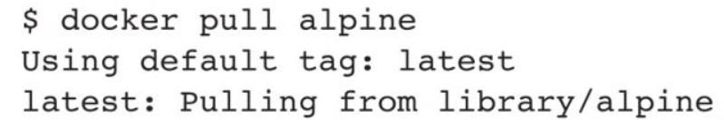
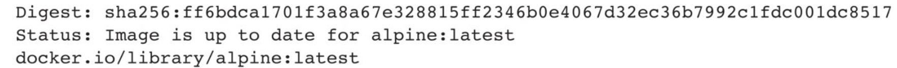
用户也可以在登录后通过docker push命令将本地镜像推送到Docker Hub。
**3.Docker Hub网站常用操作**
Docker Hub网站上拥有大部分常见热门开源软件的镜像，从这里可以下载其他人制作好的镜像。
(1)使用搜索和过滤工具搜寻镜像用户可以通过关键字搜索镜像市场，或使用左侧的过滤工具选择过滤条件，如图5-2所示。可使用的过滤条件有：
❑ Products（产品）​：包括镜像、扩展、插件。
❑ Trusted Content（信任内容）​：包括Docker官方镜像、经过认证的发布者、Docker赞助的项目。
❑ Operating Systems（操作系统）​：包括Linux、Windows等。
❑ Architectures（芯片构架）​：包括ARM、ARM64、IBM Power、IBM Z、PowerPC 64LE、X86、X86-64等。
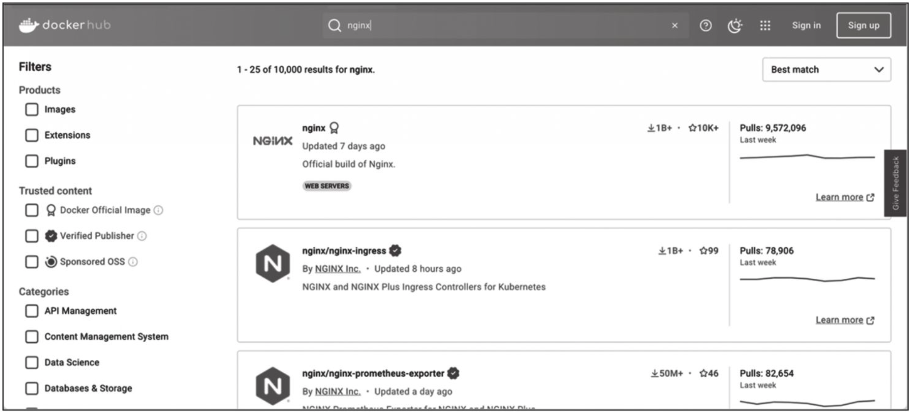
图5-2　在Docker Hub上搜索Nginx镜像
在生产环境中使用镜像时，建议选择Docker官方镜像。同时，也推荐将Docker官方镜像作为自制镜像的基础镜像。
当需要为特定芯片架构选择镜像时，可以筛选相应的架构以找到合适的镜像。例如，许多针对X86-64的镜像无法在ARM架构上运行，此时可以选择ARM64架构的镜像。
(2)查看镜像基本信息和使用方法
下载完镜像之后，读者可能会遇到以下几个问题：
❑ 如何使用这个镜像？
❑ 镜像内运行了哪些服务？
❑ 镜像对外发布了哪些端口？
❑ 镜像的作者推荐如何使用它？
❑ 镜像是如何构建的？
读者可以在镜像的主页上找到以上问题的相关信息。如图5-3所示，在Overview部分，将看到镜像的基本信息。对于Docker官方镜像，这里通常会展示软件的官方网站、镜像的制作者以及镜像的使用方法（包括运行参数、变量、更新方式等）​。最重要的是，这里通常会展示创建该镜像的Dockerfile。可以通过单击Dockerfile链接查看镜像的构建过程。
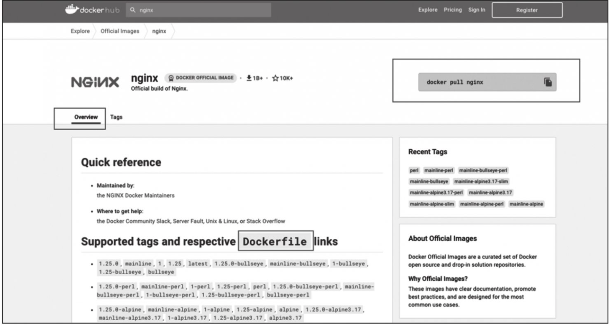
图5-3　在Docker Hub上查看Nginx镜像的Dockerfile
Tags标签页将展示当前镜像有哪些可用的镜像标签。在生产环境中建议选用稳定版的镜像，如图5-4所示。
读者可以在这里选择一个合适的镜像标签。如果选择了Nginx镜像的stable-perl标签，那么将使用下面的命令下载镜像：
```shell
docker pull nginx:stable-perl
```
**4.自动构建**
自动构建(automated build)是Docker Hub提供的一项自动化服务，该功能可根据项目代码的变更自动重新构建镜像。
例如，当用户为某应用构建镜像后，如果应用发布了新版本，用户通常需要手动更新镜像。然而，自动构建功能允许用户通过Docker Hub指定跟踪目标网站（目前支持GitHub和BitBucket）上的项目。一旦项目有新的提交，Docker Hub将自动执行构建。
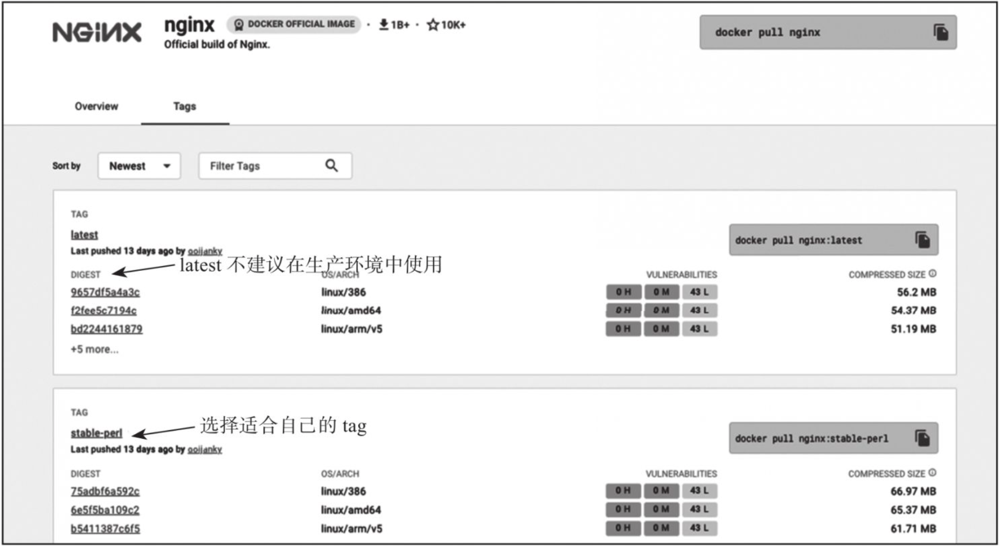
图5-4　Nginx镜像包括最新版和稳定版
要配置自动构建，需要执行如下步骤：
1)登录Docker Hub及目标网站，如GitHub。
2)在目标网站中支持Docker Hub访问服务。
3)在Docker Hub中配置一个“自动构建类型”的项目。
4)选取一个目标网站中的项目（需要含Dockerfile）和分支。
5)指定Dockerfile的位置，并提交创建。
之后，可以在Docker Hub的自动构建页面中跟踪每次构建的状态。
## 5.2 搭建本地私有仓库
**1.使用registry镜像创建私有仓库**
读者可以通过官方提供的registry镜像来简单搭建一套本地私有仓库环境。registry是由Docker官方提供的一个开源工具，用于实现容器分发，项目地址为https://github.com/distribution/distribution。首先通过如下命令下载并启动一个registry容器，以创建本地的私有仓库服务：
```shell
docker run -d p  5000:5000 registry:2
```
默认情况下，仓库会被创建在容器的/var/lib/registry目录下。读者可以通过-v参数将镜像文件存放在本地的指定路径。
例如，将上传的镜像放到/opt/data/registry目录：
```shell
docker run -d -p 5000:5000 -v /opt/data/registry:/var/lib/registry registry:2
```
此时，在本地将启动一个私有仓库服务，监听端口为5000。
**2.管理私有仓库**
通过上面的操作，已经搭建好了私有仓库。下面演示如何上传和下载镜像。
首先，在私有仓库所在主机查看本地镜像：
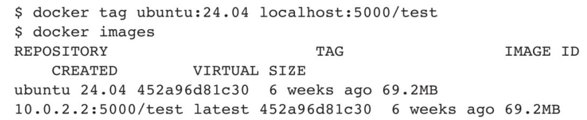
使用docker tag命令将这个镜像标记为localhost:5000/test（格式为docker tagIMAGE[:TAG]​[REGISTRYHOST/]​[USERNAME/]NAME[:TAG]​）​，如下所示：
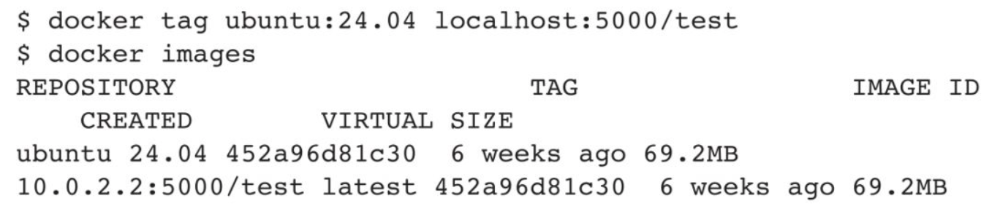
使用docker push命令上传标记的镜像：
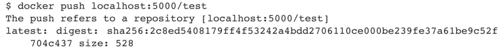
**3.启用TLS**
为了提高安全性，还可以对仓库启用TLS功能。
首先，读者需要获取一份SSL证书。可以选择从权威证书颁发机构(CA)购买证书，或使用如下命令生成自签名证书：
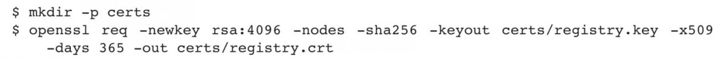
创建好证书后，在启动Docker Registry容器时需要将证书文件映射到容器中。同时，指定REGISTRY_HTTP_TLS_CERTIFICATE和REGISTRY_HTTP_TLS_KEY环境变量来启用TLS，如下所示：
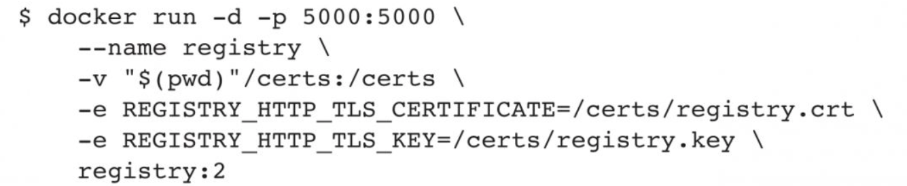
此时，仓库启用了TLS，在客户端对其进行访问时可以通过证书来进行认证，确保访问的仓库为正确仓库。
更多关于搭建私有仓库的实践，请见本书后续部分。
## 5.3 本章小结
容器仓库是用于集中维护和管理容器镜像的存储场所，为Docker镜像文件的分发和管理提供了一种高效且便捷的方法。
本章所介绍的Docker Hub是官方提供的公共仓库服务，它为个人用户提供了便利的镜像下载和使用等功能。
在企业生产环境中，通常需要使用私有仓库来维护内部镜像。本章介绍了基本的搭建操作。本书后续部分将深入探讨私有仓库的更多配置选项。
除了官方的Registry项目之外，用户还可以选择其他开源方案（例如Harbor、Nexus）来搭建私有化的容器镜像仓库。这些方案均具有各自的特点和优势，可根据实际需求进行选择。