# 第八章 使用Dockerfile创建镜像
Dockerfile是一种文本格式的配置文件，用户可通过编写Dockerfile快速地创建自定义的镜像。
本章将首先介绍Dockerfile的典型基本结构，以及它所支持的各种指令；然后具体讲解如何利用这些指令编写自定义镜像的Dockerfile，以及如何生成相应的镜像；最后分享使用Dockerfile的一些最佳实践经验，帮助读者更高效地创建和管理Docker镜像。
## 8.1 基本结构
Dockerfile是一个用于构建Docker镜像的文本文件，包含一组用户可以调用以创建镜像的指令。Docker可以使用Dockerfile的指令来自动创建和配置一个新的Docker镜像。
一般而言，Dockerfile主体内容分为四部分：基础镜像信息、维护者信息、镜像操作指令和容器启动时执行指令。
下面给出一个简单的示例：

在此示例中，首行通过注释来指定解析器命令，后续通过注释说明镜像的相关信息。
主体部分首先使用FROM指令指明所基于的镜像名称，接下来一般是使用LABEL指令说明维护者信息。后面则是镜像操作指令，例如RUN指令，RUN指令将对镜像执行跟随的命令。每运行一条RUN指令，镜像将添加新的一层，并提交。最后是CMD指令，用于指定运行容器时的操作命令。
下面是基于alpine基础镜像的Nginx官方镜像Dockerfile的示例，通过此示例，读者可以对Dockerfile结构有一个基本的感知：

## 8.2 指令说明
Dockerfile是一个纯文本文件，包括创建镜像的所有指令。在执行docker build命令时，Docker引擎会从Dockerfile中读取指令，并逐条执行。
### 8.2.1 基本格式
Dockerfile的一条指令通常由注释和构建器指令参数两部分组成，如下所示：

其中构建器指令不区分大小写，但为了更好地与后面的参数加以区分，建议使用大写字母表示构建器指令。
Docker按照Dockerfile中的顺序执行操作指令。Dockerfile从FROM指令开始执行，但是类似注释、解析器指令、全局变量可以写在FROM之前。
Docker将以#开头的行视为注释，除非该行是有效的解析器指令。行中其他任何地方的#标记被视为参数。这允许如下语句：

第二行代码中的#被解析成RUN指令的参数。
Docker在执行Dockerfile指令之前会删除注释行，下面两个示例的执行效果是一样的：

### 8.2.2 解析器指令
解析器指令是一种可选的特性，它们能够改变Dockerfile中后续行的处理方式。这类指令并不会为构建过程添加额外的层，也不会在构建步骤中被显示出来。解析器指令被设计成特殊类型的注释，采用# directive=value的形式表达。值得注意的是，每个指令只能使用一次。
一旦Docker处理了注释、空行或者构建指令，它将不再寻找解析器指令。相反，任何被格式化为解析器指令的内容都会被Docker视为注释，并且Docker不会去尝试验证这些内容是否可能为解析器指令。因此，所有解析器指令都必须被置于Dockerfile的开头部分。
解析器指令对大小写不敏感，但建议统一使用小写形式，并在每个解析器指令之后留出空行。需要特别指出的是，解析器指令中并不支持行延续字符。
基于这些规则，以下示例都是非法的格式。
❑ 行延续而无效：

❑ 出现两次而无效：

❑ 在构建器指令后出现，被视为注释：

❑ 出现在非解析器指令的注释之后，因此被视为注释：

❑ 未知指令被视为注释。第二行同样被视为注释，因为它出现在注释之后：

❑ 解析器指令中允许非换行空格。因此，以下五行效果一样：

**转义语法**
escape指令用于设置Dockerfile中的转义字符。如果未指定，默认转义字符为\。语法格式如下：

转义字符既用于转义行中的字符，也用于转义换行符。这允许Dockerfile指令跨越多行。请注意，无论escape指令是否包含在Dockerfile中，除了在行尾外，转义指令都不会在RUN指令中执行。
在Windows上设置转义字符特别有用，因为\是目录路径分隔符，容易与Dockerfile默认的转义字符相混淆。解决办法是将转义字符修改为与Windows PowerShell一致。看以下示例：

上述示例在Windows上执行失败后将难以排查。第二行末尾的第二个“\”被解释为换行的转义，而不是从第一个“\”转义的目标。同样，假设它实际上被处理为指令，第三行末尾的“\”将被视为行延续。下面这段Dockerfile的运行结果是，第二行和第三行被认为是一个单一的指令：

一种解决方案是使用“/”作为COPY指令和dir的目标。然而，这种语法理解起来非常困难，因为它不是Windows的原生路径格式，而且由于并非所有命令都支持“/”作为路径分隔符，也容易出现错误。
通过添加escape指令，将转义字符修改为与PowerShell一致的，以下Dockerfile在Windows上对文件路径使用原生平台语义时就会成功：

结果如下：

### 8.2.3 环境变量替换
环境变量（用ENV语句声明）也可以在某些指令中用作由Dockerfile解释的变量，在Dockerfile中用\$variable_name或\${variable_name}标注。\${variable_name}语法还支持以下标准bash修饰符：
❑ \${variable:-word}指示如果设置了variable，则word将是该值；如果未设置variable，则word将是它的默认值。
❑ \${variable:+word}表示如果设置了variable，则word将是该值，否则word将是空字符串。
word可以是任何字符串，包括额外的环境变量。
通过在变量之前添加一个“\”进行转义，例如，\$foo和\${foo}将分别转换为字面的$foo和${foo}：

Dockerfile中的以下指令支持环境变量：ADD、COPY、ENV、EXPOSE、FROM、LABEL、STOPSIGNAL、USER、VOLUME、WORKDIR和ONBUILD（和上述命令结合使用时）​。
### 8.2.4 .dockerignore文件
Docker CLI在向Docker守护进程发送构建上下文之前，会首先在上下文的根目录中寻找一个名为.dockerignore的文件。若该文件存在，CLI则会对上下文进行修改，从而排除那些与.dockerignore文件中的模式相匹配的文件和目录。这个过程有助于避免无意间将体积过大或包含敏感信息的文件和目录发送给Docker守护进程，或者通过ADD或COPY指令将这些文件添加到Docker镜像中。
.dockerignore文件中的模式被Docker CLI解析为类似于UNIX Shell中的换行分隔符模式。在进行模式匹配时，上下文的根目录既被视为工作目录，也被视为根目录。例如，模式/foo/bar和foo/bar都将从foo目录中排除名为bar的文件或目录。
在.dockerignore文件中，以“#”符号开头的行会被视为注释，因此在解析过程中将会被忽略。以下是一个.dockerignore文件示例：

此文件中各规则导致的构建行为如表8-1所示。

表8-1　.dockerignore文件中各规则导致的构建行为

匹配逻辑使用Go的filepath.Match规则完成。预处理步骤使用Go的filepath.Clean规则删除前导和尾随空格，并消除.和..元素，预处理后空白的行被忽略。
除了Go的filepath.Match规则外，Docker还支持匹配任意数量的目录的特殊通配符字符串＊＊。例如，＊＊/＊.go将排除所有目录中以.go结尾的所有文件。
以！开头的行可用于排除例外情况。以下是使用此机制的.dockerignore文件示例：

上面的代码表示除README.md外，所有md文件都被排除。
再来看第二个示例：
!
上面的代码表示README-secret.md被排除，它覆盖了第二行的例外逻辑。
现在分析第三个示例：

README-secret.md还是被排除，因为第三行的逻辑覆盖了第二行的逻辑。
可以使用.dockerignore文件来排除Dockerfile和.dockerignore文件。这些文件仍然被发送到守护进程，因为需要用它们来完成构建工作，但最终不会将它们复制到镜像中。
如果希望指定在上下文中包含某些文件，而不是排除这些文件，则可以将指定作为第一个模式，然后使用一个或多个例外模式。
### 8.2.5 FROM
FROM指令的一般格式为：

FROM指令初始化一个新的构建阶段，并为后续指令设置基础镜像。因此，有效的Dockerfile须以FROM指令开头。ARG是Dockerfile中唯一可以放到FROM之前的指令。
FROM可以在单个Dockerfile中多次出现，以创建多个镜像，或使用一个构建阶段作为另一个构建阶段的依赖项。只需在每个新的FROM指令之前，记下提交输出的最后一个镜像ID。每个FROM指令都会清除之前指令创建的任何状态。

可以使用AS name为每个构建阶段指定一个单独的名字，并使用COPY--from=<name>来引用。

如果FROM引用多平台镜像，则可选的--platform标志可用于指定镜像的平台。例如，Linux/AMD64、Linux/ARM64或Windows/AMD64。默认情况下，使用构建请求的目标平台作为值。全局构建参数可设置此标志的值，例如，自动平台ARG允许将构建目标强制设为本机构建平台(--platform=$BUILDPLATFORM)，并使用它对阶段内的目标平台进行交叉编译。

**ARG和FROM互动**
FROM会读取ARG中设置的值：

ARG在FROM之前，所以默认情况下，在FROM后面的构建器指令不能被识别，想要使用ARG，需要在使用前执行不带参数的ARG+变量名指令（例如，如下代码中的ARG VERSION）​：

### 8.2.6 RUN
RUN指令将在当前镜像顶部的新层中执行命令并提交结果，生成已提交镜像将用于Dockerfile中的下一步。RUN指令有两种格式：
❑ RUN command为Shell模式，类似Linux中的/bin/sh-c或者Windows中的cmd/S/C。
❑ RUN["executable","param1","param2"]为执行模式。
分层RUN指令和生成提交是Docker的核心理念，使用类似Git中的提交机制，可以从镜像历史记录中的任何点创建容器，就像源代码控制一样。
在Shell模式中，可以使用\（反斜杠）将单个RUN指令进行换行处理。例如：
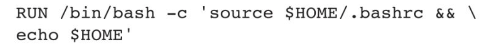
它们加起来相当于这一行：
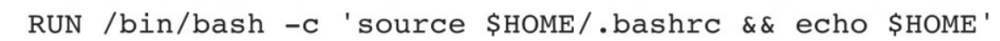
执行模式可以避免Shell字符串转义带来的混乱，可以使用SHELL命令更改Shell表单的默认Shell。
要使用/bin/sh以外的其他Shell，需要选择执行模式。例如：
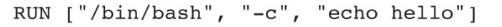
在下一次构建时，RUN指令的缓存不会自动失效。像RUN apt-get dist-upgrade-y这样的指令的缓存将在下次构建中重复使用。RUN指令的缓存可以使用--no-cache标志来强制失效，例如docker build--no-cache。
### 8.2.7 RUN--mount
RUN--mount可以挂载在构建阶段能够访问的文件系统，包括：
❑ 对主机文件系统或其他构建阶段，配置绑定挂载。
❑ 访问构建密钥或ssh-agent套接字。
❑ 使用持久性软件包管理缓存来加快构建速度。
其语法为：
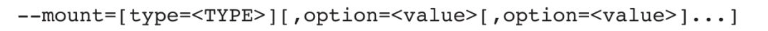
挂载类型总结如表8-2所示。

表8-2　RUN--mount的挂载类型
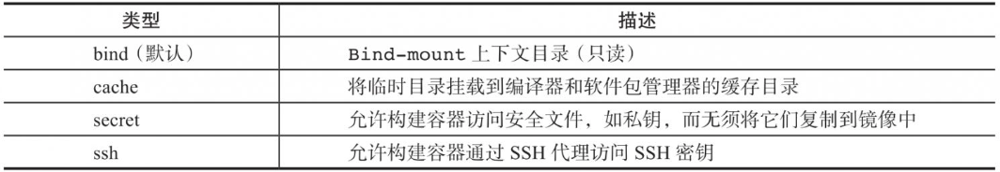
**1.bind挂载类型**
bind挂载类型允许将文件或目录绑定到构建容器。默认情况下，绑定挂载是只读的，支持的选项如表8-3所示。

表8-3　bind挂载类型支持的选项
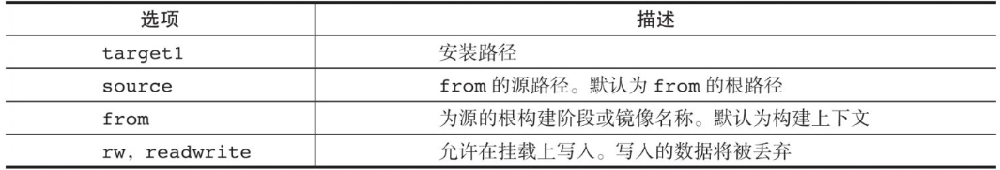
**2.cache挂载类型**
cache挂载类型允许构建容器缓存编译器和软件包管理器的目录，支持的选项如表8-4所示。

表8-4　cache挂载类型支持的选项
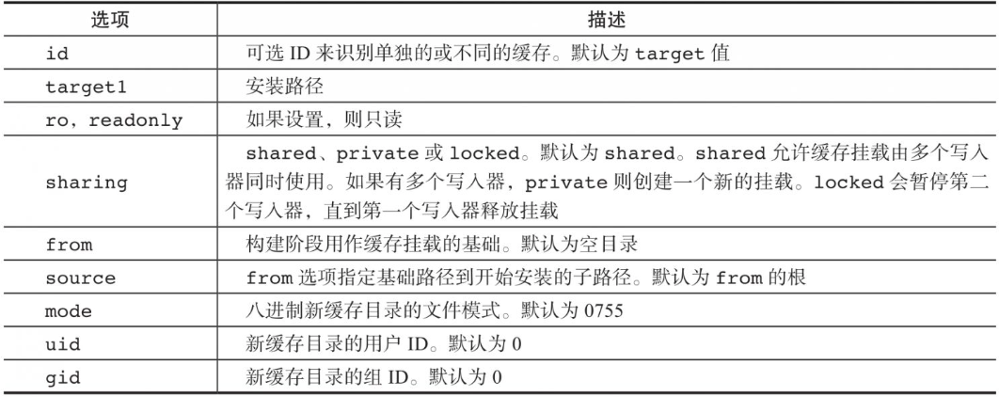
缓存目录的内容在构建器调用过程持续存在。缓存挂载可以提高构建效率。构建器与缓存目录需要绑定在一起，因为当另一个构建器可能会覆盖缓存文件，或者需要更多存储空间时，GC可能会清理它。下面给出两个缓存示例。
示例：缓存Go软件包。
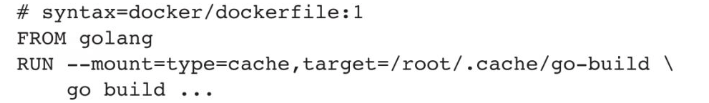
示例：缓存apt软件包。
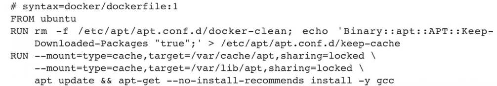
apt需要对数据进行独家访问，因此缓存使用选项sharing=locked，这将确保使用相同的缓存挂载的多个并行构建相互等待，而不是同时访问相同的缓存文件。如果希望在这种情况下让每个构建创建另一个缓存目录，也可以使用sharing=private。
**3.tmpfs挂载类型**
tmpfs挂载类型允许在构建容器中安装tmpfs，支持的选项如表8-5所示。

表8-5　tmpfs挂载类型支持的选项
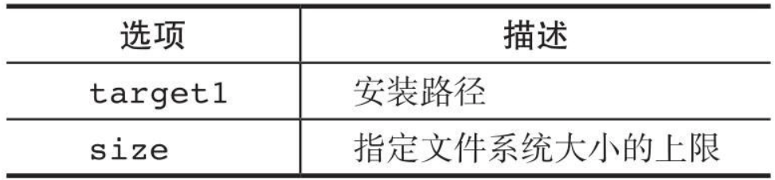
**4.secret挂载类型**
secret挂载类型允许构建容器访问安全文件，如私钥，无须将它们复制到镜像中，支持的选项如表8-6所示。

表8-6　secret挂载类型支持的选项
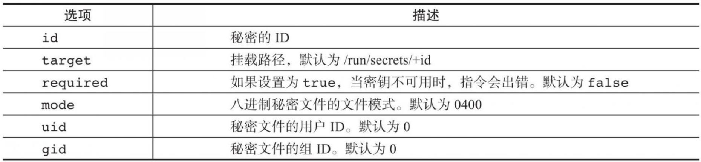
示例：访问S3。
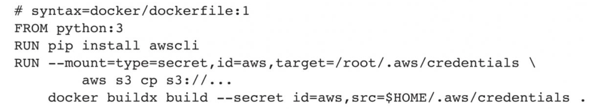
**5.ssh挂载类型**
ssh挂载类型允许构建容器通过SSH代理访问SSH密钥，支持的选项如表8-7所示。
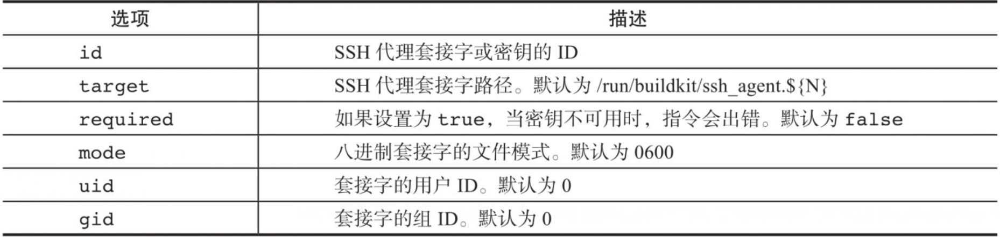
示例：访问GitLab。
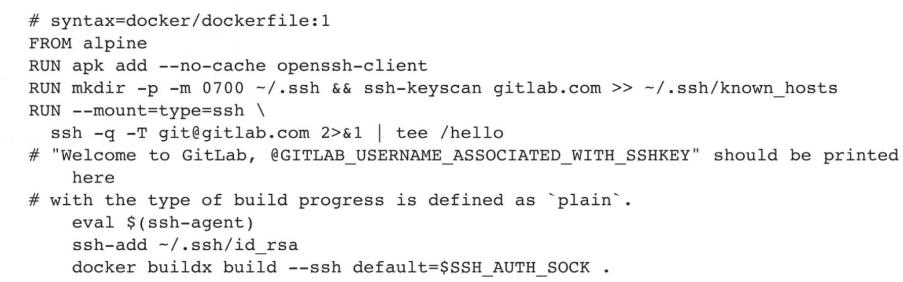
还可以直接在主机上指定*.pem文件的路径，而不是$SSH_AUTH_SOCK。注意，ssh挂载类型不支持带有密码的pem文件。
### 8.2.8 RUN--network
RUN--network用于控制单个RUN指令运行时的容器网络环境。支持的网络类型如表8-8所示。

表8-8　RUN--network支持的网络类型
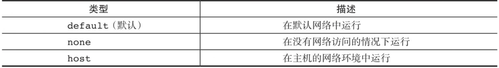
❑ RUN--network=default：命令在构建器默认网络中运行。
❑ RUN--network=none：在没有网络访问的情况下运行（本地回路网口lo仍然可用，但与此进程隔离）​。
示例：隔离外部影响。
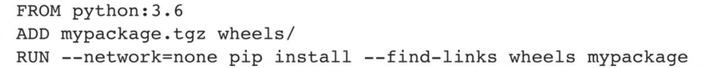
pip将只能安装tarfile中提供的软件包，这些软件包可以通过早期的构建阶段进行控制。
❑ RUN--network=host：该命令在主机的网络环境中运行（类似于docker build--network=host，执行粒度是每个RUN指令）​。使用--network=host需要在构建器套件中启用--allow-insecure-entitlement network.host。
### 8.2.9 CMD
CMD指令有三种形式：
❑ CMD["executable","param1","param2"]​（exec形式，这是默认形式）​。
❑ CMD["param1","param2"]​（作为ENTRYPOINT的默认参数）​。
❑ CMD command param1 param2（shell形式）​。
Dockerfile中只能有一个CMD指令。如果列出多个CMD，那么将只有最后一个CMD生效。
CMD指令主要是为执行容器提供默认值。默认值可以是可执行文件，如果省略可执行文件，则必须指定ENTRYPOINT指令。
如果使用CMD为ENTRYPOINT指令提供默认参数，则应使用JSON数组格式指定CMD和ENTRYPOINT指令。
exec形式被解析为JSON数组，必须在单词周围使用双引号(")而不是单引号(')。
与shell形式不同，exec形式不会调用命令shell。例如，CMD["echo","\$HOME"]不会对$HOME进行变量替换。如果想要进行shell处理，要么使用shell形式，要么直接执行shell，例如CMD["sh","-c","echo \$HOME"]​。
当以shell或exec形式执行时，CMD指令会设置在启动镜像时要执行的命令。
如果使用CMD的shell形式，那么<command>将在/bin/sh-c中执行，例如：
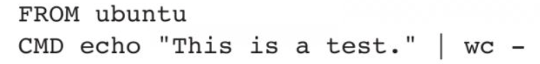
如果想在没有shell的情况下运行<command>，则必须将命令表示为JSON数组，并提供可执行文件的完整路径。此数组形式是CMD的首选格式。任何额外的参数都必须在数组中单独表示为字符串：
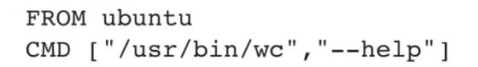
如果希望容器每次都运行相同的可执行文件，那么应该考虑将ENTRYPOINT与CMD结合使用。
如果用户为docker run指定参数，那么将覆盖CMD中指定的默认值。
> [!NOTE] 注意
>不要将RUN与CMD混淆。RUN实际上运行一个命令并提交结果镜像层；CMD在构建时不会执行任何内容，它指定镜像的启动命令。
### 8.2.10 LABEL
LABEL指令为镜像添加元数据，一个LABEL是一个键值对，指令格式如下：
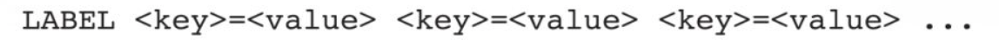
例如：
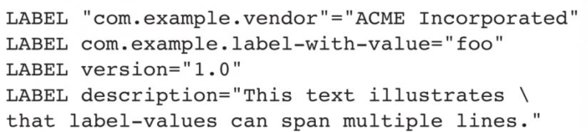
一个镜像可以有多个标签。在Docker 1.10之前，需要在一行上指定多个标签以减少最终镜像大小。现在可以选择在单个指令中指定多个标签或者一个标签一行：
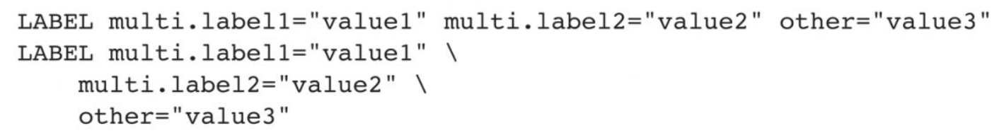
请务必使用双引号而不是单引号。特别是当使用字符串插值时（例如，LABELexample="foo-$ENV_VAR"）​，如果使用单引号，将按原样接受字符串，而不会解压变量的值。
基础或父镜像（FROM行中的镜像）中包含的标签由用户的镜像继承。如果标签已经存在，但值不同，那么最近应用的值将覆盖任何之前设置的值。
要查看镜像的标签，请使用docker image inspect命令。可以使用--format选项仅 显示标签；
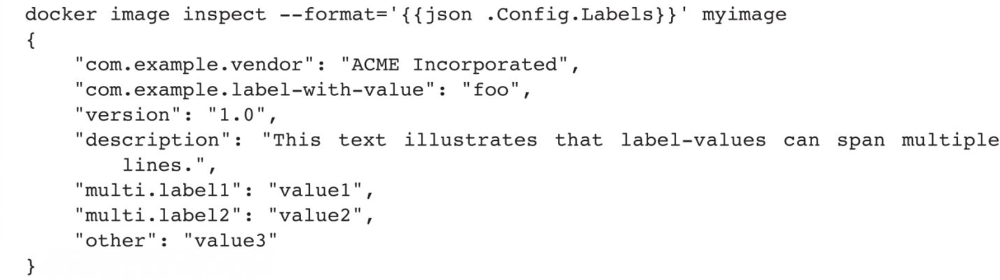
### 8.2.11 EXPOSE
EXPOSE指令通知Docker，容器在运行时监听指定的网络端口。可以指定端口是监听TCP还是UDP，如果未指定协议，默认值为TCP。命令格式为：

EXPOSE指令实际上并没有发布端口。它作为构建镜像的人和运行容器的人之间的一种文档，用于明确要发布哪些端口。要在运行容器时实际发布端口，需要在dockerrun中使用-p标志来发布和映射一个或多个端口，或者使用-P标志来发布所有暴露的端口并将它们映射到主机的高阶端口。
默认情况下，EXPOSE使用TCP，可以手动指定为UDP：
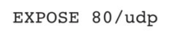
要在TCP和UDP上都发布端口，则需要都写出来：
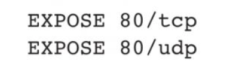
 在这种情况下，如果将-P与docker run一起使用，那么端口将发布两次，一次用于TCP，一次用于UDP。请记住，-P在主机上使用高阶主机端口，因此TCP和UDP的端口将不同。
 无论EXPOSE设置如何，都可以在运行时使用-p标志覆盖它们。例如：
 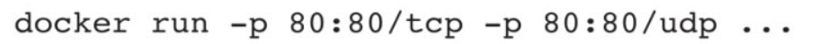
 docker network命令支持创建容器之间的通信网络，而无须公开或发布特定端口，因为连接到网络的容器可以通过任意端口相互通信。
 ### 8.2.12 ENV
 ENV指令将环境变量<key>设置为值<value>。对于构建阶段的所有后续指令，此值都将持续生效，并且可以在许多指令中内联替换。引号和反斜杠可用于包含值中的空格。语法格式如下：
 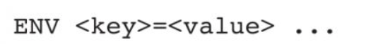
 示例：
 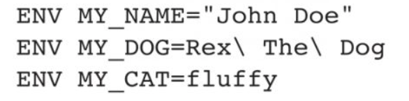
 ENV指令允许一次设置多个<key>=<value>...变量，以下示例将在最终镜像中产生与上面的指令相同的结果：
 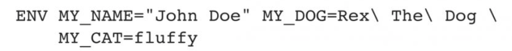
 当从生成的镜像运行容器时，使用ENV设置的环境变量将持续存在。可以使用docker inspect查看值，并使用docker run--env<key>=<value>更改它们。
 使用阶段构建时，子阶段可继承其父阶段或任意祖先使用ENV设置的环境变量。
 环境变量的持久性可能会导致意想不到的副作用。例如，设置ENVDEBIAN_FRONTEND=noninteractive会改变apt-get的行为，这可能会让使用镜像的最终用户感到困惑。
 如果仅在构建期间而不是在最终镜像中需要环境变量，则可以考虑为单个命令设置一个临时的环境变量：
 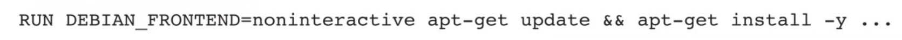
 或者使用ARG，它不会在最终镜像中持久化：
 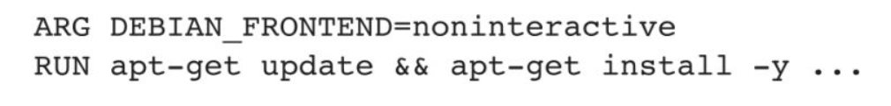
**替代语法**
ENV指令还允许替代语法ENV<key><value>，省略=。例如：
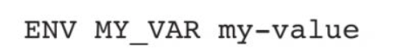
此语法不允许在单个ENV指令中设置多个环境变量，并且可能会令人困惑。例如，以下指令设置一个值为"TWO=THREE=world"的单个环境变量(ONE)：
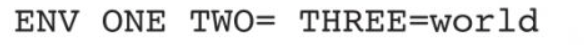
> [!NOTE] 注意
> 当前版本支持替代语法是为了向后兼容，不建议读者这样使用，该用法可能会在未来的版本中删除。
### 8.2.13 ADD
ADD指令有两种形式：
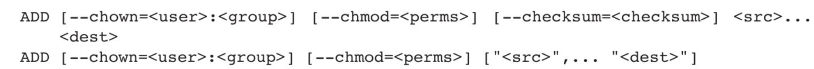
包含空格的路径需要使用后一种形式。
--chown和--chmod功能仅在用于构建Linux容器的Dockerfile上受到支持，在Windows容器上不起作用。由于用户和组所有权概念不会在Linux和Windows之间转换，因此使用/etc/passwd和/etc/group分别将用户和组名称转换为ID限制了此功能仅对基于Linux操作系统的容器有效。
--chmod从Dockerfile 1.3开始支持，目前只支持八进制符号，可在moby/buildkit#1951中跟踪非八进制的支持情况。
ADD指令从<src>复制新文件、目录或远程文件URL，并将其添加到路径<dest>的镜像文件系统中。
可以指定多个<src>资源，但如果它们是文件或目录，那么它们的路径被解释为相对于构建上下文的资源。
每个<src>可能包含通配符，匹配将使用Go的filepath.Match(https://golang.org/pkg/path/filepath#Match)规则完成。例如，要添加以hom开头的所有文件：

