# 第八章 使用Dockerfile创建镜像
Dockerfile是一种文本格式的配置文件，用户可通过编写Dockerfile快速地创建自定义的镜像。
本章将首先介绍Dockerfile的典型基本结构，以及它所支持的各种指令；然后具体讲解如何利用这些指令编写自定义镜像的Dockerfile，以及如何生成相应的镜像；最后分享使用Dockerfile的一些最佳实践经验，帮助读者更高效地创建和管理Docker镜像。
## 8.1 基本结构
Dockerfile是一个用于构建Docker镜像的文本文件，包含一组用户可以调用以创建镜像的指令。Docker可以使用Dockerfile的指令来自动创建和配置一个新的Docker镜像。
一般而言，Dockerfile主体内容分为四部分：基础镜像信息、维护者信息、镜像操作指令和容器启动时执行指令。
下面给出一个简单的示例：
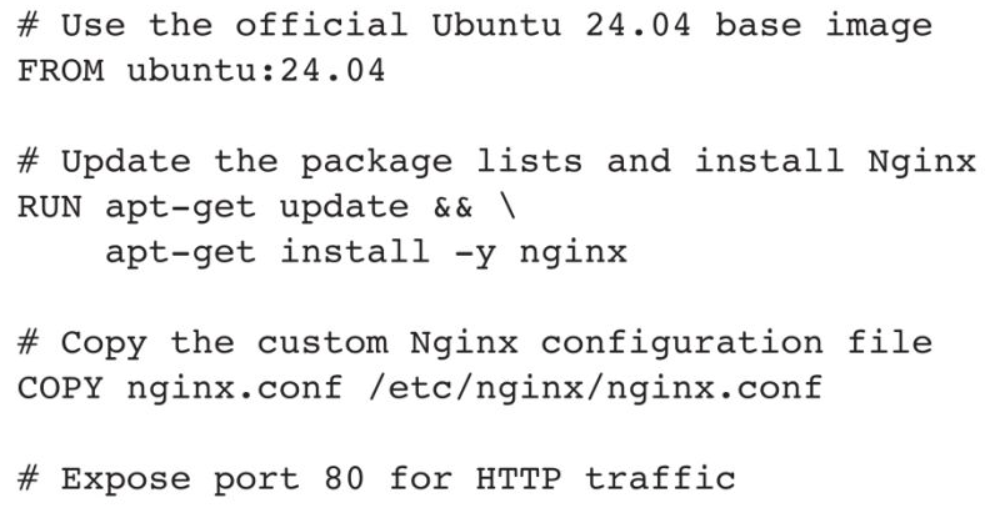
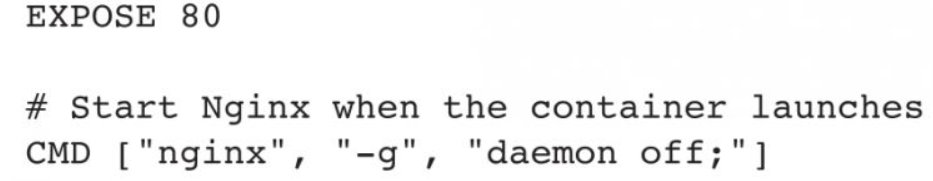
在此示例中，首行通过注释来指定解析器命令，后续通过注释说明镜像的相关信息。
主体部分首先使用FROM指令指明所基于的镜像名称，接下来一般是使用LABEL指令说明维护者信息。后面则是镜像操作指令，例如RUN指令，RUN指令将对镜像执行跟随的命令。每运行一条RUN指令，镜像将添加新的一层，并提交。最后是CMD指令，用于指定运行容器时的操作命令。
下面是基于alpine基础镜像的Nginx官方镜像Dockerfile的示例，通过此示例，读者可以对Dockerfile结构有一个基本的感知：
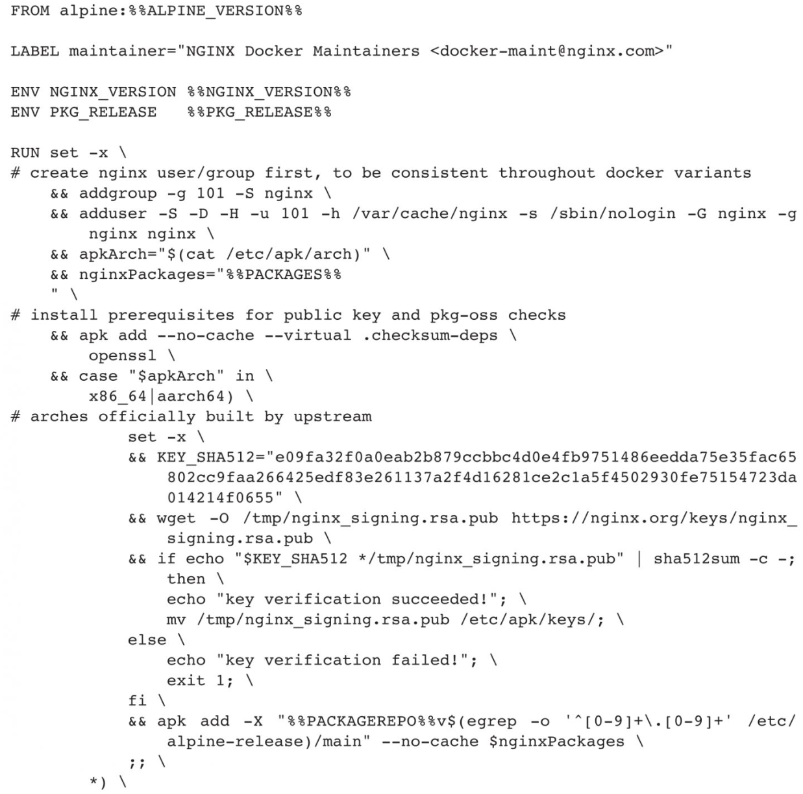
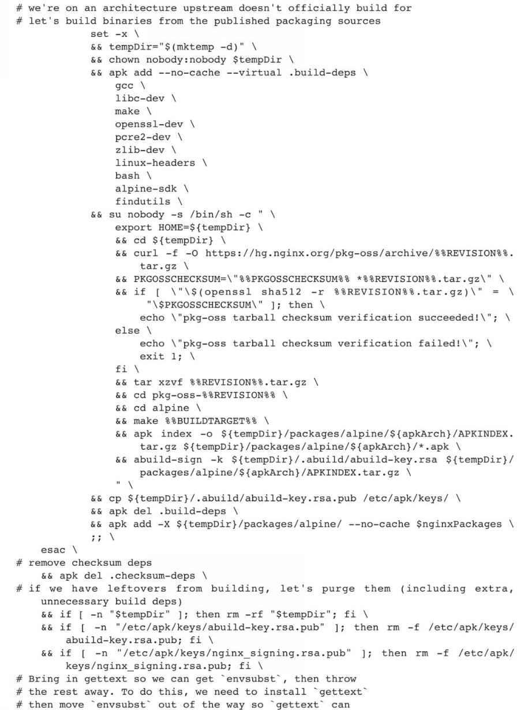
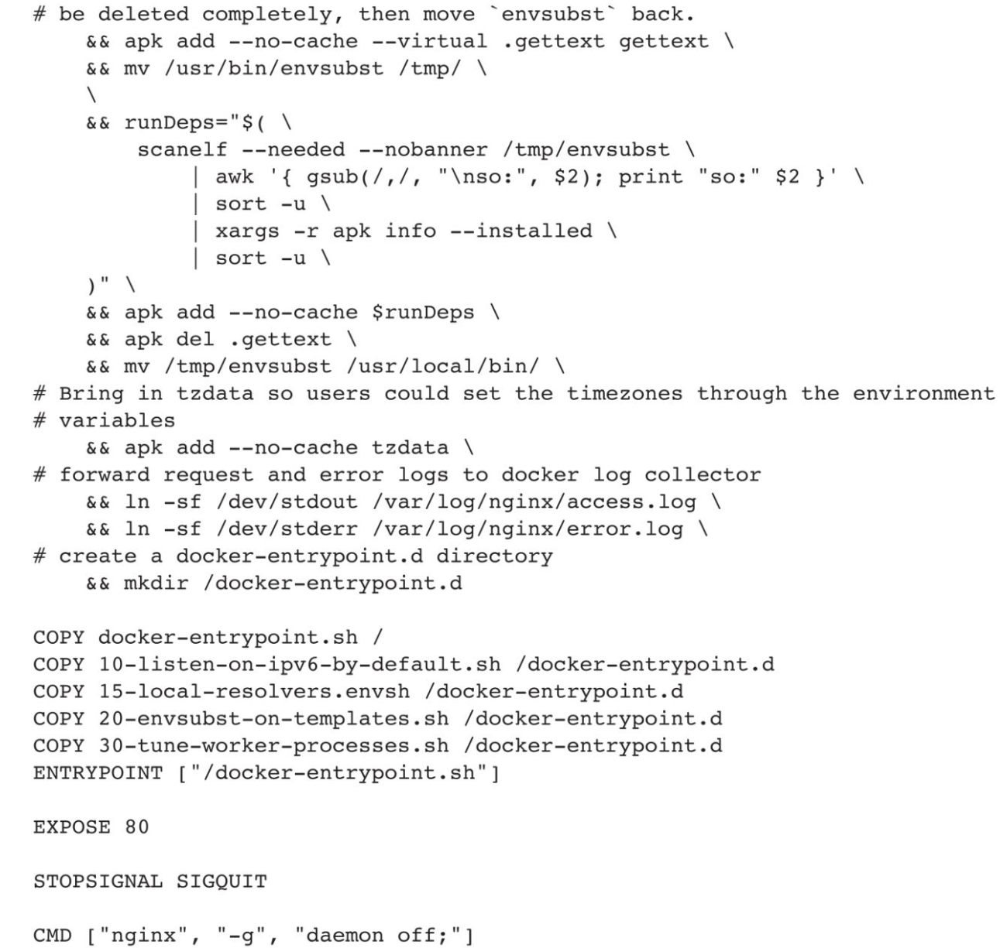
## 8.2 指令说明
Dockerfile是一个纯文本文件，包括创建镜像的所有指令。在执行docker build命令时，Docker引擎会从Dockerfile中读取指令，并逐条执行。
### 8.2.1 基本格式
Dockerfile的一条指令通常由注释和构建器指令参数两部分组成，如下所示：
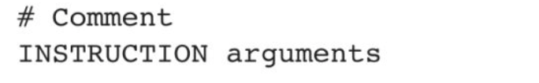
其中构建器指令不区分大小写，但为了更好地与后面的参数加以区分，建议使用大写字母表示构建器指令。
Docker按照Dockerfile中的顺序执行操作指令。Dockerfile从FROM指令开始执行，但是类似注释、解析器指令、全局变量可以写在FROM之前。
Docker将以#开头的行视为注释，除非该行是有效的解析器指令。行中其他任何地方的#标记被视为参数。这允许如下语句：
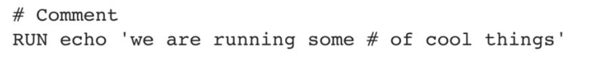
第二行代码中的#被解析成RUN指令的参数。
Docker在执行Dockerfile指令之前会删除注释行，下面两个示例的执行效果是一样的：
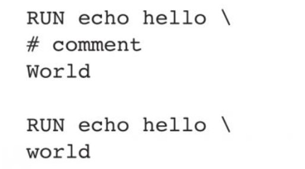
### 8.2.2 解析器指令
解析器指令是一种可选的特性，它们能够改变Dockerfile中后续行的处理方式。这类指令并不会为构建过程添加额外的层，也不会在构建步骤中被显示出来。解析器指令被设计成特殊类型的注释，采用# directive=value的形式表达。值得注意的是，每个指令只能使用一次。
一旦Docker处理了注释、空行或者构建指令，它将不再寻找解析器指令。相反，任何被格式化为解析器指令的内容都会被Docker视为注释，并且Docker不会去尝试验证这些内容是否可能为解析器指令。因此，所有解析器指令都必须被置于Dockerfile的开头部分。
解析器指令对大小写不敏感，但建议统一使用小写形式，并在每个解析器指令之后留出空行。需要特别指出的是，解析器指令中并不支持行延续字符。
基于这些规则，以下示例都是非法的格式。
❑ 行延续而无效：
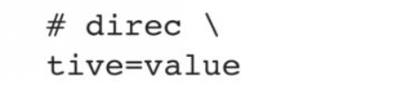
❑ 出现两次而无效：
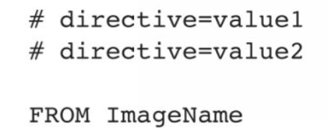
❑ 在构建器指令后出现，被视为注释：
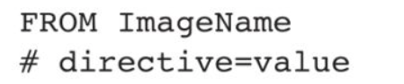
❑ 出现在非解析器指令的注释之后，因此被视为注释：
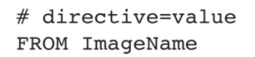
❑ 未知指令被视为注释。第二行同样被视为注释，因为它出现在注释之后：
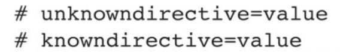
❑ 解析器指令中允许非换行空格。因此，以下五行效果一样：
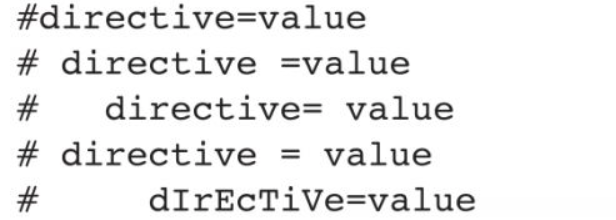
**转义语法**
escape指令用于设置Dockerfile中的转义字符。如果未指定，默认转义字符为\。语法格式如下：
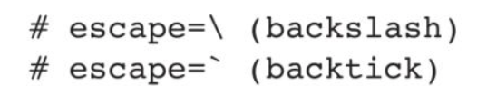
转义字符既用于转义行中的字符，也用于转义换行符。这允许Dockerfile指令跨越多行。请注意，无论escape指令是否包含在Dockerfile中，除了在行尾外，转义指令都不会在RUN指令中执行。
在Windows上设置转义字符特别有用，因为\是目录路径分隔符，容易与Dockerfile默认的转义字符相混淆。解决办法是将转义字符修改为与Windows PowerShell一致。看以下示例：
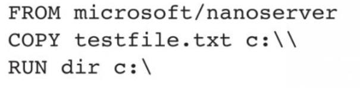
上述示例在Windows上执行失败后将难以排查。第二行末尾的第二个“\”被解释为换行的转义，而不是从第一个“\”转义的目标。同样，假设它实际上被处理为指令，第三行末尾的“\”将被视为行延续。下面这段Dockerfile的运行结果是，第二行和第三行被认为是一个单一的指令：
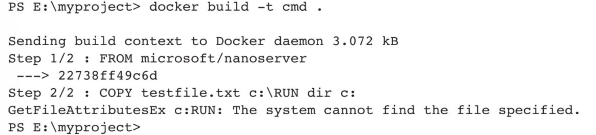
一种解决方案是使用“/”作为COPY指令和dir的目标。然而，这种语法理解起来非常困难，因为它不是Windows的原生路径格式，而且由于并非所有命令都支持“/”作为路径分隔符，也容易出现错误。
通过添加escape指令，将转义字符修改为与PowerShell一致的，以下Dockerfile在Windows上对文件路径使用原生平台语义时就会成功：
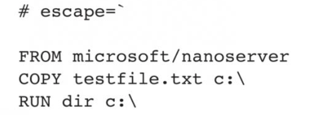
结果如下：
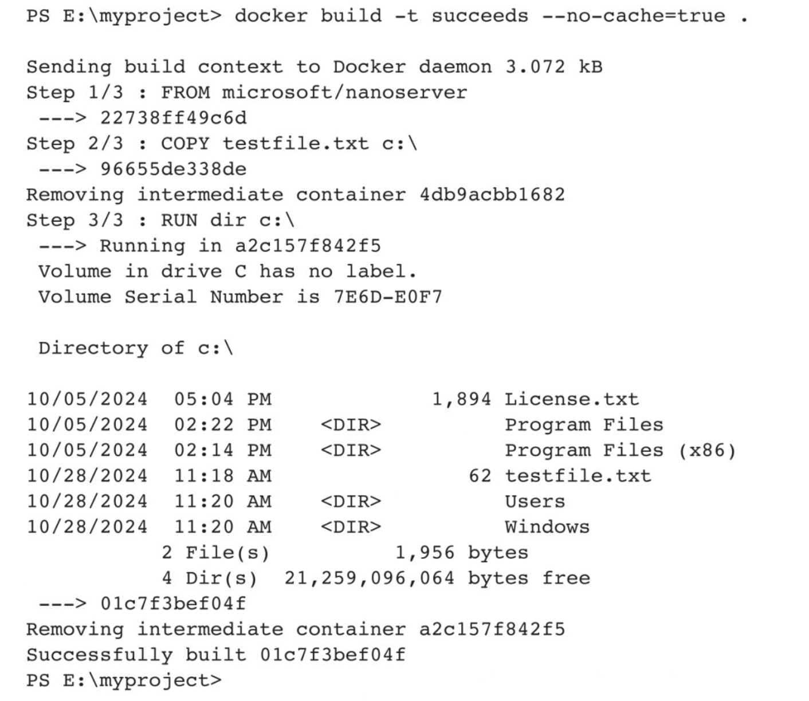
### 8.2.3 环境变量替换
环境变量（用ENV语句声明）也可以在某些指令中用作由Dockerfile解释的变量，在Dockerfile中用
\$variable_name或\${variable_name}标注。
\${variable_name}语法还支持以下标准bash修饰符：
❑ \${variable:-word}指示如果设置了variable，则word将是该值；如果未设置variable，则word将是它的默认值。
❑ \${variable:+word}表示如果设置了variable，则word将是该值，否则word将是空字符串。
word可以是任何字符串，包括额外的环境变量。
通过在变量之前添加一个“\”进行转义，例如，\$foo和\${foo}将分别转换为字面的$foo和${foo}：
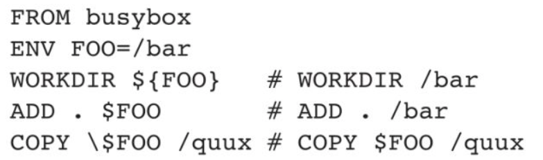
Dockerfile中的以下指令支持环境变量：ADD、COPY、ENV、EXPOSE、FROM、LABEL、STOPSIGNAL、USER、VOLUME、WORKDIR和ONBUILD（和上述命令结合使用时）​。
### 8.2.4 .dockerignore文件
Docker CLI在向Docker守护进程发送构建上下文之前，会首先在上下文的根目录中寻找一个名为.dockerignore的文件。若该文件存在，CLI则会对上下文进行修改，从而排除那些与.dockerignore文件中的模式相匹配的文件和目录。这个过程有助于避免无意间将体积过大或包含敏感信息的文件和目录发送给Docker守护进程，或者通过ADD或COPY指令将这些文件添加到Docker镜像中。
.dockerignore文件中的模式被Docker CLI解析为类似于UNIX Shell中的换行分隔符模式。在进行模式匹配时，上下文的根目录既被视为工作目录，也被视为根目录。例如，模式/foo/bar和foo/bar都将从foo目录中排除名为bar的文件或目录。
在.dockerignore文件中，以“#”符号开头的行会被视为注释，因此在解析过程中将会被忽略。以下是一个.dockerignore文件示例：
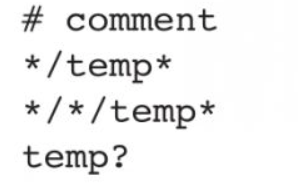
此文件中各规则导致的构建行为如表8-1所示。

表8-1　.dockerignore文件中各规则导致的构建行为
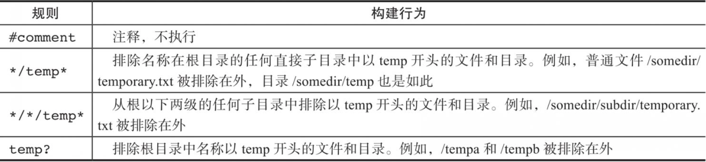
匹配逻辑使用Go的filepath.Match规则完成。预处理步骤使用Go的filepath.Clean规则删除前导和尾随空格，并消除.和..元素，预处理后空白的行被忽略。
除了Go的filepath.Match规则外，Docker还支持匹配任意数量的目录的特殊通配符字符串＊＊。例如，＊＊/＊.go将排除所有目录中以.go结尾的所有文件。
以！开头的行可用于排除例外情况。以下是使用此机制的.dockerignore文件示例：
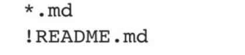
上面的代码表示除README.md外，所有md文件都被排除。
再来看第二个示例：
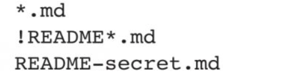!
上面的代码表示README-secret.md被排除，它覆盖了第二行的例外逻辑。
现在分析第三个示例：
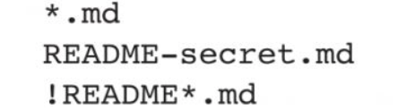
README-secret.md还是被排除，因为第三行的逻辑覆盖了第二行的逻辑。
可以使用.dockerignore文件来排除Dockerfile和.dockerignore文件。这些文件仍然被发送到守护进程，因为需要用它们来完成构建工作，但最终不会将它们复制到镜像中。
如果希望指定在上下文中包含某些文件，而不是排除这些文件，则可以将指定作为第一个模式，然后使用一个或多个例外模式。
### 8.2.5 FROM
FROM指令的一般格式为：
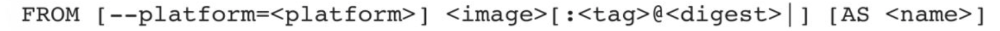
FROM指令初始化一个新的构建阶段，并为后续指令设置基础镜像。因此，有效的Dockerfile须以FROM指令开头。ARG是Dockerfile中唯一可以放到FROM之前的指令。
FROM可以在单个Dockerfile中多次出现，以创建多个镜像，或使用一个构建阶段作为另一个构建阶段的依赖项。只需在每个新的FROM指令之前，记下提交输出的最后一个镜像ID。每个FROM指令都会清除之前指令创建的任何状态。

可以使用AS name为每个构建阶段指定一个单独的名字，并使用COPY--from=<name>来引用。

如果FROM引用多平台镜像，则可选的--platform标志可用于指定镜像的平台。例如，Linux/AMD64、Linux/ARM64或Windows/AMD64。默认情况下，使用构建请求的目标平台作为值。全局构建参数可设置此标志的值，例如，自动平台ARG允许将构建目标强制设为本机构建平台(--platform=$BUILDPLATFORM)，并使用它对阶段内的目标平台进行交叉编译。

**ARG和FROM互动**
FROM会读取ARG中设置的值：
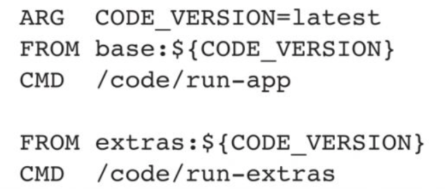
ARG在FROM之前，所以默认情况下，在FROM后面的构建器指令不能被识别，想要使用ARG，需要在使用前执行不带参数的ARG+变量名指令（例如，如下代码中的ARG VERSION）​：
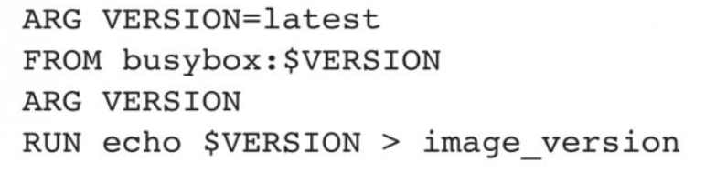
### 8.2.6 RUN
RUN指令将在当前镜像顶部的新层中执行命令并提交结果，生成已提交镜像将用于Dockerfile中的下一步。RUN指令有两种格式：
❑ RUN command为Shell模式，类似Linux中的/bin/sh-c或者Windows中的cmd/S/C。
❑ RUN["executable","param1","param2"]为执行模式。
分层RUN指令和生成提交是Docker的核心理念，使用类似Git中的提交机制，可以从镜像历史记录中的任何点创建容器，就像源代码控制一样。
在Shell模式中，可以使用\（反斜杠）将单个RUN指令进行换行处理。例如：