# 第六章 DOcker数据管理
在生产环境中使用Docker时，往往需要对数据进行持久化处理，或者需要在多个容器之间进行数据共享，这将涉及容器的数据管理操作。
容器中的数据管理主要有两种方式。
❑ 数据卷(data volume)：将容器内的数据直接映射到宿主机环境。
❑ 数据卷容器(data volume container)：借助特定容器来维护数据卷。
本章首先讲解如何在容器内创建数据卷，并将宿主机的目录或文件挂载到容器内的数据卷中。然后，将介绍如何通过数据卷容器在容器与宿主机之间、不同容器之间实现数据共享，以及如何进行数据备份与恢复。
## 6.1 数据卷
数据卷是一个专门为容器设计的特殊目录，它将主机操作系统的目录直接映射到容器中，类似于Linux系统中的挂载(mount)操作。
数据卷具有许多实用功能：
❑ 容器之间可以共享和重用数据卷，使得在容器间传输数据更加高效便捷。
❑ 无论是在容器内部还是在本地操作，对数据卷中数据的更改都会立即生效。
❑ 更新数据卷不会对镜像产生影响，实现了应用与数据的解耦。
❑ 只要还有容器在使用数据卷，它就会一直存在，可以在不需要时安全卸载。
**1.数据卷**
Docker提供了volume子命令来管理数据卷，使用如下命令可以快速在本地创建一个数据卷：
```shell
docker volume create -d local test
test
```
此时，查看/var/lib/docker/volumes路径，会发现所创建的数据卷位置：
```shell
ls -l /var/lib/doker/volumes
drwxr-xr-x 3 root root 4096 May 22 06:02 test
```
除了create子命令外，docker volume命令还支持inspect（查看详细信息）​、ls（列出已有数据卷）​、prune（清理无用数据卷）​、rm（删除数据卷）等操作，读者可以自行实践。
**2.绑定型数据卷**
除了使用volume子命令来管理数据卷外，还可以在创建容器时将本地任意路径挂载到容器内作为数据卷。以这种形式创建的数据卷称为绑定型数据卷。
在使用docker[container]run命令时，可以通过--mount选项来使用数据卷。
--mount选项支持三种类型的数据卷，如图6-1所示。
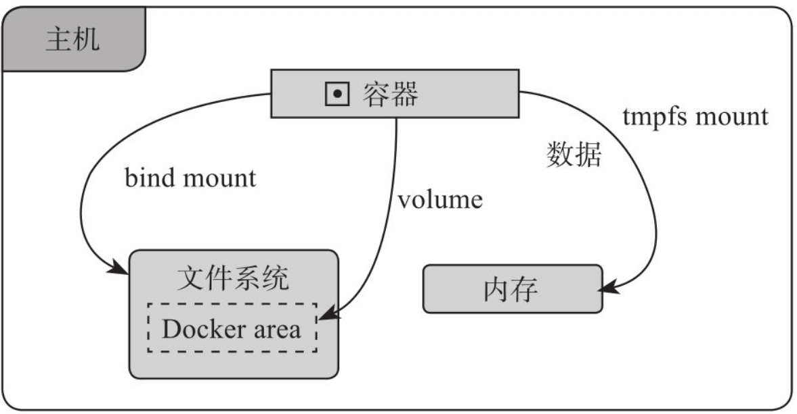
图6-1　不同类型的数据卷
❑ volume：普通数据卷，映射到主机的/var/lib/docker/volumes路径下。
❑ bind：绑定型数据卷，映射到主机指定路径下。
❑ tmpfs：临时数据卷，只存在于主机内存中。
下面使用training/webapp镜像创建一个Web容器，并创建一个数据卷挂载到容器的/opt/webapp目录：
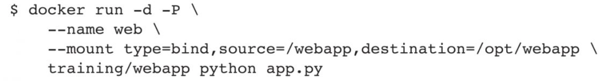
上述命令等同于使用旧的-v标记，将本地路径映射在容器内，创建一个数据卷：
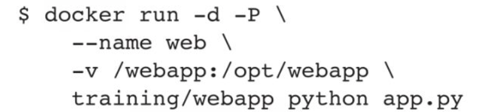
该功能在应用测试时非常便捷，例如，用户可以将一些程序或数据放置到本地目录中进行实时更新，然后在容器内部执行和使用。
此外，本地目录的路径必须为绝对路径，而容器内的路径可以是相对路径。如果目录不存在，那么Docker将自动创建。
Docker挂载数据卷的默认权限为读写(rw)，用户也可通过ro参数将其指定为只读权限，如下所示：
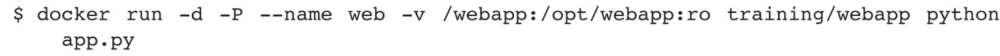
添加了：ro之后，在容器内就无法对所挂载数据卷内的数据进行修改了。
如果将一个文件直接挂载到容器内，并使用文件编辑工具（如vi或sed--in-place）进行编辑，则可能会导致文件inode发生变化，产生错误信息。因此，建议将文件所在目录挂载到容器内部，这样可以避免出现相关问题。
## 6.2 数据卷容器
如果用户需要在多个容器之间共享一些持续更新的数据，推荐的方式是使用数据卷容器。
数据卷容器也是一个容器，但是它的目的是专门提供数据卷给其他容器挂载。
首先，创建一个数据卷容器dbdata，并在其中创建一个数据卷挂载到/dbdata：
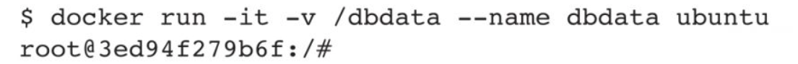
查看/dbdata目录：
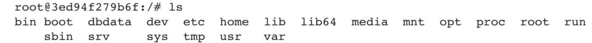
然后，可以在其他容器中使用--volumes-from来挂载dbdata容器中的数据卷，例如创建db1和db2两个容器，并从dbdata容器挂载数据卷：

此时，容器db1和db2都将同一个数据卷挂载到相同的/dbdata目录。三个容器中任何一方在该目录下的写入，其他容器都可以看到。
例如，在dbdata容器中创建一个test文件：
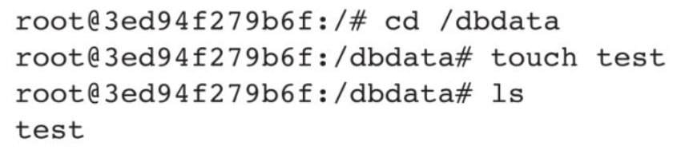
在db1容器内查看它：
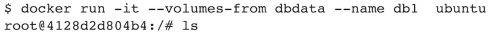
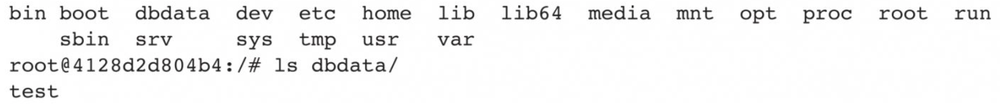
可以多次使用--volumes-from参数来从多个容器挂载多个数据卷，还可以从其他已经挂载了容器卷的容器来挂载数据卷：


> [!NOTE] 注意
>使用--volumes-from参数所挂载数据卷的容器自身并不需要保持在运行状态。

如果删除了挂载的容器（包括dbdata、db1和db2）​，那么数据卷并不会被自动删除。
如果要删除一个数据卷，则可以在删除最后一个挂载它的容器时显式地使用dockerrm-v命令来指定同时删除关联的数据卷。
通过使用数据卷容器，用户能够在不同容器之间轻松地升级和转移数据卷。这让用户在部署和管理数据存储时更加自由，同时降低了数据丢失的风险。
## 6.3 利用数据卷容器迁移数据
可以利用数据卷容器对其中的数据卷进行备份、恢复，以实现数据的迁移。
**1.备份**
使用下面的命令来备份dbdata数据卷容器内的数据卷：
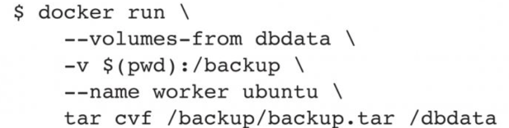
这个命令有点复杂，我们具体分析一下。
首先利用ubuntu镜像创建了一个容器worker。
使用--volumes-from dbdata参数让worker容器挂载dbdata容器的数据卷（即 dbdata数据卷）​。
使用-v $(pwd):/backup参数挂载本地的当前目录到worker容器的/backup目录。
worker容器启动后，使用tar cvf/backup/backup.tar/dbdata命令将/dbdata下的内容备份为容器内的/backup/backup.tar，即宿主机当前目录下的backup.tar。
**2.恢复**
如果要将数据恢复到一个容器，可以按照下面的方式操作。首先创建一个带有数据卷的容器dbdata2，命令如下：
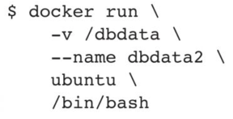
然后创建另一个新的容器，挂载dbdata2的数据卷，并使用untar工具解压备份文件到所挂载的容器卷中，命令如下：
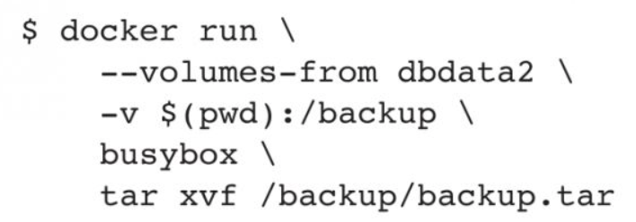
## 6.4 本章小结
数据被誉为最宝贵的资源。Docker在其设计中充分考虑到了这一点，通过数据卷功能为数据管理提供了便捷的操作支持。
本章详细介绍了如何利用数据卷和数据卷容器实现容器内数据的共享、备份和恢复等操作。借助这些机制，即便容器在运行过程中遇到故障，用户也无须担心数据丢失，只需迅速重新创建容器即可。
在生产环境中，建议在使用数据卷或数据卷容器的同时，定期备份主机上的本地数据，或采用支持容错的存储系统，如RAID或分布式文件系统（包括Ceph、GPFS、HDFS等）​。
此外，若有时不希望将数据存储在宿主机或容器内，还可以考虑使用tmpfs类型的数据卷。这种数据卷中的数据仅存储在内存里，容器退出后会自动删除。