# 第十一章 Web服务与应用
在当前的互联网领域，Web服务与应用是最热门的技术。
在本章中，笔者将着重探讨如何运用Docker来运行各类常见的Web服务器，例如Apache、Nginx、Tomcat、Jetty等，同时也会介绍一些广泛应用的程序，如LAMP、CMS等。在这个过程中，笔者会详细解析镜像构建的具体方法以及使用步骤。
阅读完本章之后，读者将能够依据自身的需求，轻松地定制Web服务或应用的镜像。
## 11.1 Apache
作为一款具有高稳定性和商业级别的开源Web服务器软件，Apache在全球范围内的使用排名位居首位。得益于出色的跨平台兼容性和安全性表现，Apache已在众多平台和操作系统上得到广泛应用。作为受到软件基金会支持的项目，Apache自1995年发布以来，依靠完善且高效的开发者社区，始终秉持高标准进行项目的维护和开发。Apache一词来源于美国西南部一个印第安人部落的名称—阿帕奇族。

**1.使用官方镜像**
Docker Hub官方提供的Apache镜像名字为httpd。
编写Dockerfile文件，内容如下：
```shell
FROM httpd:2.4
COPY ./public-html /usr/local/apache2/htdocs/
```
创建项目目录public-html，并在此目录下创建index.html文件：
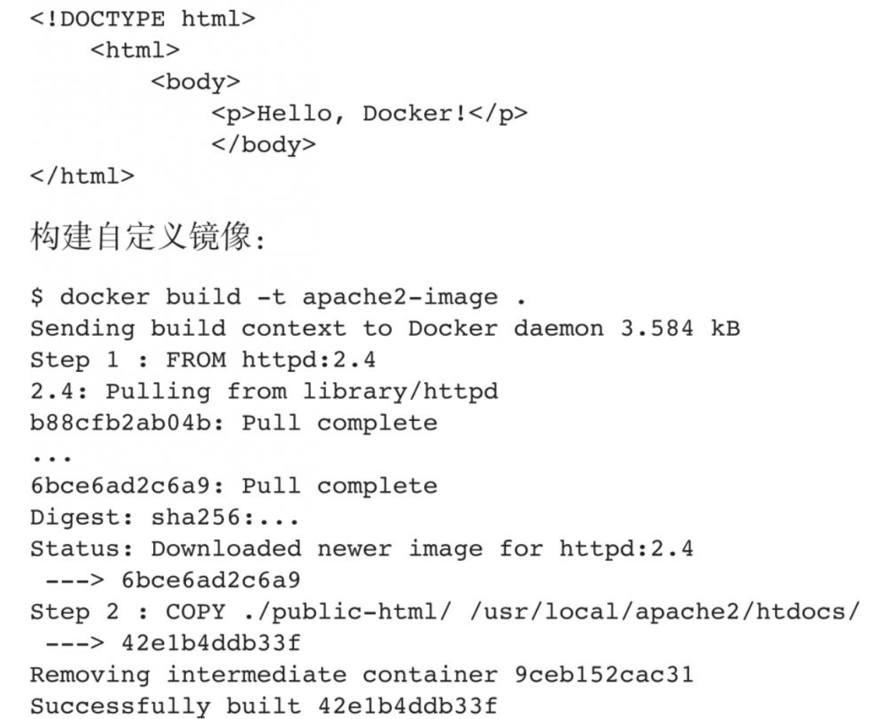
构建完成后，使用docker[container]run指令运行镜像：
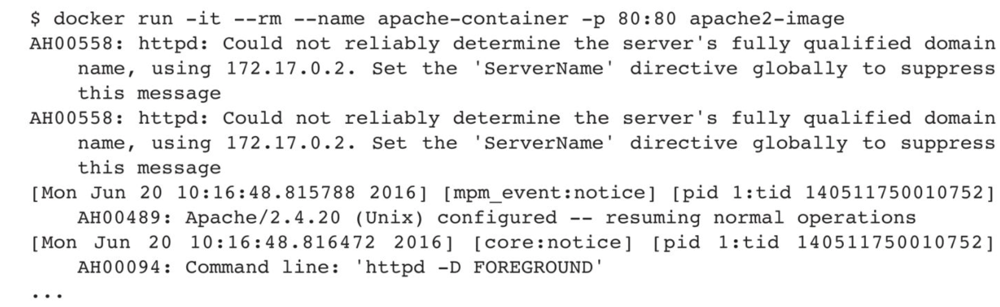
通过浏览器访问本地的80端口，即可打开静态页面，如图11-1所示。
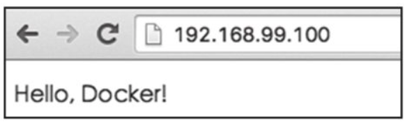
图11-1　打开静态页面

读者也可以不创建自定义镜像，直接通过映射目录的方式运行Apache容器：
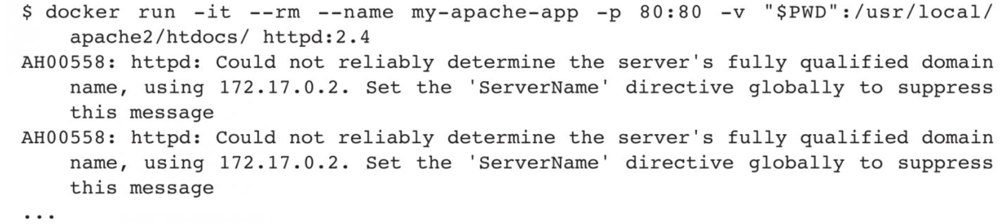
再次打开浏览器，即可看到页面输出。如果读者希望进行参数配置，可以先从镜像中获取当前配置：
```shell
docker run --rm httpd:2.4 cat /usr/local/apache2/conf/httpd.conf > my-httpd.conf
```
然后可以通过COPY命令将自定义配置导入/usr/local/apache2/conf/httpd.conf：
```shell
FROM httpd:2.4
COPY ./my-htpd.conf /usr/local/apache2/conf/httpd.conf
```
如果希望配置SSL/HTTPS，可以使用COPY命令或-v参数将server.crt和server.key加载至/usr/local/apache2/conf/中，然后将/usr/local/acche2/conf/httpd.conf文件中的以下几行取消注释：
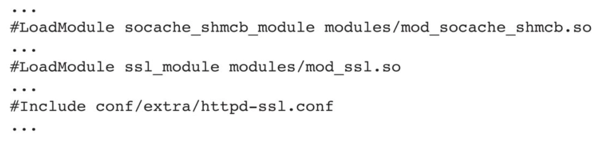
配置文件conf/extra/httpd-ssl.conf会读取上文配置的鉴权文件，同时监听443端口。运行docker run命令的时候，要记得添加-p 443:443端口映射配置。如果使用sed命令行工具，可以参考以下命令：
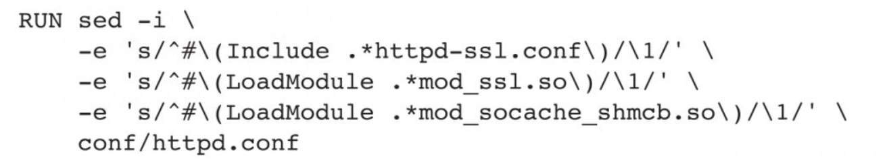
以上配置方式可用于开发环境配置，笔者建议针对生产环境定制conf文件，有关SSL设置的更多信息，请参阅 httpd.apache.org。
**2.使用自定义镜像**
首先，创建一个apache_ubuntu工作目录，在其中创建Dockerfile文件、run.sh文件和sample目录：
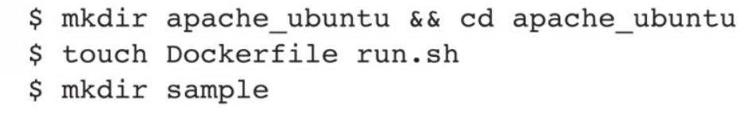
下面是Dockerfile的内容和各个部分的说明：
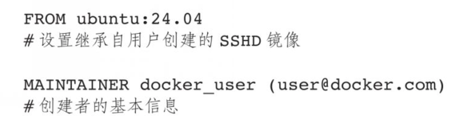
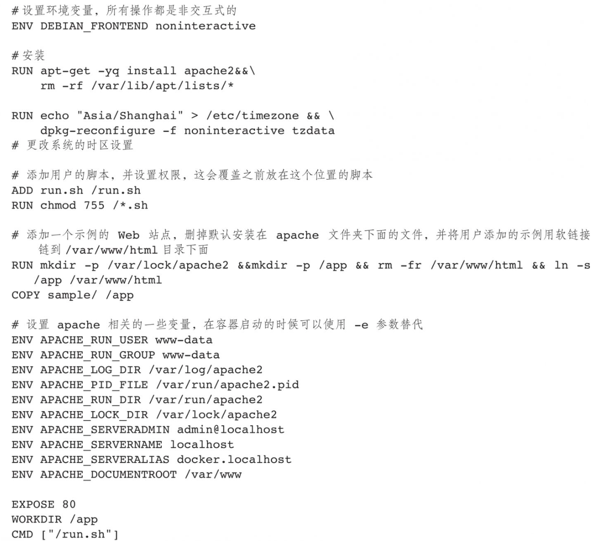
此sample站点的内容为输出Hello Docker!。下面用户在sample目录下创建index.html文件，内容为：
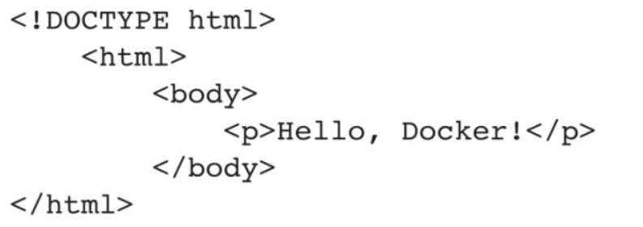
run.sh脚本内容也很简单，只是启动apache服务：
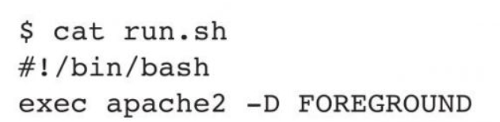
此时，apache_ubuntu目录下面的文件结构为：

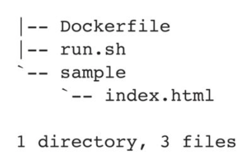
下面开始创建apache:ubuntu镜像。使用docker build命令创建apache:ubuntu镜像，注意命令最后的“.”​：
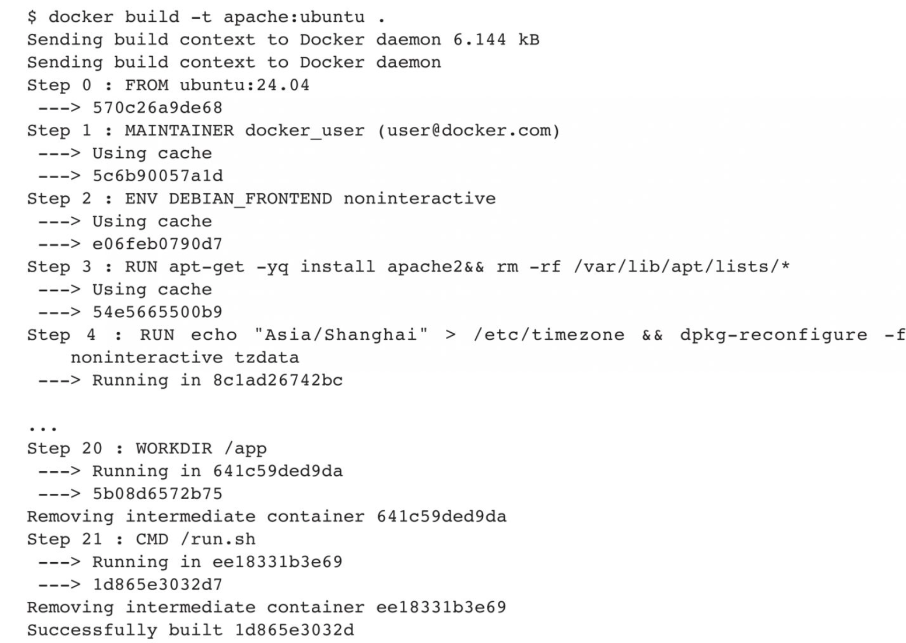
此时镜像已经创建成功了。用户可以使用docker images命令查看本地新增的apache:ubuntu镜像：
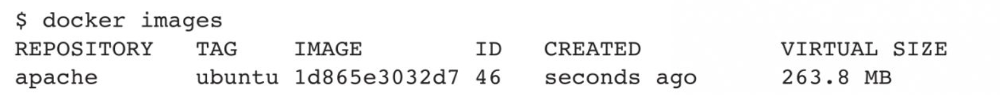
接下来，使用docker run命令测试镜像。用户可以使用-P参数映射需要开放的端口（22和80端口）​：
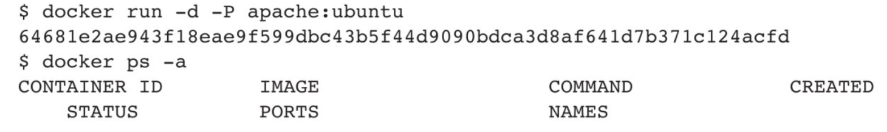

在本地主机上用curl抓取网页来验证刚才创建的sample站点：
```sheel
curl 127.0.0.1:49172
Hello Docker!
```
也可以在其他设备上通过访问宿主机ip:49172来访问sample站点。
用户可以通过映射本地目录的方式指定容器内Apache服务响应的内容，例如映射本地主机上当前目录下的www目录到容器内的/var/www目录：
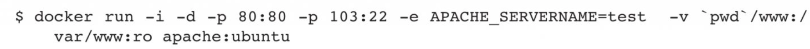
在当前目录内创建www目录，并放上自定义的页面index.html，内容为：
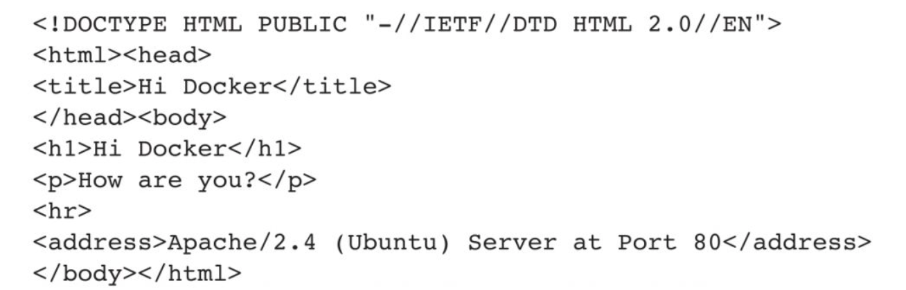
在本地主机上可访问测试容器提供的Web服务，查看获取内容为新配置的index.html页面信息。
**3.相关资料**
❑ Apache官网：https://httpd.apache.org/ 。
❑ Apache官方镜像：https://hub.docker.com/_/httpd 。
❑ Apache官方仓库：https://github.com/apache/httpd 。
## 11.2 Nginx
Nginx是一款功能强大的开源反向代理服务器，能够支持HTTP、HTTPS、SMTP、POP3、IMAP等各种协议。除此之外，Nginx也可以充当负载均衡器、HTTP缓存或Web服务器。从诞生之初，Nginx就专注于优化高并发和高性能的应用环境。遵循类BSD开源协议，它能在Linux、BSD、Mac、Solaris、AIX等类UNIX系统上运行，并且也有专门为Windows系统移植的版本。

Nginx的特性如下：
❑ 热部署：通过管理进程与工作进程的分离设计，支持热部署。在无须中断服务的情况下，可以升级版本，更新配置文件，或者更换日志文件等。
❑ 高并发连接：Nginx能够毫不费力地支持超过100000的并发连接，理论上支持的并发连接数量上限取决于机器内存的大小。
❑ 低内存消耗：通常情况下，10000个非活跃的HTTP Keep-Alive连接在Nginx中仅消耗2.5MB的内存，这也是Nginx能够支持高并发连接的重要基础。
❑ 响应迅速：在正常情况下，Nginx可以为单次请求提供更快的响应。即使在流量高峰期，Nginx也能比其他Web服务器更快地响应请求。
❑ 高可靠性：Nginx是一款高可靠性的Web服务器，许多网站都在使用Nginx，这足以证明其出色的可靠性。
**1.使用官方镜像**
用户可以使用docker run命令直接运行官方Nginx镜像：
```shell
docker run -d -p 80:80 --name webserver nginx
```
可以使用docker ps命令查看当前运行的容器：
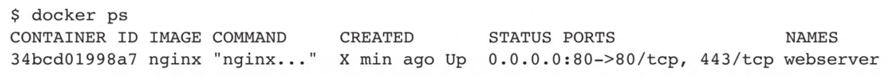
目前Nginx容器已经在0.0.0.0:80启动，并映射了80端口。打开浏览器访问此地址，即可看到Nginx输出的页面，如图11-2所示。
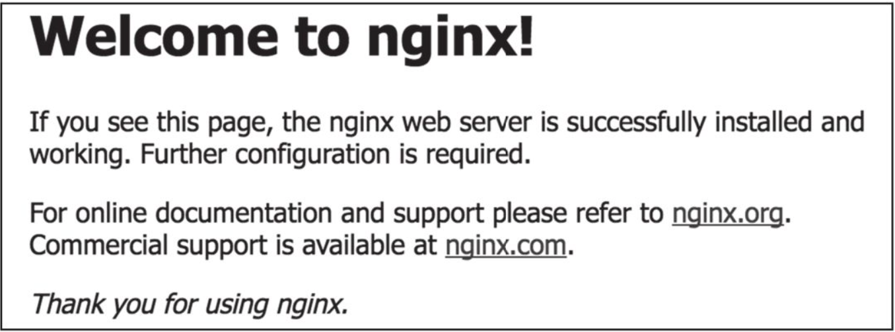
图11-2　Nginx输出的页面

也可以使用curl命令进行测试，如curl 127.0.0.1:80，命令行将会返回以下信息：
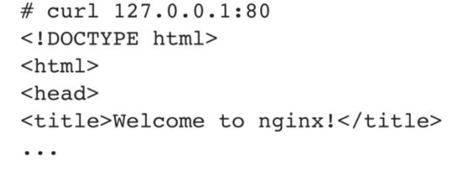
Nginx 1.9.8版本后的镜像支持debug模式，镜像包含nginx-debug，可以支持更丰富的log信息：
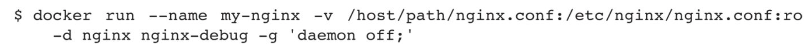
相应的docker-compose.yml配置如下：
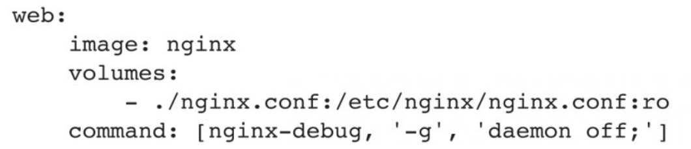
**2.自定义Web页面**
首先，新建index.html文件，内容如下：
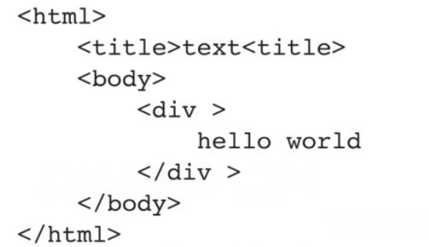
然后使用docker run命令运行，并将index.html文件挂载至容器中，即可看到显示自定义的页面：
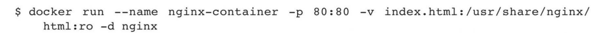
另外，读者也可以使用Dockerfile来构建新镜像。Dockerfile内容如下：
```shell
FROM nginx
COPY ./index.html /usr/share/nginx/html
```
开始构建镜像my-nginx：
```shell
docker build -t my-nginx .
```
构建成功后执行docker[container]run命令：
```shell
docker run --name nginx-container -d my-nginx
```
**3.使用自定义Dockerfile**
代码如下：
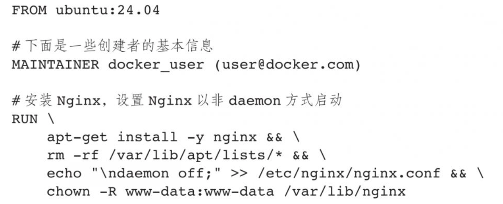
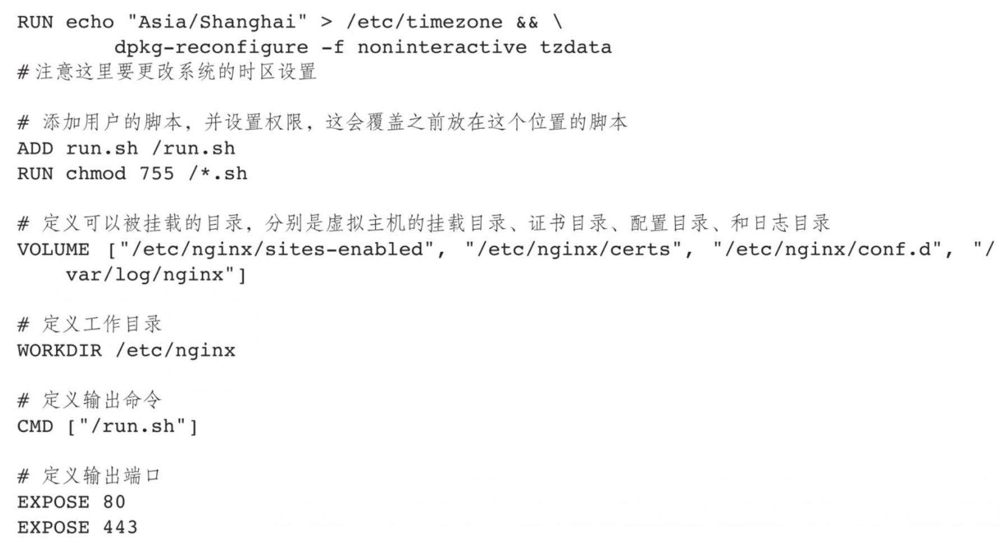
**4.查看run.sh脚本文件内容**
代码如下：
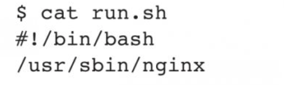
**5.创建镜像**
使用docker build命令，创建镜像nginx:stable：
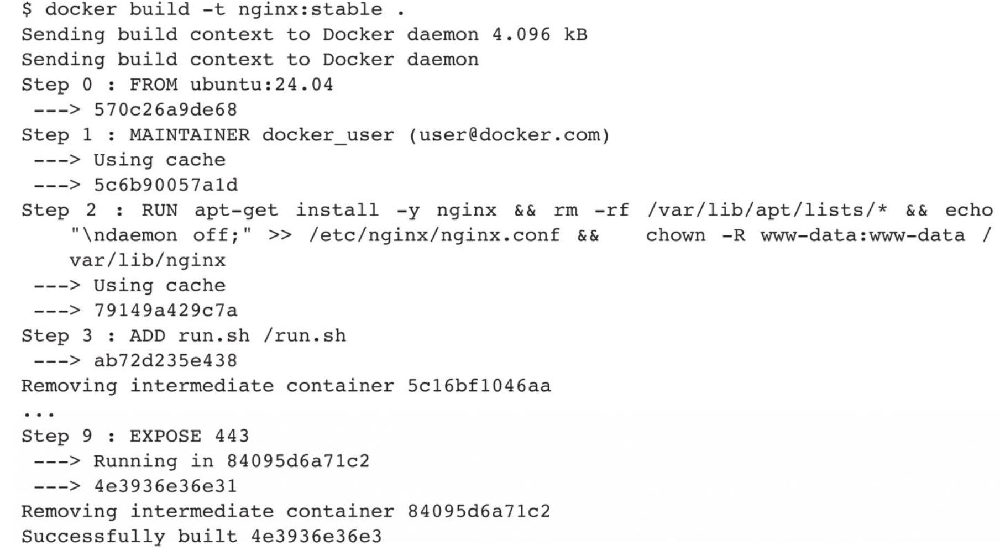
**6.测试**
启动容器，查看到内部的80端口被映射到本地的49193端口：
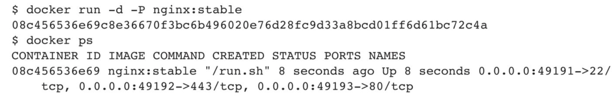
访问本地的49193端口：
```shell
curl 127.0.0.1:49193
```
如果可以再次看到Nginx的欢迎页面，说明Nginx已经正常启动了。
**7.参数优化**
为了能充分发挥Nginx的性能，用户可对系统内核参数做一些调整。下面是一份常见的适合运行Nginx服务器的内核优化参数：
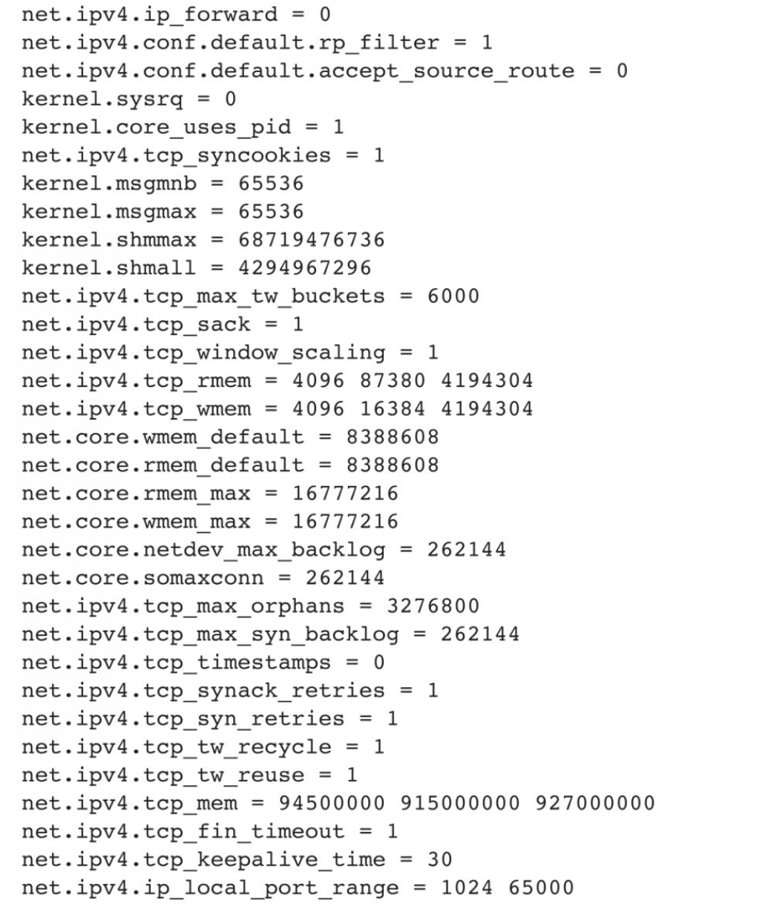
**8.相关资源**
❑ Nginx官网：https://www.nginx.com 。
❑ Nginx官方仓库：https://github.com/nginx/nginx 。
❑ Nginx官方镜像：https://hub.docker.com/_/nginx/ 。
## 11.3 Tomcat
Tomcat是一个由Apache软件基金会旗下Jakarta项目开发的Servlet容器，它严格按照Sun Microsystems的技术规范进行设计，从而实现了对Servlet和JavaServerPage(JSP)的全面支持。不仅如此，Tomcat还提供了一些专属于Web服务器的特性，包括Tomcat管理和控制平台、安全域管理以及Tomcat阀等。由于Tomcat自身内置了一个HTTP服务器，因此它也能够作为一个独立的Web服务器使用。

**1.使用官方镜像**
读者可以使用docker run命令运行官方镜像，并将容器端口8080映射到主机的8888端口：
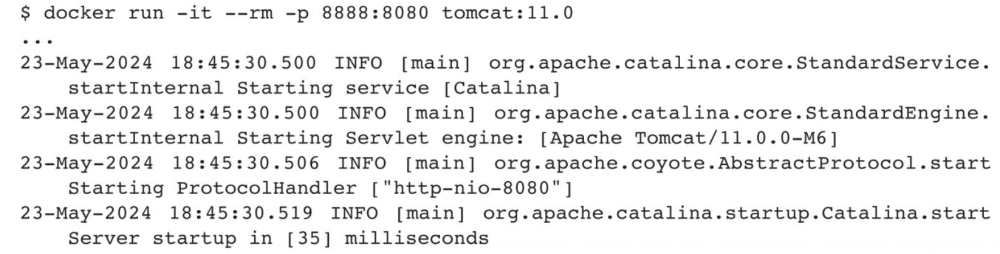
可以通过本地浏览器访问http://localhost:8888或http://host-ip:8888来测试。由于目前没有部署应用，因此浏览器会返回404页面，如图11-3所示。官方镜像的默 认配置如下：
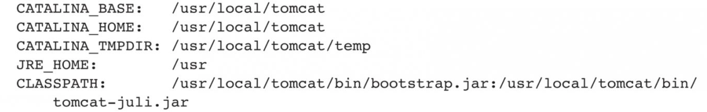
**2.相关资源**
❑ Tomcat官网：http://tomcat.apache.org/ 。
❑ Tomcat官方仓库：https://github.com/apache/tomcat 。
❑ Tomcat官方镜像：https://hub.docker.com/_/tomcat/ 。
❑ Tomcat官方镜像仓库：https://github.com/docker-library/tomcat 。
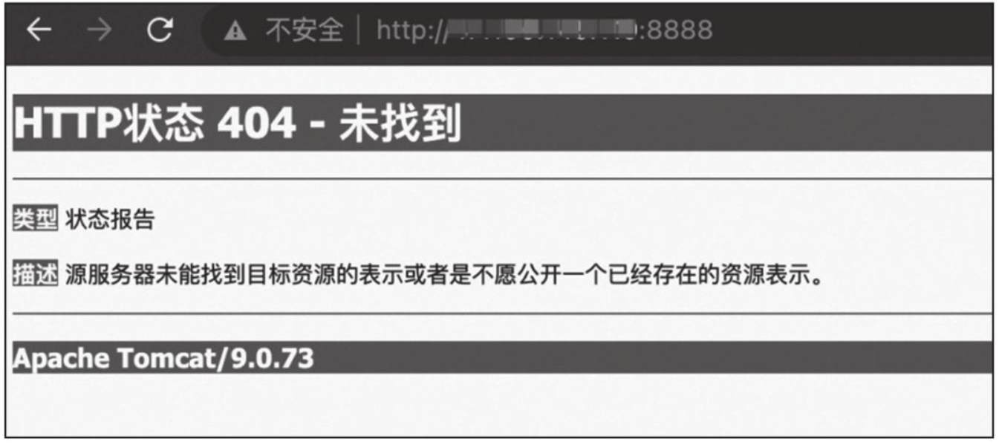
图11-3　404页面

## 11.4 Jetty
Jetty是一个优秀的开源Web服务器和Servlet容器，以其高效、小巧、可嵌入式等优点广受欢迎，它是业界主流Java Web开源运行环境之一，还支持HTTP/2、WebSocket、OSGi、JMX、JNDI、JAAS等协议。Jetty基于Java语言编写，API以JAR包的形式发布。

相对老牌的Tomcat，Jetty的架构更合理，性能更优。尤其在启动速度上，它让Tomcat望尘莫及。Jetty目前在国内外互联网企业中应用广泛。
**1.使用官方镜像**
Docker Hub官方提供了Jetty镜像，读者可以直接通过docker run命令运行：
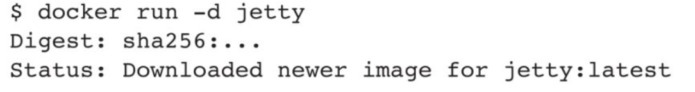
使用docker ps命令查看运行中的Jetty容器：
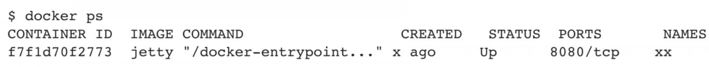
当然，还可以使用-p参数映射运行端口：
```shell
docker run -d -p 80:8080 -p 443:8443 jetty
```
使用宿主机的浏览器访问container-ip:8080，即可获得Jetty运行页面，由于当前未配置具体Java应用，因此页面会提示报错，如图11-4所示。
**2.环境配置**
官方镜像中的默认Jetty环境配置为：
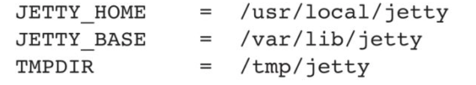
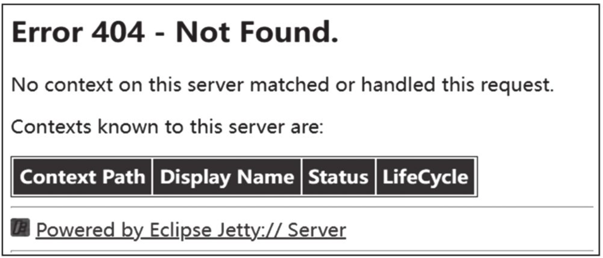
图11-4　页面报错信息

Jetty的服务器配置可以使用-list-config参数：
```shell
docker run -d jetty --list-config
```
读者也可以通过-module传入附加模块的配置：
```shell
docker run -d jetty --module=jmx jetty.threadPool.maxThreads=500
```
如果将Jetty作为基础镜像，可以在Dockerfile中使用RUN指令开启附加模块：
```shell
FROM jetty
RUN java -jar “$JETTY_HOME/start.jar" --add-to-startd=jmx,stats
```
读者还可以通过/var/lib/jetty/start.d/*.ini文件来配置模块，也可以通过删除该文件来停用模块。
**3.相关资源**
❑ Jetty官网：http://www.eclipse.org/jetty/ 。
❑ Jetty官方镜像：https://hub.docker.com/_/jetty/ 。
## 11.5 LAMP
LAMP是一款备受青睐的Web开发工具套装，由以下部分构成：Linux操作系统，Apache网络服务器，MySQL数据库，以及Perl、PHP或Python编程语言。每一种组成工具都是已经证明其稳定性的开源软件，并且被众多网站广泛采用。与Java/J2EE架构相比，LAMP拥有丰富的Web资源，以及轻量、快速开发的优势。相对于微软的.NET架构，LAMP展现出了更为广泛的通用性、跨平台性，以及高性能和较低的成本。因此，LAMP软件套装在多种场景下被大量使用。
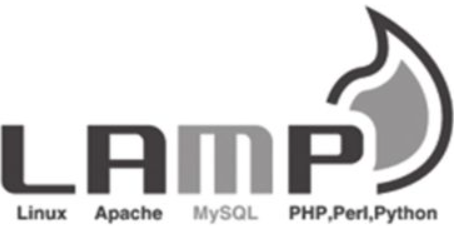
> [!NOTE] 注意
>现在也有人用Nginx替换Apache，称为LNMP或LEMP，是类似的工具套装。

**1.使用官方镜像**
用户可以使用自定义Dockerfile或者Compose方式运行LAMP，同时社区也提供了成熟的linode/lamp和tutum/lamp镜像。
**2.使用linode/lamp镜像**
首先，执行docker[container]run命令，直接运行镜像，并进入容器内部bashshell：

在容器内部shell启动Apache以及MySQL服务：
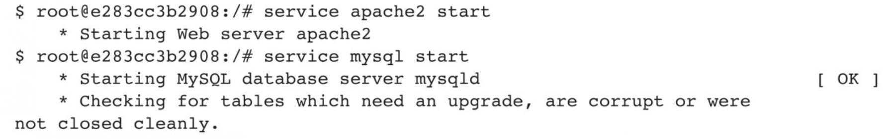
此时镜像中Apache、MySQL服务已经启动，可使用docker ps命令查看运行中的容器：
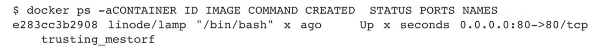
此时通过浏览器访问本地80端口即可看到默认页面，如图11-5所示。
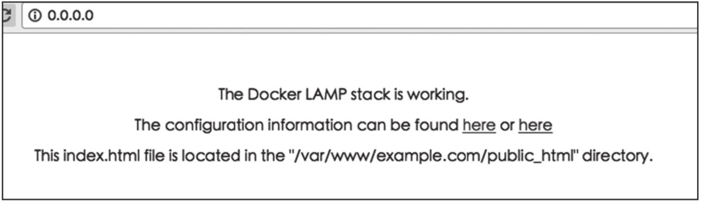
图11-5　默认页面

**3.使用tutum/lamp镜像**
首先，执行docker[container]run命令，直接运行镜像：
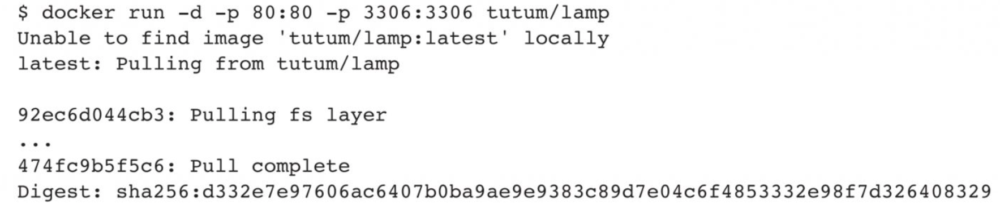
容器启动成功后，打开浏览器，访问demo页面，如图11-6所示。
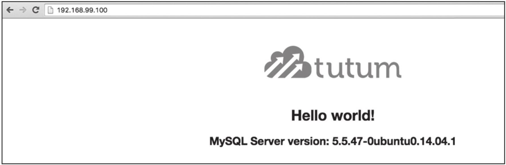
图11-6　访问demo页面

**4.部署自定义PHP应用**
默认的容器启动了一个hello world应用。读者可以基于此镜像，编辑Dockerfile来创建自定义LAMP应用镜像。
在宿主机上创建新的工作目录lamp：
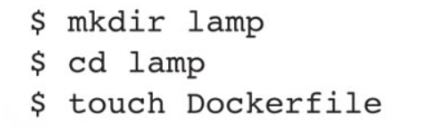
在php目录下创建Dockerfile文件，内容为：
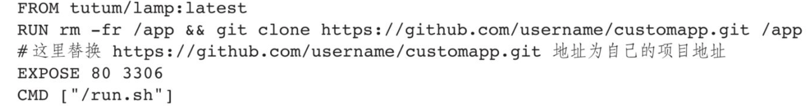
创建镜像，命名为my-lamp-app：
```shell
docker build -t my-lamp-app .
```
利用新创建的镜像启动容器，注意启动时指定-d参数，让容器在后台运行：
```shell
docker run -d -p 8080:80 -p 3306:3306 my-lamp-app
```
在本地主机上使用curl命令测试应用程序是不是已经正常响应。
```shell
curl http://127.0.0.1:8080/
```
**5.相关资料**
❑ tutum LAMP镜像：https://hub.docker.com/r/tutum/lamp/ 。
❑ linode LAMP镜像：https://hub.docker.com/r/linode/lamp/ 。
## 11.6 CMS
内容管理系统(Content Management System，CMS)是一个提供内容编辑服务的平台软件。CMS使用户能够轻松发布、修改和管理各种类型的数字内容，主要包括文本和图像。在接下来的内容中，笔者将以两款流行的CMS软件—WordPress和Ghost为例，详述如何使用它们的Docker镜像。
### 11.6.1 WordPress
WordPress是一款在全球广受欢迎的开源CMS，被广泛应用于博客、企业官网、产品首页等多种内容相关的平台。它采用了GPLv2协议，值得注意的是，它已成为网络上超过43%的网站的首选平台。此外，还有许多类似的项目，如Drupal、Joomla、Typo3等。

WordPress基于PHP和MySQL构建，其架构设计简洁明了。它支持各种主题、插件和功能模块，更引人注目的是，WordPress拥有庞大的用户社区，其在线资源丰富多样。而且，WordPress在各大网络服务商和云平台中得到广泛的支持和应用。
**使用官方镜像**
可以使用docker run命令直接运行官方WordPress镜像：
```shell
docker run --name my-wordpress -p 8089:80 -d wordpress
```
可以使用-link命令配置WordPress连接的MySQL数据库：
```shell
docker run --name my-wordpress --link my-mysql:mysql -d wordpress
```
容器启动成功后，读者可在浏览器中访问http://localhost:8089 或 http://host-ip:8089 来打开WordPress初始化页面，如图11-7所示。
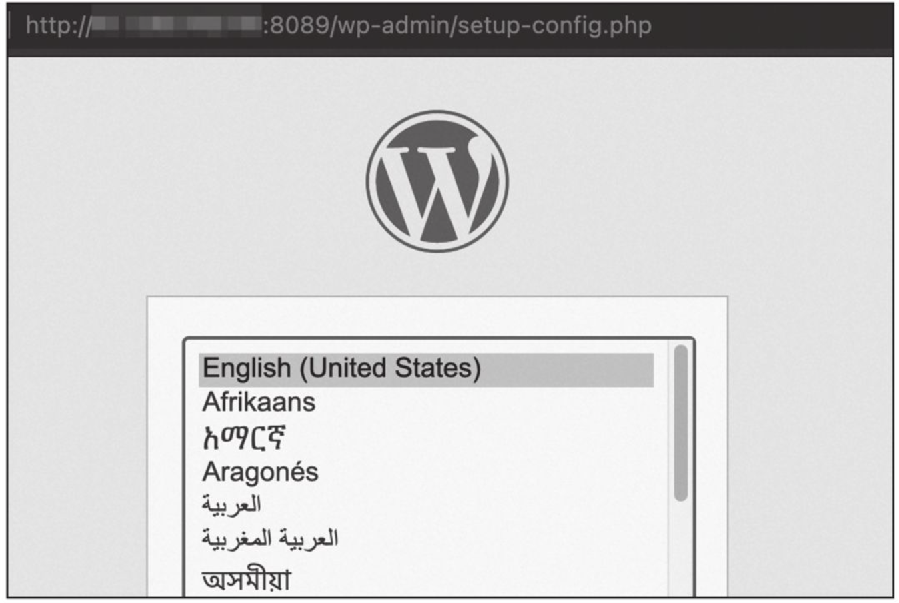
图11-7　WordPress初始化页面

### 11.6.2 Ghost
Ghost是一个广受欢迎的开源博客平台，使用JavaScript编写，以MIT协议发布。它的设计非常简约，使用起来体验优异，非常适合做内容发布，故而受到很多极客或技术工作者的喜爱。

**1.使用官方镜像**
读者可以使用docker run命令直接运行官方Ghost镜像。
```shell
docker run -d --name some-ghost -e NODE_ENV=development -e url=http://localhost:3001 -p 3001:2368 ghost
```
容器启动后，读者可以通过http://localhost:3001 或 http://IP:3001 访问Ghost管理界面，如图11-8所示。初次访问会跳转至http://IP:3001/ghost/#/setup 。这里的IP指容器的公网IP。
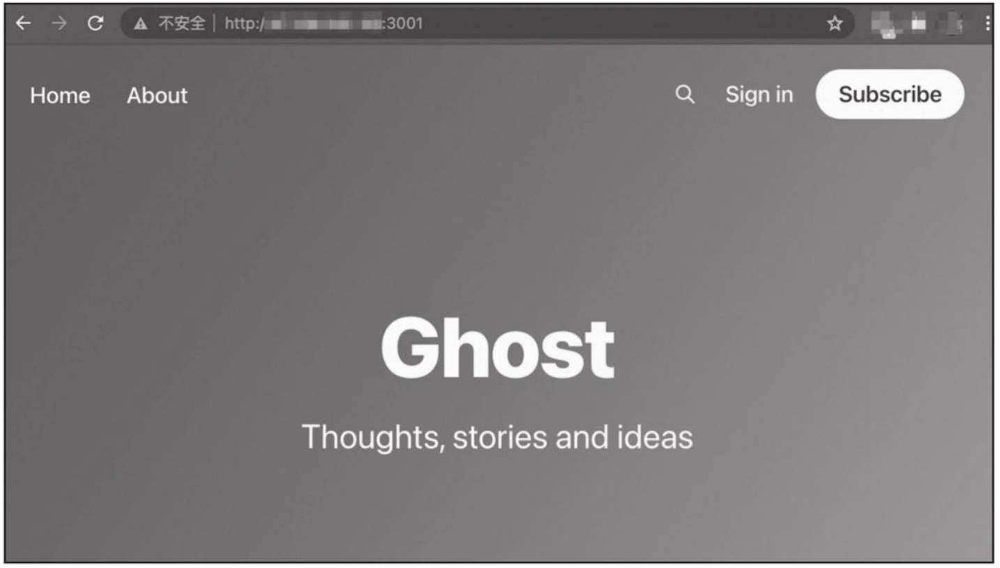
图11-8　Ghost管理界面
此外，读者还可以通过-v命令挂载已有的内容到Ghost容器内，如下所示，这里可以使用Ghost官方提供的基于Alpine的镜像。
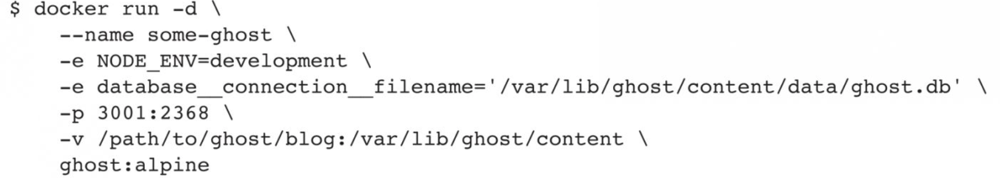
注意，database__connection__filename仅在开发模式下有效，这里指向SQLite数据库文件的位置。如果读者希望在生产环境中使用Ghost，则需要使用外部MySQL服务器，如下面的docker-compose.yml示例所示：
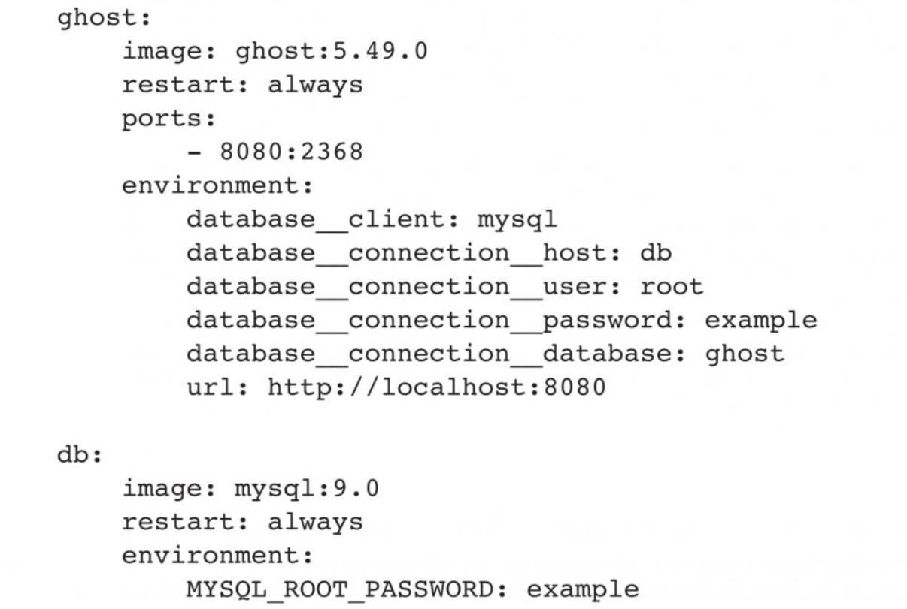
**2.相关资源**
❑ WordPress官网：https://wordpress.org/ 。
❑ WordPress官方镜像：https://hub.docker.com/_/wordpress/ 。
❑ Ghost官网：https://ghost.org/ 。
❑ Ghost官方镜像：https://hub.docker.com/_/ghost/ 。
## 11.7 本章小结
本章介绍了常见的Web服务工具，如Apache、Nginx、Tomcat、Jetty，以及享有盛名的LAMP组合及广泛应用的内容管理框架。通过这些示例，读者将能迅速掌握Web开发的基本要领，同时再度体验到基于容器化的开发和部署模式的强大实力。
笔者认为，包括Web服务在内的中间件领域十分适合引入容器技术，主要原因包括：
❑ 中间件服务器作为除数据库服务器之外的主要计算节点，极易成为性能瓶颈。因此，通常需要大规模部署，而Docker在批量部署方面具有天生的优势。
❑ 中间件服务器的结构通常很清晰。在剥离配置文件、日志、代码目录之后，容器几乎可以维持在零增长状态，从而使容器迁移和批量部署更为便捷。
❑ 中间件服务器能轻松实现集群。通过使用硬件的F5、软件的Nginx等负载均衡工具，中间件服务器集群的实现变得异常简单。
最后，在实践过程中，读者需要特别关注数据的持久化问题。对于程序代码、资源目录、日志、数据库文件等需要实时更新和保存的数据，务必启用数据持久化机制，以防止数据丢失的情况发生。