# 第三部分　进阶技能
经过前两部分的详细讲解和案例实践，相信读者已经熟练掌握了Docker相关的常见操作和应用技巧。
接下来，将重点介绍Docker相关的进阶技能，包括Docker的核心实现技术、私有镜像仓库的创建和管理、Docker安全机制、高级网络配置以及Docker的插件化网络支持工具libnetwork。
第17章将深入探讨Docker的核心实现技术，包括Docker的架构、命名空间、控制组、联合文件系统、虚拟网络等技术话题。理解Docker的底层原理，将有助于读者深入领会Docker的优势和限制，同时优化Docker的使用方式。
第18章将着重讲解如何使用Docker Registry工具来建立和管理私有镜像仓库。私有镜像仓库能够方便地存储和分享个人或团队自己的镜像，这将有利于团队内部共享应用程序，同时提升应用程序的安全性。
第19章从命名空间、控制组、内核能力、服务端、第三方工具等角度来剖析Docker安全机制。本章会讨论Docker容器中可能存在的安全风险，并介绍如何使用安全措施来保护Docker容器中的应用程序。
第20章将详细讲解Docker高级网络配置以及其底层实现原理，介绍Docker的网络架构，包括Docker容器如何与宿主机和其他容器通信，以及如何利用Docker的高级网络配置功能实现各种网络拓扑结构。
最后，第21章将深入讲解Docker的网络插件化支持工具—libnetwork，它能支持更多的网络应用场景。笔者会详细探讨libnetwork的实现原理和使用方式，并讨论libnetwork在实际应用场景中的用途。
# 第十七章 核心技术实现
Docker容器需要操作系统的支持才能运行。本章将以Linux作为容器宿主系统，介绍Docker底层所依赖的核心技术，包括Linux命名空间(Namespace)、控制组(Control Group)、联合文件系统(Union File System)和网络虚拟化支持等。
## 17.1 基本架构
Docker采用标准的客户端/服务器(C/S)架构，包括客户端和服务端两个核心组件（见图17-1）​。两者通过网络协议（包括Socket和RESTful API）进行通信，而Docker服务端则负责管理所有的Docker容器、镜像、网络等资源。客户端和服务端可以运行在同一台机器上，也可以在不同的机器上通过网络进行通信。
此外，Docker还通过Docker镜像仓库来存储和分享Docker镜像。
**1.服务端**
Docker服务端一般在宿主机后台运行，通过dockerd接受来自客户的请求，并通过containerd处理与容器相关的请求，包括创建、运行、删除容器等。
Docker服务端的运行时组件主要包括：
❑ dockerd：Docker守护进程，为客户端提供RESTful API，负责监听Docker API请求并管理Docker对象，如镜像、容器、网络等。dockerd采用模块化的架构，通过专门的Engine模块来分发管理各个来自客户端的任务，可以单独升级。
❑ containerd：containerd是dockerd的子进程，用于管理容器生命周期，包括容器的创建、运行、停止、删除等操作。containerd还支持多个容器运行时，如runC和gVisor等，提供gRPC接口响应来自dockerd的请求，对下管理runC镜像和容器环境，可以单独升级。
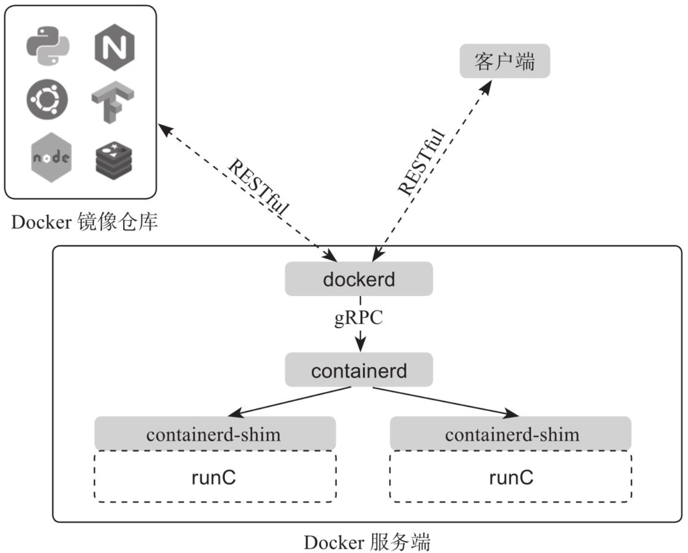
图17-1　Docker基本架构

❑ runC：Docker推出的轻量级容器运行时，实现了开放容器倡议标准，负责启动容器进程并提供一个隔离的环境，同时也负责管理容器的生命周期。
❑ containerd-shim：containerd的子进程，用于在容器和主机之间建立一个进程通信(IPC)的桥梁，负责将Docker容器的标准输入、输出和错误(stdin、stdout、stderr)与容器内运行的进程的对应文件描述符连接起来，以便Docker客户端可以与容器进行交互。
❑ CNI(Container Network Interface)：一个轻量级的网络插件规范，用于连接容器和主机网络。Docker使用CNI插件来创建和管理容器网络。
dockerd默认监听本地的unix:///var/run/docker.sock套接字，只允许本地的root用户或Docker用户组成员访问。可以通过-H选项来修改监听方式。
例如，让dockerd监听本地的TCP连接1234端口，代码如下：
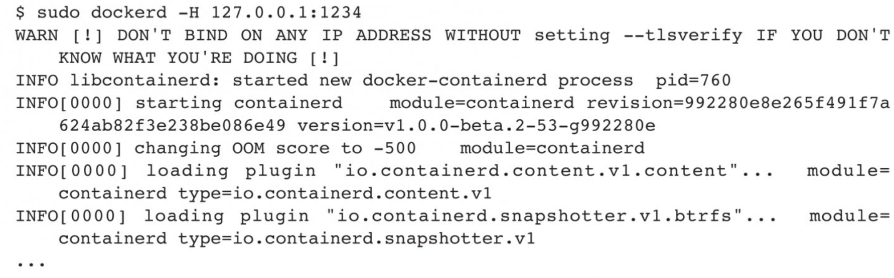
此外，Docker还支持通过TLS认证的方式来验证访问。
**2.客户端**
Docker客户端提供了一系列可执行命令，用户可以使用这些命令与Docker服务端进行交互。
这些可执行命令即为客户端程序。不同于Docker服务端的持续运行方式，客户端发送命令后需要等待服务端返回结果。一旦收到返回结果，客户端就会立即执行结束并退出。如果用户需要执行新的命令，就需要再次调用客户端命令。
默认情况下，客户端通过本地的unix:///var/run/docker.sock套接字向服务端发送命令，但是如果服务端没有监听默认的地址，客户端在执行命令时就需要显式地指定服务端地址。
例如，假设服务端监听本地的TCP连接1234端口tcp://127.0.0.1:1234，只有通过-H参数指定了正确的地址信息，客户端才能够连接到服务端：
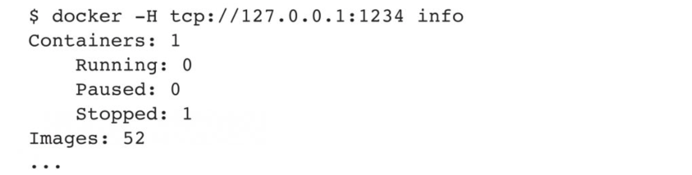
**3.Docker镜像仓库**
镜像是容器技术的基础，Docker使用镜像仓库(Registry)来存储和分发Docker镜像。镜像仓库支持多种不同的存储后端，可以存储镜像文件，并提供RESTful API，接收来自Docker客户端的命令，包括拉取、上传镜像等。
用户可以从镜像仓库中拉取镜像文件，这些文件会被存储在本地供用户使用。同时，用户也可以将自己创建的镜像上传到仓库中，方便其他人使用。使用镜像仓库可以大大简化镜像管理和分发的流程。
目前，镜像仓库已经作为Docker项目的一部分，开源在GitHub(docker/distribution)，目前支持API 2.0。
## 17.2 命名空间
命名空间是Linux内核的一个强大特性，为容器虚拟化的实现带来了极大便利。利用这一特性，每个容器都可以拥有自己单独的命名空间，运行在其中的应用程序就像处于独立的操作系统环境中一样。命名空间机制保证了容器之间相互隔离，避免了彼此的影响。
在操作系统中，包括内核、文件系统、网络、进程号(Process ID，PID)、用户号(User ID，UID)、进程间通信(Inter Process Communication，IPC)等，所有资源都是应用进程直接共享的。为了实现虚拟化，除了要实现对内存、CPU、网络I/O、硬盘I/O、存储空间等的限制外，还要实现文件系统、网络、PID、UID、IPC等的相互隔离。前者相对容易实现，后者则需要宿主机系统的深入支持。
随着Linux系统对于命名空间功能的逐步完善，现在已经可以实现这些需求，让进程在彼此隔离的命名空间中运行。虽然这些进程仍然共用同一个内核和某些运行时环境（例如，一些系统命令和系统库）​，但它们互不可见，并认为自己是独占系统的。
在Docker容器每次启动时，都会调用func setNamespaces(daemon＊Daemon,s＊specs.Spec,c＊container.Container) error方法来完成对各个命名空间的配置。
**1.进程命名空间**
Linux的进程命名空间是一个强大的特性，用于对进程号进行管理。同一个进程(task_struct)在不同的命名空间中所对应的进程号是不同的。每个进程命名空间都有自己的进程号管理方法，这种管理方式能够保证不同命名空间中的进程号不会相互干扰。进程命名空间是一个父子关系的结构，子空间中的进程可以被父空间看到。
例如，查看Docker服务主进程(dockerd)的进程号是3393，它作为父进程启动了docker-containerd进程，进程号为3398：
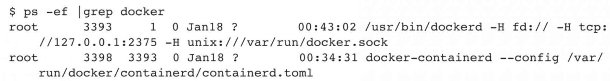
新建一个Ubuntu容器，执行sleep命令。此时，docker-containerd进程作为父进程，会为每个容器启动一个docker-containerd-shim进程，作为该容器内所有进程的根进程：
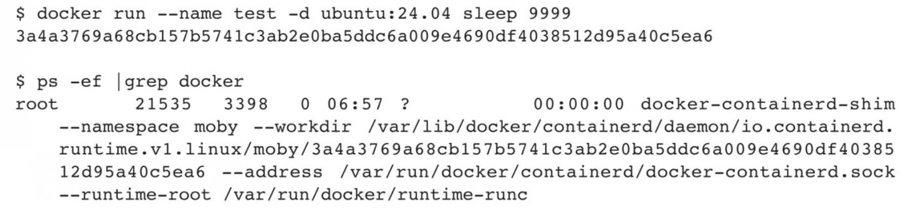
从宿主机上查看新建容器的进程的父进程，正是docker-containerd-shim进程：

而在容器内的进程空间中，则把docker-containerd-shim进程作为0号根进程（类似宿主系统中0号根进程idle）​，while进程的进程号则变为1（类似宿主系统中1号初始化进程/sbin/init）​。容器内只能看到docker-containerd-shim进程往下的子进程空间，而无法获知宿主机上的进程信息：

通过pstree命令，可以直接看到完整的进程树结构：
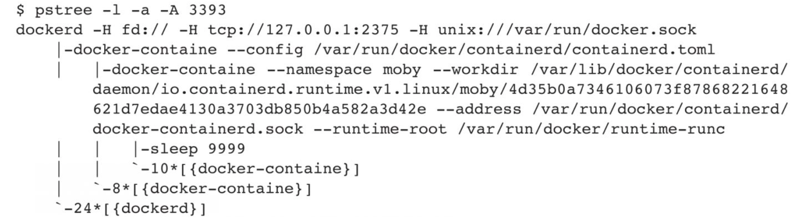
一般地，当启动多个容器时，宿主机和容器内进程空间的关系如图17-2所示。
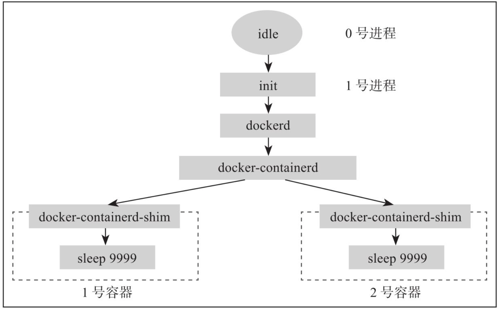
图17-2　宿主机与容器内进程空间的关系

**2.IPC命名空间**
容器中的进程交互通常使用Linux常见的进程间通信(InterprocessCommunication，IPC)方式，包括信号量、消息队列和共享内存等。
PID命名空间和IPC命名空间可以组合起来使用。在同一个IPC命名空间内的进程可以相互看见，可以进行进程间通信；在不同命名空间的进程无法交互。这种隔离的机制确保了容器内的进程彼此隔离，从而保障了容器的安全性和稳定性。
**3.网络命名空间**
使用进程命名空间可以使得不同命名空间中的进程号相互隔离，但是网络端口仍然会共享本地系统的端口。
为了解决这个问题，可以使用网络命名空间实现网络隔离。每个网络命名空间为进程提供一个完全独立的网络协议栈的视图，包括网络设备接口、IPv4和IPv6协议栈、IP路由表、防火墙规则、Socket等。这样每个容器的网络就能完全隔离开来，互相不会产生干扰。
Docker采用虚拟网络设备(Virtual Network Device，VND)的方式来实现网络隔离。它将不同命名空间的网络设备连接到一起，从而使得容器之间可以进行网络通信。在默认情况下，Docker在宿主机上创建多个虚拟网桥（如默认的网桥docker0）​，然后容器中的虚拟网卡通过这些网桥进行连接，实现容器之间的通信，如图17-3所示。
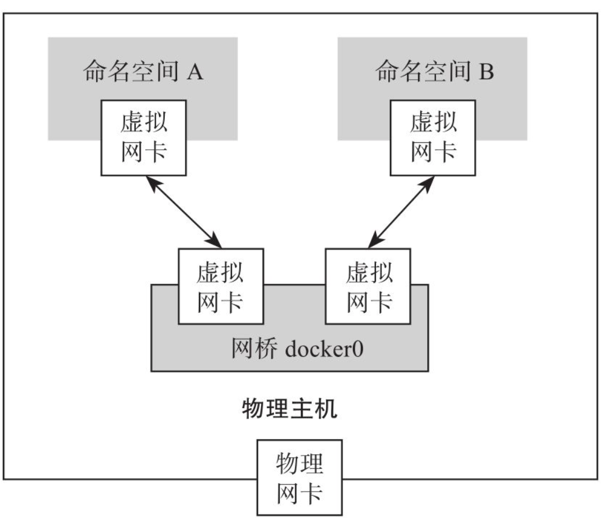
图17-3　Docker将不同命名空间的网络设备连接起来

使用docker network ls命令可以查看到当前系统中的网桥：
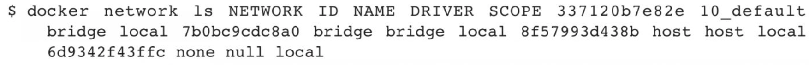
使用brctl工具（需要安装bridge-utils工具包）还可以看到连接到网桥上的虚拟网络接口的信息。每个容器默认分配一个网桥上的虚拟网络接口，并将docker0的IP地址设置为默认的网关，容器发起的网络流量通过宿主机的iptables规则进行转发。
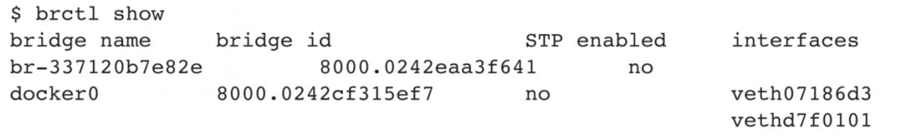
**4.挂载命名空间**
类似于chroot，挂载命名空间可以将一个进程的根文件系统限制到一个特定的目录下。
挂载命名空间允许不同命名空间的进程看到的本地文件位于宿主机中不同路径下，每个命名空间中的进程所看到的文件目录相互隔离。
例如，不同命名空间中的进程都认为自己独占了一个完整的根文件系统(rootfs)，但实际上，不同命名空间中的文件彼此隔离，不会相互影响，同时也无法影响宿主机文件系统中的其他路径。
**5.UTS命名空间**
UTS（UNIX Time-sharing System，UNIX分时系统）是Linux内核中最简单的一个命名空间，主要用于隔离主机名和域名。每个UTS命名空间中的进程都可以拥有独立的主机名和域名，这使得在同一台机器上运行的不同容器看起来像是在不同的主机上运行一样。
如果没有手动指定主机名称，Docker容器的主机名就是返回的容器ID的前6字节前缀，否则为指定的用户名：
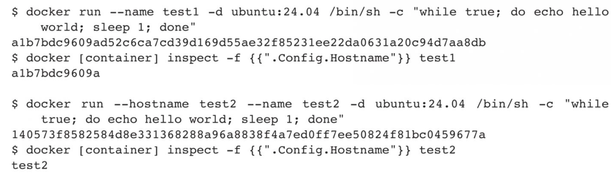
**6.用户命名空间**
每个容器可以有不同的用户和组ID，这意味着可以在容器内使用特定的内部用户ID执行程序，而不是使用本地系统上已存在的用户ID。
虽然每个容器内部都可以拥有最高权限的root账号，但它与宿主机上的root账号不在同一个命名空间内。
通过使用隔离的用户命名空间，可以提高安全性，避免容器内的进程获得额外的权限；同时，使用不同的用户ID也可以进一步控制容器内的权限。
例如，下面的命令在容器内创建了test用户，只有普通权限，无法访问更高权限的资源：
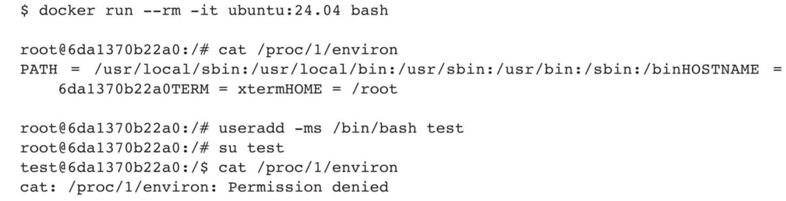
## 17.3 控制组
控制组(CGroups)是Linux内核提供的一种资源管理机制，用于隔离、限制和审计资源。通过对容器资源分配进行控制，可以避免容器之间争夺宿主机系统的资源。控制组提供了一种层级化结构的资源限制机制，允许对容器内的资源使用进行限制，包括内存、CPU、磁盘I/O等。
控制组最初由Google的程序员于2006年提出，并在Linux内核2.6.24版本开始原生支持。它提供了一种统一的接口，从单个进程的资源控制（如nice工具）到系统级虚拟化（如OpenVZ、Linux-VServer和LXC等）​，都可以通过控制组来实现。
具体来看，控制组提供：
❑ 资源限制(Resource Limiting)：限制和分配不同进程组的资源，如CPU、内存、磁盘I/O、网络带宽等。通过控制组，可以确保多个进程组不会因为资源竞争而导致宿主机性能下降或崩溃。
❑ 优先级(Prioritization)：设置不同进程组的优先级，如CPU时间片、I/O调度算法等，以确保关键进程组的执行优先级高于普通进程组。
❑ 资源审计(Accounting)：对不同进程组的资源使用情况进行计费和配额管理，例如，使用cpuacct子系统记录某个进程组使用的CPU时间。
❑ 隔离(Isolation)：将进程组隔离在独立的容器中，从而提供进程级别的隔离和安全性。这样可以确保容器内的进程不会影响其他进程，同时可以减少攻击面和提高容器安全性。
❑ 控制(Control)：执行挂起、恢复和重启动等操作。
Docker容器每次启动时，都通过调用func setCapabilities(s＊specs.Spec,c＊container.Container) error方法来完成对各个命名空间的配置。
安装Docker后，用户可以在/sys/fs/cgroup/memory/docker/目录下看到对Docker组应用的各种限制项，包括全局限制和对于子目录中某个容器的单独限制：
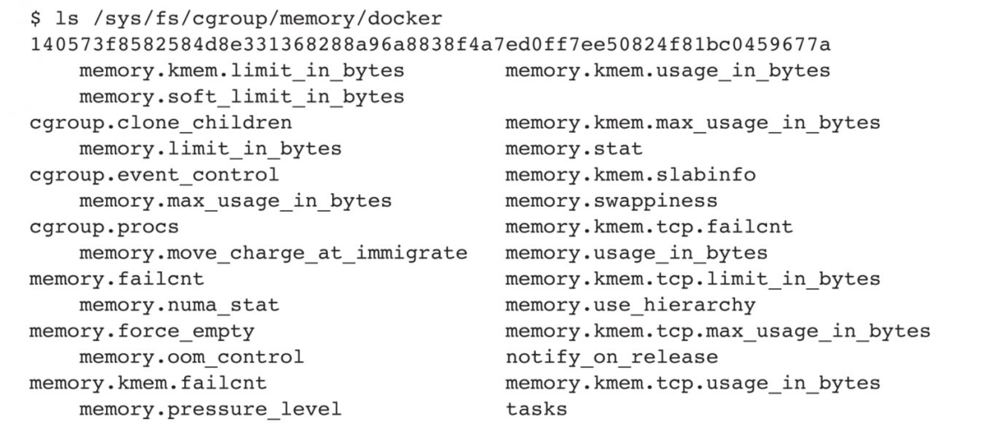
用户可以通过修改这些文件值来控制组，限制Docker应用资源。例如，通过下面的命令可限制Docker组中的所有进程使用的物理内存总量不超过100MB：
```shell
sudo echo 104857600 >/sys/ff/cgroup/memory/docker/memory.limit_in_bytes
```
进入对应的容器文件夹，可以看到对应容器的限制和目前的使用状态：
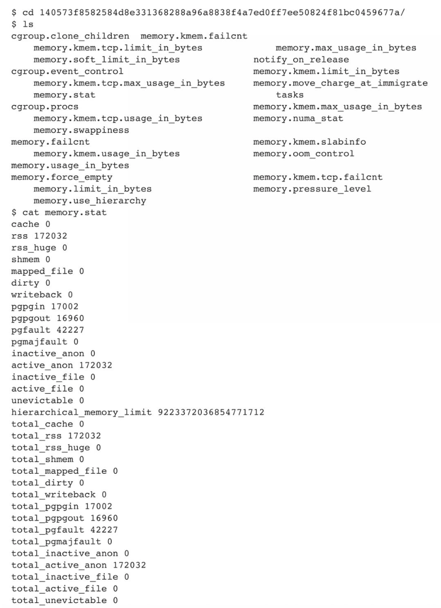
同时，可以在创建或启动容器时为每个容器指定资源的限制，例如，使用-c|--cpu-shares[=0]参数调整容器使用CPU的权重；使用-m|--memory[=MEMORY]参数调整容器最多使用的内存的大小。
## 17.4 联合文件系统
联合文件系统(UnionFS)是一种轻量级的高性能分层文件系统，支持将多个不同文件系统的目录挂载到同一个虚拟文件系统下，同时应用程序看到的是挂载的最终结果。这种技术可以让用户创建一个可读写的文件系统层以及一些只读的文件系统层，以保证镜像的不变性。这也是实现Docker镜像的基础。
Docker镜像是通过分层的方式来实现继承和变更的。例如，用户可以基于一个基础镜像来创建各种不同的应用镜像，这些镜像共享同一个基础镜像层，从而提高了存储效率。当用户对一个Docker镜像进行修改时，会创建一个新的层，而不是替换整个原镜像或重新构建。这使得Docker的镜像管理变得十分轻量级和快速，同时也方便用户进行版本管理和分发。
**1.Docker存储原理**
Docker目前通过插件化方式支持多种联合文件系统后端。联合文件系统支持为每个成员目录（类似Git的分支）设定只读(readonly)、读写(readwrite)或写出(whiteoutable)权限，同时联合文件系统支持分层，对只读分支可以在逻辑上进行增量修改，不影响只读部分的数据。
可以通过如下命令获得当前的存储后端类型：
```shell
docker info --format '{{.Driver}}'
overlay2
```
Docker镜像自身就是由多个文件层组成的，每一层都有基于内容的唯一的编号（层ID）​。可以通过docker history命令查看一个镜像由哪些层组成。例如，查看ubuntu:24.04镜像由6层组成，每层执行了不同的命令：
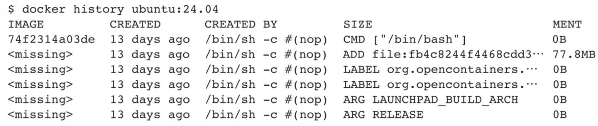
Docker镜像层的数据都是不可修改的、只读的。当Docker使用镜像启动容器时，会在镜像文件系统的顶部再挂载一个新的可读写层，用于容器中内容的更新。如果需要修改较深层次的对象，则必须先将其复制到最上层的可读写层。由于这种复制操作可能涉及大量数据，因此可能会导致较差的I/O性能。因此，对于需要进行大量I/O操作的应用程序，建议使用数据卷(Volume)的方式来挂载容器中需要修改的数据，而不是直接修改镜像中的数据。另外，对于频繁启停Docker容器的场景，文件系统的I/O性能也将十分关键。
**2.Docker存储结构**
所有的镜像和容器都存储在Docker指定的存储目录下，以Linux系统为例，默认路径是/var/lib/docker。
在这个目录下，存储着Docker镜像和与容器运行相关的文件和目录。如果是默认的overlay2存储，可能包括buildkit、containers、image、network、overlay2、plugins、runtimes、swarm、tmp、trust、volumes等。
各个子目录的作用如表17-1所示。

表17-1　overlay2存储的子目录及作用
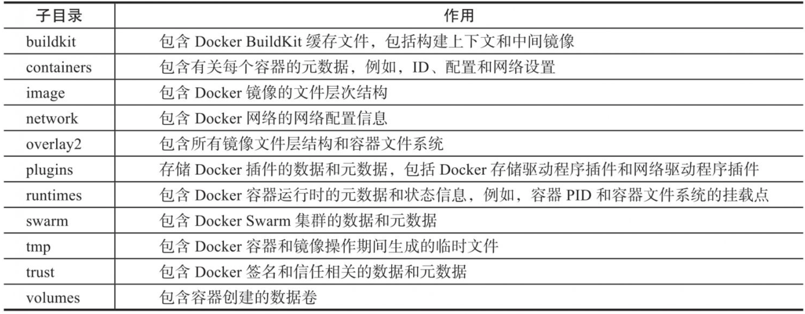
可以使用docker inspect<镜像>命令查看镜像的层次结构和存储路径。例如：
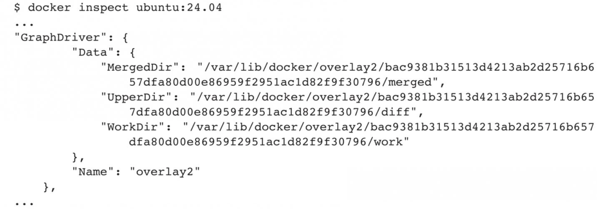
**3.选择正确的文件系统**
Docker支持的联合文件系统种类包括AUFS、btrfs、Device Mapper、overlay、overlay2、vfs、zfs等。
多种文件系统目前的支持情况总结如下：
❑ AUFS：最早支持的文件系统，对Debian/Ubuntu支持好，较为成熟，但不再推荐。
❑ btrfs和zfs：支持快照和克隆等高级功能的联合文件系统，还支持RAID、压缩和其他高级数据管理功能，需要进行专门配置。
❑ Device Mapper：Red Hat公司和Docker团队一起开发用于支持RHEL的文件系统，性能略慢，较为成熟。
❑ overlay：类似于AUFS的层次化文件系统，性能更好，但不再推荐。
❑ overlay2：Docker 1.12后推出，原生支持128层，效率比OverlayFS高，要求内核大于4.0。
❑ vfs：基于普通文件系统（EXT、NFS等）的中间层抽象，性能差，比较占用空间，不再推荐。
目前，overlay2文件系统是Docker主要推荐使用的文件系统，比较稳定，性能也更好。
## 17.5 Linux网络虚拟化
Docker的本地网络实现利用了Linux上的网络命名空间和虚拟网络设备，尤其是veth对(veth pair)。了解这两个概念的基础知识有助于理解Docker网络的实现过程。
**1.基本原理**
要实现网络通信，计算机需要至少一个网络接口（物理接口或虚拟接口）与外界相连，并能够收发数据包。此外，如果要实现不同子网之间的通信，则需要额外的路由机制。
在Docker中，网络接口默认是虚拟接口。虚拟接口的最大优势在于转发效率极高。这是因为Linux使用内核级别的数据复制来实现虚拟接口之间的数据转发。具体来说，发送接口的发送缓存中的数据包将被直接复制到接收接口的接收缓存中，而不需要通过外部物理网络设备进行交换。
对本地系统和容器内系统而言，虚拟接口与一个普通的以太网卡没有什么区别，只是速度更快。
Docker容器网络充分利用了Linux的虚拟网络技术。它在本地主机和容器内分别创建一个虚拟接口veth，并将它们连接起来（这样的一对接口称为veth对）​，如图17-4所示。
**2.网络创建过程**
通常，Docker在创建容器时会执行以下操作：
1)分配网络命名空间：为每个容器分配一个独立的网络命名空间，该命名空间将提供容器所需的网络接口、IP地址、路由表和其他网络配置信息。
2)创建一对虚拟接口：在本地主机和新容器的命名空间中分别创建一对虚拟接口。
3)连接虚拟接口：将本地主机一端的虚拟接口连接到默认的docker0网桥或指定网桥上，并为其分配一个以veth开头的唯一名字，例如veth1234。容器一端的虚拟接口将放到新创建的容器中，并将其命名为eth0，这个接口只在容器的命名空间中可见。
4)配置网络参数：从网桥可用地址段中获取一个空闲地址，例如172.17.0.2/16，将它分配给容器的eth0。同时配置默认路由网关为docker0网卡的内部接口docker0的IP地址，例如172.17.42.1/16。
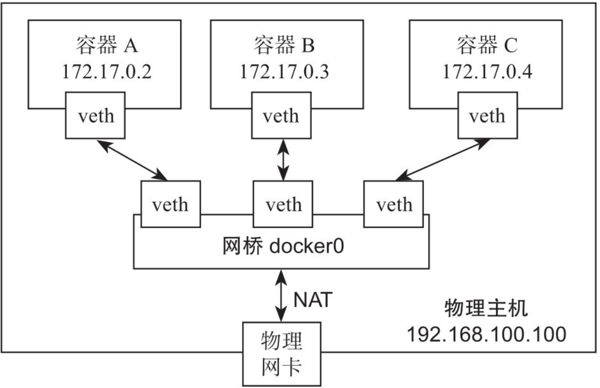
图17-4　容器网络的基本原理

完成上述步骤后，容器就可以使用它所能看到的eth0虚拟网卡来连接其他容器和访问外部网络。
在使用docker run命令启动容器时，可以通过-network参数来指定容器的网络配置。支持的网络类型包括：
❑ bridge：默认值，在Docker网桥docker0上为容器创建新的网络栈。
❑ none：让Docker将新容器放到隔离的网络栈中，但是不进行网络配置。之后，用户可以自行配置。
❑ container:NAME_or_ID：让Docker将新建容器的进程放到一个已存在容器的网络栈中，新容器进程有自己的文件系统、进程列表和资源限制，但会和已存在的容器共享IP地址和端口等网络资源，两者的进程可以直接通过lo环回接口通信。
❑ host：不要将容器网络放到隔离的命名空间中，而是使用本地主机的网络。容器拥有完全的本地主机接口访问权限。容器进程与主机其他root进程一样可以打开低范围的端口，可以访问本地网络服务（比如D-bus）​，还可以让容器做一些影响整个主机系统的事情，比如重启主机，因此使用这个选项的时候要非常小心。如果进一步使用--privileged=true参数，容器甚至会被允许直接配置主机的网络栈。
❑ 自定义的网络：用户可以用docker network create命令创建自己定义的网络，并将容器连接到指定的网络上。
**3.手动配置网络**
用户使用--net=none后，Docker将不对容器网络进行配置。下面将手动完成配置网络的整个过程。通过这个过程，可以了解Docker配置网络的更多细节。
首先，启动一个ubuntu:24.04容器，指定--net=none参数：
```shell
docker run -it --rm --net=none ubuntu:24.04 /bin/bash
root@63f36fc01b5f:/#
```
在本地主机查找容器的进程ID，并为它创建网络命名空间：
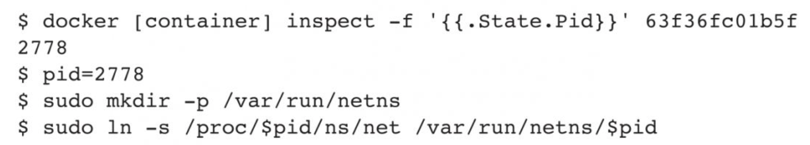
检查桥接网卡的IP和子网掩码信息：
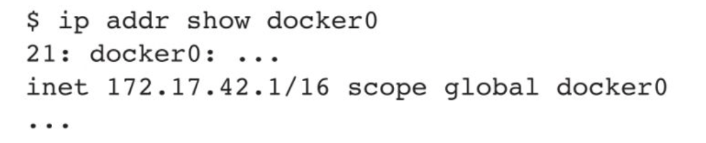
创建一对veth接口A和B，绑定A接口到网桥docker0，并启用它：
```shell
sudo ip link add A type veth peer name B
sudo brct addif docker0 A
sudo ip link set A up
```
将B接口放到容器的网络命名空间，命名为eth0，启动它并配置一个可用IP（桥接网段）和默认网关：
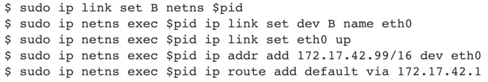
以上是Docker配置网络的实现过程。容器终止后，Docker会清空容器，容器内的网络接口会随网络命名空间一起被清除。此时，A接口也被自动从docker0网桥卸载并清除。
需要注意的是，如果容器所连接的网络是由用户创建的网络，那么在容器终止时网络并不会被自动删除，而是需要用户手动删除。可以通过dockernetwork rm命令来删除。
## 17.6 本章小结
本章详细讲解了Docker的核心实现技术，包括基本架构、命名空间、控制组、联合文件系统和虚拟网络支持等特性。在了解这些内容后，读者会发现Docker的优秀特性与操作系统的支持密不可分，特别是Linux上成熟的容器技术支持。
在实际使用Docker容器的过程中，还需要对系统配置进行调整以优化容器性能，这需要有丰富的Linux系统运维知识和实践经验。通过更通用的容器运行时技术规范，Docker现在可以移植到Linux以外的多种平台上，如macOS和Windows等，这将使得Docker的应用范围更加广泛。
此外，Docker还引入了插件化组件（例如网络插件）​，可以支持更丰富的功能，这将在后续章节中介绍。