# 第十三章 分布式处理与大数据平台
分布式系统和大数据处理平台正是业界关注的技术焦点。
在本章中，笔者将着重解析几款热门工具，包括广泛使用的消息队列中间件RabbitMQ和介绍大数据分布式处理的三大工具：Hadoop、Spark以及Storm，并展示新一代的数据采集和分析引擎Elasticsearch。
本章将介绍如何利用Docker快速部署并运用这些工具，带领读者深入实战，理解分布式处理技术在大数据领域的关键作用。
## 13.1 RabbitMQ
RabbitMQ是一个开源的消息队列实现，它遵循高级消息队列协议(AdvancedMessage Queuing Protocol，AMQP)，并且使用Erlang编程语言构建，以其卓越的性能、稳健的可用性以及出众的可伸缩性而广受好评。它支持各种客户端，包括Java、Python、PHP、.NET、Ruby和JavaScript等。RabbitMQ在分布式系统中主要负责存储和传递消息，便于系统各组件之间的解耦。这样，消息的发送方并不需要知晓消息的接收方，反之，接收方也不需要知晓发送方，大大提高了系统的灵活性。图13-1展示了AMQP消息流转方式。

**1.使用官方镜像** 
RabbitMQ的数据存储在具体的节点上。在使用docker[container]run命令运行容器的时候，可以通过-h/--hostname参数指定每一个rabbitmq daemon运行的主机名。这样就可以方便地管理和维护数据，如下所示：
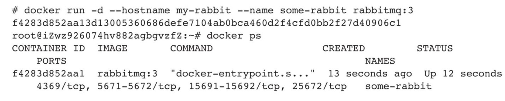
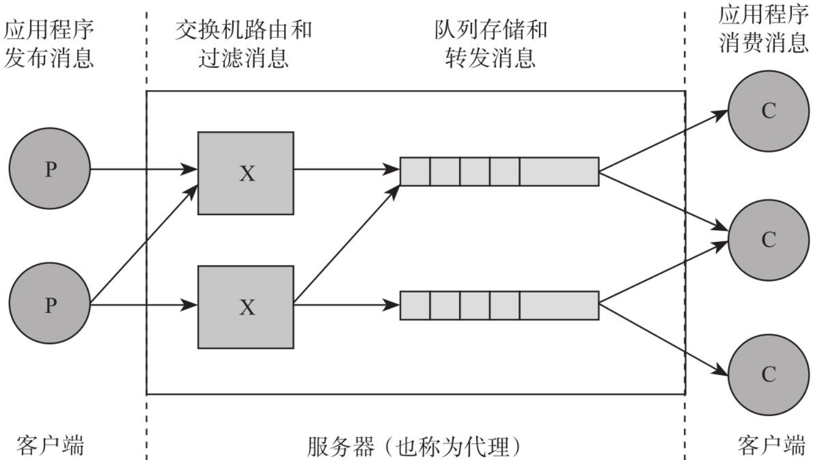
图13-1　AMQP消息流转方式

容器启动后，可以使用docker logs查看已部署的RabbitMQ服务。
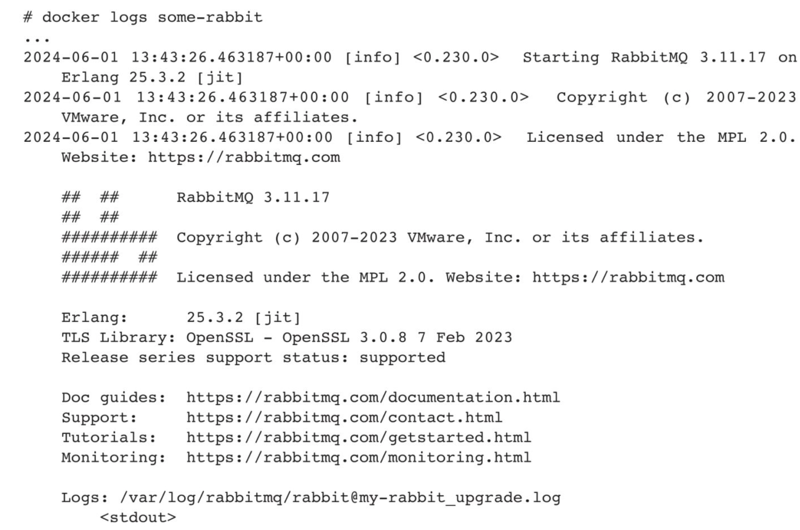
可以使用RabbitMQCTL工具进行远程管理或跨容器管理，此时需要设置持久化的cookie。在这种情况下，可以使用RABBITMQ_ERLANG_COOKIE参数进行设置：
```shell
docker run -d --hostname my-rabbit --name some-rabbit -e RABBITMQ_ERLANG
  COOKIE='secret cookie here' rabbitmq:3
```
使用cookie连接至一个独立的实例：
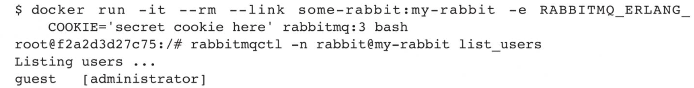
同样，用户也可以使用RABBITMQ_NODENAME简化指令：
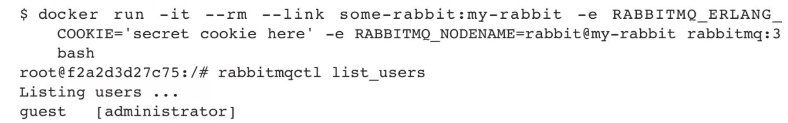
默认情况下，RabbitMQ会安装并启动一些管控插件，如rabbitmq:3-management。通常可以通过默认用户名、密码，以及标准管控端口15672访问这些插件：
```shell
docker run -d --hostname my-rabbit --name some-rabbit rabbitmq:3-management
```
用户可以通过浏览器访问http://container-ip:15672，如果需要从宿主机外访问，则使用8080端口：
```shell
docker run -d --hostname my-rabbit --name some-rabbit -p 8080:15672 rabbitmq:3-management
```
可以通过浏览器访问http://localhost:8080或http://host-ip:8080使用RabbitMQ管控工具，如图13-2所示。
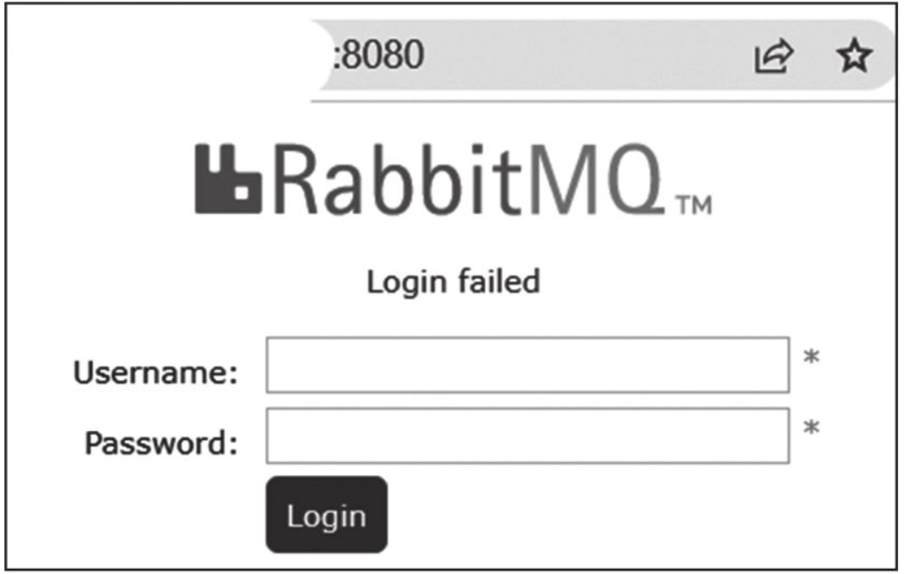
图13-2　通过浏览器使用RabbitMQ管控工具

使用默认用户名和密码(guest：guest)登录，如图13-3所示。
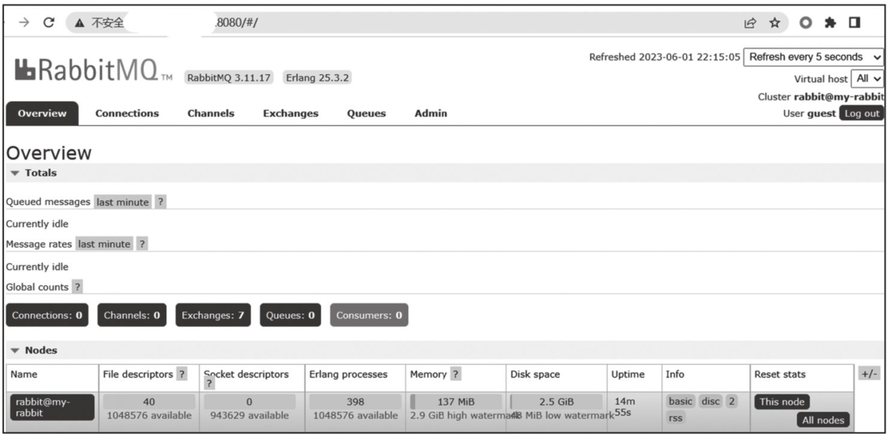
图13-3　使用默认用户名和密码登录

如果需要修改默认用户名与密码，则可以使用RABBITMQ_DEFAULT_USER和RABBITMQ_DEFAULT_PASS环境变量：
```shell
docker run -d --hostname my-rabbit --name some-rabbit -e RABBITMQ_DEFAULT_USER=user -e RABBITMQ_DEFAULT_PASS=password rabbitmq:3-management
```
之后可以使用浏览器访问http://localhost:8080或http://host-ip:8080，并使用新的用户名密码访问管控工具。

如果需要修改默认vhost，可以修改RABBITMQ_DEFAULT_VHOST环境变量：
```shell
docker run -d --hostname my-rabbit --name some-rabbit -e RABBITMQ_DEFAULT_VHOST=my_vhost rabbitmq:3-management
```
然后连接至daemon：
```shell
docker run --name some-app --link some-rabbit:rabbit -d application-that-uses-rabbitmq
```
用户也可以访问官方镜像仓库，并对Dockerfile进行更多定制。
**2.相关资源**
❑ RabbitMQ官网：http://www.rabbitmq.com/ 。
❑ RabbitMQ官方镜像：https://hub.docker.com/_/rabbitmq/ 。
## 13.2 Hadoop
Hadoop是Apache软件基金会的一款开源分布式计算平台，专为处理大规模数据集而设计。它在计算集群中运行，提供高度的可靠性和可扩展性，能够处理复杂的数据处理任务。在大规模数据处理、数据分析、机器学习等领域，Hadoop被广泛应用，并已成为大数据处理的核心工具之一。

作为大数据处理的经典分布式框架，Hadoop主要使用Java语言实现，并由HDFS、YARN、MapReduce三个核心子系统构成。
❑ HDFS：这是一个高度容错的分布式文件系统，能够部署在大量的经济实惠的机器上，并提供高吞吐量的数据访问，与操作系统中的Linux ext3/ext4文件系统有相似之处。
❑ YARN(Yet Another Resource Negotiator)：作为资源管理器，YARN为上层应用提供统一的资源管理和调度，支持多计算框架的兼容，这与Linux的进程调度和内存分配模块类似。
❑ MapReduce：这是一种分布式编程模型，能够将大规模数据集的处理任务(Map)分发到网络的各个节点，然后收集处理结果进行整合(Reduce)。
此外，Hadoop社区还扩展出了一系列相关的项目，包括HBase（列存数据库）​、Hive（支持SQL查询的数据仓库软件）​、Pig（数据流处理引擎）​，以及Zookeeper（分布式应用程序协调服务）等，如图13-4所示。
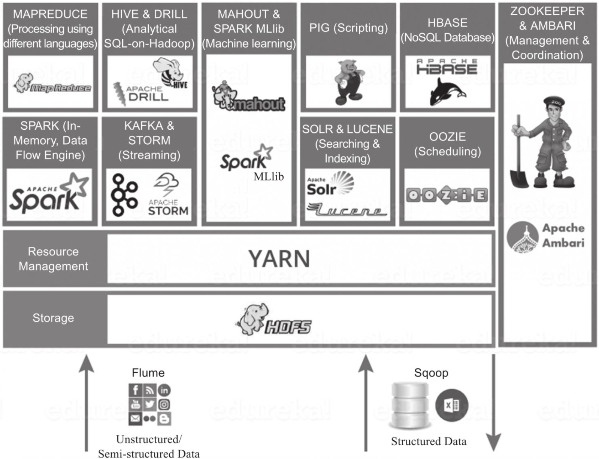
图13-4　Hadoop社区相关项目

**1.使用官方镜像**
可以直接使用Apache开源基金会维护的Hadoop官方镜像，目前提供Hadoop V2和V3两个版本镜像。下面是获取官网最新镜像版本V3的命令代码。
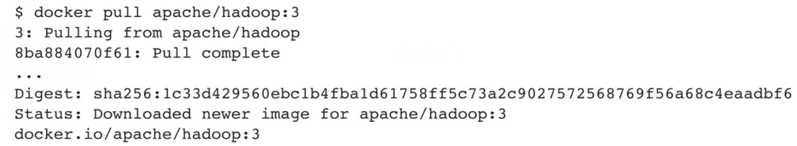
此镜像工具较完整，包含hdfs、yarn等常用命令，可以在测试环境中使用：
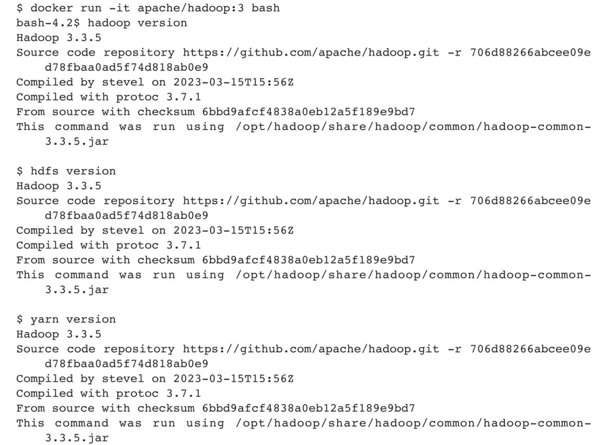
可以通过hdfs namenode命令格式化一个新的分布式文件系统：
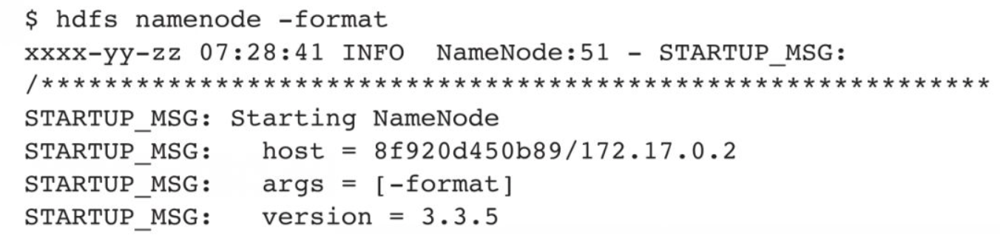
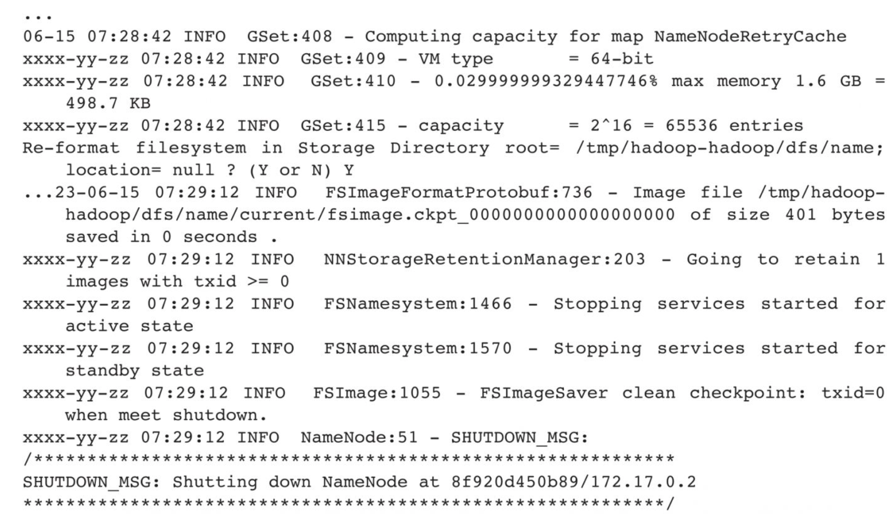
还可以通过hadoop命令使用HDFS集群：
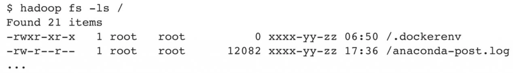
使用yarn命令可以查看和管理应用：

**2.相关资源**
❑ Hadoop官网：http://hadoop.apache.org 。
❑ Hadoop官方镜像：https://hub.docker.com/r/apache/hadoop 。
## 13.3 Spark
Spark是一个围绕速度、易用性和复杂分析构建的大数据处理框架，基于Scala开发。该框架诞生于2009年，由加州大学伯克利分校的AMPLab团队研发，并于2010年正式加入Apache的开源项目家族。Spark旨在处理大规模的数据处理任务，能够轻松处理各种类型的数据，包括结构化数据、半结构化数据和非结构化数据。它在大规模数据分析、机器学习、图形计算以及实时处理等领域广泛应用，是大数据处理的重要工具之一。

相较于Hadoop和Storm等其他大数据和MapReduce技术，Spark能够提供更为灵活的函数定义，能将应用处理速度提升至原来的一到两个数量级。同时，它还提供了一系列实用工具，包括SQL查询、流处理、机器学习和图处理等。
Spark目前支持使用Scala、Java、Python、Clojure、R等编程语言来编写应用。除了核心API外，Spark生态系统还囊括了众多附加库，以便在大数据分析和机器学习领域提供更为强大的功能。这些库包括Spark Streaming（用于构建弹性和容错的流处理应用）​、Spark SQL（支持SQL和结构化数据处理）​、Spark MLlib（专为机器学习设计）以及Spark GraphX（专用于图数据处理）​。此外，Spark生态系统中还包含一些其他库，如BlinkDB和Tachyon等。
Spark的典型架构主要由三个核心组件组成：驱动程序、集群管理器以及工作节点，如图13-5所示。
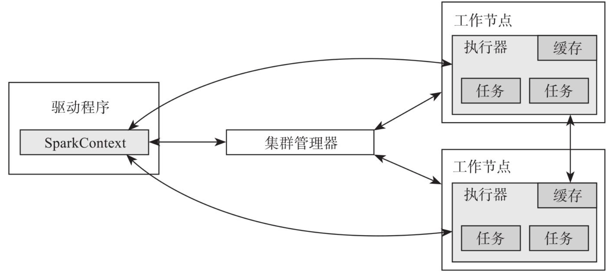
图13-5　Spark的典型架构

目前Spark推出了3.4.0版本，这是3.x版本中的第5个发布版本。得益于开源社区的贡献，该版本成功解决了超过2600个Jira请求。此版本新增了Spark Connect的Python客户端，增强了Structured Streaming的异步进度跟踪功能，增加了Pandas API的覆盖范围并提供了NumPy支持。
**1.使用官方镜像**
入门Spark最简单的方式是使用Spark的Scala shell。读者可以使用Apache/Spark的官方镜像：
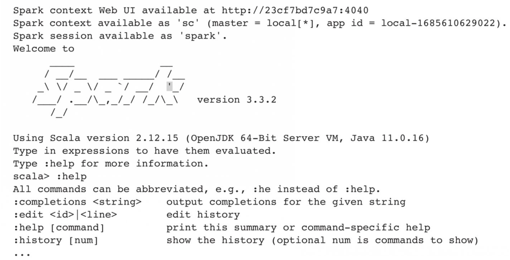
功能如下：
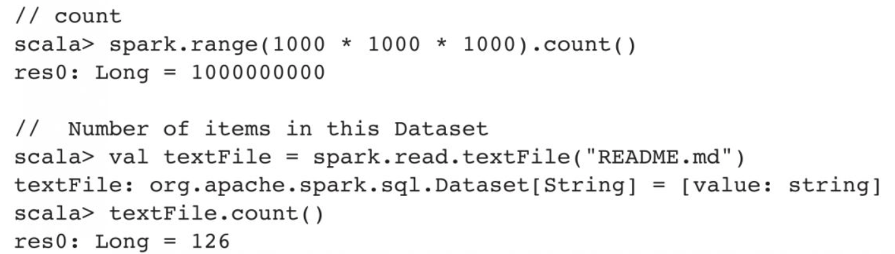
**2.相关资源**
❑ Spark官网：http://spark.apache.org/ 。
❑ Spark官方仓库：https://github.com/apache/spark 。
❑ Spark官方镜像仓库：https://hub.docker.com/r/apache/spark 。
## 13.4 Storm
Storm是一款实时流计算框架，它在2014年由Twitter正式开源，并遵循EclipsePublic License 1.0协议，基于Clojure等语言进行开发。

Storm集群的运作方式与Hadoop集群极其相似，二者的主要差别在于，在Hadoop上运行的是MapReduce任务，而在Storm上执行的是topology任务。MapReduce任务在处理完成后就会结束，但topology任务则会持续等待消息并进行处理，直至任务被显式地终止。
Storm集群中有两类节点：主节点和工作节点。主节点运行一个名为Nimbus的守护进程，其功能类似于Hadoop的Jobtracker。Nimbus主要负责代码的分发、任务的分配以及故障监测。工作节点则运行名为Supervisor的守护进程，负责监听由Nimbus分派的任务，并根据这些指派信息管理工作进程。这里的每个工作进程都执行topology任务的一部分。
在集群中，Nimbus和Supervisor之间的所有协调工作都是通过Zookeeper集群来完成的。值得注意的是，Nimbus守护进程和Supervisor守护进程均设计成了“快 速失败”(fail-fast)和无状态的，从而实现了极高的稳定性。
**1.本地模式部署topology**
如果读者在当前目录中有topology.jar文件，则可以直接通过docker run部署。
```shell
docker run -it -v $(pwd)/topology.jar:/topology.jar storm storm jar /topology.jar org.apache.storm.starter.ExclamationTopology
```
**2.部署最小化的Storm集群**
首先部署Storm集群依赖的Zookeeper，并设置为自动重启，保证一定的可靠性：
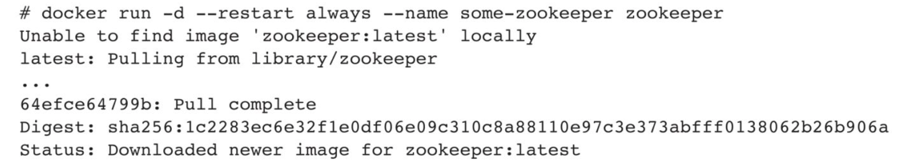
Nimbus的守护进程也必须连接Zookeeper服务：

然后启动管控节点(Supervisor)，它将负责与Nimbus和Zookeeper通信：

现在读者可以向这个最小化集群提交一个topology：

为了方便管理，可以启动一个管控UI：
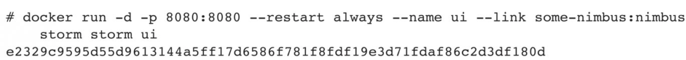
启动后，可以通过本地浏览器访问容器IP和8080端口，如图13-6所示。
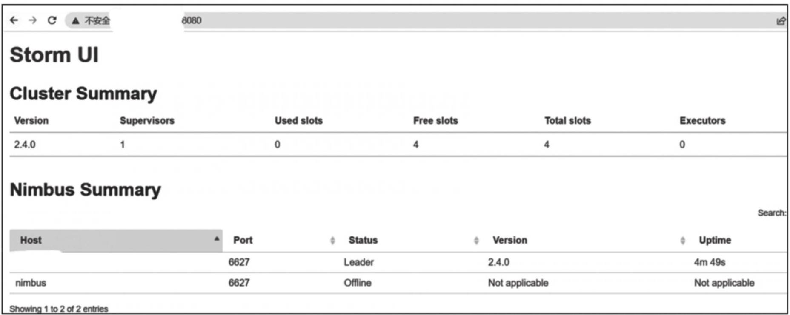
图13-6　通过本地浏览器访问容器IP和8080端口

生产环境可以使用compose运行，可以通过docker stack deploy-c stack.ymlstorm或者docker-compose-f stack.yml up启动。启动后，可以通过http://swarm-ip:6627或http://host-ip:6627访问Nimbus。详情可以参考docker-compose.yml，如下所示：
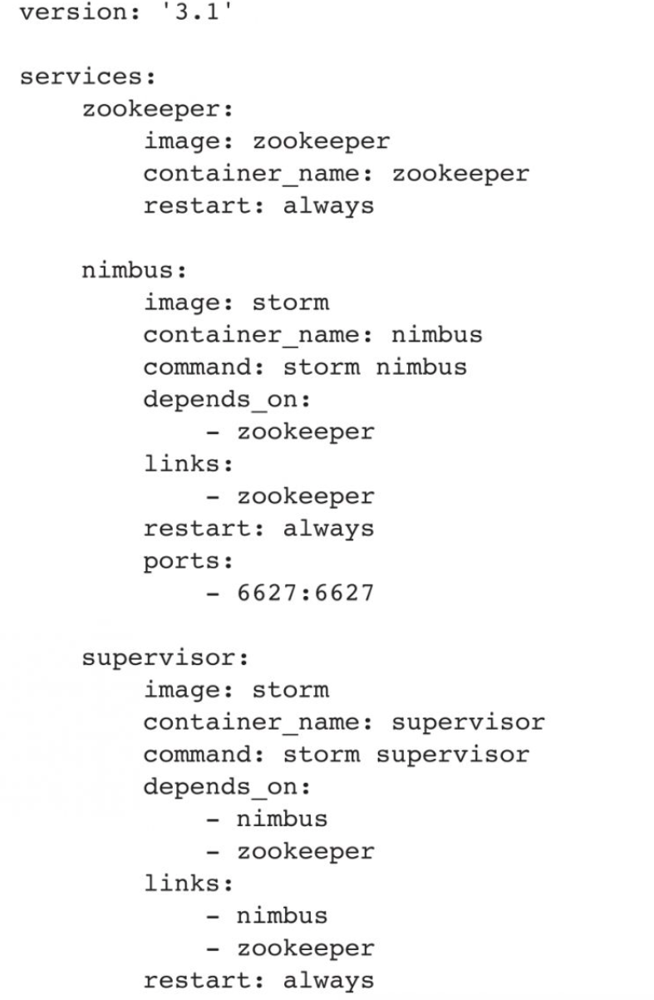
**3.相关资源**
❑ Storm官网：http://storm.apache.org/ 。
❑ Storm官方镜像仓库：https://hub.docker.com/r/baqend/storm/ 。
## 13.5 Elasticsearch
Elasticsearch是一款开源的分布式搜索和分析引擎，深受业界青睐。此工具依托于Lucene搜索引擎库，旨在提供一种可扩展的搜索平台，其功能覆盖全文搜索、结构化搜索，以及数据分析和可视化。

Elasticsearch已经广泛应用于众多领域，包括但不限于日志分析、电子商务搜索以及金融风控。这款产品已经证明自己是一种成熟且有效的分布式搜索和分析引擎。
总的来说，凭借强大的功能、易用性以及优异的性能，Elasticsearch已经成为大数据领域中的重要一环。
**1.使用官方镜像**
读者可以使用官方镜像，通过单节点模式快速运行Elasticsearch容器，这种模式最好用于测试用途。
首先，创建用户定义的网络，这样可以方便地连接到同一网络的其他服务，如Kibana：
```shell
docker network create test-network
```
然后读者可以通过单节点模式直接运行：
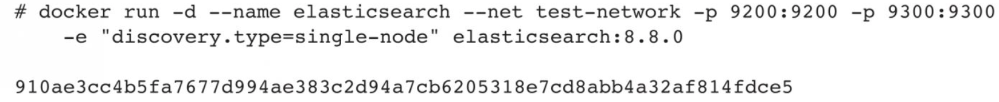
Elasticsearch容器启动后，可以通过docker exec命令进入容器并开始使用Elasticsearch：
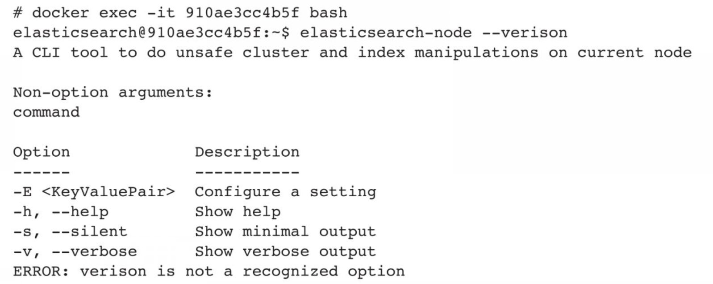
读者也可以在启动时传入一些额外的配置参数：

用户目前使用的镜像内含有默认配置文件，包含了预先定义好的默认配置。如果用户要使用自定义配置，可以使用数据卷，挂载自定义配置文件至/usr/share/elasticsearch/config：

如果需要数据持久化，则可以使用数据卷指令，挂载至/usr/share/elasticsearch/data：

此镜像会暴露9200、9300两个默认的HTTP端口，可以通过此端口进行服务访问。
9200端口是对外提供服务的API使用的端口，9300端口是内部通信端口，这些通信包括心跳、集群内部信息同步。
如果读者希望在生产环境中使用Elasticsearch，则建议使用多节点模式。读者可以使用Docker Compose运行三节点Elasticsearch集群。
首先新建docker-compose.yml文件，代码如下：
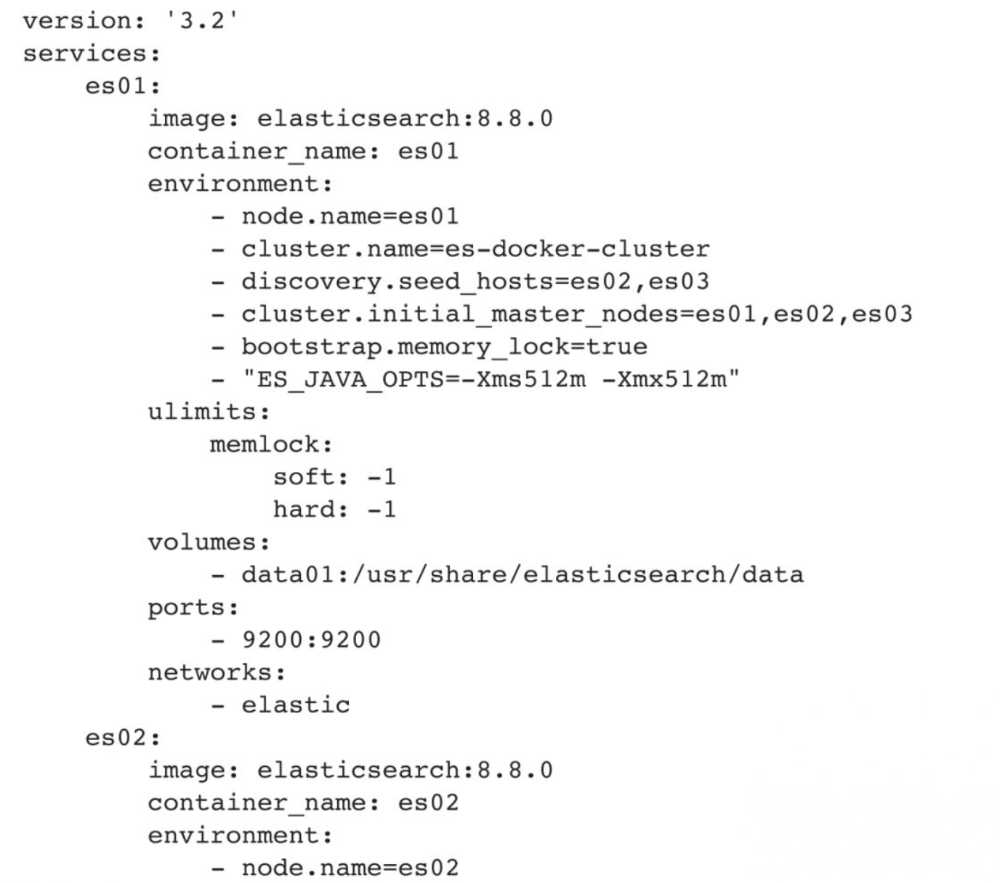
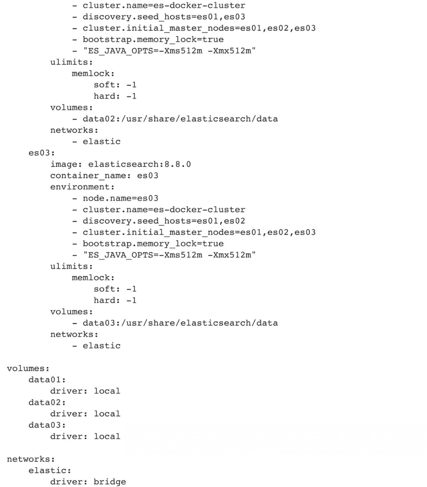
以上Docker Compose文件会搭建一个三节点Elasticsearch集群。节点es01会侦听本地主机的9200端口，节点es02和es03会通过Docker网络与es01节点通信。Elasticsearch服务会监听在公开端口9200上。
**2.相关资源**
❑ Elasticsearch官网：https://www.elastic.co 。
❑ Elasticsearch官方仓库：https://github.com/elastic/elasticsearch 。
❑ Elasticsearch官方镜像：https://hub.docker.com/_/elasticsearch/ 。
## 13.6 本章小结
本章深入讨论了分布式处理与大数据处理领域的标志性工具，其中包括Rabbitmq、Hadoop、Spark、Storm和Elasticsearch等。这些开源项目极大地降低了开发者在分布式处理和数据分析领域的入门难度。
事实上，由于摩尔定律的限制，越来越多的复杂任务不得不依赖于分布式架构进行处理。在这些新的架构和平台下，如何实现高性能、高可用性，以及如何让应用易于开发和调试，都是一些复杂的问题。幸运的是，现有的开源平台提供了优秀的实施参考，使用户能够将更多精力专注于核心业务的维护上。通过容器化的部署和使用，大大简化了对这些复杂系统的使用和维护工作。