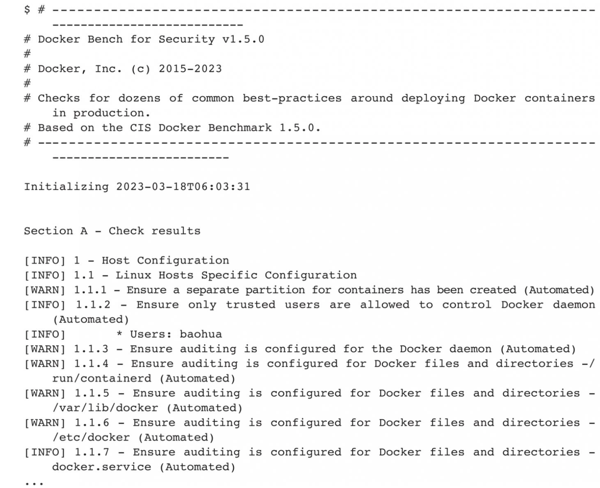
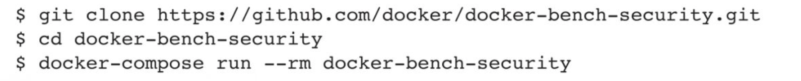
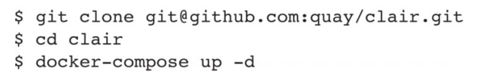
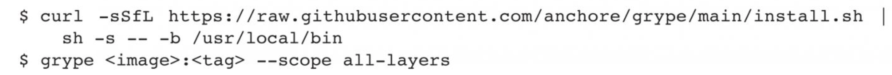
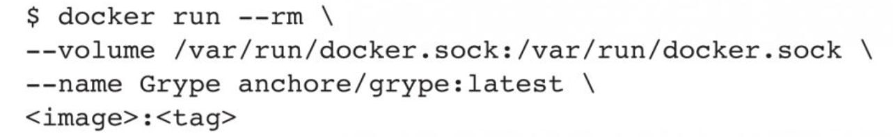

第十九章 安全防护与配置
Docker是一种基于Linux操作系统实现的应用虚拟化技术。运行在Docker容器内的进程与本地系统中的进程本质上没有区别，因此如果配置不当，可能会给本地系统带来安全风险。因此，在生产环境中，Docker的安全性是非常重要的衡量因素。
Docker容器的安全机制在很大程度上依赖于操作系统自身，主要包括下面几个方面：
❑ 命名空间机制：Linux内核的命名空间机制可以提供容器隔离和安全。通过为每个容器提供独立的命名空间，Docker可以隔离进程和文件系统等资源，从而防止容器之间的互相干扰和攻击。
❑ 控制组机制：Linux内核的控制组机制可以对容器资源进行控制和限制，从而确保容器使用资源的安全性。Docker可以使用控制组来限制容器的CPU、内存和磁盘使用等方面的资源，防止容器滥用资源。
❑ 权限机制内核能力机制：Linux内核的能力机制提供了一种精细的操作权限控制机制，可以限制容器访问主机系统的能力。Docker可以利用这个机制来限制容器对主机系统的访问权限，从而提高安全性。
❑ Docker服务端防护机制：Docker程序（特别是服务端）本身的保护，确保未经授权的用户或应用不能访问到容器或服务端。
❑ 其他安全增强机制：Docker可以使用第三方工具，例如AppArmor和SELinux等，来增强容器的安全性。这些工具可以提供更强的安全策略来保护容器。
❑ 第三方评估工具：使用第三方工具可以评估Docker环境的安全性。例如，DockerBench工具可以帮助管理员评估Docker环境的安全性，并提供改进建议。
本章将从这几个方面讨论Docker的安全机制。
## 19.1 命名空间隔离的安全
命名空间是Docker容器和LXC容器实现隔离的关键机制之一。
命名空间隔离是Linux内核中的一个功能，允许在相互隔离的环境中运行进程。在容器安全方面，命名空间隔离起着重要作用，它能够为每个容器创建独立的运行环境。命名空间隔离的主要功能包括：
❑ 进程隔离：通过PID（进程ID）命名空间，容器内的进程与其他容器和主机系统的进程相互隔离，这使得容器内的进程看不到其他容器或主机系统上的进程，从而提高了系统的安全性。
❑ 网络隔离：网络命名空间允许为每个容器分配独立的网络堆栈和资源，例如IP地址、路由表和防火墙规则，这样可以限制容器之间和容器与主机系统之间的网络通信，降低网络攻击的风险。
❑ 挂载点隔离：通过挂载命名空间，每个容器可以拥有独立的文件系统视图，这有助于保护容器内外的文件系统不受未经授权的访问和修改。
❑ 用户隔离：用户命名空间允许将容器内的用户和组ID映射到主机系统上的不同用户和组ID。这样，即使容器内的进程以root用户身份运行，它在主机系统上的权限也会受到限制，从而降低潜在的安全风险。
❑ IPC隔离：IPC命名空间隔离了容器内的进程间通信资源，防止跨容器的信息泄露和攻击。
❑ UTS隔离：UTS命名空间允许为每个容器设置独立的主机名，从而在一定程度上提高了容器的隔离性。
在使用docker[container]run命令启动容器时，Docker会为每个容器创建一个独立的命名空间，这意味着容器中运行的进程无法通过常规命令被主机上的进程或其他容器发现和干扰。
由于每个容器都具有独立的网络栈，因此它们无法访问其他容器的套接字(socket)或接口。尽管如此，在默认情况下，容器能够与本地主机或其他容器进行网络通信。实际上，这是通过本地主机的网桥接口(docker0)实现的，就像物理机器通过物理交换机通信一样。
命名空间的设计最初由2005年发布的OpenVZ项目提出，Linux内核从2.6.15版本开始引入。经过数十年的演化和改进，命名空间机制已经十分成熟，被广泛应用于大型生产系统中。
然而，与虚拟机相比，通过命名空间实现的隔离程度相对较低。在容器中运行的应用程序可以直接访问系统内核和部分系统文件，因此用户必须确保容器中的应用程序是安全可信的，否则本地系统将面临潜在风险。用户需要确保容器的来源可靠，以及容器本身是值得信赖的，就像确保运行在系统中的软件是可信的一样。
因此，容器命名空间提供了基本的隔离机制，但仍需用户负责确保容器内应用程序的安全性，从而保障本地系统的安全。
## 19.2 控制组资源控制的安全
控制组(Control Groups，Cgroups)是Linux内核的一个功能，用于对一组进程的资源使用进行限制、审计和隔离。控制组技术最早于2006年出现，Linux内核从2.6.24版本开始正式引入该技术。
控制组主要包括如下几个功能：
❑ 资源限制：控制组能够限制容器内进程使用的资源，如CPU、内存、磁盘I/O、网络带宽等，这有助于防止容器内的恶意程序或漏洞利用导致的资源耗尽攻击，确保主机系统和其他容器正常运行。
❑ 进程隔离：控制组可以将容器内的进程与主机系统及其他容器的进程隔离开来，减少攻击者通过容器逃逸到主机系统或其他容器的可能性。通过实现资源、命名空间和设备的隔离，控制组能够在一定程度上提高容器的安全性。
❑ 监控与审计：控制组提供了资源使用的监控和审计功能，使管理员可以观察和记录容器内进程的资源使用情况，这有助于发现异常行为、调试性能问题和优化资源分配策略。
❑ 优先级控制：控制组可以为容器分配不同的优先级，确保关键任务获得足够的资源，以提高整体系统的稳定性和性能。
当用户执行docker[container]run命令启动一个Docker容器时，Docker会通过与Linux相关的调用在后台为容器创建一个独立的控制组策略集合，该集合将限制容器内应用对资源的消耗。
控制组机制对容器提供了很多有用的特性，例如公平的资源共享和资源消耗的限制。这可以确保容器之间公平地共享主机的内存、CPU、磁盘I/O等资源，防止某个容器对系统的资源消耗过大而影响其他容器和本地主机系统的正常运行。此外，控制组还能防止各种恶意攻击，特别是拒绝服务攻击(DDoS)等。
对于支持多用户的服务平台（如公有的各种PaaS、容器云）来说，控制组尤为重要。当某个应用容器出现异常时，控制组可以保证其他容器和本地主机系统正常运行而不受影响，从而避免“雪崩”灾难的发生。
因此，控制组是Docker容器机制中的另一个重要组成部分，它可以确保容器之间公平地共享主机资源，并限制容器对资源的占用。这有助于保护本地主机系统和其他容器，避免恶意攻击对系统的影响。
## 19.3 内核能力机制
能力机制(Capability)是Linux内核中的一个强大特性，提供了细粒度的权限访问控制。与传统的UNIX系统只区分根权限（用户ID为0，即root用户）和非根权限（非root用户）两种粗粒度权限不同，Linux内核自2.2版本起支持能力机制，通过能力机制将权限划分为更细粒度的操作能力，既可以作用在进程上，也可以作用在文件上。
例如，一个Web服务进程可能只需要绑定低于1024的端口权限，而无须完整的root权限。此时，只需为该进程授权net_bind_service能力即可。类似地，可以赋予进程许多其他能力，以避免它们获得root权限。
在默认情况下，Docker启动的容器受到严格限制，仅允许使用内核的部分能力。这些能力包括chown、dac_override、fowner、kill、setgid、setuid、setpcap、net_bind_service、net_raw、sys_chroot、mknod、setfcap和audit_write等。这种限制策略有助于提高容器安全性，防止潜在的权限滥用。
在大多数情况下，容器实际上并不需要真正的root权限，只需具备有限的能力。为了提高安全性，可以通过禁用某些不必要的权限来限制容器的操作范围。这些限制包括：
❑ 完全禁止任何文件挂载操作，防止容器访问敏感数据或修改主机文件系统。
❑ 禁止直接访问本地主机的套接字，降低容器与主机或其他容器之间的潜在风险。
❑ 禁止进行某些文件系统操作，如创建新设备、修改文件属性等，以限制容器对系统资源的影响。
❑ 禁止加载内核模块，防止容器加载恶意模块或影响系统稳定性。
通过实施这些限制，即使攻击者在容器中获得了root权限，它在本地主机上所能获得的权限仍然受限，从而减少潜在的破坏范围，这有助于保障容器和主机系统的安全。
分配不恰当的内核能力给容器可能会导致容器内的应用程序获取足以破坏本地系统的权限。例如，早期的Docker版本曾错误地继承了CAP_DAC_READ_SEARCH能力，从而使得容器内的进程可以通过系统调用访问本地系统的任意文件和目录。
为了防止这类问题，Docker默认采用白名单机制，仅启用必要的内核能力，而禁用其他权限。目前，Docker支持的内核能力包括CAP_CHOWN、CAP_DAC_OVERRIDE、CAP_FSETID、CAP_FOWNER、CAP_MKNOD、CAP_NET_RAW、CAP_SETGID、CAP_SETUID、CAP_SETFCAP、CAP_SETPCAP、CAP_NET_BIND_SERVICE、CAP_SYS_CHROOT、CAP_KILL和CAP_AUDIT_WRITE等。
当然，根据实际需求，用户可以为Docker容器启用额外的内核能力。然而，在执行此操作时，务必确保这些权限对容器和主机系统的安全性不会产生负面影响。在考虑添加额外权限时，应充分评估潜在风险并权衡利弊。
## 19.4 Docker服务端的防护
Docker容器的核心是Docker服务端。由于Docker服务运行仍需要root权限的支持，因此确保服务端的安全性至关重要。
首先，必须确保只有可信的用户才能访问Docker服务。Docker允许用户在主机和容器之间共享文件夹，而无须限制容器的访问权限，这可能导致容器突破资源限制。例如，如果恶意用户在启动容器时将主机的根目录/映射到容器的/host目录中，那么容器便可以在理论上对主机的文件系统进行任意修改。实际上，几乎所有虚拟化系统都允许类似的资源共享，并且无法阻止恶意用户将主机根文件系统共享到虚拟机系统。
这可能导致严重的安全后果。因此，在提供容器创建服务时（例如通过Web服务器）​，务必加强对参数的安全检查，防止恶意用户使用特定参数创建具有破坏性的容器。为了确保安全，建议仅授权可信的用户访问Docker服务，并在允许用户创建容器时加强安全措施，以降低潜在风险。
为了加强对服务端的保护，Docker的REST API在0.5.2版本之后使用本地的UNIX套接字机制替代了原先绑定在127.0.0.1上的TCP套接字，因为后者容易遭受跨站脚本攻击。用户可以通过UNIX权限检查来提高套接字访问的安全性。
尽管用户仍然可以通过HTTP提供REST API访问，但建议采取安全措施，确保仅可信的网络或VPN网络或采用证书保护机制（例如受保护的Stunnel和SSL认证）的访问可以进行。此外，还可以利用TLS证书加强保护，可以参考Docker服务TLS的相关参数了解更多信息。
最近改进的Linux命名空间机制将可以实现使用非root用户来运行全功能的容器，这将从根本上解决容器和主机之间共享文件系统而引起的安全问题。
目前，Docker服务端自身也在不断改进安全性，主要方向有：
❑ 继续开发和完善使容器能够在非root用户下运行的功能，从根本上降低潜在的安全风险。
❑ 加强与如SELinux、AppArmor和Seccomp等Linux安全模块的集成，以提供更强大的访问控制和权限管理。
## 19.5 更多安全特性的使用
除了默认启用的能力机制之外，还可以利用一些现有的安全软件或机制来增强Docker的安全性，例如AppArmor、SELinux、GRSEC等。它们提供了额外的安全层，以限制和控制容器进程访问主机资源的权限。
AppArmor是基于路径的访问控制系统，它允许管理员为每个程序指定一个访问控制策略。Docker默认在支持AppArmor的Linux发行版上启用AppArmor配置文件。当Docker容器启动时，Docker会自动为容器加载默认的AppArmor配置文件，以限制容器进程的权限。用户还可以根据需要为特定容器创建和应用自定义的AppArmor配置文件。
SELinux(Security-Enhanced Linux)是基于标签的强制访问控制(MAC)系统，它允许更细粒度地控制进程和文件的访问权限。Docker可以与SELinux集成，为容器进程提供更严格的隔离。在支持SELinux的Linux发行版上，Docker可以自动为容器分配SELinux标签，以便限制容器进程的访问权限。
GRSEC(Grsecurity)是一个Linux内核补丁，它为系统提供了一系列安全增强功能，如地址空间布局随机化(ASLR)、强制访问控制(MAC)和角色权限管理。虽然GRSEC不直接与Docker集成，但通过应用GRSEC补丁的Linux发行版（如Alpine Linux）可以提高Docker容器在宿主机上的安全性。
另外，还可以从如下方面提升容器系统的安全能力：
❑ 在将文件系统挂载到容器内部时，设置为只读模式，防止容器内的应用程序通过文件系统破坏外部环境。这尤其适用于一些与系统运行状态相关的目录，如/proc/sys、/proc/irq和/proc/bus等。这样一来，容器内的应用进程可以访问所需的系统信息，但无法进行修改。
❑ 以非特权用户身份启动Docker内的应用。这样可以进一步限制用户权限，例如禁止访问Shell，以避免在出现故障时对容器内的其他资源造成损害。
❑ 使用容器扫描工具。定期使用Clair、Anchore、Snyk等容器扫描工具检查容器镜像的漏洞和安全风险。
❑ 使用加密通信，确保容器与外部服务之间的通信加密，例如使用HTTPS、TLS等。
❑ 尽量使用官方镜像，特别是最小化镜像，减少安全漏洞和恶意代码的风险，同时定期更新镜像，修复漏洞。
❑ 对容器内应用进行严格的安全配置，限制其权限和资源访问。容器即应用，原先保障应用安全的各种手段，都可以合理地借鉴利用。❑ 将Docker服务端和相关的容器管理服务配置到单独的服务器上，并启用最高级别的安全机制。
❑ 监控和日志记录，关注容器内应用的行为和性能指标，记录日志以便监测异常活动，并进行跟踪与分析，及时发现和解决潜在安全问题。
❑ 将运行Docker容器的机器划分为不同的组，互相信任的机器放到同一个组内，组之间进行资源隔离，同时进行定期的安全检查。
❑ 在大规模运营场景下，需要考虑在容器网络上进行必备的安全防护，避免诸如DDoS、ARP攻击、规则表攻击等网络安全威胁，这也是生产环境中需要关注的重要问题。
## 19.6 使用第三方检测工具
前面笔者介绍了大量增强Docker安全性的手段。要逐一检查会比较烦琐，幸好已经有了一些进行自动化检查的开源工具，比较知名的有DockerBench和Clair。
**1.Docker BenchDocker**
Bench是一个开源项目，代码托管在docker/docker-bench-security。该项目按照互联网安全中心(Center for Internet Security，CIS)对于Docker的安全规范进行一系列环境检查，可发现当前Docker部署在配置、安全等方面的潜在问题。
CIS Docker规范在主机配置、Docker引擎、配置文件权限、镜像管理、容器运行时环境、安全项六大方面都进行了相关的约束和规定，推荐大家在生产环境中使用Docker时，采用该规范作为部署的安全标准。
Docker Bench自身也提供了Docker镜像，采用如下命令，可以快速对本地环境进行安全检查：

输出结果中带有不同的级别，说明问题的严重程度，最后会给出整体检查结果和评分。一般要尽量避免出现WARN或更高级别的问题。用户也可以通过获取最新开源代码的方式启动检测：

**2.Clair**
Clair是原CoreOS团队推出的开源的容器漏洞扫描工具，它基于Go语言实现，支持对容器（支持appc和Docker）的文件层进行静态扫描以发现已知安全漏洞，项目地址为https://github.com/quay/clair 。
读者可以使用Docker-compose方式快速进行体验。使用Docker-Compose方式启动Clair：

**3.Grype**
Grype是一款由Anchore提供的开源容器镜像漏洞扫描工具，它可以扫描Docker和OCI（Open Container Initiative，开放容器倡议）容器镜像，识别并报告镜像中的已知安全漏洞。Grype支持多种操作系统和软件包管理器，包括Debian、Ubuntu、Alpine、Python、Node.js等。读者可以通过本地或容器形式体验。
如果要安装到本地，可以执行如下命令，对指定镜像Error!Filename notspecified进行检测：

另外，还可以通过容器方式直接运行，对指定镜像进行检测：

## 19.7 本章小结
总体来看，通过结合Docker自身的安全特性以及第三方安全机制，如AppArmor、SELinux、GRSEC等，可以有效地确保容器的运行安全。
然而，仅依赖技术层面的安全实现是不够的，还需要搭配一系列安全执行流程和合规使用方法。特别是对于生产环境而言，影响安全的因素非常复杂，风险可能来自多个方面。除了通过安全监测降低服务运行期间的安全风险之外，还需要配备完善的安全监控系统，以便在问题出现时能够及时响应和解决。