# 第十二章 数据库应用
当前，主流数据库主要被划分为两大类别：关系数据库(SQL)和非关系数据库(NoSQL)。
关系数据库建立在关系模型之上，运用集合代数等数学理论和方法来管理数据库中的数据。这种类型的数据库强调复杂的事务处理能力和结构化查询功能，其中一些知名的实例包括MySQL、OracleDB、PostgreSQL、MariaDB和SQL Server。
非关系数据库，作为一种新兴的技术趋势，适时地放弃了传统关系数据库的部分强一致性要求，在性能上取得了显著提升。由于非关系数据库的设计使其更适应大规模并行处理的场景，因此它成为关系数据库的有效补充。此类数据库的代表性产品包括MongoDB和Redis。
本章将重点探讨一些具有代表性的数据库软件，如MySQL、MongoDB、Redis、Memcached等，并详细解析如何基于Docker创建相应的镜像并运用于实际操作中。
## 12.1 MySQL
MySQL是全球最流行的开源关系数据库之一，因具有高性能、成熟可靠、高适应性、易用性而得到广泛应用。
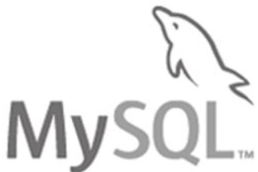
**1.使用官方镜像**
用户可以使用官方镜像快速启动一个MySQL Server实例：
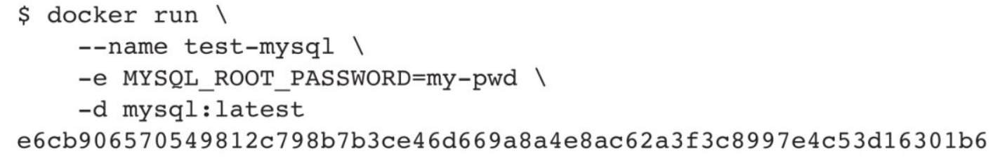
以上命令中的test-mysql是容器名称，my-pwd为数据库的root用户密码。
使用docker ps命令可以看到运行中的容器：
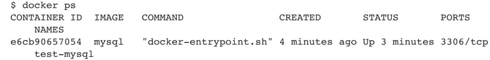
当然，还可以使用-link标签将一个应用容器连接至MySQL容器：
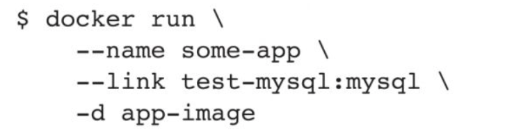
MySQL服务的标准端口是3306，用户可以通过CLI工具对配置进行修改：
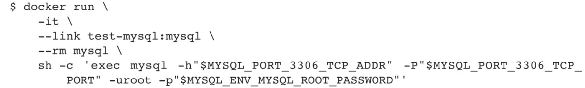
官方MySQL镜像还可以作为客户端，连接非Docker或者远程的MySQL实例：
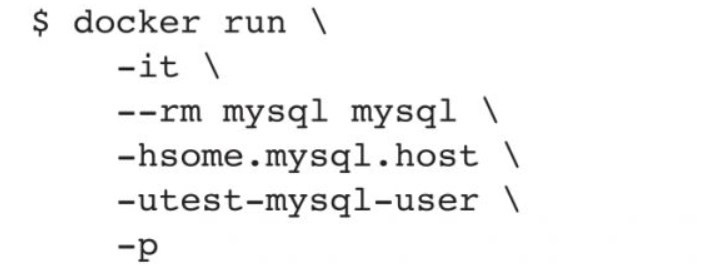
**2.系统与日志访问**
用户可以使用docker exec命令调用内部系统中的bash shell，以访问容器内部系统：
```shell
docker exec -it test-mysql bash
```
MySQL Server日志可以使用docker logs命令查看：
```shell
docker logs test-mysql
```
**3.使用自定义配置文件**
如果用户希望使用自定义MySQL配置，则可以创建一个目录，内置cnf配置文件，然后将其挂载至容器的/etc/mysql/conf.d目录。比如，自定义配置文件为/my/custom/config-file.cnf，则可以使用以下命令：
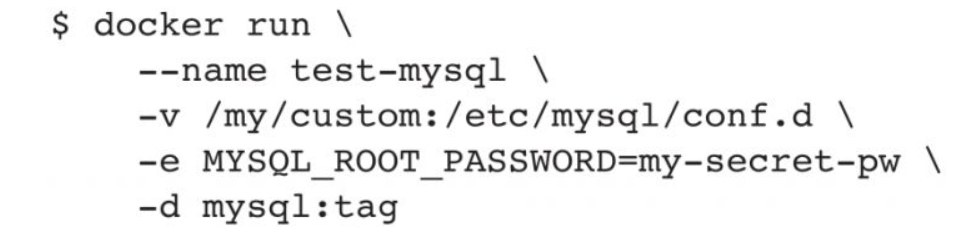
这时，新的容器test-mysql启动后，就会结合使用/etc/mysql/my.cnf和/etc/mysql/conf.d/config-file.cnf两个配置文件。这时，新的容器test-mysql启动后，就会结合使用/etc/mysql/my.cnf和/etc/mysql/conf.d/config-file.cnf两个配置文件。
**4.脱离cnf文件进行配置**
很多的配置选项可以通过标签传递至mysqld进程，这样用户就可以脱离cnf配置文件，对容器进行弹性的定制。比如，用户需要改变默认编码方式，将所有表格的编码方式修改为uft8mb4，则可以使用如下命令：
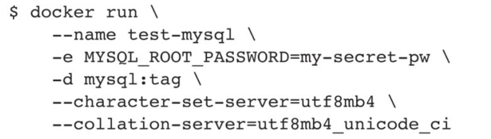
如果需要查看可用选项的完整列表，则可以执行如下命令：
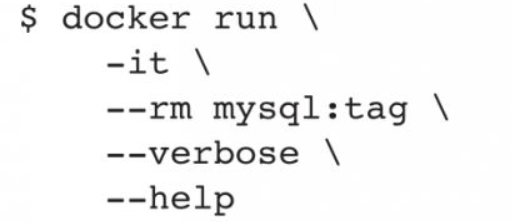
**5.通过docker-compose运行**
读者可以使用示例文件mysql-compose.yml：
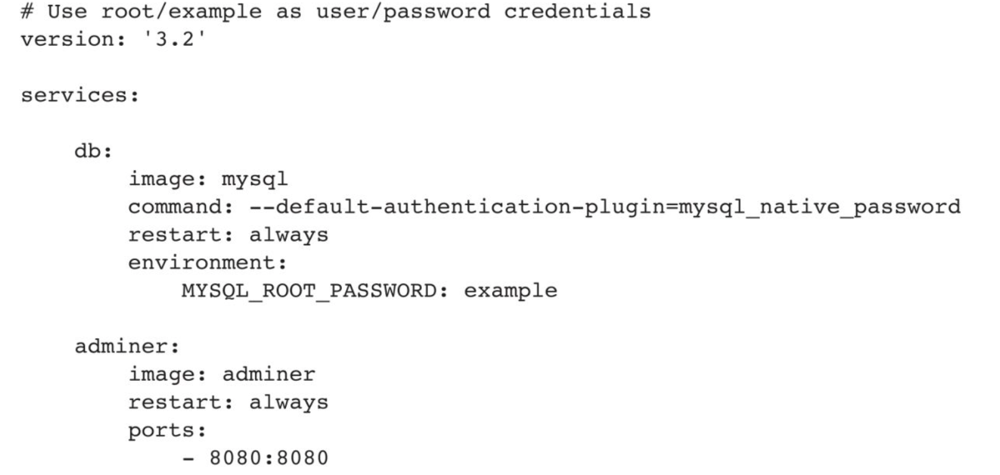
新建文件后，读者可以使用docker-compose-f mysql-compose.yml up命令进行启动：

初始化完毕后，可以使用http://localhost:8080访问服务。
**6.相关资源**
❑ MySQL官网：https://www.mysql.com/ 。
❑ MySQL官方镜像：https://hub.docker.com/_/mysql/ 。
❑ MySQL官方镜像仓库：https://github.com/docker-library/mysql/ 。
## 12.2 MongoDB
MongoDB是一款可扩展、高性能的开源文档(Document-Oriented)数据库，也是最流行的NoSQL数据库之一。它采用C++开发，支持复杂的数据类型和强大的查询语言，提供了关系数据库的绝大部分功能。MongoDB凭借其卓越的性能、简易的部署过程以及便捷的使用体验，已经在各个领域得到了广泛应用。

**1.使用官方镜像**
用户可以使用docker[container]run命令直接运行官方MongoDB镜像：
```shell
docker run --name mongo-container -d mongo
```
之后，可以通过docker ps命令查看正在运行的mongo-container容器的容器ID：
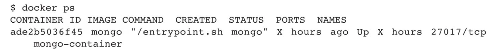
在此，mongo容器启动一个bash进程，并通过mongosh命令启动交互命令行，再通过db.stats()命令查看数据库状态：
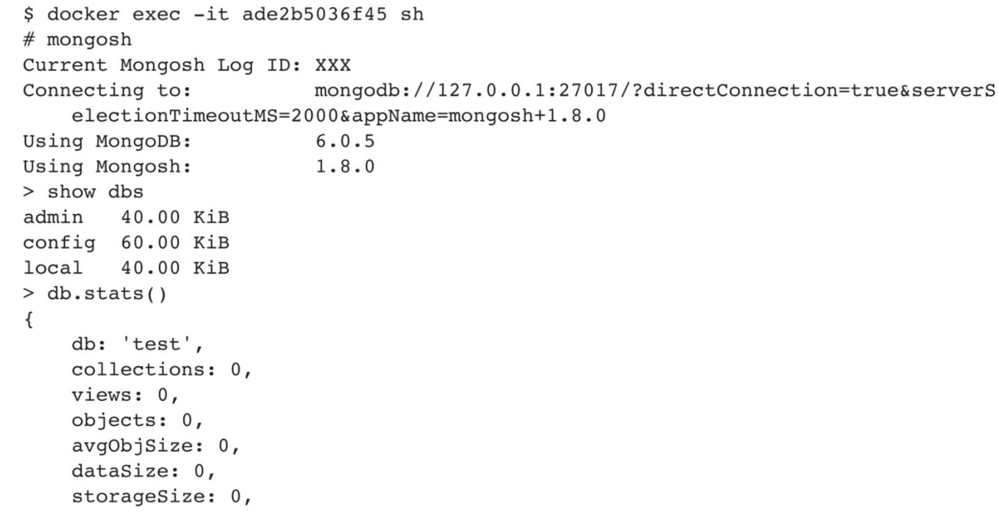
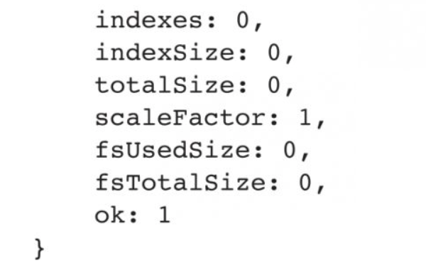
读者可以通过env命令查看环境变量的配置：
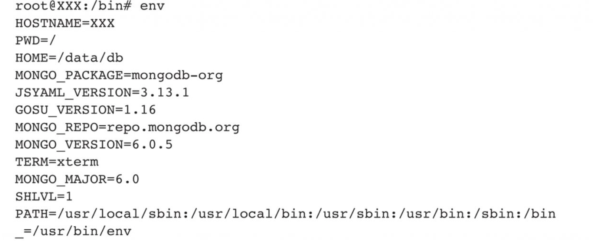
镜像默认暴露了mongodb的服务端口27017，可以通过该端口访问服务。
**2.通过link连接直接使用MongoDB容器**
读者可以使用--link参数，连接新建的mongo-container容器：
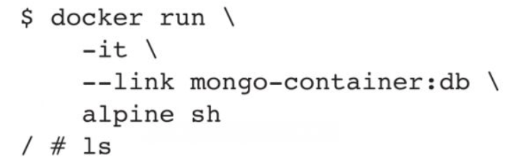
进入alpine系统容器后，读者可以使用ping命令测试Redis容器的连通性：
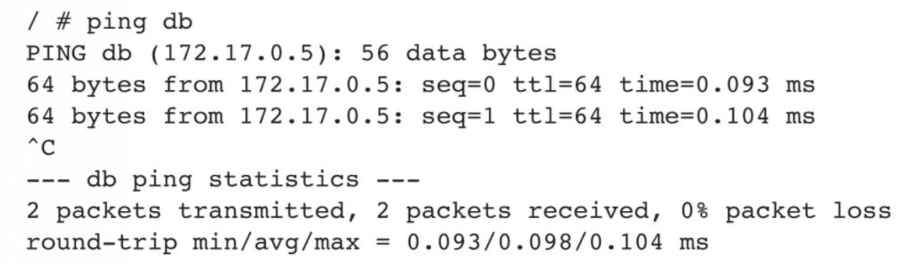
如果用户想直接在宿主机器上使用MongoDB，可以在docker[container]run命令后面加入entrypoint命令，这样就可以非常方便地直接进入mongosh了。读者可以在交互命令行使用db.help()读取帮助文档：
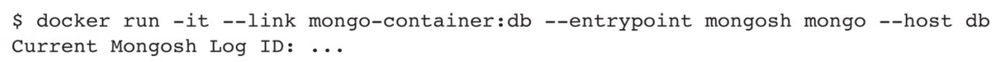
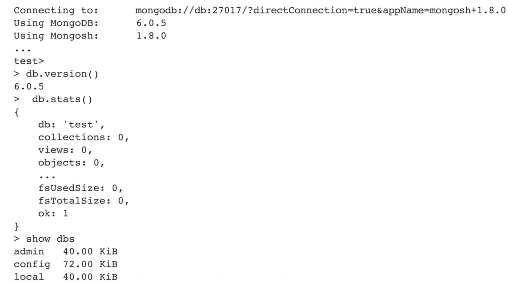
如果读者的生产环境是XFS文件系统，那么笔者推荐使用WiredTiger引擎，它基于BTree结构组织数据，相比MongoDB早期的MMAPv1存储引擎性能提升明显，且支持数据压缩，存储成本更低。读者可以使用--storageEngine参数来设置储存引擎：
```shell
docker run --name mongo-container -d mongo --storageEngine wiredTiger
```
**3.使用Compose编排**
代码如下：
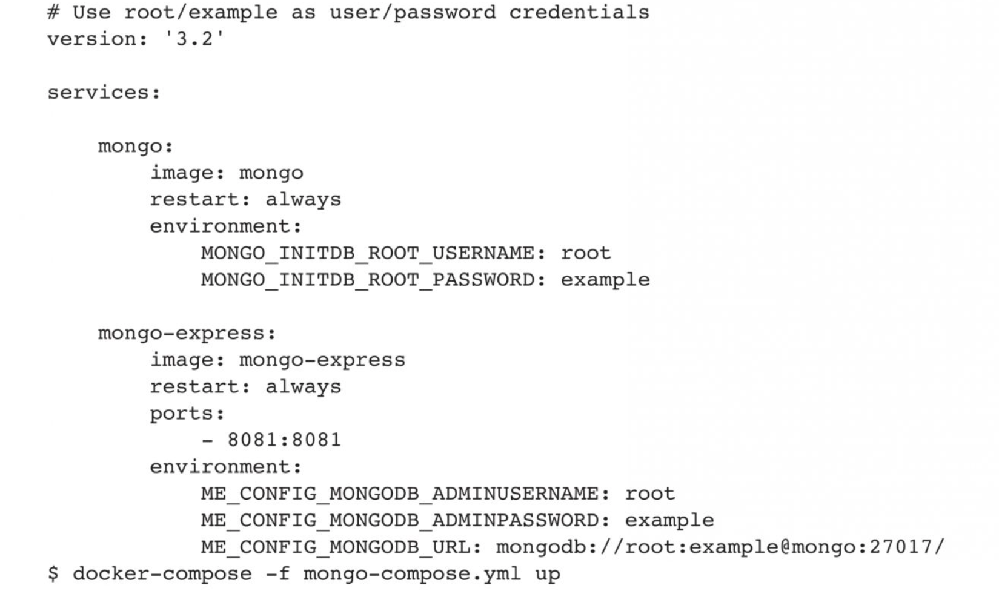
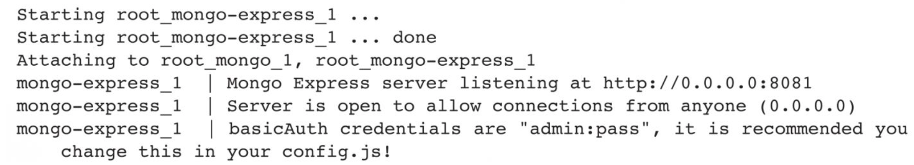
**4.使用自定义Dockerfile**
第一步，准备工作。新建项目目录，并在根目录新建Dockerfile，内容如下：
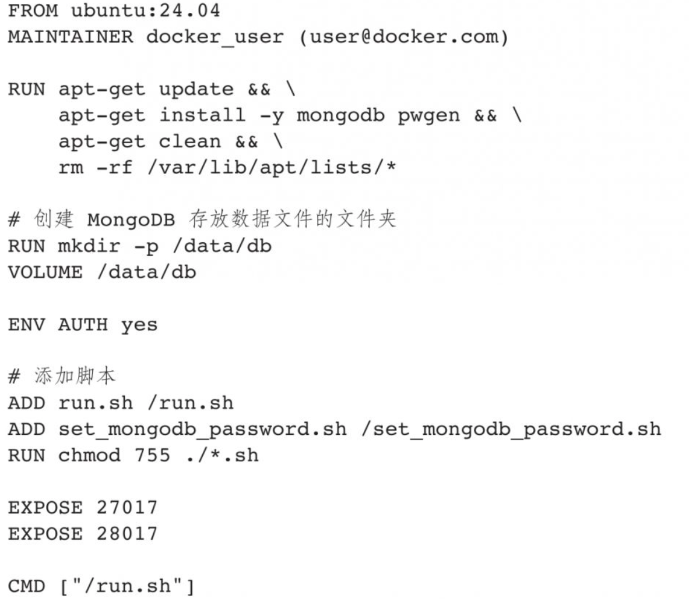
新建set_mongodb_password.sh脚本，此脚本主要负责配置数据库的用户名和密码：
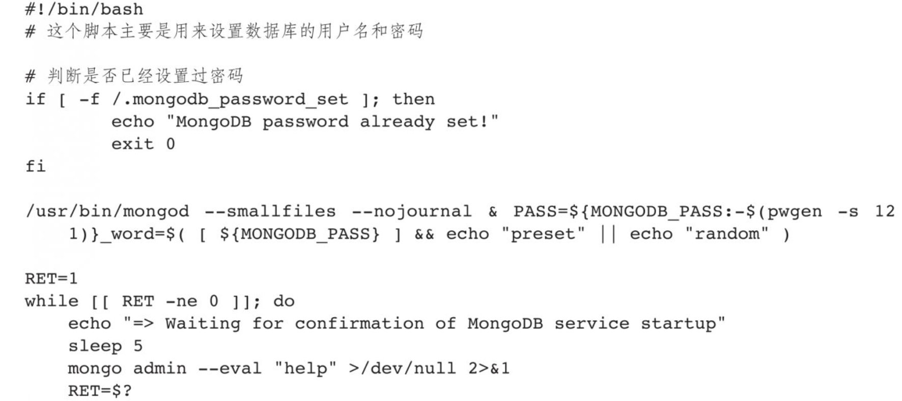
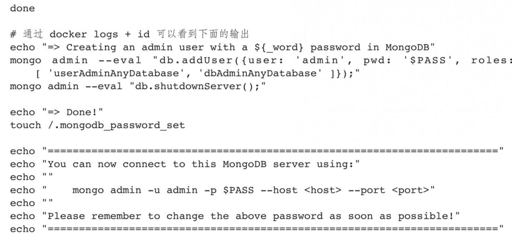
新建 run.sh，此脚本是主要的MongoDB启动脚本：
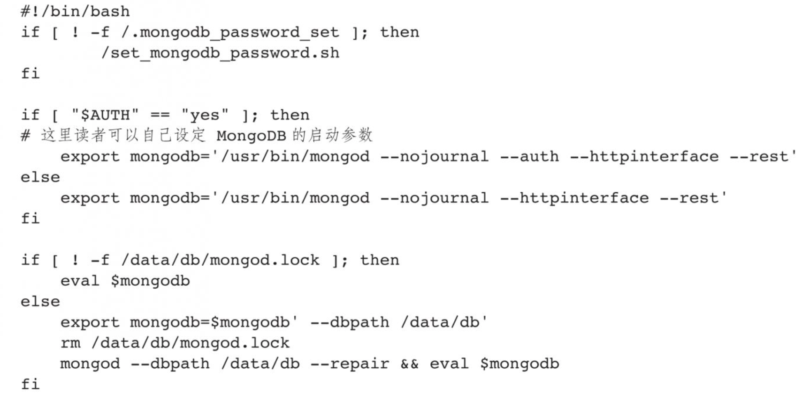
第二步，使用docker build命令构建镜像：
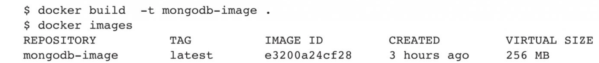
第三步，启动后台容器，并分别映射27017和28017端口到本地：
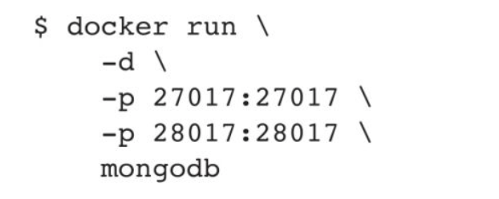
通过docker logs查看默认的admin账户密码：
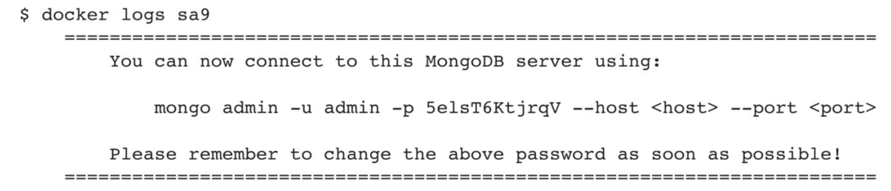
屏幕输出中的5elsT6KtjrqV就是admin用户的密码。也可以利用环境变量在容器启动时指定密码：
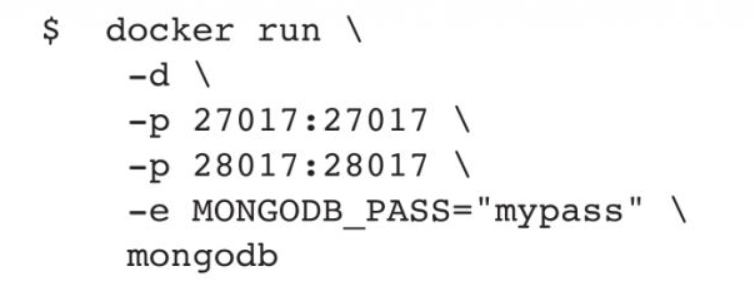
甚至设定为不需要密码即可访问：
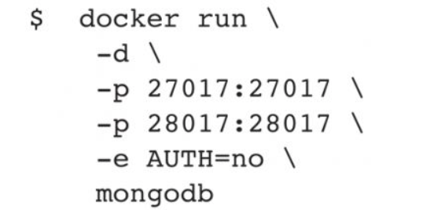
同样，读者也可以使用-v参数来映射本地目录到容器。
**5.MongoDB详细启动参数**
MongoDB的启动参数有很多，如表12-1所示。

表12-1　MongoDB的启动参数
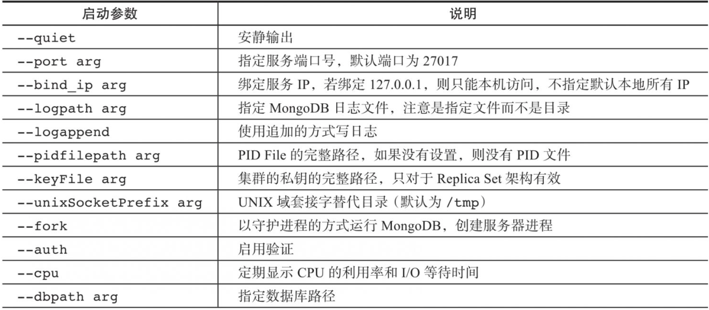
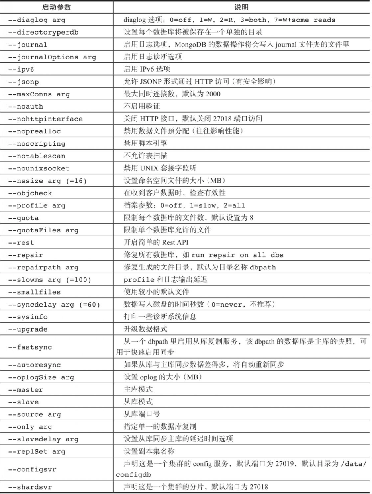
上述参数也可以直接在mongod.conf配置文件中配置，例如：
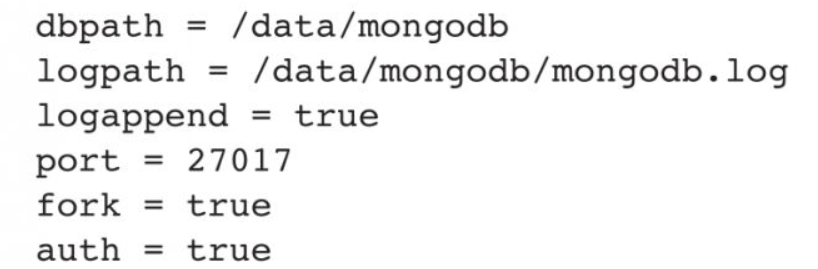
**6.相关资源**
❑ MongoDB官网：https://www.mongodb.org 。
❑ MongoDB官方镜像：https://hub.docker.com/_/mongo/ 。
❑ MongoDB官方镜像实现：https://github.com/docker-library/mongo 。
## 12.3 Redis
Redis是一个基于BSD许可的开源项目，它是一个内存中的数据结构存储系统，可以被广泛应用于数据库、缓存和消息中间件的场景。Redis的实现基于ANSI C语言。

它支持多种类型的数据结构，如string（字符串）​、hash（哈希）​、list（列表）​、set（集合）​、sorted set（有序集合）以及范围查询、bitmaps、hyperloglogs和地理空间geospatial索引半径查询等。另外，Redis也支持数据复制(replication)、LUA脚本、LRU驱动事件、事务处理和多种级别的持久化策略。通过哨兵和集群机制，Redis还能够为用户提供高可用性的保障。
**1.使用官方镜像**
用户可以通过docker[container]run命令直接启动一个redis-container容器：
```shell
docker run \
  --name redis-container \
  -d redis
```
之后可以通过docker ps命令查看正在运行的redis-container容器的容器ID：
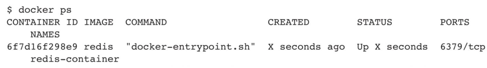
可以使用exec命令进入Redis容器并启动bash，使用env命令查看环境变量配置：
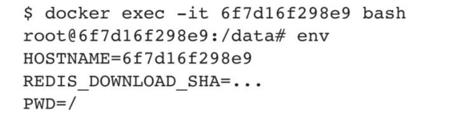
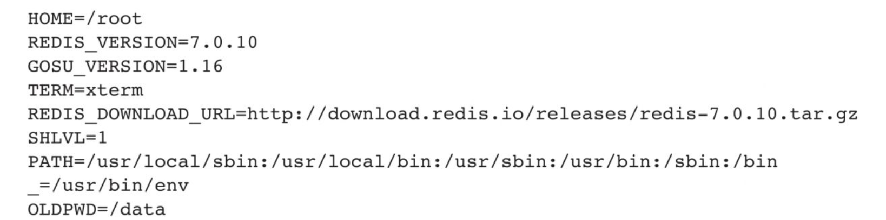
**2.连接Redis容器**
用户可以使用--link参数，连接创建的redis-container容器：
```shell
docker run \
  -it \
  --link redis-container：db \
  alpine sh
/ #  ls
```
进入alpine系统容器后，可以使用ping命令测试Redis容器，还可以使用nc命令（即NetCat）检测Redis服务的可用性：
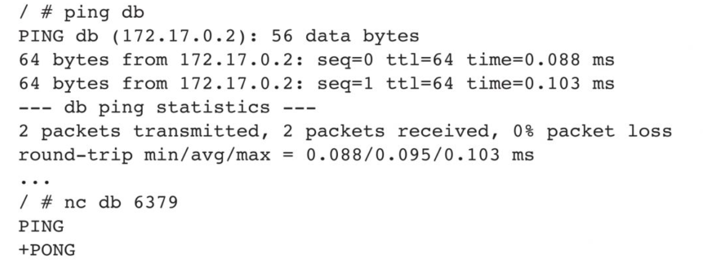
官方镜像内也自带了Redis客户端，可以通过以下命令直接使用：
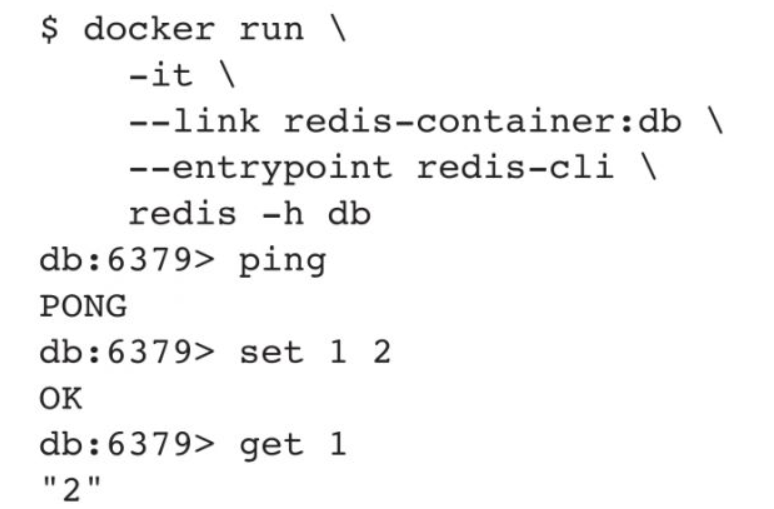
**3.使用自定义配置**
如果需要使用自定义的Redis配置，可以构建自定义镜像或使用数据卷。例如，如下所示的Dockerfile文件将本地的redis.conf配置文件复制到生成镜像中：
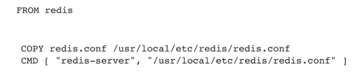
然后可以使用docker build命令，构建使用自定义配置的Redis镜像。如果使用数据卷映射自定义Redis配置，则可以通过以下命令完成：
```shell
docker run \
  -v /myredis/conf/redis.conf:/usr/local/etc/redis/redis.conf \
  --name myredis redis redis-server /usr/local/etc/redis/redis.conf
```
**4.相关资源**
❑ Redis官方网站：http://redis.io/ 。
❑ Redis官方镜像：https://hub.docker.com/_/redis/ 。
❑ Redis官方镜像仓库：https://github.com/docker-library/redis 。
## 12.4 Memcached
Memcached是一款基于BSD license协议发布的高性能、分布式开源内存对象缓存系统，最初由Danga Interactive开发，旨在优化LiveJournal的访问速度。如今，Memcached广泛应用于各类Web应用中。Memcached设计简洁、部署迅速、开发易于上手，其API还兼容绝大多数热门编程语言。Memcached基于C语言实现，并借助libevent实现高性能。

需要注意的是，由于Memcached的数据仅存储于内存中，在重启Memcached服务或操作系统时，数据可能全部丢失。
**1.使用官方镜像**
可以直接通过官方提供的Memcached镜像运行一个memcached-container容器：
```shell
docker run \
  --name memcached-container \
  -d memcached
```
在docker[container]run命令中可以设定Memcached服务器使用的内存大小：
```shell
docker run \
  --name memcached-container-2 \
  -d memcached memcached \
  -m 64
```
以上指令会将Memcached服务器的内存使用量设置为64MB。
此时，用户可以在宿主机器上直接用telnet测试访问Memcached容器，并直接输入客户端命令：
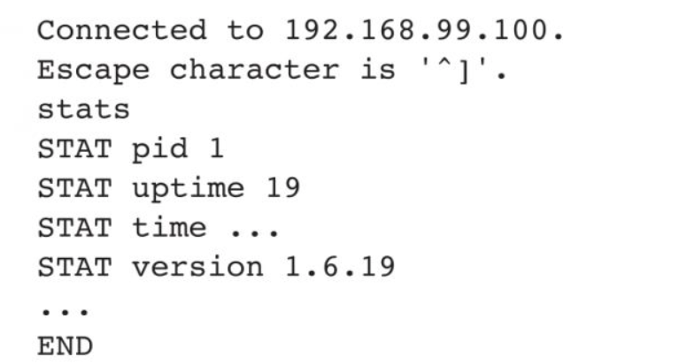
此外，还可以进行以下维护性操作。
通过docker ps命令查看正在运行的memcache-container容器的容器ID：
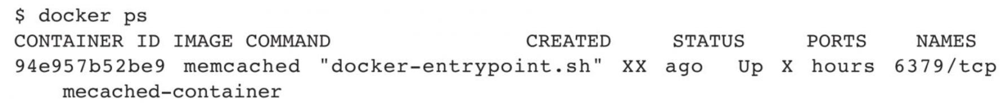
在Memcached容器内启动一个bash进程，查看此Memcached容器的运行时间和内存状况：
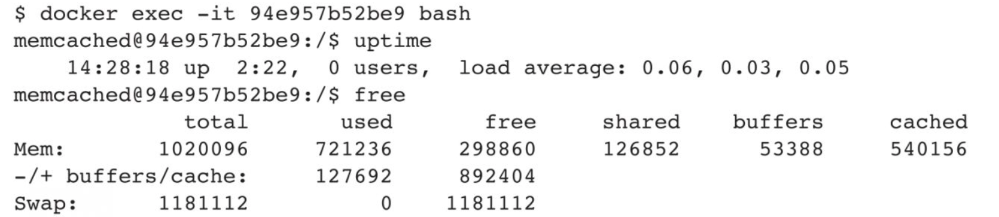
通过env命令查看环境变量的配置：
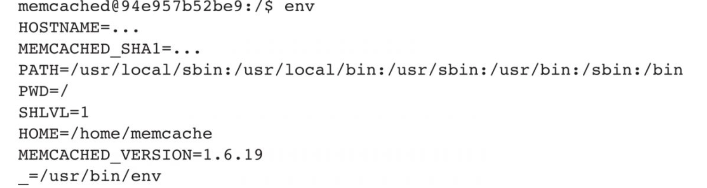
通过ps命令查看当前容器运行的进程信息：
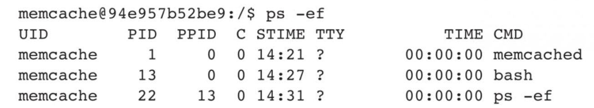
使用type命令查看当前Memcached进程使用的二进制文件地址：
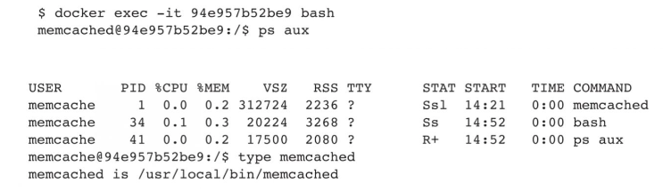
**2.连接Memcached容器**
用户可以使用--link参数，连接新建的memcached-container容器：
```shell
docker run \
  -it \
  --link memcached-container:db \
  alpine sh
/ #
```
进入alpine系统容器后，可以使用ping命令测试memcached-container容器的连通性：
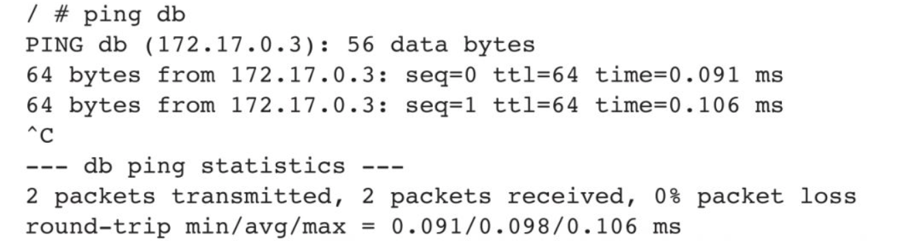
如果要检测Memcached服务的可用性，可以使用nc命令：
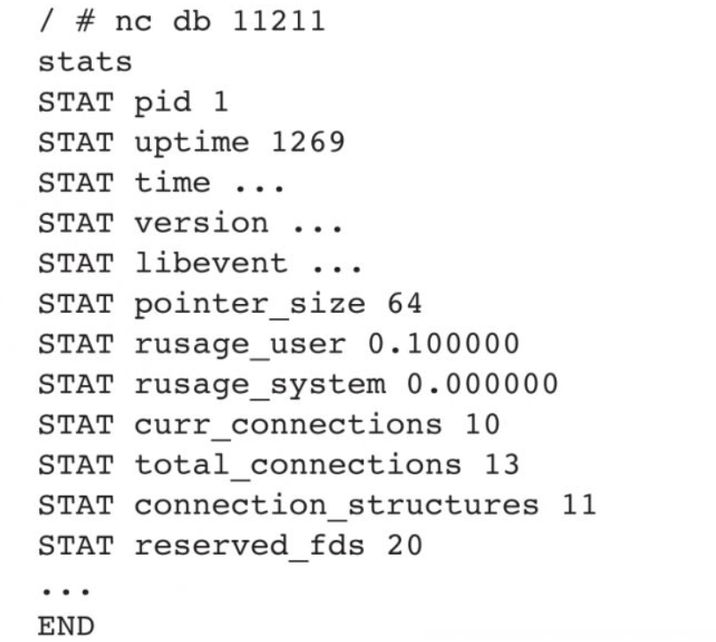
**3.相关资源**
❑ Memcached官网：http://memcached.org/ 。
❑ Memcached官方镜像：https://hub.docker.com/_/memcached/ 。
❑ Memcached官方镜像仓库：https://github.com/docker-library/memcached 。
## 12.5 本章小结
本章详细讲解了众多常见数据库软件镜像的使用方法，其中包括MySQL、MongoDB、Redis、Memcached等。通过学习本章内容，读者应能掌握在生产环境中部署和使用数据库容器的技巧。
当运用数据库容器时，建议将数据库文件映射至宿主机。这样做的好处有两方面：首先，可以缓解容器文件系统对性能的潜在影响；其次，可以实现数据的持久化，保证数据的安全性。
为了更好地理解和应用本章内容，读者需要具备一定的特定数据库特性和配置知识。读者可以参考数据库的使用手册或文档，以便更深入地学习和掌握相关技能。