# 第十五章 容器与云服务
章将深入探索公有云平台，如AWS、谷歌云、Azure、阿里云以及腾讯云对Docker容器服务的支持。
首先，笔者会介绍各大公有云平台上容器服务的现状，并阐述它们的特性以及优势。随后，笔者将针对这些特性和优势，解析它们在各种业务场景中的应用。
本章旨在帮助读者初步理解云平台容器服务，并做出合适的选择，以满足业务需求。通过对各个平台进行详细比较和分析，读者能获得对云平台服务较为全面的认识，并为其技术选型提供有力的支持。
## 15.1 云服务简介
云计算以按需的方式通过互联网提供IT资源，并基于使用量设定付费方式。诸如Amazon Web Services(AWS)、腾讯云、阿里云等云服务提供商允许用户根据需求获取技术服务，包括计算能力、存储和数据库，这消除了购买、拥有和维护物理数据中心和服务器的需要。各种规模、类型和行业的组织都在利用云进行各种应用，包括数据备份、灾难恢复、电子邮件、虚拟桌面、软件开发与测试、大数据分析，以及构建面向客户的Web应用程序，例如：医疗保健公司正在利用云技术为患者开发个性化治疗方法；金融服务公司利用云技术支持实时欺诈检测和预防；电子游戏制造商利用云技术为全球数以百万计的玩家提供在线游戏。
目前，云平台主要分为公有云和私有云两种模式，也有两者可以互通的混合模式。
公有云是标准云计算的一种服务模式，由第三方供应商通过公共网络提供，向所有希望使用或购买的人开放。这种服务可能是免费的，也可能是按需提供的，允许客户根据CPU使用周期、存储或带宽使用量支付费用。这些服务供应商创造的公共计算资源，比如网络和存储资源，可以被公众和企业通过公共网络获取。
目前，许多公有云供应商都提供能够运行Docker环境的虚拟机，并且各家公有云供应商也都发布了自己的容器服务。云原生技术正在成为企业云化应用实现大规模现代化的首选方式。许多大型企业正在寻求企业级容器平台，以便通过全栈云原生功能来加速和简化云原生应用程序的开发和运维，并且实现弹性、可管理性和可观察性。
相对于私有云，公有云能够节省企业购买、管理和维护本地硬件及应用程序基础设施的高昂成本，因为云服务提供商将负责所有的系统管理和维护工作。与本地基础设施相比，公有云还可以更快地部署，并提供一个可以无限扩展的平台。只要企业员工能够访问互联网，他们就可以在任何地点使用任何设备访问相同的应用程序。虽然有人对公有云环境的安全性有所担忧，但如果提供商采取了适当的安全措施，如入侵检测和防御系统(IDPS)，公有云可以达到与高效管理的私有云同样的安全性。
私有云是指通过互联网或专用内部网络为特定用户群体（而非一般公众）提供的计算服务。私有云也称为专有云或企业云，它不仅具有许多公有云的优势（包括自助服务、可伸缩性和弹性）​，还借助专用资源提供了更多的控制和定制能力，超越了传统本地托管的计算基础设施。
此外，私有云通过公司防火墙和内部托管提供更高级别的安全和隐私，确保第三方提供商无法访问其敏感数据。不过，私有云的成本和管理责任由公司IT部门承担。
因此，私有云需要具有与传统数据中心所有者相同的人员配备、管理和维护费用。
私有云可提供两种模式的云服务：基础设施即服务(IaaS)，使公司能够使用基础设施资源，如计算、网络和存储；平台即服务(PaaS)，使公司能够提供各种应用程序，从基于云的简单应用到复杂的企业应用。私有云也可以与公有云结合，形成混合云，这样当计算需求增加时，可以利用云爆发扩展计算服务规模，释放更多空间到公有云。
## 15.2 AWS
AWS是一项全球领先的云服务，它通过全球数据中心提供了超过200种功能丰富的服务，是全球最全面且广泛使用的云平台。无论是增长最迅速的初创公司，还是规模最大的企业，抑或主要的政府机构，数百万的客户都选择了AWS，以降低成本、增强灵活性，并加速创新。作为亚马逊公司旗下的IaaS和PaaS产品，AWS提供了包括弹性计算、存储、数据库和应用程序在内的一整套云计算服务，它能够帮助企业有效减少IT投入和维护成本。
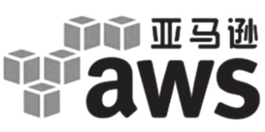
自2006年以来，AWS一直在为各种规模的公司提供云端技术服务平台。通过AWS，软件开发者可以便捷地购买基于Internet的计算、存储、数据库等服务以支持他们的应用程序。他们可以自由选择任何开发平台或编程环境，以更有效地解决问题。由于费用是按使用量计算的，不需要在前期进行大量的资本投入，因此AWS成为一种高效且经济的解决方案，以向最终用户提供计算资源、保存的数据和其他应用程序。
2015年，AWS正式推出容器服务Amazon ECS，如图15-1所示。AWS ECS旨在简化Docker容器的使用，它提供了一个集群和编排层，以控制主机上的容器部署，以及管理集群内的容器生命周期。此后，AWS还推出了一系列丰富的容器类产品。
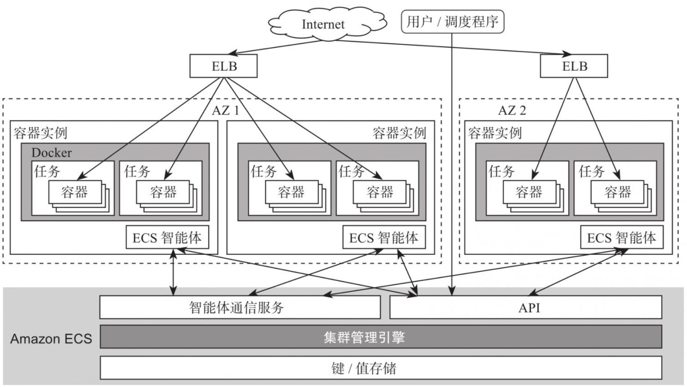
图15-1　AWS容器服务

Amazon ECS提供了一种高度安全、可靠且可扩展的容器运行环境，是一个完全托管的容器编排服务，简化了容器化应用程序的部署、管理和伸缩过程。只需描述应用程序及其所需的资源，Amazon ECS就能启动、监控和扩展用户的应用程序，同时还能自动集成用户应用所需的其他AWS服务。
此外，Amazon ECS Anywhere是Amazon ECS的一项功能，允许用户在自有的基础设施上轻松运行和管理工作负载，既满足了合规性要求，又能扩展业务规模，而不必放弃本地投资。
Amazon Elastic Kubernetes Service(Amazon EKS)是一个托管的Kubernetes服务，可以在AWS Cloud和本地数据中心运行Kubernetes。Amazon EKS在本地提供了一致且完全支持的Kubernetes解决方案，实现了与AWS网络和安全服务的深度集成。
Amazon EKS Anywhere则让用户在自己的基础设施中创建和运营Kubernetes集群，提供了一个比自主管理的Kubernetes产品更可靠的本地Kubernetes环境。
AWS App2Container(A2C)是一款命令行工具，能够将Java和.NET Web应用程序迁移到现代化的容器格式。AWS A2C能够分析在裸机、虚拟机、Amazon EC2实例或云端运行的应用程序并建立清单。
AWS App Runner是一种完全托管的容器应用服务，允许用户构建、部署和运行容器化Web应用程序和API服务，无须具备任何基础设施或容器方面的经验。而且，可以实现大规模构建并运行安全的Web应用程序。
AWS Fargate则是一种无服务器计算引擎，让用户可以专注于构建应用程序，而无须管理服务器。AWS Fargate与Amazon ECS和Amazon EKS兼容。
Amazon Elastic Container Registry(Amazon ECR)是一个完全托管的容器注册表，提供高性能的托管服务，让用户可以在任何地方可靠地部署应用程序镜像和构建。
最后，AWS的Red Hat OpenShift服务（即ROSA）提供了集成化的OpenShift使用体验，用户可以使用各种AWS的计算、数据库、分析、机器学习(ML)、网络、移动等服务来更快地构建安全且可扩展的应用程序。
## 15.3 谷歌云服务
Google Cloud Platform(GCP)是谷歌提供的一套全面的云服务套件，让企业专注于核心业务，而将IT基础设施的烦琐管理任务交由谷歌处理。GCP涵盖了AppEngine、Container Engine、Container Registry，以及众多的数据库、网络、安全、大数据，甚至包括机器学习产品等。GCP的服务网络遍布全球200多个国家和地区，包含35个区域、106个可用区，以及176个网络边缘位置。
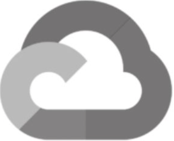
Google Kubernetes Engine(GKE)是一个全自动化、高度可扩展的Kubernetes服务，所提供的Autopilot模式使用户无须再管理节点或考虑容量问题，大大降低了集 群成本，同时也减少了集群运营的专业知识需求。
Autopilot模式是GKE的一种全托管Kubernetes服务，它负责管理集群的底层计算基础设施，无须用户进行配置或监控，同时还提供了完整的Kubernetes使用体验。它的费用按Pod计算，用户只需为实际运行的Pod支付费用，无须为系统组件、操作系统开销或未分配的容量付费，这样既节约了资源，又提升了运营效率。
在网络和安全性方面，GKE提供了专用网络集群，可以限制专用端点的访问，或只允许特定的地址范围访问公共端点。GKESandbox提供了一层额外的安全防御，加强了容器化工作负载的安全性。此外，GKE集群支持Kubernetes的网络政策，可以利用Pod级别的防火墙规则来控制流量。
GKE还提供了预构建的Kubernetes应用和模板，用户可以使用这些包含预构建部署模板的企业级容器化解决方案，这些方案具有可移植性、简化的许可机制以及合并结算功能。这些解决方案不仅仅是简单的容器镜像，还包括各种开源应用、商业应用和谷歌构建的应用，能够提升开发者的工作效率。用户可以通过Google CloudMarketplace在本地或第三方云环境中进行一键部署。
GKE还支持完全的Kubernetes API、四向自动扩缩、发布渠道以及多集群的支持，能够扩展至最多15000个节点。Pod的横向自动扩缩可以根据CPU使用率或自定义指标进行调整，集群的自动扩缩则是在每个节点池内进行。Pod的纵向自动扩缩会持续监控Pod的CPU和内存使用情况，并根据需求自动调整CPU和内存资源。
此外，GKE提供名为Migrate to Containers的自动化工具，该工具可以轻松地对传统应用进行现代化改造，从虚拟机迁移到容器环境。该工具的独特自动化方法可以 从虚拟机中提取关键应用元素，方便用户将这些元素插入不含虚拟机层（如客户机操作系统）的GKE或Anthos集群内的容器中。这一产品也可以与GKE Autopilot模式联动使用。图15-2展示了如何在开发场景中使用谷歌容器引擎。
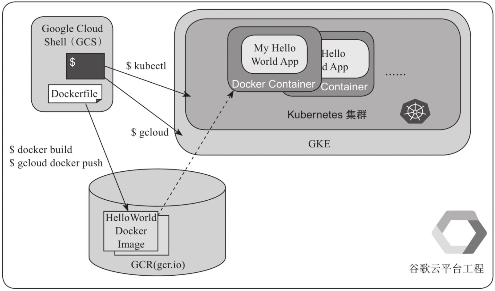
图15-2　GCP容器服务的开发场景

GCP提供了一系列容器化产品，包括Cloud Build、Deep Learning Containers、Knative以及Artifact Registry。
Cloud Build是GCP的无服务器CI/CD平台，用于构建、测试和部署应用。它的主要特性如下。
❑ 极速构建：通过利用Google全球网络互连的机器，可以显著缩短构建时间。用户还可以在高性能CPU虚拟机上运行构建作业或缓存源代码、镜像或其他依赖项，进一步加快构建速度。
❑ 自动化部署：在构建步骤中创建流水线，实现自动化部署。使用内置的集成功能，可以将代码部署到Google Kubernetes Engine、Cloud Run、App Engine、Cloud Functions和Firebase等平台。配合Cloud Build和Spinnaker，用户可以创建和执行复杂的流水线。
❑ 在整个网络中实现大规模的CI/CD：用户可以从默认或专用池中选择，根据用户的网络和扩缩需求运行工作负载。默认池允许用户在能够访问公共互联网的安全托管环境中运行构建。专用池是专用的工作负载池，可以为用户提供更大的构建环境灵活性和并发性，同时也能够访问专用网络中的资源。
Deep Learning Containers是专为深度学习环境预设定和优化的容器，为用户的AI应用提供一个便携式、一致性的开发、测试和部署环境，助力用户快速构建原型。这些Docker镜像已经针对流行的框架进行了性能优化和兼容性测试，并能直接部署。Deep Learning Containers为Google Cloud的各类服务提供了一致的环境，使用户可以轻松地扩缩云规模或从本地迁移到云端。用户可以灵活地在GoogleKubernetes Engine(GKE)、Vertex AI、Cloud Run、Compute Engine、Kubernetes和Docker Swarm等平台上进行部署。
Knative是一个基于Kubernetes的平台，用于构建、部署和管理现代的无服务器工作负载，其主要特性如下。
❑ 全能的基础组件：Knative是由Google初创并由50多家不同公司贡献代码的项目。它为在Kubernetes上构建和运行无服务器应用提供了一套核心组件。这些组件提供了诸如缩减至零、自动扩缩、集群内构建以及事件驱动等功能。无论用户是在本地、云端还是在第三方数据中心，Knative都能够提供源于实践中的、基于 Kubernetes的标准化最佳实践。
❑ 对开发者友好的软件：Knative提供了一套可重用的组件，可以解决许多烦琐的问题，如构建应用（从源代码到容器镜像）​、部署期间的流量路由和管理、自动扩缩工作负载等。Knative将容器镜像视为部署的基本单元，因此，开发者可以使用他们熟悉的任何语言、框架或开发风格。
❑ 支持流行的开发模式：Knative支持开发者习惯的开发模式，如GitOps、DockerOps、ManualOps，以及支持Django、Ruby on Rails、Spring等各种工具和框架。
❑ 灵活性和可控性：Knative旨在使用户能够轻松地嵌入现有的构建工具链和持续集成/持续交付工具链。借助基于Kubernetes的、可以在任何地点、任何云和任何基础设施上运行的开源优先技术，用户可以自由地将工作负载迁移到最合适的地方。这为用户提供了调整系统以适应独特需求的灵活性和可控性。
Artifact Registry是Google Cloud的一项服务，可以帮助用户管理和保护Docker容器镜像以及其他语言包。它是Container Registry的升级版本，提供了更丰富的功能，包括对多个位置的支持、细粒度的访问控制和集成的Vulnerability Analysis。
Google Cloud Deploy是一款持续交付工具，专为Google Kubernetes Engine、Cloud Run和Anthos设计，它的主要特性如下。
❑ 简化的持续交付：Google Cloud Deploy能够简化持续交付流程，使用户可以轻松、高效地持续交付到GKE、Cloud Run和Anthos。用户可以在Web控制台、CLI或API上进行一步式的版本升级和回滚。内置的指标使用户可以深入了解部署频率和成功率。
❑ 全代管式单一管理平台：Google Cloud Deploy是一个全代管式服务，无须设置和管理基础设施。它还提供自动扩缩功能，以优化成本和性能。此外，它还提供了一个集中化的管理平台，用户可以在此监控和控制整个组织内部署候选版本的提升过程。
❑ 与Google Cloud紧密集成：Google Cloud Deploy与GKE、Cloud Run和Anthos的集成度最高。此外，用户可以使用IAM锁定版本进度，使用CloudLogging监控版本事件，使用Cloud Audit Logs实现可追溯性，以及将监控功能连接到已部署的资源。
❑ 与用户喜爱的工具集成：Google Cloud Deploy能够与诸多常用的DevOps工具（例如CI和工单系统）进行集成。Google Cloud Deploy将Skaffold引入流水线，与Cloud Code协同工作，使开发和CI/CD流水线保持一致。
Deep Learning Containers是专门为深度学习环境预配置并优化的容器解决方案。它提供一种可移植且一致的开发、测试和部署环境，让用户能够迅速为用户的AI应用构建原型。这些Docker镜像经过了精心优化和兼容性测试，可直接部署使用，采用流行的深度学习框架。借助Deep Learning Containers，用户可以确保在各种Google Cloud服务上实现环境的一致性，无论是在云端进行扩展，还是从本地环境迁移到云端，都能轻松实现。无论用户选择GKE、Vertex AI、Cloud Run、Compute Engine，还是Kubernetes和Docker Swarm，Deep LearningContainers都能提供灵活的部署选项。它的主要特性如下。  
❑ 一致的环境：Deep Learning Containers提供了一个可移植且一致的环境，无论是从本地环境迁移到云端，还是在云环境中运行，都能保证环境的一致性。
❑ 迅速构建原型：所有必要的框架、库和驱动程序已预先安装并经过兼容性测试，助用户快速启动AI项目。
❑ 优化的性能：利用最新版本的深度学习框架和NVIDIACUDA-X AI库，DeepLearning Containers可以显著加快模型的训练和部署速度。
❑ 广泛支持的框架：Deep Learning Containers支持市场上最流行的机器学习框架，如TensorFlow、PyTorch和Scikit-Learn，并计划在未来支持更多框架。
## 15.4 Azure云服务
Azure在容器技术方面的发展始于2014年，首先通过在Linux虚拟机上兼容Docker的方式来吸引开发者社区。同年，Azure进一步联手Google和Docker，提供对Kubernetes和Swarm开源项目在其云平台上的运行支持，而Docker官方也相应推出了Docker Machine的Azure版本。2015年，Azure推出了其容器服务(AzureContainer Service，ACS)，支持Docker Swarm和Apache Mesos集群编排工具。
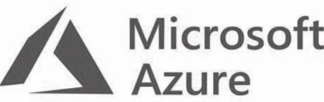
ACS的主要特性如下。
❑ 创建优化型的托管解决方案容器：ACS针对Azure优化了常用的开源工具和技术配置，从而提供了开放且具有可移植性的解决方案，方便用户对容器和应用程序进行配置。用户只需选择规模、主机数量及Orchestrator工具选项，ACS就会自动处理所有剩余事项。
❑ 利用熟悉的工具管理容器应用程序：用户在将容器工作负荷迁移到云端时，无须更改现有的管理措施。通过标准的适用于所选Orchestrator的API终端，用户可使用熟悉的应用程序管理工具。
❑ 使用DC/OS或DockerSwarm进行缩放和协调：用户可选择最适合其Docker容器业务流程和缩放需求的工具和解决方案，包括基于Mesos的DC/OS，或者DockerSwarm和Compose。
❑ 使用常用的开源工具：由于ACS公开了业务流程引擎的标准API终结点，因此最常用的工具将与Azure容器服务兼容，大多数情况下是即时可用的，包括可视化工具、监控工具、持续集成工具、命令行工具，以及未来可能推出的工具。
❑ 通过Azure进行容器工作负荷的来回迁移：Azure容器服务在业务流程层仅使用开源组件，为整体应用程序（而非单个容器）提供可移植性，用户可以无缝地进行与Azure的来回迁移。Azure Kubernetes服务(AKS)提供了在Azure、数据中心或边缘使用内置代码到云管道和护栏快速开发和部署云原生应用的方式。用户可通过AKS实现本地、边缘和多云Kubernetes集群的统一管理和治理，并与Azure的安全性、标识、成本管理和迁移服务互操作。AKS的主要特性包括：
❑ 拥有自动化管理和可扩展的Kubernetes集群，适用于企业级容器业务流程。
❑ 通过调试、CI/CD、事件日志和自动节点维护来提高端到端开发人员的工作效率。
❑ 具备高级标识和访问管理，可监视和维护容器安全性以进行大规模治理。
❑ 使用AzureArc在所选的基础架构上部署支持Linux、WindowsServer和IoT资源的AKS。
Azure Kubernetes Fleet Manager可以轻松处理Azure Kubernetes服务集群的多集群方案，包括工作负载传播、北向-南向负载均衡（用于处理流入成员集群的流量）​，以及跨多个集群的业务流程升级。Fleet Manager的主要特性包括：
❑ 能够集中管理所有集群的Fleet集群。
❑ 托管的中心集群负责处理升级和Kubernetes集群配置。
❑ 通过Kubernetes配置传播，可以使用策略和替代物跨Fleet成员集群传播对象。
❑ 北向-南向负载均衡器协调部署在Fleet的多个成员集群中的工作负载的流量流动。
Azure Red Hat OpenShift提供了一种按需供应的高可用、完全托管的OpenShift集群，这个集群由Microsoft和Red Hat联合监控和运营。OpenShift基于Kubernetes核心构建，并引入了可增值的功能来补充Kubernetes，以打造为一种统包式的容器平台即服务，极大地优化了开发人员和操作员的体验。OpenShift的主要特性包括：
❑ 高可用、全托管的公共和专业集群，实现自动化操作和无缝平台升级。
❑ 在上游Kubernetes的基础上构建，并捆绑一系列关键功能，形成完整的平台以实现统一操作。
❑ Microsoft和Red Hat的联合工程、操作和支持，已通过多项合规性认证。
❑ 在全球超过20个区域中将集群部署到Azure，并通过订阅进行计费。
Azure Container Instance(ACI)是一种以虚拟机监控程序隔离的方式运行容器的服务，用户无须管理服务器即可运行容器。通过在ACI中运行工作负载，用户可将关注点集中在应用程序的设计和构建上，而不必分心管理运行应用程序的基础架构。ACI支持按需增强容器的灵敏性，用户可以使用单一命令将容器部署到云端，这种速度和便利性是前所未有的。在需要的时候，用户可以使用ACI为密集型工作负载预配额外的计算资源。例如，可以利用VirtualKubelet，在流量峰值时利用ACI从AzureKubernetes服务(AKS)集群中弹性地突发。通过虚拟机监控程序隔离来保证应用程序的安全性，用户可以获得适合其容器工作负载的虚拟机安全性，同时保持轻量级容器的效率。ACI利用虚拟机监控程序隔离每个容器组，确保每个容器都不共享内核并能独立运行。ACI的主要特性包括：
❑ 借助AKS进行弹性扩展：ACI提供独立的快速计算资源，可以满足峰值流量的需求，而无须用户管理服务器。例如，AKS可以使用Virtual Kubelet，在ACI内部预配Pod时几秒内即可启动，这使得AKS的运行容量能够满足平均工作负载的需求。如果AKS集群中的容量不足，那么用户可以在ACI中扩展额外的Pod，而无须管理任何其 他服务器。
❑ 结合Azure逻辑应用的事件驱动应用程序：用户可以将ACI与ACI逻辑应用连接器、Azure队列和Azure Functions相结合，构建出强大的基础设施，实现按需弹性扩展容器。借助Azure容器实例，用户可以运行能够对事件进行响应的复杂任务。
❑ 数据处理任务：使用Azure容器实例进行数据处理，可以引入、处理源数据并将其放入Azure Blob存储等持久存储设备中。使用ACI而不是静态预配的虚拟机处理数据，可以实现按秒计费，从而节省大量成本。
Azure容器应用是一种使用无服务器容器生成和部署完全托管的云原生应用和微服务的服务，是基于Kubernetes的应用程序平台，可以帮助用户从代码或容器部署应用，而无须协调复杂的基础架构。用户可以使用统一的集中式网络、可观察性、动态缩放和配置来构建异构的现代应用或微服务，以提高工作效率。Azure容器应用支持设计复原微服务，并全面支持Dapr和动态缩放，由KEDA提供支持。Azure容器应用的主要特性包括：
❑ 提供高级标识和访问管理，用于监控和维护大规模的容器安全性。
❑ 使用Azure Arc在任何基础设施上部署支持Linux和Windows Server资源的AKS。
❑ 具有安全性、可移植性、弹性和资源效率，适合各种用途和环境。
## 15.5 阿里云容器服务
阿里云创立于2009年，是全球领先的云计算和信息科技公司，为200多个国家和地区的企业、开发者和政府机构提供安全、可靠的在线公共服务。
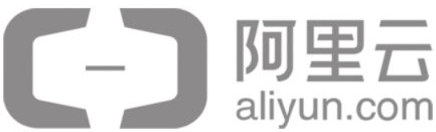
阿里云的容器服务Kubernetes版(ACK)提供了高性能且可伸缩的容器应用管理能力，支持企业级容器化应用的全生命周期管理（见图15-3）​。自2021年起，阿里云成为连续三年入选Gartner公共云容器报告的国内唯一产品，并于2022年成为国内唯一进入Forrester领导者象限的服务。阿里云通过整合其虚拟化、存储、网络和安全能力，帮助企业在云端高效运行Kubernetes容器化应用。目前，阿里云的容器服务已经扩展到全球六大洲，成为中国领先的公共云平台。在需要云服务的企业环境中，ACK提供统一的容器基础设施，使用户能够根据自身的业务和数据管理需求，在最适合的地方选择开放且一致的云能力。这包括实现统一集群管理、统一资源调度、统一数据容灾和统一应用交付，以构建现代化的云原生IT架构。阿里云的核心产品包括容器服务ACK、容器镜像服务ACR、边缘容器ACK@Edge、Serverless容器服务ASK、云原生AI套件，以及分布式云容器平台ACK One。
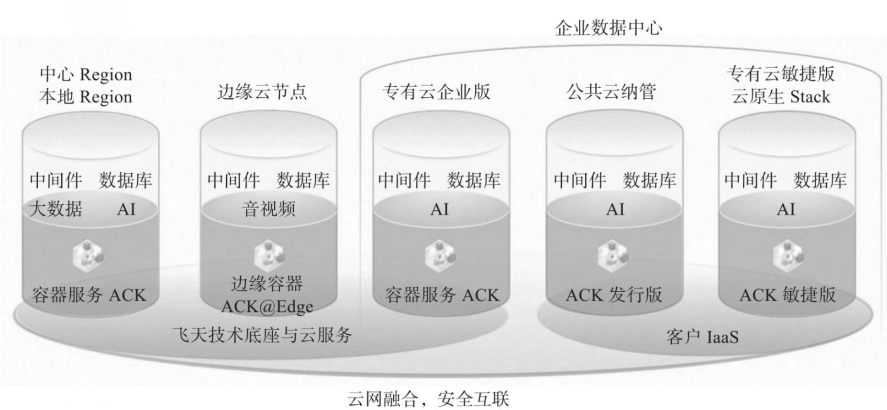
图15-3　阿里云容器服务
阿里云的容器镜像服务(ACR)是一款专为容器镜像、Helm Chart等符合OCI标准的云原生制品提供安全托管及高效分发服务的平台，提供全球同步加速、大规模/大镜像分发加速和多代码源构建加速等全链路提效服务。通过无缝集成阿里云的容器服务ACK，ACR可帮助企业降低交付复杂度，打造一站式云原生应用解决方案。
Serverless版的阿里云容器服务(ASK)是一款基于阿里云弹性计算基础架构，同时与Kubernetes生态完全兼容的安全、可靠的容器产品。通过ASK，用户无须管理和维护集群，即可快速创建Kubernetes容器应用，并根据应用实际使用的CPU和内存资源量进行按需付费。这使用户可以将更多的注意力集中在应用本身，而非运行应用的基础设施。
云原生AI套件是一个基于标准Kubernetes的服务，通过可组装、可扩展的架构，提供了加速AI平台构建、提高资源效率和交付速度的解决方案。无论在公共云、专有云、混合云，还是边缘场景下，都能实现统一运维CPU、GPU、NPU等异构算力，高效调度AI和大数据作业，加速数据访问和计算，管理AI任务生命周期，全栈优化AI工程效率。
阿里云分布式云容器平台(ACK One)是一款面向混合云、多集群、分布式计算和容灾等场景的企业级云原生平台，支持连接并管理任何地域、任何基础设施上的Kubernetes集群，提供一致的管理和社区兼容的API，同时支持对计算、网络、存储、安全、监控、日志、作业、应用、流量等进行统一运维管控。
阿里云的边缘容器服务(ACK@Edge)是一款提供标准Kubernetes集群云端托管的服务，能支持边缘计算资源、业务快速接入、统一管理和运维，帮助实现云边一体化协同。无论是边缘异构资源的快速接入，还是断网、弱网环境下边缘端的自治能力，都能通过ACK@Edge实现。
下面，笔者将对ACK产品进一步展开介绍。阿里云容器服务Kubernetes版(ACK)是全球首批通过Kubernetes一致性认证的服务平台，提供高性能的容器应用管理服务，支持企业级Kubernetes容器化应用的生命周期管理，让用户轻松、高效地在云端运行Kubernetes容器化应用。ACK包含了专有版Kubernetes(DedicatedKubernetes)、托管版Kubernetes(Managed Kubernetes)、ServerlessKubernetes三种形态，用户可以按需选择。
ACK容器服务的主要功能特性如下：
❑ 强大的集群管理。具有三种集群形态，包括专有版Kubernetes集群、托管版Kubernetes集群、Serverless Kubernetes集群。其中，托管版Kubernetes集群的  管控节点默认为3个可用区的高可用部署，单集群支持千量级ECS节点，此外，托管版Kubernetes集群支持跨可用区集群以及注册外部集群，支持跨宿主机容器间互联，支持高性能VPC网络驱动。
❑ 极致弹性的资源扩缩。根据容器资源使用情况，快速、自动地调整容器数量，可在数分钟内扩展到上千个节点。如果使用ASK和弹性容器实例ECI，可在30s内启动500个容器组。此外，支持一键垂直扩缩容，支持应用横向扩展以及设置与资源的亲和性策略；提供社区标准的HPA、VPA、Autoscaler等能力，提供类似CronHPA的定时伸缩能力、vk-autoscaler的无服务器弹性能力等；针对在线业务，提供ElasticWorkload的精细化调度弹性能力；针对不同的弹性场景，提供alibaba-metrics-adapter，实现诸如Ingress网关、Sentinel微服务限流等应用层弹性场景优化。❑ 一站式容器管理。
· 应用管理：支持灰度发布、蓝绿发布、应用监控、应用弹性伸缩。内置应用商店，支持一键部署Helm应用。
· 镜像仓库：高可用，支持大并发；支持镜像加速；支持大规模P2P分发，可自动执行并优化基本镜像分发流程，最大分发到1万个节点，效率提升4倍。
· 日志：支持日志采集及将采集的日志集成到日志服务，支持集成第三方开源日志解决方案。
· 监控：支持容器级别和VM级别的监控，支持集成第三方开源监控解决方案。
### 15.5.1 产品架构
以ACK托管版集群为例（见图15-4）​，集群管控面由ACK管理，托管组件包括kube-apiserver、kube-controller-manager、ack-scheduler和Etcd，每一个托管集群的管控面包含至少两个kube-apiserver实例和三个Etcd实例，并且部署在不同的可用区以提供Region级别的高可用性。ACK管控会持续监控托管组件，保障服务SLA，并且及时修复安全漏洞。
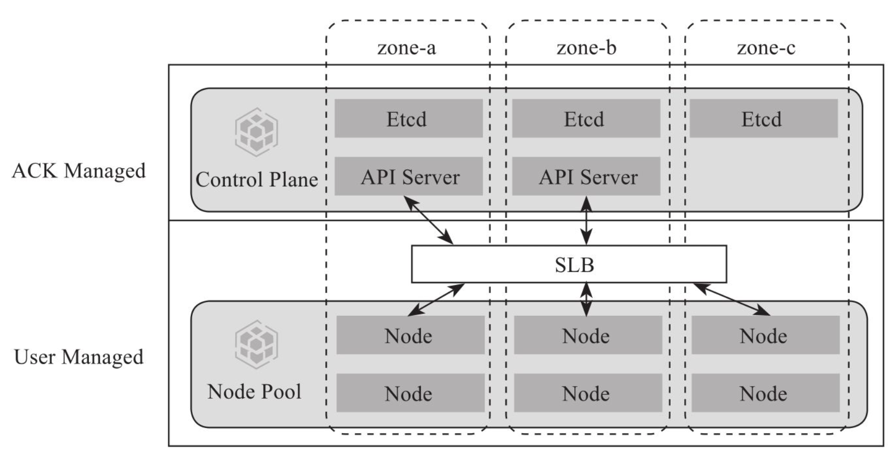
图15-4　ACK产品架构

### 15.5.2 应用场景
**1.DevOps持续交付**
场景说明：
❑ DevOps自动化：实现从代码变更到代码构建、镜像构建和应用部署的全流程自动化。
❑ 环境一致性：容器技术交付的不仅是代码，还有基于不可变架构的运行环境。
❑ 持续反馈：每次集成或交付，都会将结果实时反馈。
推荐搭配使用：云服务器ECS+容器服务。
具体场景展示如图15-5所示。
**2.基于云原生技术的机器学习**
场景说明：
❑ 支持生态：内置对TensorFlow、Caffe、MXNet、PyTorch等主流深度学习计算框架支持和优化。
❑ 快速弹性：一键部署机器学习开发、训练、推理服务，支持秒级启动和弹性伸缩。
❑ 简单可控：轻松创建、管理大规模GPU计算集群，并且可以监控GPU利用率等核心指标。
❑ 深度整合：无缝接入阿里云存储、日志监控和安全基础架构能力。
推荐搭配使用：云服务器ECS/GPU服务器EGS/高性能计算服务(Alibaba CloudHPC)+容器服务+对象存储OSS/文件存储NAS/CPFS。
具体场景展示如图15-6所示。
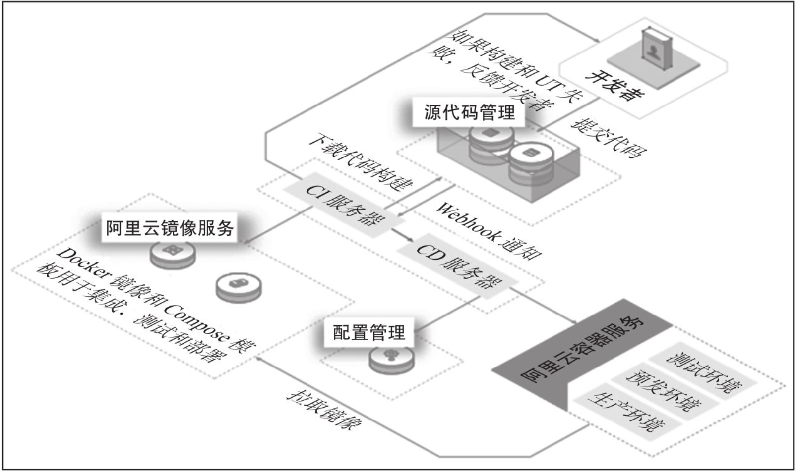
图15-5　DevOps持续交付场景
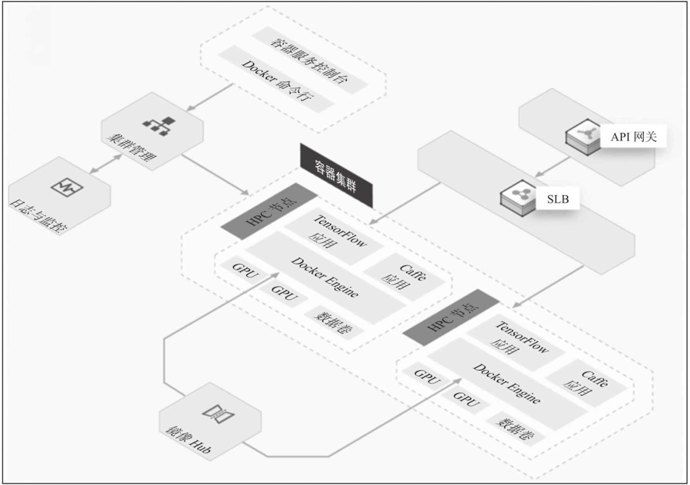
图15-6　基于云原生技术的机器学习场景
**3.微服务架构**
场景说明：
❑ 全面消除变更过程中的风险：依托于配置管理、无损上下线和全链路灰度能力，全面消除变更过程中的风险。
❑ 全面消除偶发问题引发的风险：依托于限流、降级、熔断、隔离等能力，可以在出现偶发的流量洪峰和依赖服务出异常时，有效地限流保护、削峰填谷、隔离故障、降级保护。
❑ 低成本实现微服务敏捷开发：依托于开发环境隔离能力，可以在不增加物理机器成本的前提下，低成本扩展出多套逻辑隔离的开发环境，有效地解决环境抢占和冲突问题，实现敏捷开发。
推荐搭配使用：微服务引擎MSE+云服务器ECS+云数据库RDS版+对象存储OSS+容器服务。
具体场景展示如图15-7所示。
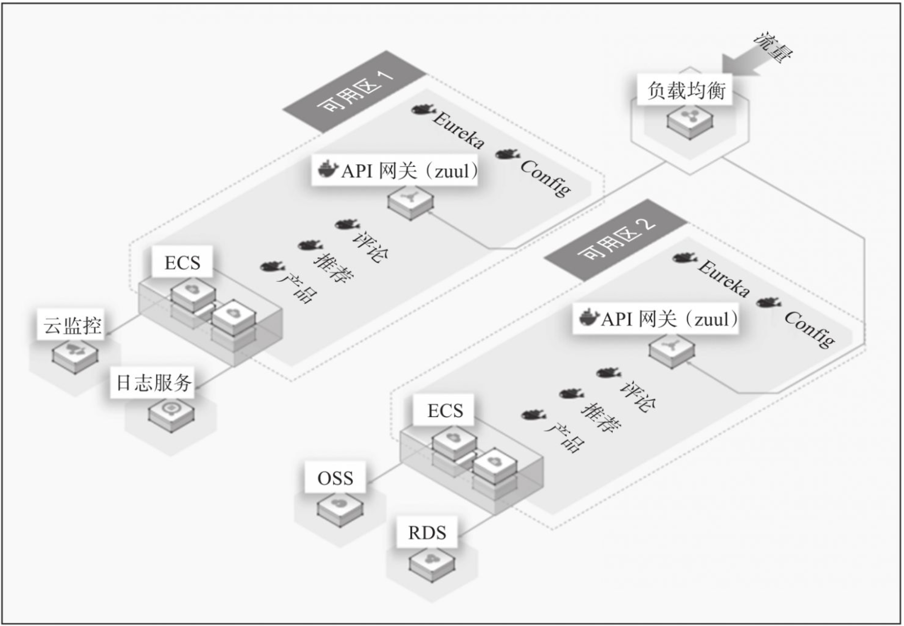
图15-7　微服务架构场景

**4.混合云架构**
场景说明：
❑ 在云上伸缩应用：业务高峰期，在云端快速扩容，把一些业务流量引到云端。
❑ 云上容灾：业务系统同时部署到云上和云下，云下提供服务，云上容灾。
❑ 云下开发测试：云下开发测试后的应用无缝发布到云上。
推荐搭配使用：云服务器ECS+专有网络VPC+高速通道(Express Connect)。
具体场景展示如图15-8所示。
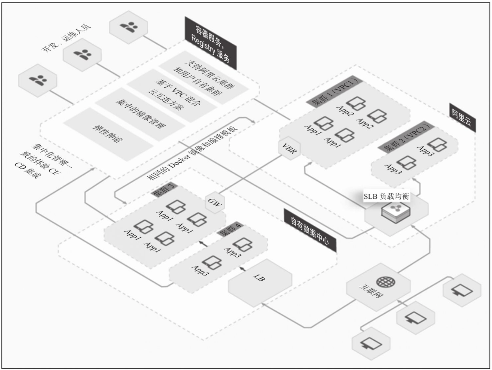
图15-8　混合云架构场景

**5.弹性伸缩架构**
场景说明：
❑ 快速响应：业务流量达到扩容指标，秒级触发容器扩容操作。
❑ 全自动：整个扩容/缩容过程完全自动化，无须人工干预。
❑ 低成本：流量降低自动缩容，避免资源浪费。
推荐搭配使用：云服务器ECS+专有网络VPC+高速通道。
具体场景展示如图15-9所示。
如果想要了解更多信息，可以访问阿里云官方网站：https://www.aliyun.com/product/kubernetes 。
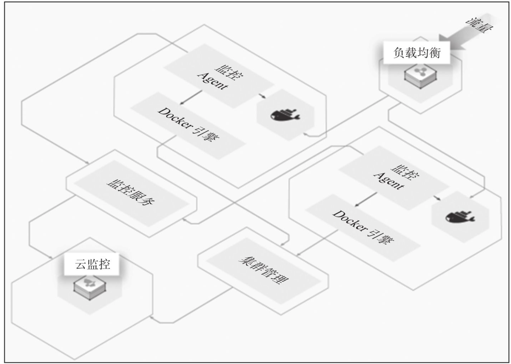
图15-9　弹性伸缩架构场景
## 15.6 腾讯云容器服务
腾讯云是腾讯集团全力打造的云计算品牌，面向全球各个国家和地区的政府机构、企业和个人开发者，提供先进的云计算、大数据和人工智能技术产品与服务。腾讯云依托卓越的科技能力，打造出多元化的行业解决方案，构建开放共赢的云端生态，推动产业互联网的发展，从而助力各行各业实现数字化转型。腾讯云基础设施分布全球，覆盖26个物理区域，70个可用区，以及超过2000个中国境内加速节点和800多个境外加速节点，为用户提供快速、稳定、智能、可靠的服务。
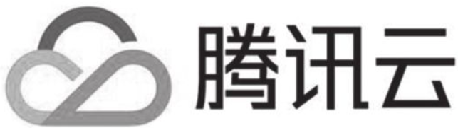
腾讯云的优势包括：
❑ 高效稳定：深厚的基础架构，自研的操作系统，多年技术锤炼和海量服务经验，为客户提供高性能、易运维、智能化、弹性化的云服务。
❑ 安全可靠：七大安全联合实验室团队，一体化智慧安全管理体系，帮助用户建立系统性的安全防御机制。
❑ 丰富场景：从基础设施到行业应用领域，提供完善的产品体系，为各种业务场景提供全栈解决方案，助力业务腾飞。
❑ 开放生态：完整的合作伙伴生态体系，与产业链上下游通力合作，提供优质的服务和丰富的产品，满足用户全方位的业务需求。
❑ 服务保障：7×24小时高效服务保障，多元化的服务支持，提供专业的上云前、中、后全流程技术服务，让用户的云上之旅更安心。
2015年1月6日，腾讯云正式宣布支持Docker服务，并将自身定位为Docker基础设施的服务商。在此基础上，推出了常用系统的标准版Docker镜像，以便于用户创建容器。此后，腾讯云陆续推出了丰富的容器类产品。
腾讯云的容器服务(Tencent Kubernetes Engine，TKE)以原生Kubernetes为基础，提供了一个以容器为中心，高度可扩展的高性能容器管理服务。该服务覆盖了Serverless、边缘计算、分布式云等多种业务部署场景，并首创了一个业界领先的容器资源管理模式，它能让单个集群兼容多种计算节点。同时，作为云原生Finops领先推动者，TKE主导了开源项目Crane，全方位帮助客户优化资源，控制成本。
Serverless容器服务原名弹性容器服务(EKS)，是TKE推出的一个特殊服务模式。在此模式下，用户无须购买节点即可部署工作负载，它以快速开发交付、高效运维和低资源成本为主要特征，使得业务能更快速地上云，让用户以最少的运维投入享受云服务的便利。
腾讯云容器镜像服务(Tencent Container Registry，TCR)为用户提供了一个安全、高性能的容器镜像托管和分发服务。用户可以在全球多个地区创建独享实例，以实现容器镜像的就近拉取，降低拉取时间，节约带宽成本。TCR还提供细颗粒度的权限管理和访问控制，保障了用户数据的安全。
腾讯云原生分布式云中心(Tencent Kubernetes Engine Distributed CloudCenter，TDCC)是一个面向多云和多集群场景的应用管理平台。TDCC支持将云原生应用扩展到分布式云，并以全球视角统一管理和运维分布式云资源，使得用户能轻松地将业务发布到全球，实现一次部署、处处运行。
腾讯云的边缘容器服务(Tencent Kubernetes Service for Edge，TKE Edge)基于其 领先的容器服务技术，用户可以一键将各地边缘节点（如云服务器、物理服务器、PC等）加入边缘容器集群，支持海量节点并发接入。该服务还具有独创的边缘节点自治、多地域自治流量闭环以及分布式健康状态检查等高级功能。
腾讯微服务引擎(Tencent Cloud Service Engine，TSE)提供了一套即插即用的云全场景微服务解决方案。这个解决方案支持开源增强的云原生注册配置中心（包括Zookeeper、Nacos、Consul和Apollo）​，腾讯自研并开源的北极星网格(PolarisMesh)、云原生API网关（如Nginx Ingress、Kong）以及微服务应用托管的弹性微服务平台。微服务引擎完全兼容开源版本的使用方式，且在功能、可用性和可运维性等方面进行了增强，以帮助用户快速构建微服务架构。
腾讯云可观测平台(Tencent Cloud Observability Platform，TCOP)基于全类型的监控数据（如指标、链路、日志、事件）​，配合强大的可视化和告警功能，为用户提供了一体化的监控解决方案。它满足了用户全链路、端到端的统一监控需求，提高了运维排障效率，保证了业务的健康和稳定运行。
下面，笔者将针对TKE产品进一步展开介绍。
TKE容器服务的主要功能特性如下：
❑ 高效运维：提供自研智能运维系统，通过实时检测多个层面的故障问题来缩短运维响应时间，提供Pod原地升降配能力，在业务零感知的情况下提升资源利用率。提供运维窗口周期内的自动并行升级能力，简化版本迭代和维护工作。
❑ 声明式管理：面向云原生环境，腾讯云容器服务推出原生节点，提供基础设施声明式API，提供全新的CRD MachineSet来管理节点机型、内核参数、自动伸缩等功能，使得节点的管理更契合Kubernetes的使用习惯。
❑ 安全可靠：结合腾讯全面自研上云技术实践，对操作系统、运行时、Kubernetes全方位参数调优和适配，提供统一的操作系统和运行时服务，节点运行稳定性显著增强。容器服务采用分布式服务架构，实现服务故障自动修复、数据快速迁移。
❑ 高效部署：容器服务运行在高品质的BGP网络中，能够实现镜像极速下载和上传，海量容器秒级启动，提高容器部署效率；容器服务可对提交的业务代码进行快速构建、测试和打包集成，将集成的代码部署到预发布环境和现网环境上。
❑ 资源高效利用：支持Request智能推荐，可以为Kubernetes的Workload推荐容器级别资源的Request/Limit数值，减少资源浪费。原生节点专用调度器支持虚拟放大节点的容量，用来解决节点资源都被占用，但本身利用率很低的问题。
❑ 低成本：容器服务托管集群具有极高性价比，用户只需花费少量费用即可获得高稳定、高可靠、可扩展的集群管理面，让用户可专注于容器化应用的开发，而无须关心集群的管理以及维护。
### 15.6.1 产品架构
腾讯云容器服务基于原生Kubernetes进行适配和增加，支持原生Kubernetes能力，提供了腾讯云的Kubernetes插件，帮助用户快速在腾讯云上构建Kubernetes集群（见图15-10）​。另外，腾讯云容器服务在Kubernetes上层，提供了集群管理、应用管理、CI/CD等进阶能力。
### 15.6.2 应用场景
**1.微服务架构**
微服务架构适用于构建复杂的应用，将单体式应用从不同纬度拆分成多个微服务，每个微服务的内容使用一个Docker镜像管理。在功能不变的情况下，应用拆分成了多个可管理的服务，每个单体的服务容易理解、开发和维护。不同的微服务也可以由不同的团队来开发，开发团队可自由选择开发技术和程序语言等，每个服务又可独立部署、独立扩展。例如，Web应用程序可以分割成一组更简单的外部服务及多组内部服务。
**2.弹性伸缩**
腾讯云容器服务提供集群和服务两个层级的弹性伸缩能力，能够根据业务运行情况，监控容器的CPU、内存、带宽等指标进行自动扩缩服务，同时可以根据容器的部署情况，在容器不够资源分配，或者有过多剩余资源的情况下自动伸缩集群。
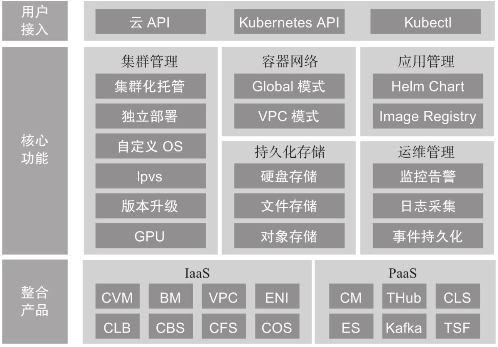
图15-10　腾讯云容器架构

**3.持续集成**
持续集成与持续交付提供的优秀的DevOps环境，可极大地提高软件的发布效率。持续集成强调开发人员提交了新代码之后，立刻进行构建、​（单元）测试，便于确定新代码和原有代码能否正确地打包集成在一起。持续交付在持续集成的基础上，将集成的代码部署到预发布环境和现网环境上。
**4.节点排障**
基础设施的不稳定性、环境的不确定性经常会引发不同维度的系统故障。为了将工作人员从繁重的运维事务中解放出来，腾讯云容器服务在原生节点上支持故障自愈功能来帮助运维人员快速定位问题，并通过预置平台运维经验，针对不同检测项提供最小化的自愈动作。该能力在NPD Plus组件的基础上进行全面升级，具体包含：
❑ 系统实时检测需要人为干预解决的持续性故障。
❑ 故障范围涵盖操作系统、K8S环境、运行时等数十种检测项。
❑ 通过预置专家经验（执行修复脚本、重启组件）来对故障进行快速响应。
具体场景展示如图15-11所示。
**5.成本优化**
当企业面对成本优化时，最终目的往往是下线节点，节约资源花销。在实施过程中，浪费现状分析、筛选下线节点、降低下线行为对存量业务的影响、规整业务、避免再次浪费、观察成本优化效果，每一个环节都会遇到很多困难：现有工具学习门槛高、K8S存在原生限制、担心优化动作影响稳定性等。为了解决这些问题，腾讯推出业界首创可交互式资产管理大盘，进行闭环全链路降本动作（资产观测—浪费现状分析—利用率提升—优化效果观测）​，如图15-12所示。
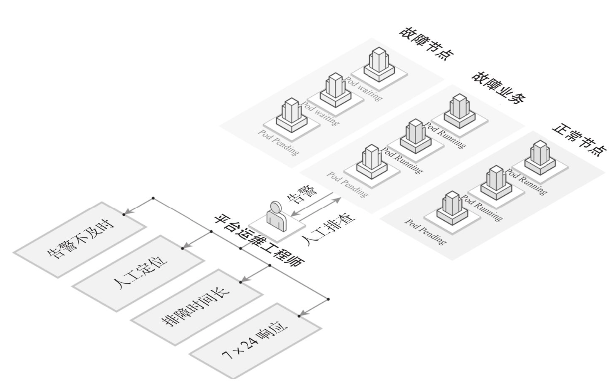
图15-11　节点排障场景
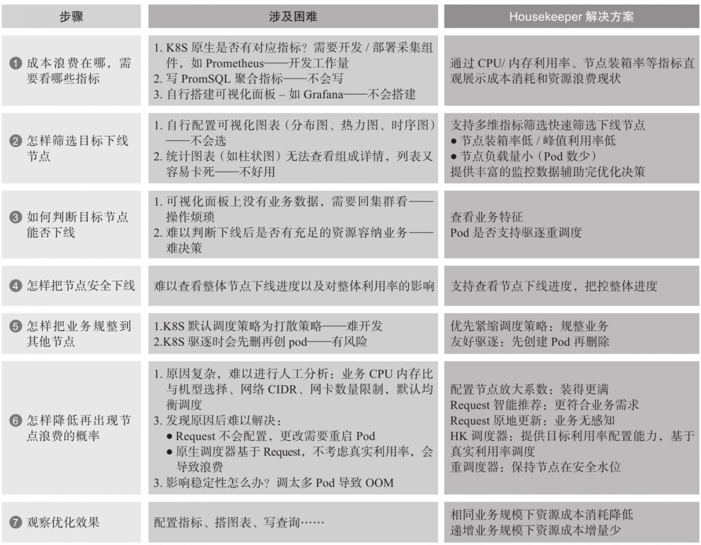
图15-12　成本优化方案

如果想要了解更多信息，可以访问腾讯云官方网站：https://cloud.tencent.com/product/tke 。
## 15.7 本章小结
本章详细阐述了公有云服务，如AWS、Google、Azure、阿里云以及腾讯云如何积极地支持并利用容器技术，尤其是Docker技术。容器技术的崛起不仅推动了云计算行业的发展，还为整个行业引领了新的发展方向。
笔者进一步探讨了将公有云的虚拟机和容器技术结合使用可能带来的多方面优势。这种结合使得持续交付和部署变得更快、更高效。另外，通过内核级虚拟化，能够更有效地在公有云环境中利用服务器资源。最后，利用公有云和容器的特性，应用的迁移和扩展变得更加简单和方便。
容器技术和公有云服务的结合，无疑为云计算领域带来了新的机遇和挑战，也给信息技术的应用带来更多可能。