# 第18章　配置私有仓库
在使用Docker一段时间后，用户往往会发现手头积累了大量的自定义镜像文件，这些文件通过公有仓库（如Docker Hub）进行管理和分享并不总是方便。另外，有时用户只是希望在内部成员之间分享镜像，不希望公开发布。在这种情况下，搭建一个本地的私有镜像仓库变得尤为重要。
本章将具体讲解Docker Registry的使用技巧，并通过案例来展示如何搭建一个功能齐全的私有镜像仓库。之后，将详细解析Docker Registry的配置参数和访问控制，最后还会介绍其他私有仓库搭建工具。
## 18.1 安装Docker Registry
Docker Registry工具目前的最新版本为2.8系列版本，这一版本和一些类库以及工具一起被打包为负责容器内容分发的工具集：DockerDistribution。目前，它的核心功能组件仍负责镜像仓库的管理。
新版本的Registry基于Golang进行了重构，提供更好的性能和扩展性，并且支持Docker 1.6+的API，非常适合用来构建私有的镜像注册服务器。官方仓库中也提供了Registry的镜像，因此用户可以通过容器运行和源码安装两种方式来使用Registry。
1.基于容器安装运行 基于容器的运行方式十分简单，只需要一条命令：
```shell
docker run -d -p 5000:5000 --restart=always --name registry registry:2
```
启动后，服务监听在本地的5000端口，可以通过访问http://localhost:5000/v2/ 测试启动是否成功。
Registry比较关键的参数是配置文件和仓库存储路径。
默认的配置文件为/etc/docker/registry/config.yml，因此，通过如下命令，可以指定使用本地主机上的配置文件（如/home/user/registry-conf）​：
```shell
docker run -d -p 5000:5000 \
  --restart = always \
  --name registry \
  -v /home/user/registry-conf/config.yml:/etc/docker/registry/config.yml \
  registry:2
```
默认的存储位置为/var/lib/registry，可以通过-v参数来映射本地的路径到容器内。
例如，下面的例子是将镜像存储到本地/opt/data/registry目录：
```shell
docker run -d -p 5000:5000 \
  --restart = always \
  --name registry \
  -v /opt/data/registry:/var/lib/registry \
  registry:2
```
**2.本地安装运行**
有时需要在本地运行仓库服务，此时可以通过源码方式进行安装。
首先安装Golang环境支持，以Ubuntu为例，可以执行如下命令：
```shell
sudo add-apt-repository ppa:ubuntu-lxc/lxd-stable
sudo add-get update
sudo apt-get install golang
```
确认Golang环境安装成功，并配置\$GOPATH环境变量，例如/go。
创建$GOPATH/src/github.com/docker/目录，并获取源码：
```shell
mkdir -p $GOPATH/src/github.com/docker/
cd $GOPATH/src/github.com/docker/
git clone https://github.com/docker/distribution.git
cd distribution
```
将自带的模板配置文件复制到/etc/docker/registry/路径下，创建存储目录/var/lib/registry：
```shell
cp cmd/registry/config-dev.yml /etc/docker/registry/config.yml
mkdir -p /var/lib/registry
```
然后执行安装操作：
```shell
make PREFIX = /go clean binaries
```
编译成功后，可以通过下面的命令来启动：
```shell
registry serve /etc/docker/registry/config.yml
```
此时使用访问本地的5000端口，看到返回成功(200 OK)，则说明运行成功：

## 18.2 配置TLS证书
当本地主机运行Registry服务后，所有能访问到该主机的Docker Host都可以把它作为私有仓库使用，只需要在镜像名称前面添加上具体的服务器地址。
例如将本地的ubuntu:latest镜像上传到私有仓库myrepo.com：
```shell
docker tag ubuntu:latest myrepo.com:5000/ubuntu:latest
docker push myrepo.com:5000/ubuntu:latest
```
或者从私有仓库myrepo.com下载镜像到本地：
```shell
docker pull myrepo.com:5000/ubuntu
docker tag myrepo.com:5000/ubuntu ubuntu
```
私有仓库需要启用TLS认证，否则会报错。第一部分介绍了通过添加DOCKER_OPTS=»--insecure-registry myrepo.com:5000来避免这个问题。在这里将介绍如何获取和生成TLS证书。
**1.自行生成证书**
使用openssl工具可以很容易地生成私人证书文件：
```shell
mkdir -p certs
openssl req \
  -newkey rsa:4096 \
  -nodes -sha256 \
  -keyout certs/myrepo.key \
  -x509 -days 35 \
  -out certs/myrepo.crt
```
生成过程中会提示填入各种信息，注意CN一栏的信息要填入与访问的地址相同的域名，例如这里应该为myrepo.com。
生成结果为密钥文件myrepo.key，以及证书文件myrepo.crt。其中，证书文件需要发送给用户，并且配置到用户Docker Host上，注意路径需要与域名一致，例如：
```shell
/etc/docker/certs.d/myrepo.com:5000/ca.crt
```
**2.从代理商申请证书**
如果Registry服务需要对外公开，则需要申请大家都认可的证书。知名的代理商包括SSLs.com、GoDaddy.com、LetsEncrypt.org、GlobalSign.com等，用户可以自行选择权威的证书提供商。
**3.启用证书**
当拥有密钥文件和证书文件后，可以配置Registry启用证书支持，主要通过REGISTRY_HTTP_TLS_CERTIFICATE和REGISTRY_HTTP_TLS_KEY参数实现：
```shell
docker run -d \
    --restart = always \
    --name registry \
    -v 'pwd'/certs:/certs \
    -e REGISTRY_HTTP_ADDR =0.0.0.0:443 \
    -e REGISTRY_HTTP_TLS_CERTIFICATE = /certs/myrepo.crt \
    -e REGISTRY_HTTP_TLS_KEY = /certs/myrepo.key \
    -p 443:443 \
    registry:2
```
## 18.3 管理访问权限
在生产场景中，通常需要对私有仓库进行访问代理并提供认证和用户管理。
**1.Docker Registry v2的认证模式**
Docker Registry v2的认证模式相较v1有了较大变化，如降低了系统的复杂度，减少了服务之间的交互次数等，其基本工作模式如图18-1所示。
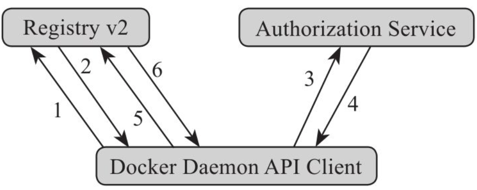
图18-1　Docker Registry v2的认证模式

具体交互过程包括如下步骤：
1)Docker Daemon或者其他客户端尝试访问Registry服务器，比如pull、push或者访问manifiest文件。
2)在Registry服务器开启了认证服务模式时，就会直接返回401Unauthorized错误，并通知调用方如何获得授权。
3)调用方按照要求，向Authorization Service发送请求，并携带Authorization Service需要的信息，比如用户名、密码。
4)如果授权成功，则可以拿到合法的Bearer token，来标识该请求方可以获得的权限。
5)请求方将拿到Bearer token并加到请求的Authorization Header中，再次尝试步骤1中的请求。
6)Registry服务通过验证Bearer Token以及JWT格式的授权数据来决定用户是否有权限进行请求的操作。
当启用认证服务时，需要注意两点：
❑ 对于Authentication Service，Docker官方目前并没有给出对应的实现方案，需要自行实现对应的服务接口。
❑ Registry服务和Authentication服务之间通过证书进行Bearer Token的生成和认证，所以要保证两个服务之间证书的匹配。
除了使用第三方实现的认证服务（如docker_auth、SUSE Portus等）外，还可以通过Nginx代理方式来配置基于用户名和密码的认证。
**2.配置Nginx代理**
使用Nginx代理Registry服务的原理十分简单，在18.2节中，笔者让Registry服务监听在127.0.0.1:5000，这意味着只允许本机才能通过5000端口访问到，其他主机是无法访问到的。
为了让其他主机访问到，可以通过让Nginx监听在对外地址的15000端口，当外部访问请求到达15000端口时，内部再将请求转发到本地的5000端口。可以通过如下步骤实现这一配置。
首先，安装Nginx（也可使用Nginx容器）​：
```shell
sudo apt-get -y install nginx
```
在/etc/nginx/sites-available/目录下创建新的站点配置文件/etc/nginx/sites-available/docker-registry.conf，代理本地的15000端口转发到5000端口。
配置文件内容如下：
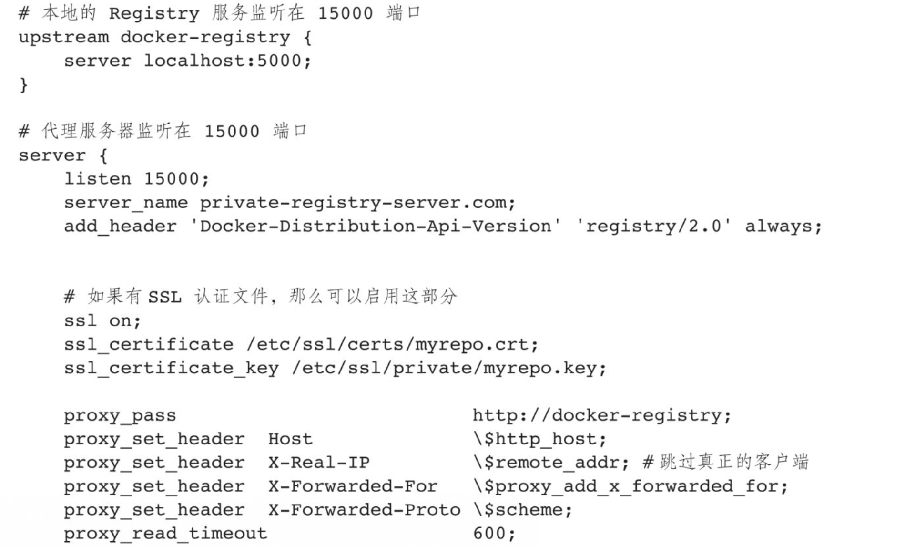
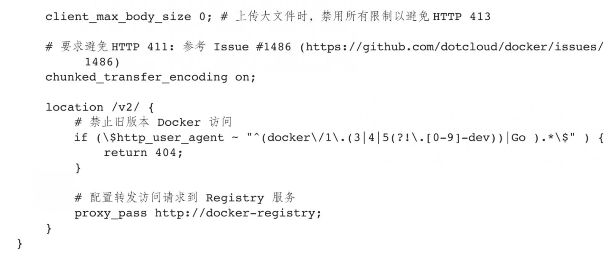
建立配置文件软连接，放到/etc/nginx/sites-enabled/下面，让Nginx启用它，最后重启Nginx服务：
```shell
docker tag ubuntu:24.04 127.0.0.1:15000/ubuntu:latest
docker push 12.0.0.1:15000/ubuntu:latest
```
**3.添加用户认证**
公共仓库Docker Hub是通过注册索引服务来实现的。由于索引服务并没有完善的开源实现，因此在这里介绍基于Nginx代理的用户访问管理方案。
Nginx支持基于用户名和密码的访问管理。
首先，在配置文件的location/字段中添加两行：
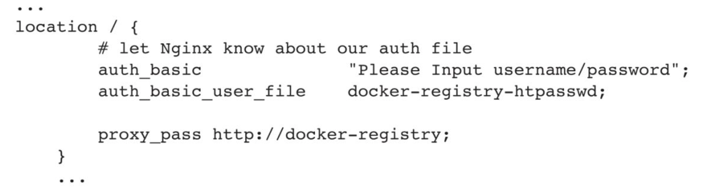
其中，auth_basic行说明启用认证服务，不通过的请求将无法转发。auth_basic_user_file docker-registry-htpasswd;行则指定了验证的用户名和密码存储文件为本地（/etc/nginx/下）的docker-registry-htpasswd文件。
docker-registry-htpasswd文件中存储用户名和密码的格式为每行放一个用户名、密码对。例如：
```shell
···
user1:password1
user2:password2
···
```
需要注意的是，密码字段存储的并不是明文，而是使用crypt函数加密过的字符串。要生成加密后的字符串，可以使用htpasswd工具，首先安装apache2-utils：
```shell
sudo aptitude install apache2-utils -y
```
创建用户user1，并添加密码。例如，如下的操作会创建/etc/nginx/docker-registry-htpasswd文件来保存用户名和加密后的密码信息，并创建user1和对应密码：
```shell
sudo htpasswd -c /etc/nginx/docker-registry-htpasswd user1
New password:
Re-type new password:
Adding password for user user1
```
添加更多用户，可以重复上面的命令（密码文件存在后，不需要再使用-c选项来新创建）​。
最后，重新启动Nginx服务：
```shell
sudo service ngnx restart
```
此时，通过浏览器访问本地的服务http://127.0.0.1:15000/v2/ 会弹出对话框，提示需要输入用户名和密码。
通过命令行访问，需要在地址前面带上用户名和密码才能正常返回：
```shell
curl USERNAME:PASSWORD@127.0.0.1:15000/v2/
```
除了使用Nginx作为反向代理外，Registry自身也支持简单的基于用户名和密码的认证以及基于Token的认证，可以通过如下环境变量来指定：
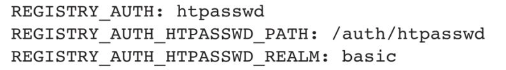
**4.用Compose启动Registry**
通常，用户使用Registry时需要进行的配置主要包括存储路径、TLS证书和用户认证。下面提供了一个快速启动Registry的Docker Compose模板：
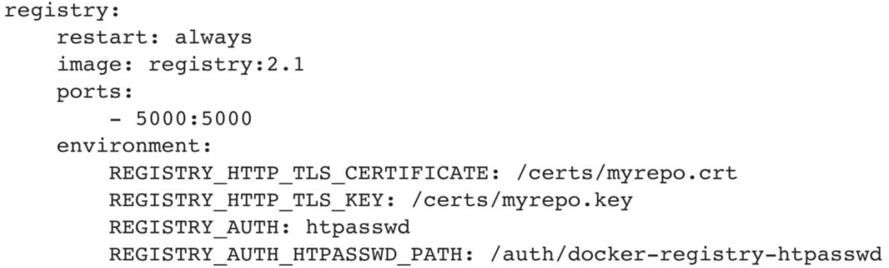
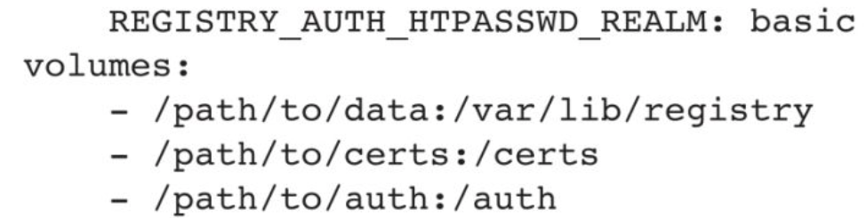
## 18.4 配置Registry
Docker Registry提供了一些样例配置，用户可以直接使用它们进行开发或生产部署。笔者将以下面的示例配置为例，介绍如何使用配置文件来管理私有仓库。
**1.示例配置**
示例配置如下：
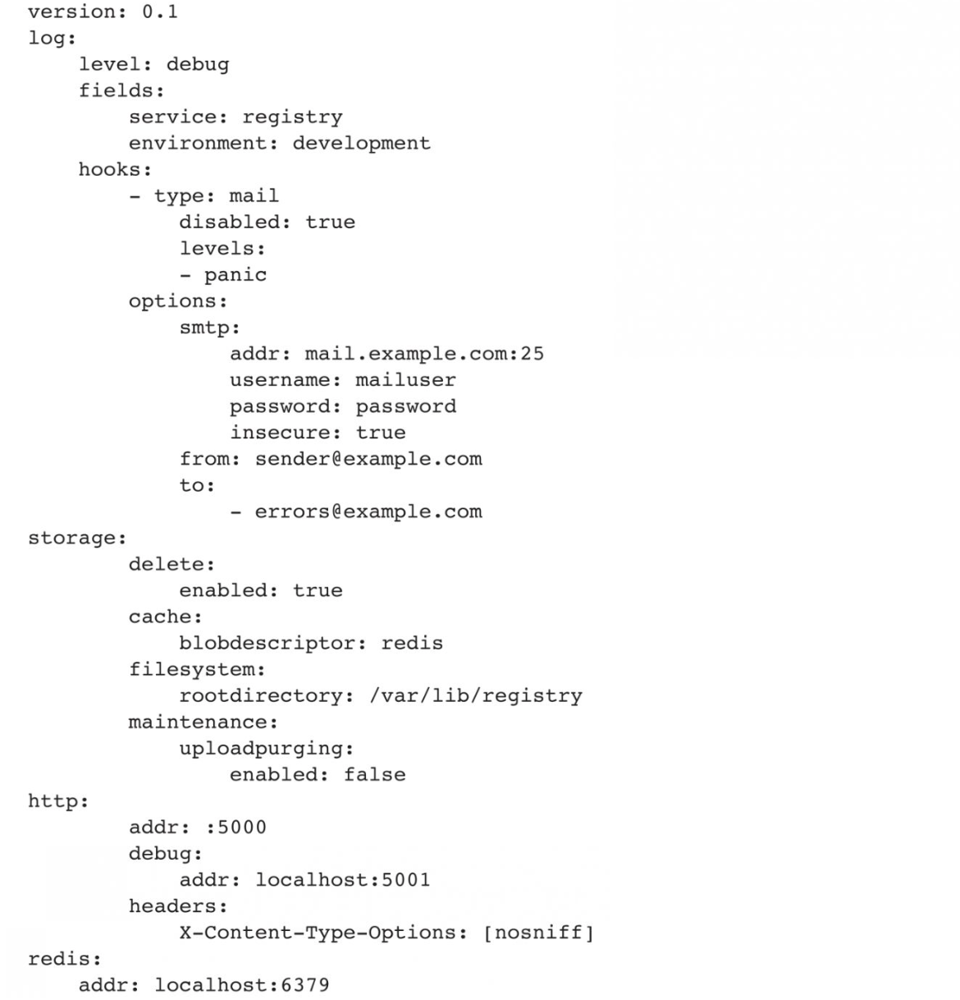
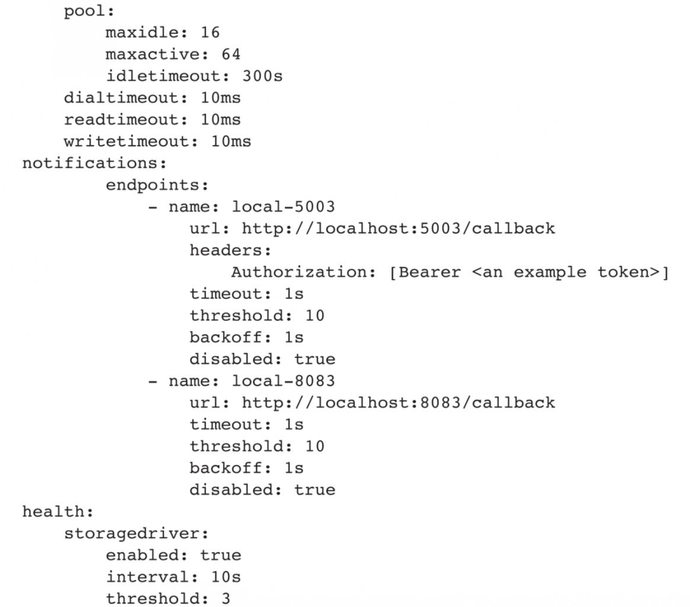
**2.选项**
这些选项以YAML文件格式提供，用户可以直接进行修改，也可以添加自定义的模板段。
默认情况下，变量可以从环境变量中读取，例如log.level:debug可以配置为：
```shell
exprot LOG_LEVEL=debug
```
比较重要的选项包括版本信息、log选项、hooks选项、存储选项、认证选项、HTTP选项、通知选项、Redis选项、健康监控选项、代理选项和验证选项等。
(1)版本信息
version:0.1
(2)log选项
该选项提供与日志相关的内容，代码如下：
```YAML
log:
    level:debug
    formatter:text
    fields:
        service:registry
        environment:staging
```
其中：
❑ level：字符串类型，标注输出调试信息的级别，包括debug、info、warn、error。
❑ fomatter：字符串类型，表示日志输出的格式，包括text、json、logstash等。
❑ fields：表示增加到日志输出消息中的键值对，可以用于过滤日志。
(3)hooks选项
配置当仓库发生异常时，通过邮件发送日志时的参数，代码如下：
```YAML
hooks:
    -type:mail
       levels: 
           - panic
           options:
               smtp:
                   addr:smtp.sendhost.com:25
                   username:sendername
                   password:password
                   insecure:true
               from:name@sendhost.com
               to:
                  - name@receivehost.com
```
(4)存储选项
存储(storage)选项将配置存储的引擎，默认支持包括本地文件系统、Google云存储、AWS S3云存储和OpenStack Swift分布式存储等：
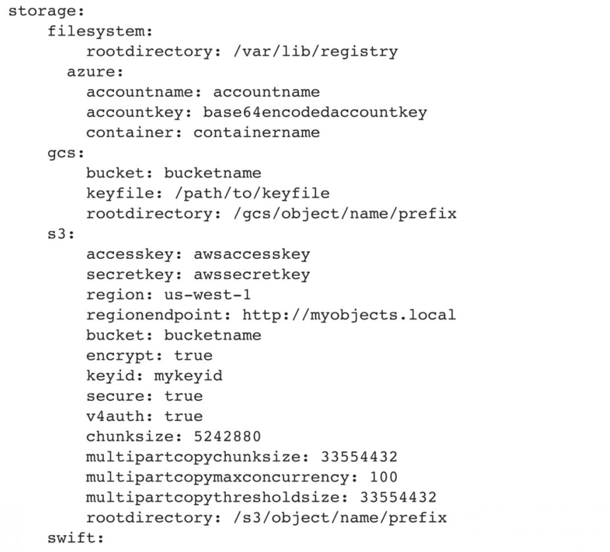
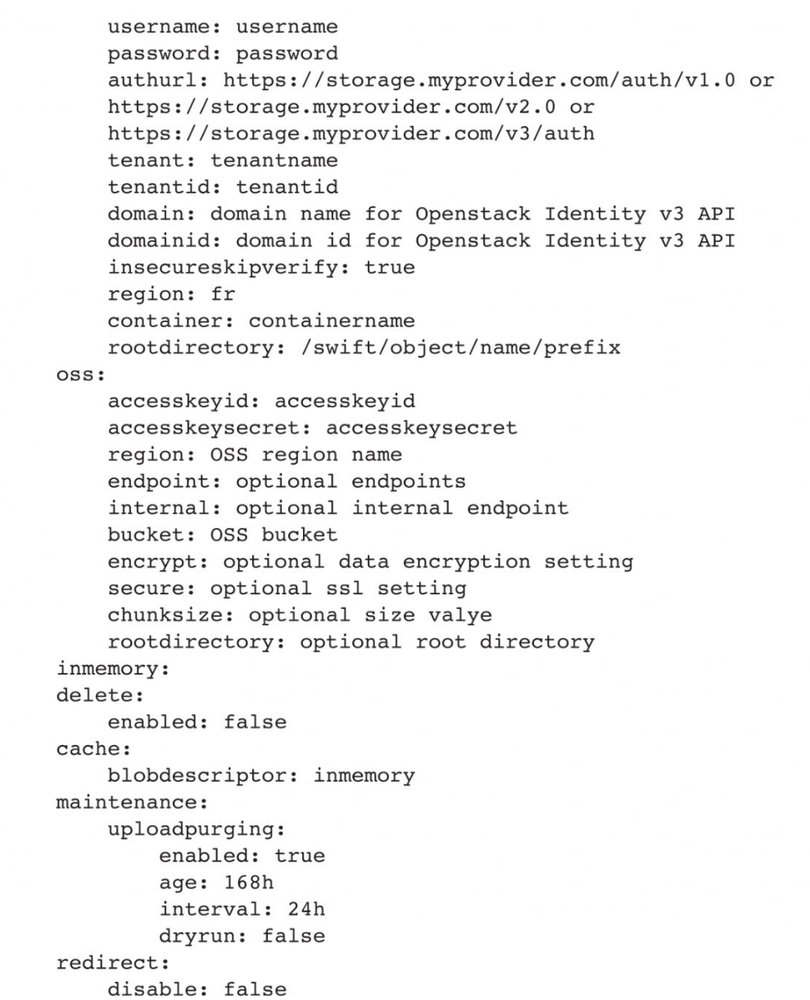
比较重要的选项包括：
❑ maintenance：配置维护相关的功能，包括对孤立旧文件的清理、开启只读模式等。
❑ delete：是否允许删除镜像功能，默认关闭。
❑ cache：开启对镜像层元数据的缓存功能，默认开启。
(5)认证选项
用于进行对认证类型的配置，代码如下：
```shell
auth:
    silly:
        realm:silly-realm
        service:silly-service
    token:
        realm:token-realm
        service:token-service
        issure:registry-token-issuer

        rootcertbundle: /root/certs/bundle
    htpasswd:
        realm:basic-realm
        path: /path/to/htpasswd
```
其中：
❑ silly：仅供测试使用，只要请求头带有认证域即可，不做内容检查。
❑ token：基于Token的用户认证，适用于生产环境，需要额外的Token服务来支持。
❑ htpasswd：基于Apache htpasswd密码文件的权限检查。
(6)HTTP选项
用于进行与HTTP服务相关的配置，代码如下：
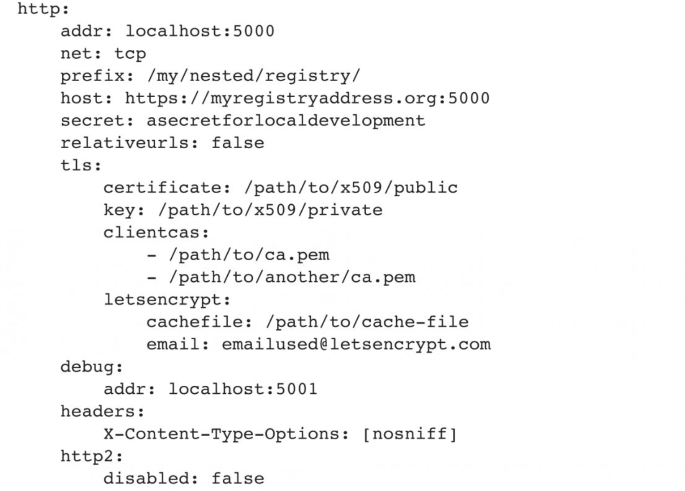
其中：
❑ addr：必选，表示服务监听地址。
❑ secret：必选，是与安全相关的随机字符串，用户可以自己定义。
❑ tls：与证书相关的文件路径信息。
❑ http2：设置是否开启http2支持，默认关闭。
(7)通知选项用于设置有事件发生时的通知系统：
```YAML
notifications:
    endpoints:
        - name: alistener
            disabled: false
            url: https://my.listener.com/event
            headers:<http.Header>
            timeout:500

            threshold: 5
            backoff: 1000
```
(8)Redis选项
Registry可以用Redis来缓存文件块，在这里可以配置相关选项：
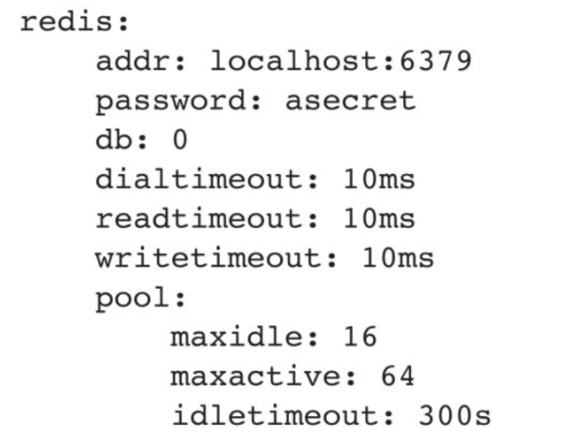
(9)健康监控选项
这类与健康监控相关，主要是对配置服务进行检测，判断系统状态，默认关闭：
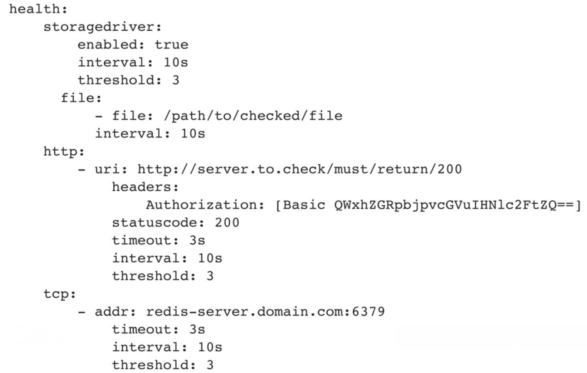
(10)代理选项
配置Registry作为一个pull代理，从远端（目前仅支持官方仓库）拉取Docker镜像，代码如下：
```shell
proxy:
    remoteurl: https://registry-1.docker.io
    username:[username]
    password:[password]
```
之后，用户可以通过如下命令配置Docker使用代理：
```shell
docker --registry-mirror = https://myrepo.com:5000 daemon
```
(11)验证选项
限定来自指定地址的客户端才可以执行push操作，代码如下：
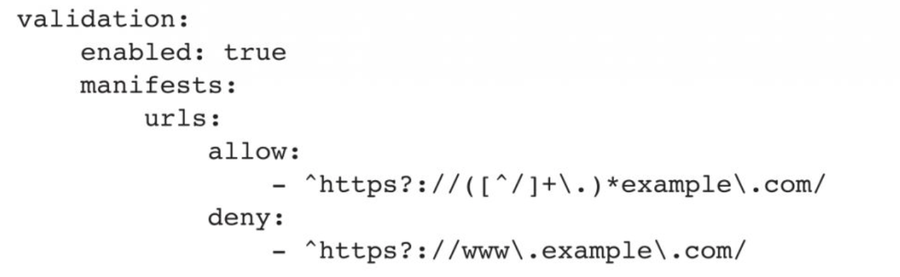
## 18.5 批量管理镜像
在之前的章节中，笔者介绍了如何对单个镜像进行上传、下载的操作。有时候，本地镜像很多，逐个打标记进行操作将十分浪费时间。这里将以批量上传镜像为例，介绍如何利用脚本实现对镜像的批量化处理。
**1.批量上传指定镜像**
可以使用下面的push_images.sh脚本，批量上传本地的镜像到注册服务器中，默认是本地注册服务器127.0.0.1:5000，用户可以通过修改registry=127.0.0.1:5000这行来指定目标注册服务器：
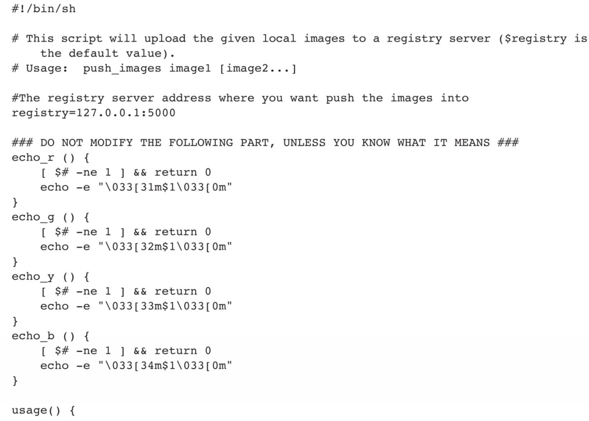
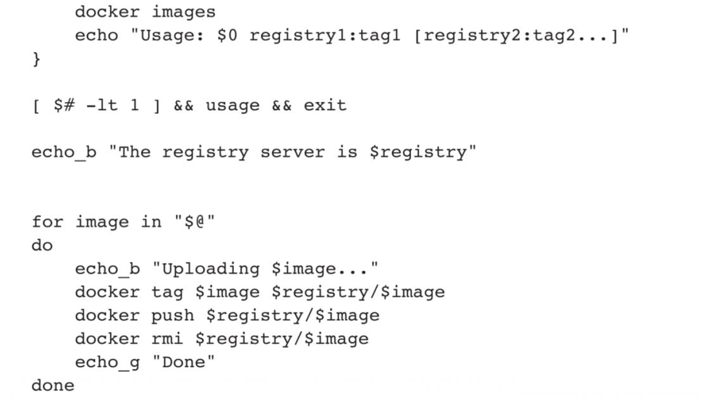
建议把脚本存放到本地可执行路径下，例如/usr/local/bin/下面。然后添加可执行权限，就可以使用该脚本了：
```shell
sudo chmod a+x /usr/local/bin/push_images.sh
```
例如，推送本地的ubuntu:latest和ubuntu:24.04镜像到本地仓库：
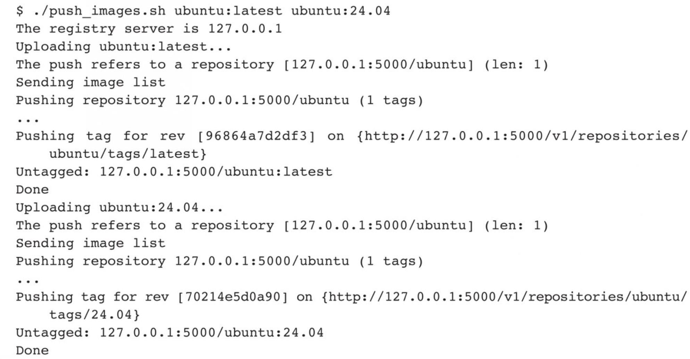
上传后，查看本地镜像，会发现上传中创建的临时标签也同时被清理了。
**2.上传本地所有镜像**
在push_images工具的基础上，还可以进一步创建push_all工具来上传本地所有镜像：

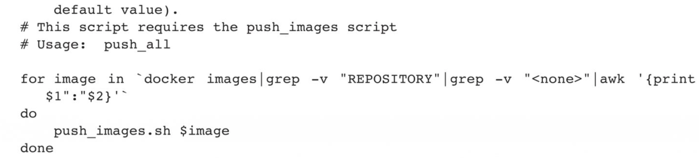
另外，建议把它放在/usr/local/bin/下面，并添加可执行权限。这样就可以通过push_all命令来同步本地所有镜像到本地私有仓库了。
同样地，读者可以试着修改脚本，实现批量化下载镜像、删除镜像、更新镜像标签等操作。
## 18.6 使用通知系统
Docker Registry v2还内置了Notification功能，提供了非常方便、快捷的集成接口，避免了v1中需要用户自己实现的麻烦。
Notification功能其实就是Registry在有事件发生的时候，向用户自己定义的地址发送webhook通知。目前的事件包括镜像manifest的push、pull，镜像层的push、pull。这些动作会被序列化成webhook事件的负载，为集成服务提供事件详情，并通过Registry v2的内置广播系统发送到用户定义的服务接口，Registry v2将这些用户服务接口称为Endpoint。
Registry服务器的事件会通过HTTP发送到用户定义的所有Endpoint上，而且每个Registry实例的每个Endpoint都有自己独立的队列、重试选项以及HTTP的目的地址。当一个动作发生时，会被转换成对应的事件并放置到一个内存队列中。镜像服务器会依次处理队列中的事件，并向用户定义的Endpoint发送请求。事件发送处理是串行的，但是Registry服务器并不会保证其到达顺序。
**1.相关配置**
Notification在Registry中的相关配置如下：
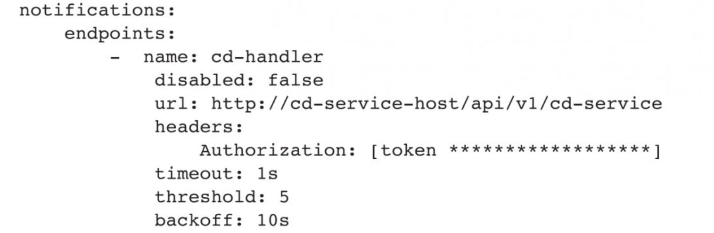
上面的配置会在pull或者push操作发生时向http://cd-service-host/api/v1/cd-service发送事件，并在HTTP请求的header中传入认证信息，可以是Basic、token、Bearer等模式，主要用于接收事件方进行身份认证。更新配置后，需要重启Registry服务器，如果配置正确，会在日志中看到对应的提示信息，比如：
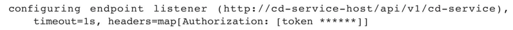
此时，用户再通过Docker客户端进行push、pull操作，或者查询一些manifiest信息时，就会有相应的事件发送到定义的Endpoint上。
接下来看一下事件的格式及其主要属性：
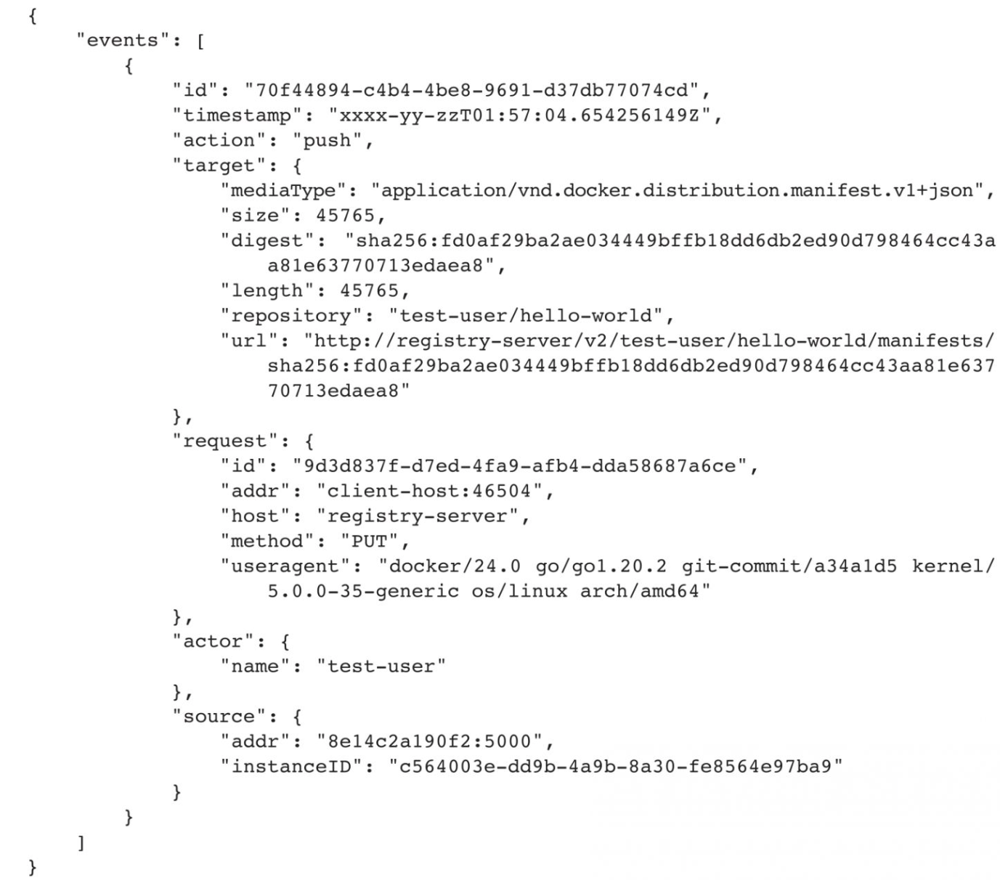
每个事件的负载都是一个定义好的JSON格式的数据。通知系统的主要属性主要包括action、target.mediaType、target.repository、target.url、request.method、request.useragent、actor.name等，参见表18-1。
2.通知系统的使用场景
理解了如何配置Registry v2的Notification、Endpoint以及接收的Event数据格式，就可以很方便地实现一些个性化的需求。这里简单列举两个场景：一个是如何统计镜像的上传、下载次数，方便了解镜像的使用情况；另一个是对服务的持续部署，方便管理镜像，参见图18-2。

表18-1　通知系统的主要属性及描述
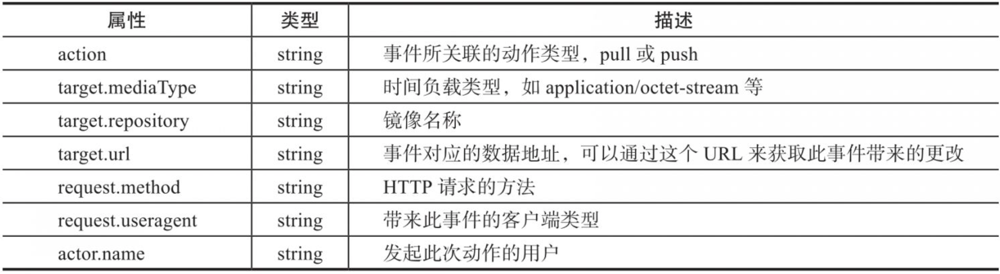
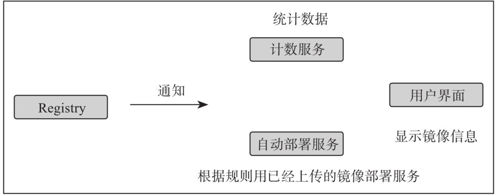
图18-2　通知系统整合持续部署

(1)镜像上传、下载计数
很常见的一个场景是根据镜像下载次数，向用户推荐使用得最多的镜像，或者统计镜像更新的频率，以便了解用户对镜像的维护程度。
用户可以利用Notification功能定义自己的计数服务，并在Registry上配置对应的Endpoint。在有pull、push动作发生时，对对应镜像的下载或者上传次数进行累加，达到计数效果。然后添加一个查询接口，供用户查看用户镜像的上传、下载次数，或者提供排行榜等扩展服务。
(2)实现应用的自动部署
在这个场景下，可以在新的镜像推送到Registry服务器时自动创建或者更新对应的服务，这样可以快速查看新镜像的运行效果或者进行集成测试。用户还可以根据事件中的相应属性，比如用户信息、镜像名称等，调用对应的服务部署接口进行自动化部署操作。
另外，镜像的命名规则是namespace/repository:tag，但在上面的事件负载示例中并没有看到tag的属性。如果需要tag信息，则需要使用DockerRegistry v2.4.0及以上的版本，在这个版本中对应的manifest事件中将会携带tag的属性，来标识该动作涉及的镜像版本信息。
## 18.7 使用Harbor搭建私有镜像仓库
除了官方的Registry项目外，开源社区还提供了其他私有镜像仓库方案，其 中最出名的就是Harbor项目。Harbor是一个企业级的开源容器镜像仓库，旨在提供安全、策略驱动的高度可扩展的用户界面以管理和分发Docker和Kubernetes镜像。
Harbor于2016年由VMware启动并开源，由CNCF（Cloud NativeComputing Foundation，云原生计算基金会）孵化成熟。Harbor提供了丰富的云原生功能以满足企业级别的需求，主要包括如下特性：
❑ 支持安全漏洞扫描：Harbor能自动扫描镜像以识别已知的漏洞，并且在用户拉取镜像前显示漏洞的严重性。
❑ 支持内容签名和认证：Harbor支持Notary，这是一个基于The UpdateFramework的开源项目，用于发布和验证内容的安全性。
❑ 支持多租户：Harbor支持为每个项目设置租户配额，以防止资源被过度使用。
❑ 可扩展的API和WebUI：用户可以使用官方的API和UI，并进行扩展。
❑ 支持在多个镜像仓库之间复制：用户自由地在多个Harbor实例之间复制镜像，从而支持镜像的跨数据中心的可用性。
❑ 基于角色的访问控制：Harbor允许用户为每个项目设置多种角色，这种基于角色的访问控制(RBAC)使得用户可以精细地管理他们对镜像的权限，  如推送或者拉取。
**1.安装和配置Harbor**
(1)下载Harbor安装包安装包分为离线安装包和在线安装包两种，读者可以根据自己的需要下载，下载地址为https://github.com/goharbor/harbor/releases。
(2)配置HTTPS访问
使用openssl命令生成私有的CA证书密钥文件，代码如下：
```shell
openssl genrsa -out ca.key 4096
```
生成CA证书文件，代码如下：
```shell
openssl req -x509 -new -nodes -sha512 \
   -days 3650 \
   -subj "/C=CN/ST=Beijing/L=Beijing/O=example/OU=Personal/CN=yourdomain.com" \
   -key ca.key
   -out ca.crt
```
读者可以将yourdomain.com替换成自己的主机名。
生成服务证书文件和CSR文件，代码如下：
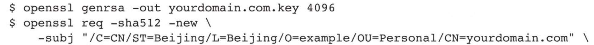

生成X.509 v3扩展文件，代码如下：
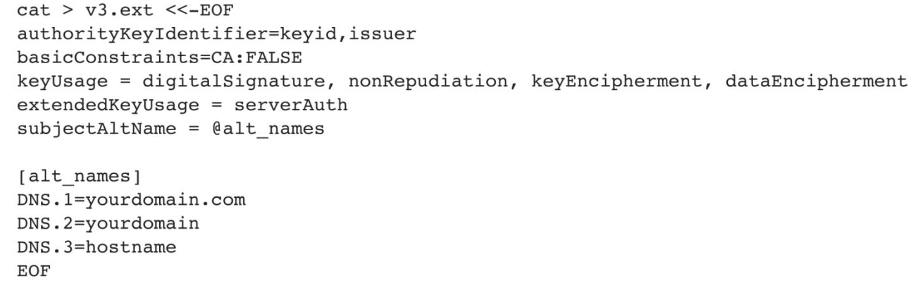
使用v3.ext文件生成Harbor主机的证书，代码如下：
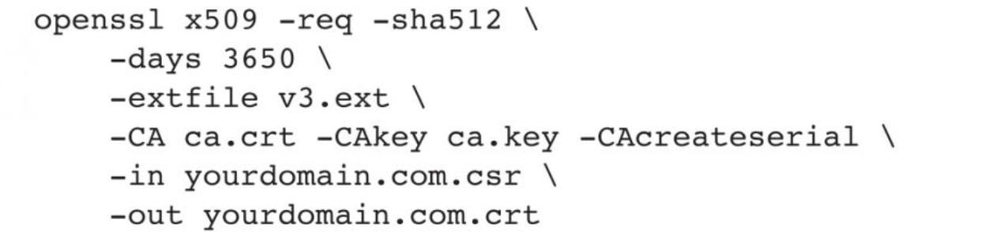
将证书复制到Habor安装目录。笔者将Harbor部署在～/harbor_data/目录下面，读者可以自行调整路径，代码如下：
```shell
mkdir -p -/harbor_data_cert
cp yourdomain.com.crt -/harbor_data/cert
cp yourdomain.com.key -/harbor_data/cert
```
将.crt文件转换成.cert文件，代码如下：
```shell
openssl x509 -inform PEM -in yourdomain.com.crt -out yourdomain.com.cert
```
创建证书目录，复制证书到目录下面，代码如下：
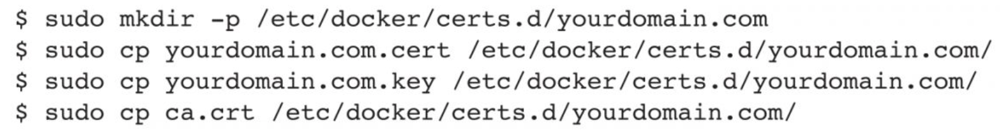
如果读者没有使用默认端口443，则只需要创建带端口的目录，例如：etc/docker/certs.d/yourdomain.com:port或者/etc/docker/certs.d/harbor_IP:port。
重启Docker，代码如下：
```shell
systemctl restart docker
```
(3)修改安装配置文件
安装包内自带了默认的harbor.yml配置文件，用户需要根据本地环境配置如表18-2所示的参数。

表18-2　配置harbor.yml文件参数
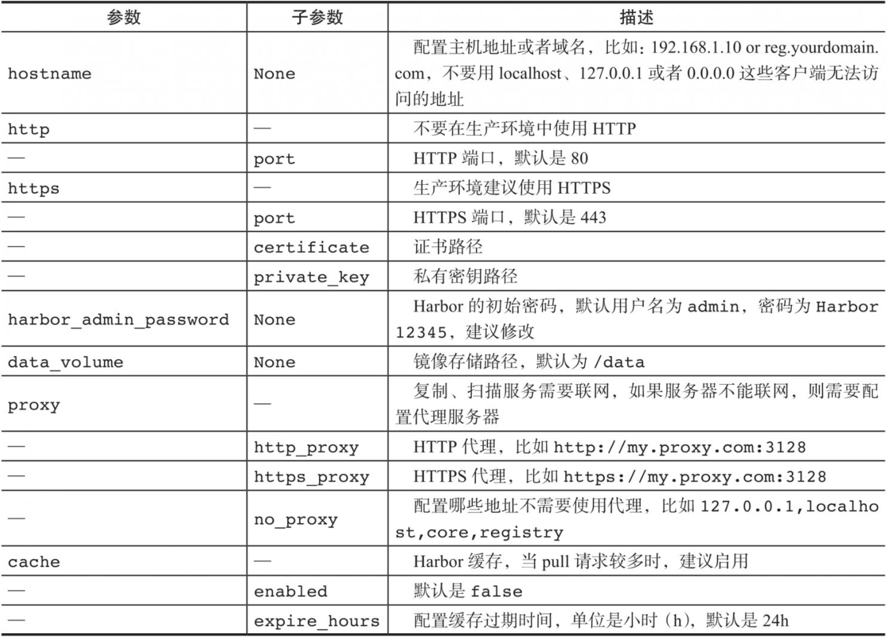
(4)执行install.sh
修改完成配置文件后，执行$ sudo./install.sh命令进行安装，代码如下：
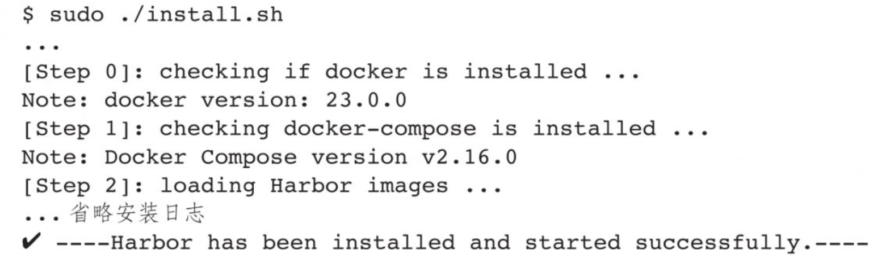
当看到最后一行✔----Harborhasbeeninstalledandstartedsuccessfully.----时，表示安装成功，可通过浏览器访问Habror UI。
2.搭建研发库到生产库数据同步
在企业应用中，研发的成果物仓库和生产使用的仓库常常是分离的，利用Harbor的复制功能，就可以在多个镜像仓库之间实现数据同步。
(1)新建目标仓库
首先，在仓库管理菜单中单击“新建目标”按钮，弹出“新建目标”对话框，如图18-3所示。Harbor支持在多种类型的镜像仓库之间同步镜像。
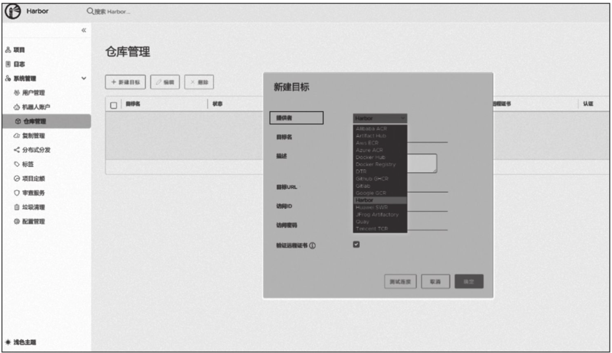
图18-3　新建目标

然后，按照要求填写仓库，可以使用测试连接来测试到目标仓库的连接，若对端仓库没有使用证书，则可取消验证远程证书选项。图18-4所示的效果表示连接成功。
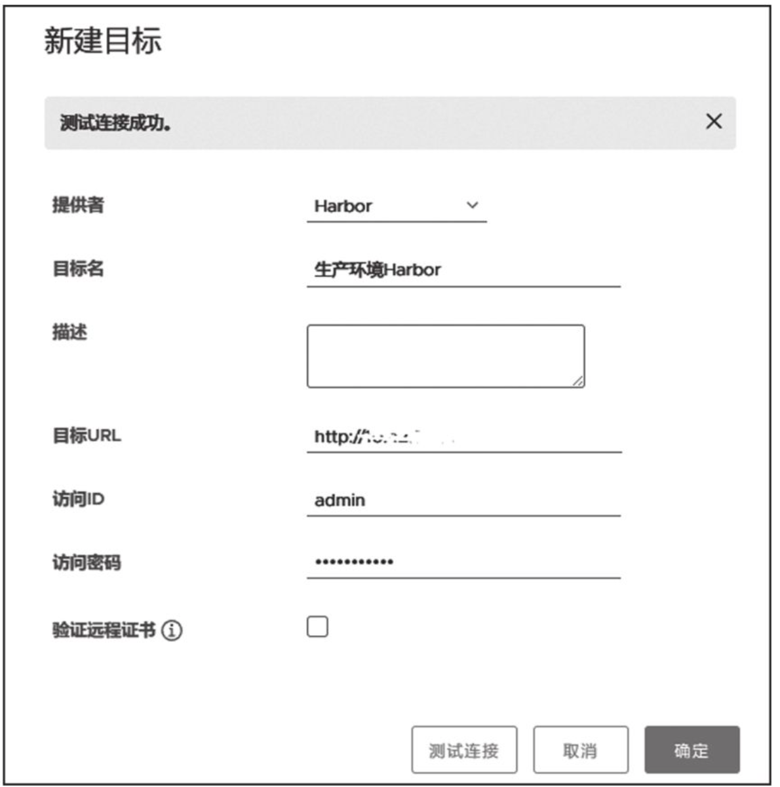
图18-4　测试连接成功

(2)配置复制规则
1)先单击左侧“复制管理”菜单，再单击“新建规则”按钮。
2)配置规则：
❑ 资源过滤器：可配置要推送到目标点资源前缀，比如有一批镜像前缀都是dockerbook.com/dockerbook/project01，那这里就可以填dockerbook/project01/**。
❑ 目标：指定要将当前的推送规则内的资源推送到目标的哪个名称空间下面，如果不填，会默认选择和当前空间一致的名称空间。
❑ 触发模式：可选手动、定时和事件驱动，当选择事件驱动时，源仓库会将改动实时推送到目标仓库。
配置规则的操作如图18-5所示。
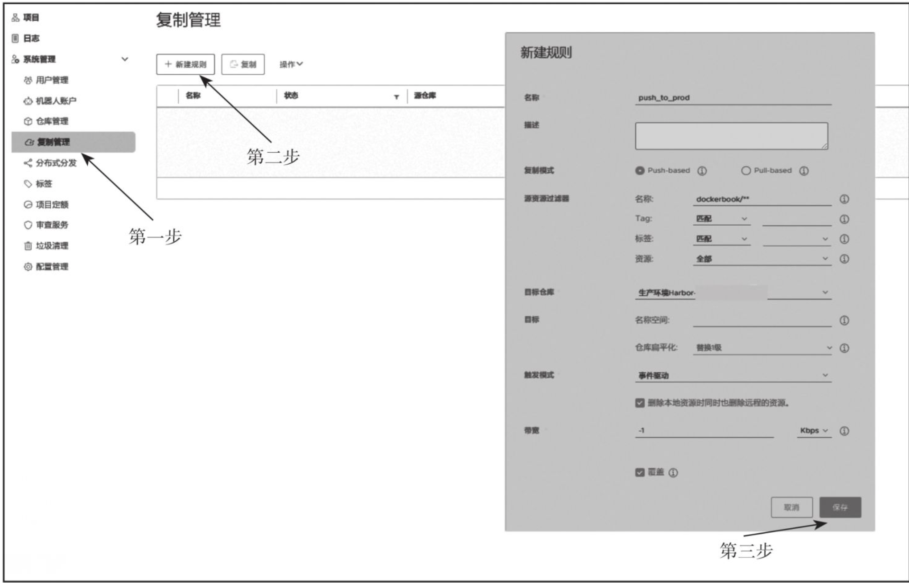
图18-5　配置规则

3)查看复制过程。单击刚才建立的复制规则，可以看到复制状态和日志，如图18-6所示。
## 18.8 本章小结
本章详细介绍了如何安装、使用和配置DockerRegistry，以及如何启用Docker Registry的访问控制，还演示了如何通过脚本来实现对镜像的批量管理，以及使用Docker Registry的通知系统。最后介绍了CNCF孵化的Harbor项目的安装和使用。通过本章的学习，读者可以搭建一套私有的镜像仓库，并对其进行自定义配置。在生产环境中，为了提高仓库的性能和容错性，还可以考虑在仓库前使用负载均衡工具。
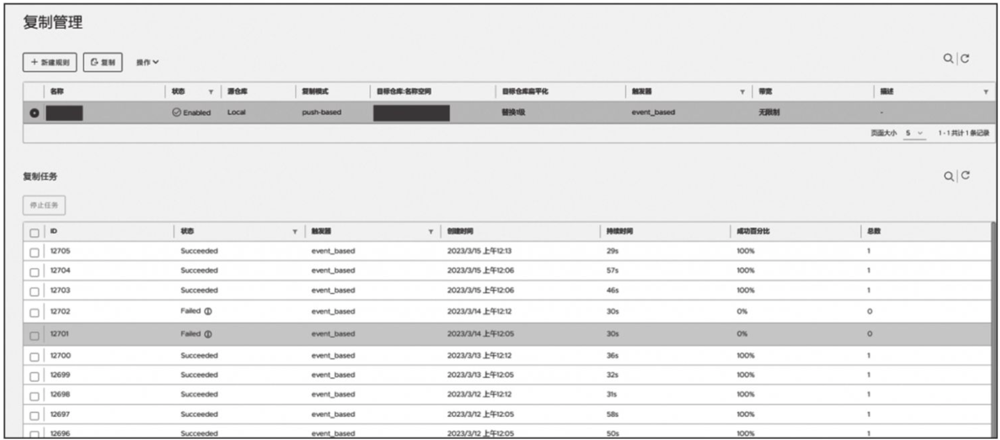
图18-6　查看复制状态和日志