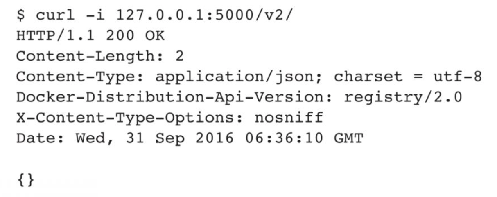

# 第18章　配置私有仓库
在使用Docker一段时间后，用户往往会发现手头积累了大量的自定义镜像文件，这些文件通过公有仓库（如Docker Hub）进行管理和分享并不总是方便。另外，有时用户只是希望在内部成员之间分享镜像，不希望公开发布。在这种情况下，搭建一个本地的私有镜像仓库变得尤为重要。
本章将具体讲解Docker Registry的使用技巧，并通过案例来展示如何搭建一个功能齐全的私有镜像仓库。之后，将详细解析Docker Registry的配置参数和访问控制，最后还会介绍其他私有仓库搭建工具。
## 18.1 安装Docker Registry
Docker Registry工具目前的最新版本为2.8系列版本，这一版本和一些类库以及工具一起被打包为负责容器内容分发的工具集：DockerDistribution。目前，它的核心功能组件仍负责镜像仓库的管理。
新版本的Registry基于Golang进行了重构，提供更好的性能和扩展性，并且支持Docker 1.6+的API，非常适合用来构建私有的镜像注册服务器。官方仓库中也提供了Registry的镜像，因此用户可以通过容器运行和源码安装两种方式来使用Registry。
1.基于容器安装运行 基于容器的运行方式十分简单，只需要一条命令：
```shell
docker run -d -p 5000:5000 --restart=always --name registry registry:2
```
启动后，服务监听在本地的5000端口，可以通过访问http://localhost:5000/v2/ 测试启动是否成功。
Registry比较关键的参数是配置文件和仓库存储路径。
默认的配置文件为/etc/docker/registry/config.yml，因此，通过如下命令，可以指定使用本地主机上的配置文件（如/home/user/registry-conf）​：
```shell
docker run -d -p 5000:5000 \
  --restart = always \
  --name registry \
  -v /home/user/registry-conf/config.yml:/etc/docker/registry/config.yml \
  registry:2
```
默认的存储位置为/var/lib/registry，可以通过-v参数来映射本地的路径到容器内。
例如，下面的例子是将镜像存储到本地/opt/data/registry目录：
```shell
docker run -d -p 5000:5000 \
  --restart = always \
  --name registry \
  -v /opt/data/registry:/var/lib/registry \
  registry:2
```
**2.本地安装运行**
有时需要在本地运行仓库服务，此时可以通过源码方式进行安装。
首先安装Golang环境支持，以Ubuntu为例，可以执行如下命令：
```shell
sudo add-apt-repository ppa:ubuntu-lxc/lxd-stable
sudo add-get update
sudo apt-get install golang
```
确认Golang环境安装成功，并配置\$GOPATH环境变量，例如/go。
创建$GOPATH/src/github.com/docker/目录，并获取源码：
```shell
mkdir -p $GOPATH/src/github.com/docker/
cd $GOPATH/src/github.com/docker/
git clone https://github.com/docker/distribution.git
cd distribution
```
将自带的模板配置文件复制到/etc/docker/registry/路径下，创建存储目录/var/lib/registry：
```shell
cp cmd/registry/config-dev.yml /etc/docker/registry/config.yml
mkdir -p /var/lib/registry
```
然后执行安装操作：
```shell
make PREFIX = /go clean binaries
```
编译成功后，可以通过下面的命令来启动：
```shell
registry serve /etc/docker/registry/config.yml
```
此时使用访问本地的5000端口，看到返回成功(200 OK)，则说明运行成功：

