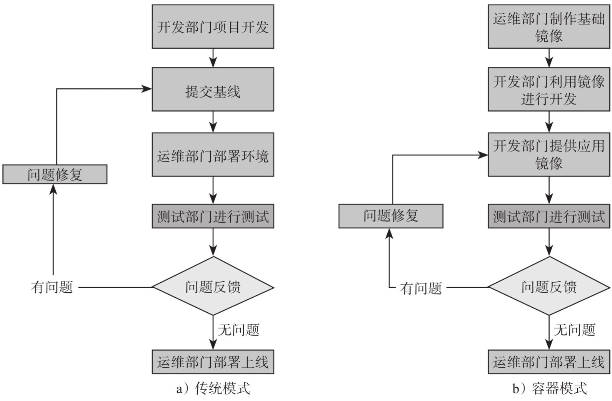
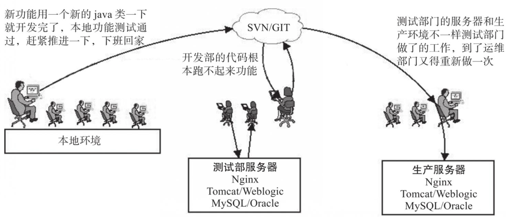
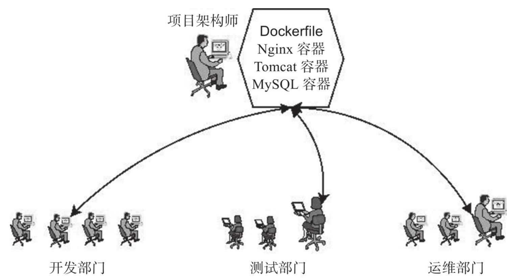

# 第十六章 容器实战思考
在开发和运维实践中大量使用容器技术之后，相信读者都会有一些心得体会，此时进行经验总结十分有必要。
在本章中，笔者将分享自己在容器实践中的一些思考和体会，包括Docker成功的根本原因，开发人员该如何看待容器，DevOps团队该如何使用容器，以及生产环境中部署容器的一些技巧等。希望读者在阅读完本章内容后，对容器的理解能更上一层楼，在实践应用上也能融会贯通。
## 16.1 Docker为什么会成功
Docker实现所依赖的各种基础技术（cgroups、namespace、分层文件系统等）在Docker之前已经存在很多年，并且其前身LXC也在诸多企业的生产环境中得到了大量的应用实践以及极为明显的性能优势。Google大规模容器集群的性能比传统虚拟机要高很多，接近于Bare Metal。与传统虚拟机相比，容器集群让这些公司拥有秒级而非分钟级的弹性计算伸缩能力，同时使用更少的机器运行更多实例。既然容器技术有如此大的优势，为什么在Docker出现之前，容器并没有引发广泛的关注呢？核心问题在于易用性。前人走完了九十九步，而Docker迈出了最后一步，引发了从量变到质变的突破。Docker首次创造了一种简单易行并且覆盖应用全生命周期的工作流。用户可以通过简单的指令或Restful API来拉取、打包、运行和维护容器。这种简化从根本上降低了应用程序部署的难度，极大地提高了应用运行时环境的部署与维护的效率。用户可以不依赖类似于Ansible、Chef、Puppet这类配置管理和发布系统，不需要在一次部署中同时关注基础系统与软件的安装配置，以及应用的安装调试。同时，Docker提供了一种统一的实践方法，每个服务（或应用）维护一个Dockerfile。即便使用编排工具（如Docker Compose）​，一个服务（或应用）也只需维护一个docker-compose.yml文件。应用程序及其运行时环境全部打包到一个简单易读的Dockerfile或Compose文件中，开发团队和运维团队都可以透明地合作维护这个文件，极大地降低了沟通成本与部署成本，满足了研发团队与DevOps团队、运维团队之间的沟通需求，清晰划分了责任边界。Docker正以一种前所未有的方式让用户快速在各种Linux发行版、各种开发环境中快速切换，这对应用开发者来说真是一种福音。使用各种开发环境的用户再也不必担心破坏主机的系统环境（如环境变量）和应用程序了。系统架构师也可以使用Docker快速搭建各种网络架构的系统，并且可以方便地管理这些系统之间的数据连接和共享。目前Docker发展迅速，基于Docker的PaaS平台也层出不穷。这让技术创业者无须过多关注服务器部署，只需专注业务代码的实现即可。完整解决用户痛点，真正带来效率的提升，正是一个产品和技术能最终成功的关键！
## 16.2 研发人员该如何看待容器
很多研发工程师经常会问：做开发，不做运维，需要学习容器技术吗？
其实，笔者在实践过程中发现，合理应用容器技术，不仅能提升开发效率，还能提升技术水平。
**1.快速上手新技术**
众所周知，新技术的学习往往从学习简单示例（例如Hello World）开始，这是学习新知识的标准思路：最小系统原则，即从变量最少的最小系统开始，循序渐进地学习。
现实生活中，简单的事物背后往往蕴含着复杂的机制。用户在构建最小系统的时候，首先面对的就是环境（或者说前置条件）的搭建。虽然随着程序语言自身的发展，周边工具越来越多，但学习成本仍然居高不下，各大技术论坛中关于环境安装的问题总是层出不穷。
通过Docker的使用，用户可以将精力和注意力都尽快放在语言本身的学习上，而无须过多关注系统环境的各种配置。Docker官网的口号就包含了以上含义—Build,Ship and Run Any App,Anywhere，即任何应用都可以自动构建、发布、运行于任何环境，将环境的影响因素降至最低，全面掌控应用的整个生命周期。
目前，Docker官方支持的编程语言镜像已达几十种，涵盖所有的主流编程语言的开发环境。除此之外，常用数据库、缓存系统、主流Web框架等都有官方的镜像。除此之外，Docker Hub还提供了丰富的第三方镜像。
**2.容器化的代码仓库**
经常整理和收集常用代码库是软件工程师实现高效交付的“秘诀”​。在技术团队中，为何行业新人和资深工程师之间的生产力可以有几十倍的差距呢？
暂且不论基础技能和经验的差距，同样是做一件任务，新人首先面对的就是工具的选择，然后需要解决工程实践中的各种“坑”​。而资深工程师接手后，可以快速规划所需要的资源，并在最短时间内利用积累的模块搭建起系统，从而可以快速完成任务。
另外，研发过程中的各种发布版本也可以用Docker容器的方式保存。以后遇到类似的需求，可以直接运行、调试并复用代码。
**3.面向业务编程**
软件开发，除非是算法比赛，否则本质上还是要能解决业务问题，满足需求方的要求。
最近几年，各种新的技术和工具层出不穷，虽然万变不离其宗，但能快速掌握新的业务需求和新的技术栈，是对一个优秀技术人员的迫切要求。
笔者根据Docker的特性给出一个可行方案：使用Docker快速掌握新技术要点并完成适当的技术储备。
下面举一个简单的例子，假设读者是Python技术栈的后端工程师，熟悉常规网站的后台建设，那么如何快速实现移动应用的Restful API Server呢？
可以去Docker Hub搜索适合做API服务器的Python快速开发框架，根据自身业务需求修改Dockerfile，定制符合要求的镜像，然后快速启动一套能满足相关API需求的系统。
可见，容器技术可以帮助软件工程师更加专注地面向业务需求，快速启用新技能。
**4.使用Docker Hub发布开源项目**
技术人员从社区借鉴和学习各种好用的工具和技能时，也需要积极反馈社区，共同营造一个良好的生态环境。
笔者在此建议：读者如果参与开源项目的建设，那么可以通过Docker完成程序的打包、测试、发布和部署，通过Docker Hub来管理和维护镜像，这样可以统一又清晰地管理整个开源项目。
## 16.3 容器化开发模式
传统开发模式会涉及多种环境和团队。开发团队在开发环境中完成软件开发，在本地完成单元测试，测试通过，则可提交到代码版本管理库，由测试团队打包进行进一步测试。运维团队把应用部署到测试环境，开发团队或测试团队再次进行测试，测试通过后通知部署人员发布到生产环境。
在上述过程中涉及的三个环境（开发、测试和生产）以及三个团队（开发、测试、运维）​，彼此之间需要进行大量人工交互，很容易出现由于环境不一致而出错的情况，浪费不必要的人力物力。
在容器化开发模式中，应用是以容器的形式存在，所有和该应用相关的依赖都会在容器中，因此移植非常方便，避免了因为环境不一致而出错的风险。

图16-1比较了两种模式下的不同流程。

图16-1　传统模式与容器模式下的工作流程比较

**1.操作流程**
在容器化的应用中，项目架构师和开发人员的作用贯穿整个开发、测试、生产三个环节。
项目伊始，架构师根据项目预期创建好需要的基础的base镜像，如Nginx、Tomcat、MySPL镜像，或者将Dockerfile分发给所有开发人员，开发人员根据Dockerfile创建的容器或者从内部仓库下载的镜像来进行开发，达到开发环境的充分一致。若开发过程中需要添加新的软件，只需要向架构师申请修改基础的base镜像的Dockerfile即可。
开发任务结束后，架构师调整Dockerfile或者Docker镜像，然后分发给测试部门，测试部门马上就可以进行测试，消除了部署困难等问题。
**2.场景示例**
假如有一个200人左右的软件企业，主要使用Java作为开发语言，使用Tomcat、Weblogic作为中间件服务器，后台数据库使用Oracle、MySQL等。
在应用容器之前，开发到测试的流程如图16-2所示。

图16-2　传统的开发流程

可见，因为环境不一样，开发、测试、运维三个部门做了很多重复的工作。容器化开发恰好可以解决这个问题，大大简化工作流程，如图16-3所示。

图16-3　利用容器环境开发的流程

**3.注意事项**
首先，在开发和测试环境中，推荐使用-v共享文件夹来存储开发人员的程序代码，避免频繁打包操作。
其次，利用基础的base镜像的继承特性来调整镜像的轻微变更。例如，当需要测试程序对不同版本的JDK的支持情况时，只需改变base镜像的JDK设置，然后其他依赖它的镜像在重新创建的过程中就可以自动完成更新。
最后，测试部门应当注意Docker以及镜像的版本，并经常对部署后的应用程序进行性能上的测试。
**4.容器与生产环境**
对于生产环境，不同的产品技术团队可能有不同的解读。在这里，生产环境是指企业运行其商业应用的IT环境，是相对于开发环境、预发布环境和测试环境而言的。
在生产环境中，容器既可以作为API后端服务器，也可以作为业务应用的Web服务器，还可以作为微服务中的服务节点。但是不管用户将容器用于哪种场景，在生产环境中运行容器与其他环境相比，对安全性与稳定性等方面有更高的要求。
Docker算是IT生产环境与基础设施的新成员。近些年，Docker在DevOps和基础设施领域快速风靡起来。Google、IBM、Amazon、Microsoft，以及几乎所有云计算供应商都宣布支持Docker。很多容器领域的创业公司都在2014年或2015年初获得了风险投资。同时，Docker公司在2015年的估值也达到了10亿美元。
尽管Docker获得广大公有云厂商的大力支持，但是目前容器技术生态中已经存在许多分支与分歧，如rkt项目。为了解决容器生态中的差异化问题，并从根本上解决在生产环境中运用Docker的风险，Google、Intel、Microsoft、IBM、Amazon、VMware、Oracle、HPE等IT巨头于2015年6月共同宣布成立OCI(Open ContainerInitiative)组织。OCI组织的目标在于建立通用的容器技术标准。除了保障与延续既有容器服务的生命周期外，还通过不断推出标准的、创新的容器解决方案赋能开发者。OCI成员企业也会秉持开放、安全、弹性等核心价值观来发展容器生态。客观而言，OCI组织的出现确立了容器技术的标准，避免容器技术被单一厂商垄断。统一技术标准后，广大企业不用担心未来新兴的容器技术不兼容Docker。
2016年开始，大量企业应用开始云化，部分已经云化的企业开始实施全面容器化和微服务化。不过，用户不应该把容器当作“银弹”​，并不是所有应用和服务都适合容器化。对于12 Factor类型的应用，容器化是非常容易和平滑的。因为这些应用是无状态的，而且它们在微服务架构中可以在很短时间内完成启停，高度保证了整个 服务的可用性。传统数据库或有状态应用以及对网络吞吐性能有高要求的应用并不适合容器化。
可以说，绝大部分分层架构的企业架构都可以平滑地在生产环境中容器化，而绝大部分完成容器化的企业架构，都可以通过代码重构完成微服务化，这样可以从服务层面进一步提高可用性，进一步降低IT固定成本、持续集成与部署成本。
现在越来越多的企业正在生产环境中使用Docker。截至本书写作时，Docker Hub镜像的年下载量超过了100亿次。调研报告显示，八成的IT从业者了解和接触过Docker，四成的组织目前正在生产环境中使用Docker，预计这个比例会在未来继续上升。
要在在生产环境中使用容器，这里提供一些基本建议供大家参考：
❑ 如果Docker出现不可控的风险，是否有备选解决方案？
❑ 是否需要对Docker容器做资源限制，以及如何限制，如CPU、内存、网络、磁盘等。
❑ 目前，Docker对容器的安全管理做得不够完善，在应用到生产环境之前可以使用第三方工具来加强容器的安全管理，如使用apparmor对容器的能力进行限制，使用更加严格的iptables规则，禁止root用户登录，限制普通用户权限以及做好系统日志的记录。
❑ 公司内部私有仓库的管理、镜像的管理问题是否解决？目前官方提供的私有仓库管理工具的功能并不十分完善，若在生产环境中使用，还需要更多的完善措施。
> [!NOTE] 注意
>OCI组织官网为https://www.opencontainers.org/ ,12 Factor App网址为https://12factor.net/ 。

## 16.4 本章小结
本章主要介绍了实战中使用容器技术的一些思考，这些思考源自产品研发中的痛点。产品研发流程中非常让人头痛的一点就是研发周期管理。无论是传统模式还是快速迭代、瀑布流，都需要有完善的代码周期支持。容器化毫无疑问地契合了这一需求，为产品研发带来了生产力的提升。
笔者认为，自容器之后，信息产业将会上升到一个更高的水平，更多的生产力将被解放出来，可以去攻克更核心的技术问题。在这个过程中，技术人员要主动拥抱变化，掌握全新的工作模式和核心技能，推动科技进步。