# 第十四章 编程开发
本章主要介绍如何使用Docker快速部署主流编程语言的开发、编译环境及其常用框架，包括C/C++、Java、Python、JavaScript、Go、PHP、Rust等。
通过学习本章，读者在今后采用编程语言开发和测试时，将不用花费大量时间进行环境配置，只需要简单获取容器镜像，即可快速拥有相关的环境。
本章内容需要读者事先对相关语言的基础概念和工具栈有所了解，可自行查看语言相应的技术文档。
## 14.1 C/C++
C是一门古老的语言，在今天仍然是系统领域和高性能计算的主要选择，它在1969年由贝尔实验室设计开发。C语言具有高效、灵活、功能丰富、表达力强和较高的可移植性等特点。C++在C的基础上，支持了数据的抽象与封装、面向对象和泛型编程。功能与性能的平衡使C++成为目前应用最广泛的系统编程语言之一。
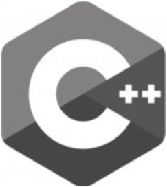
本节将介绍三款流行的C/C++开发工具：GCC、LLVM和Clang。
### 14.1.1 GCC
GCC（GNU Compiler Collection，GNU编译器套装）是一套由GNU开发的编程语言编译器，是一套根据GPL及LGPL许可证发行的自由软件，也是GNU计划的关键部分。GCC（特别是其中的C语言编译器）通常被认为是跨平台编译器的事实标准。

GCC可处理C/C++、Fortran、Pascal、Objective-C、Java、Ada等多种语言。
**1.使用官方镜像**
将C/C++代码运行在容器内的最简方法，就是将编译指令写入Dockerfile中，然后使用此Dockerfile构建自定义镜像，最后直接运行此镜像，即可启动程序。
如果对GCC版本有要求，则可以在以上命令中加入镜像标签，并在下一步Dockerfile的FROM指令中明确GCC版本号。
然后，在Dockerfile中，加入需要执行的GCC编译命令：
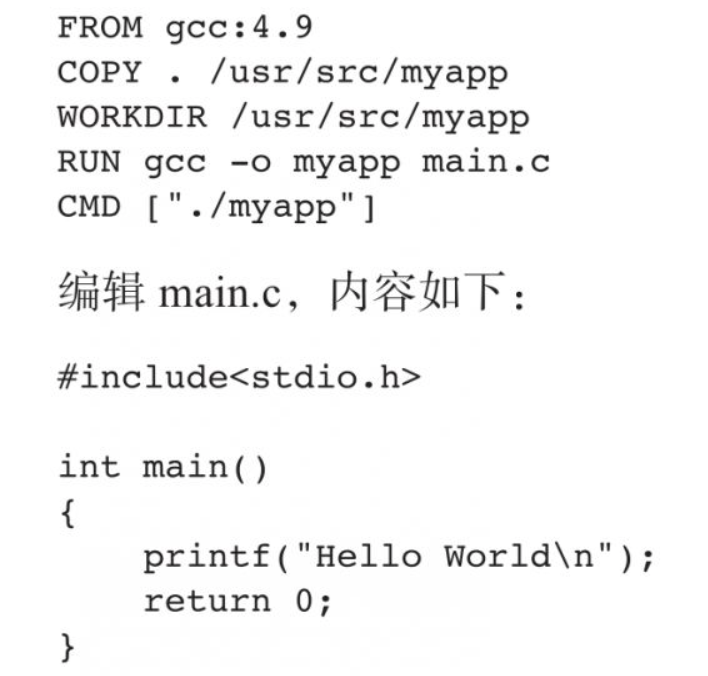
现在，就可以使用Dockerfile来构建镜像my-gcc-app：
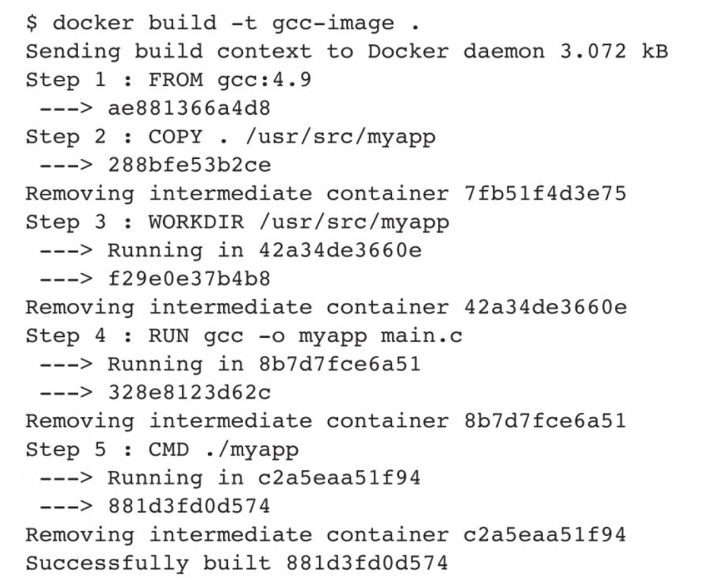
用户可以使用docker images命令查看生成的镜像：
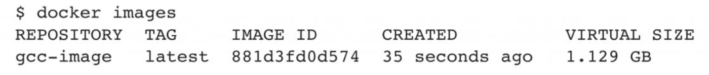
创建并运行此容器，会编译并运行程序，输出Hello World语句：

如果只需要容器编译程序，而不需要运行它，则可以使用如下命令：
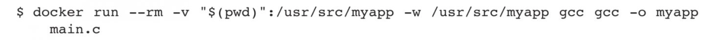
以上命令会将当前目录("$(pwd)")挂载到容器的/usr/src/myapp目录，并执行gcc-o myapp myapp.c。GCC将会编译myapp.c代码，并将生成的可执行文件输出至/usr/src/myapp文件夹。
如果项目已经编写好了Makefile，也可以在容器中直接执行make命令：
```shell
docker run --rm -v "$(pwd)":/usr/src/myapp -w /usr/src/myapp gcc make`
```
**2.定制镜像**
下面，笔者给出了基于buildpack-deps:wheezy镜像创建GCC镜像的Dockerfile供读者参考：
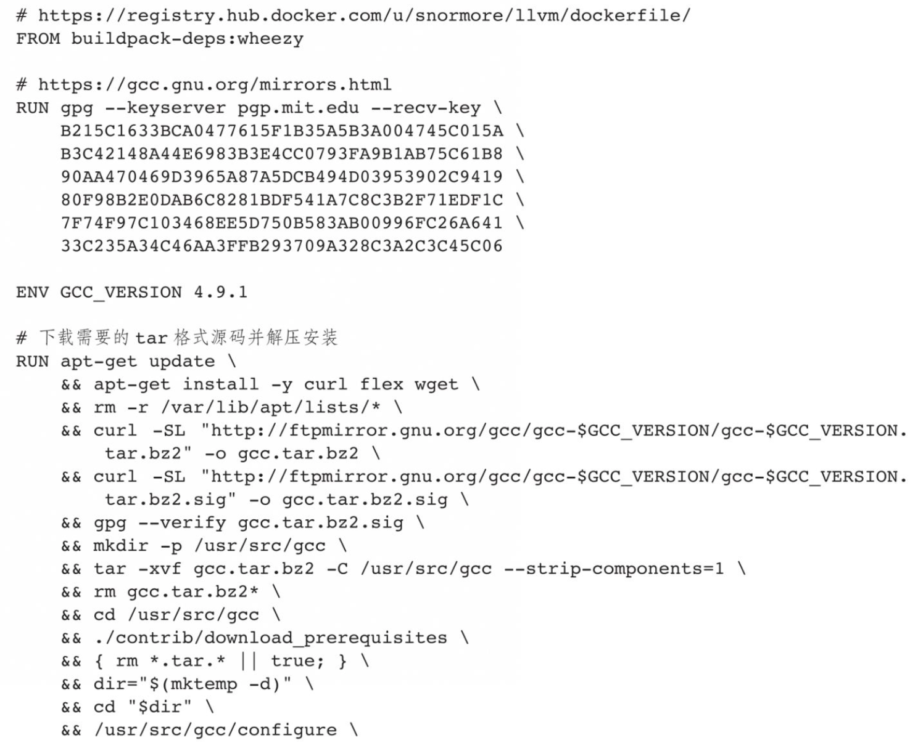
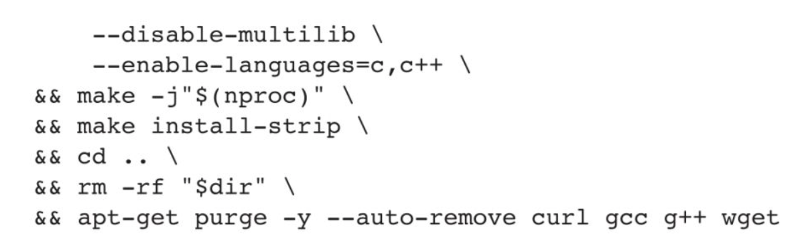
### 14.1.2 LLVM
LLVM（Low Level Virtual Machine，底层虚拟机）是美国伊利诺伊大学的一个研究项目，试图提供一个现代化的，基于SSA的编译策略，同时支持静态和动态编程语言。和之前为大家所熟知的JVM以及.net Runtime这样的虚拟机不同，这个虚拟系统提供了一套中立的中间代码和编译基础设施，并围绕这些设施提供了一套全新的编译策略（使得优化能够在编译、连接、运行环境执行过程中，以及安装之后以有效的方式进行）和其他一些非常有意思的功能。
LLVM包括若干重要的子项目，其中Clang将在后面讲解。
**1.使用官方镜像**
Docker Hub中已经有用户提供了LLVM镜像，读者可以直接下载使用，不再赘述：
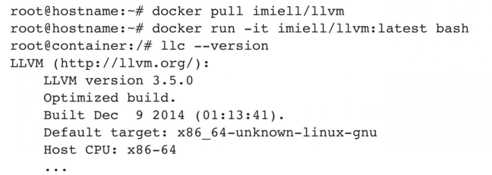
**2.定制镜像**
读者可以基于前面提到的SSHD基础镜像来定制GCC镜像，构建后直接运行。也可以使用Docker Hub中提供的第三方Dockerfile，定制或修改后构建镜像，然后运行容器即可。
### 14.1.3 Clang
Clang是一个由Apple公司用C++实现、基于LLVM的C/C++/Objective-C/Objective-C++编译器，其目标就是超越GCC成为标准的C/C++编译器，它遵循LLVM BSD许可。Clang很好地兼容了GCC。
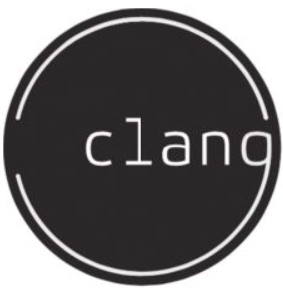
Clang的特性包括以下几点。
❑ 快：在OSX上的测试中，Clang比GCC 4.0快2.5倍。
❑ 内存占用小：Clang内存占用一般比GCC要小得多。
❑ 诊断信息可读性强：Clang对于错误的语法不但有源码提示，还会在错误的调用和相关上下文上有更好的提示。
❑ 基于库的模块化设计：Clang将编译过程分成彼此分离的几个阶段，将大大增强了IDE对于代码的操控能力。
**1.使用官方镜像**
在Docker Hub中已经有用户提供了Clang的镜像，读者可以直接下载使用：
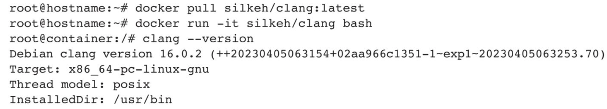
读者可以通过Docker Hub的镜像详情查看实际安装指令，确认是否符合需求，如下所示：
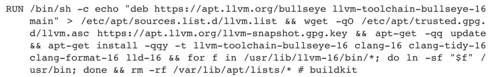
**2.定制镜像**
如前文所说，读者可以基于SSHD镜像自定义Dockerfile，也可以使用Docker Hub中的第三方镜像构建Clang容器。
这里以ubuntu:bionic系统为例，给出了示例Dockerfile文件：
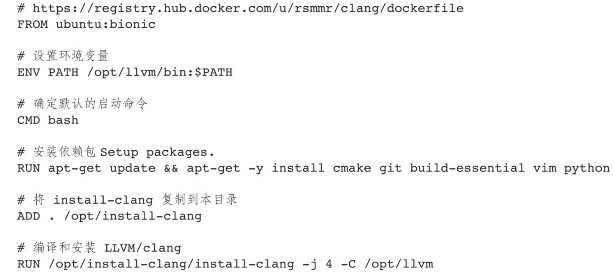
**3.相关资源**
❑ GCC官网：https://gcc.gnu.org/ 。
❑ GCC官方镜像：https://hub.docker.com/_/gcc/ 。
❑ GCC官方镜像仓库：https://github.com/docker-library/gcc 。
❑ LLVM官网：http://llvm.org/ 。
## 14.2 Java
ava是广受欢迎的编程语言和开发平台，有助于企业降低成本、缩短开发周期、推动创新以及改善应用服务。如今，Java仍是企业和开发人员的首选开发平台，全球有数百万开发人员运行超过60亿台Java虚拟机。Java是一种跨平台、面向对象、泛型编程的编译型语言，广泛应用于企业级应用开发和移动应用开发领域，由SUN公司在1995年推出。Java是基于类的面向对象的高级语言，其设计理念是尽可能减少部署依赖，致力于允许Java应用的开发者“开发一次，到处运行”​。这就意味着Java的二进制编码不需要再次编译，即可运行在异构的JVM上。Java在大型互联网项目，特别是互联网金融和电子商务项目中非常受欢迎。OpenJDK(Open JavaDevelopment Kit)是免费开源的Java平台，支持Java SE(Standard Edition)。从Java 7开始，OpenJDK就是官方的Java SE环境。
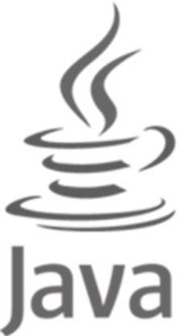
**使用官方镜像**
在容器中运行Java代码最简单的方法就是将Java编译指令直接写入Dockerfile。然后使用此Dockerfile构建并运行此镜像，即可启动程序。
具体步骤如下。
首先，从官方仓库获取某版本Java基础镜像：
```shell
docker pull java:20
```
然后，在本地新建一个空目录，在其中创建Dockerfile文件。在Dockerfile中，加入需要执行的Java编译命令，例如：
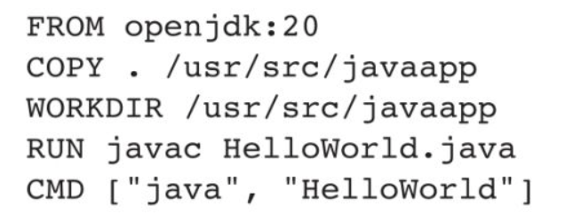
如果希望使用最新的Java 10，则可以修改基础镜像为FROM openjdk:10。下面继续使用此Dockerfile构建镜像java-image：
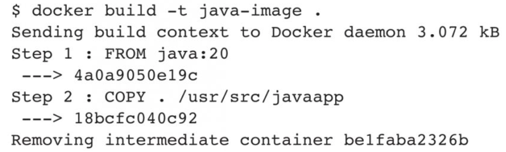
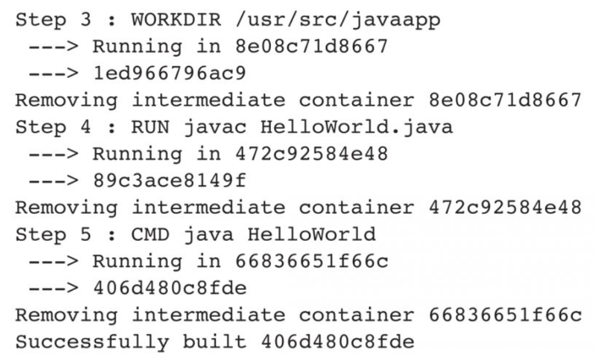
用户可以通过docker images命令查看生成的镜像：
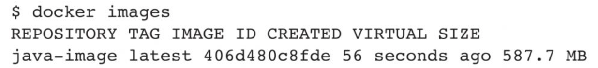
然后，运行此镜像即自动编译程序并执行：

如果只需要在容器中编译Java程序，而不需要运行，则可以使用如下命令：
```shell
docker run --rm -v "$(pwd)":/usr/src/javaapp -w /usr/src/javaapp java:7 javac
  HelloWorld.java
```
以上命令会将当前目录("$(pwd)")挂载为容器的工作目录，并执行javacHelloWorld.java命令编译HelloWorld.java代码，然后生成HelloWorld.class类文件至当前目录下：
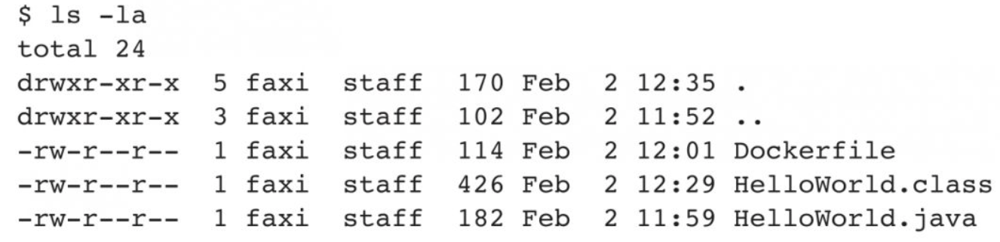
### 14.2.1 Spring Boot
Spring Boot是由Pivotal团队开发的框架，其设计目的是简化新Spring应用的初始搭建以及开发过程。Spring Boot致力于在蓬勃发展的快速应用开发领域成为领导者，旨在简化创建产品级的Spring应用和服务。Spring Boot是一个基于Spring框架的快速开发的框架，可以用来创建独立、可运行的、生产级别的Spring应用程序。使用Spring Boot可以大大简化Spring应用程序的开发过程，通过自动配置Spring和第三方库，减少了大量烦琐的配置，从而让开发人员更加专注于业务代码的编写。

图14-1显示了Spring Boot在Spring生态中的位置。
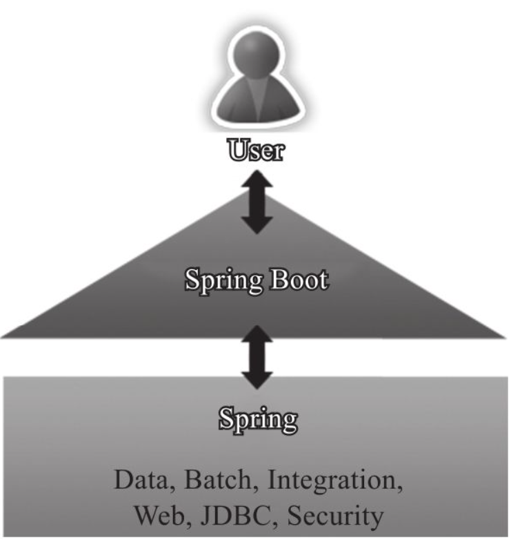
图14-1　Spring Boot在Spring生态中的位置

Spring Boot的特性包括：
❑ 创建独立的Spring应用。
❑ 内嵌Tomcat、Jetty或Undertow（无须部署WAR文件）​。
❑ 提供starter POM，简化Maven配置。
❑ 尽可能地实现Spring项目配置自动化。
❑ 提供工业级特性，如Metrics、健康检查等。
❑ 不生成代码，不需要XML配置。
**使用compose搭建Spring Boot应用**
下面介绍如何使用compose搭建Spring Boot应用，环境要求是JDK 1.8或以上版本，Maven 3.0或以上版本。
下面创建一个Spring Boot应用。
第一步，先下载并解压Spring Boot应用模板代码：
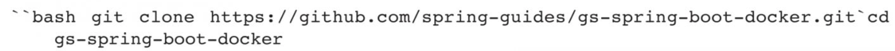
然后，编辑代码文件'src/main/java/hello/Application.java'，内容如下：
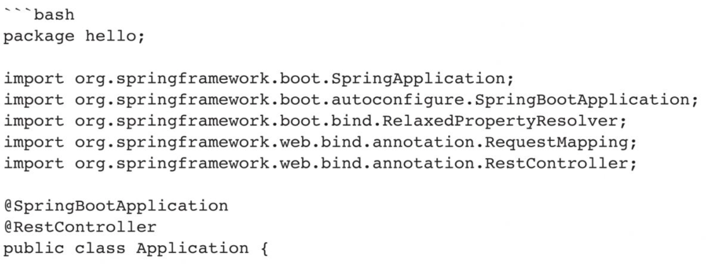
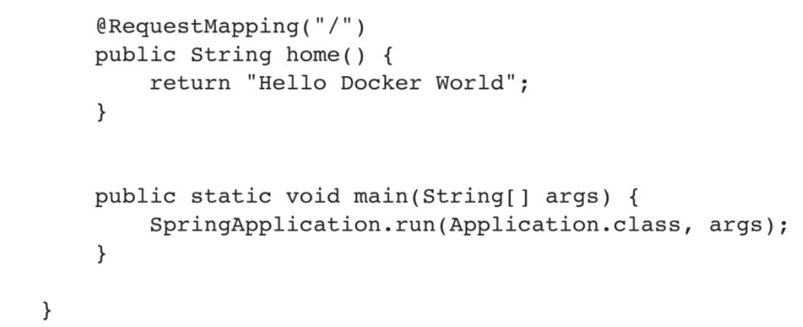
@SpringBootApplication和@RestController表示Java类Application已经准备好被Spring MVC调用，并提供HTTP服务。注解@RequestMapping("/")表示context path "/"的请求路由到方法home中进行处理，main方法中的SpringApplication.run()用来启动一个Spring Boot应用。
第二步，容器化spring boot应用。首先，新建src/main/docker/Dockerfile，内容如下：
```shell
FROM java:8
VOLUME /tmp
ADD gs-spring-boot-docker-0.1.0.jar app.jar
RUN bash -c 'touch /app.jar'
ENTRYPOINT["java","-Djava.security.egd=file:/dev/./urandom","/app.jar"]
```
然后，使用docker-maven-plugin构建镜像，pom.xml文件内容如下：
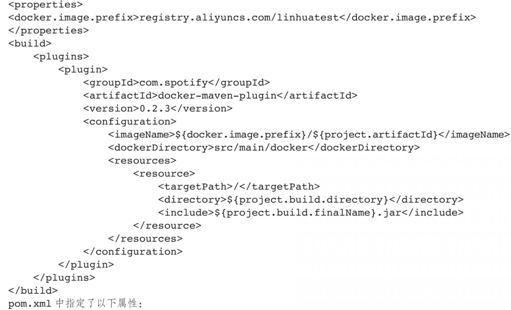
此处镜像的名称为 registry.aliyuncs.com/linhuatest/gs-spring-boot-docker ，其中registry.aliyuncs.com是阿里云镜像仓库的域名，linhuatest是用户的命名空间，gs-spring-boot-docker是用户某个仓库的名称，此处没有镜像tag，默认为latest；Dockerfile文件所在的目录可以理解为Dockerfile的context，用于保存Dockerfile依赖的资源；要将资源复制到Dockerfile文件所在的目录（即context）中，用户只需要编译出jar文件。
最后，用户可以构建和推送镜像到任何一个镜像仓库，如下所示：
```shell
mvn package docker:build #此处必须有Docker客户端连接到docker daemon，方能构建
docker push springio/gs-spring-boot-docker
```
### 14.2.2 相关资源
❑ Java官方镜像：https://registry.hub.docker.com/_/java/ 。
❑ Java官方镜像标签：https://registry.hub.docker.com/_/java/tags/manage/ 。
❑ Spring Boot官网：http://projects.spring.io/spring-boot/ 。
## 14.3 Python
Python是一种解释型动态语言，是功能强大的面向对象语言，集成了模块(module)、异常处理(exception)、动态类型(dynamic typing)、高级数据结构（元组、列表、序列）​、类(class)等高级特性。Python设计精良，语法简约，表达能力很强。目前，所有主流操作系统（Windows、Linux、类UNIX系统）都支持Python。
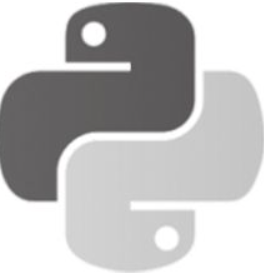
下面讲解如何使用Docker部署Python环境，以及部署Python技术栈中的主流框架。
**使用官方镜像**
首先，推荐用户使用Docker官方提供的Python镜像作为基础镜像。
第一步，新建项目目录py-official，进入此目录，然后使用docker pull命令拉取官方镜像：
```shell
docker pull python
```
接下来，在项目中新建一个Dockerfile文件，内容如下：
```shell
FROM python:3-onbuild
CMD ["python3.5","./py3-sample.py"]
```
新建py3-sample.py文件，计算Fibonacci数列：
```python
def fib(n):
    a,b=0,1
    while a < n：
        print(a,end=' ')
        a, b = b, a+b
    print()
fib(1000)
```
新建requirements.txt依赖文件，读者可以在此文件中加入项目依赖程序，如Django等。此处仅新建空文件：
```shell
touch requirements.txt
```
第二步，使用docker build命令构建名为py2.7-sample-app的镜像：
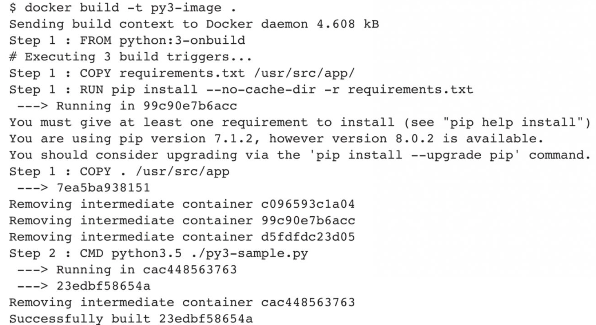
可见至此用户已经成功构建了镜像，可以通过docker images命令进行查看：
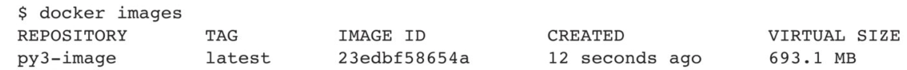
第三步，通过docker[container]run命令创建并运行容器：
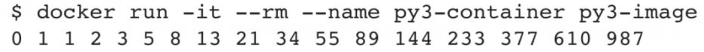
如果只需要运行单个Python脚本，那么无须使用Dockerfile构建自定义镜像，而是通过以下命令直接使用官方Python镜像，带参数运行容器：
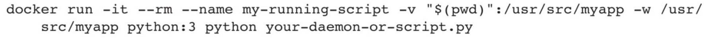
如果读者希望深入了解Python的官方镜像，包括镜像的原始Dockerfile、ONBUILD指令的具体执行内容等，则可以参考GitHub上的docker-library/official-images仓库。
### 14.3.1 使用PyPy
PyPy是一个Python实现的Python解释器和即时编译(JIT)工具，它专注于速度、效率，和CPython的完全兼容性。通过JIT技术，PyPy可以使Python的运行速度提高近十倍，同时保证兼容性。
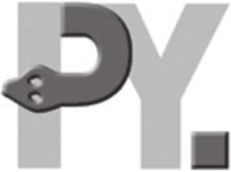
**使用官方镜像**
首先，设置项目目录，并新建hi.py实例程序：
```python
for animal in ["dog","cat","mouse"]:
    print "%s is a mammal" % animal
```
然后，在根目录新建Dockerfile，其内容基于pypy3的onbuild版本镜像：
```shell
FROM pypy:3-onbuild
CMD ["pypy3","./hi.py"]
```
如果用户需要使用pypy2，则可以使用FROM pypy:2-onbuild。
onbuild版本的镜像内含若干onbuild触发器，它们可以在镜像构建期间完成一些必要的初始化操作，便于项目直接运行。pypy的onbuild镜像会复制一个requirements.txt依赖文件，运行RUN pip install安装依赖程序，然后将当前目录复制到/usr/src/app。
下面，用户开始构建和运行此镜像：
```shell
docker build -t mypython-app
docker run -it --rm --name my-running-app my-python-app
```
如果用户只需要运行单个pypy脚本，并希望避免新建Dockerfile，那么可以直接使用如下指令：
```shell
docker run -it --rm --name my-running-script -v "$PWD":/usr/src/myapp -w /usr/src/myapp pypy:3 pypy3 your-daemon-or-script.py
```
如果需要使用pypy2运行，则可以使用如下指令：
```shell
docker run -it --rm --name my-running-script -v "$PWD":/usr/src/myapp -w /usr/src/myapp pypy:2 pypy your-daemon-or-script.py
```
### 14.3.2 使用Django
Django是一个开放源代码的Web应用框架，是基于Python实现的流行的Web框架之一，于2005年7月在BSD许可证下发布。Django采用了MVC（模型、视图、控制器）的经典软件设计模式，主要目标是使得开发复杂的、数据库驱动的网站变得简单。Django注重组件的重用性和可插拔性，以及敏捷开发和DRY(Don't RepeatYourself)法则。

相比Tornado、Flask、Web.py等框架，Django要“重”一些，但它自带了很多工具包，包括认证系统、站点管理系统、评论系统等，便于进行中小型站点的快速开发。
**1.使用Django镜像**
在本地可通过pip安装Django，十分简单：
```shell
pip install Django
```
下面创建一个容器镜像。
第一步，新建项目目录django-official，新建一个名为dockerdjango的Django项目：
```shell
django-admin startproject dockerdjango
```
新建Dockerfile文件，内容如下：
```shell
FROM django:onbuild
```
使用onbuild标签意味着在执行docker build命令的过程中，docker engine会执行ONBUILD命令中的操作。具体的ONBUILD命令可以在GitHub上的docker-library仓库中看到，即：
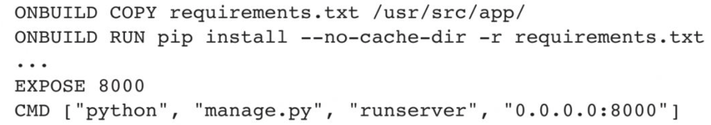
第二步，新建requirements.txt文件，内容为Django：
```shell
echo "Django" > requirements.txt
```
第三步，使用docker build命令构建此Django镜像：
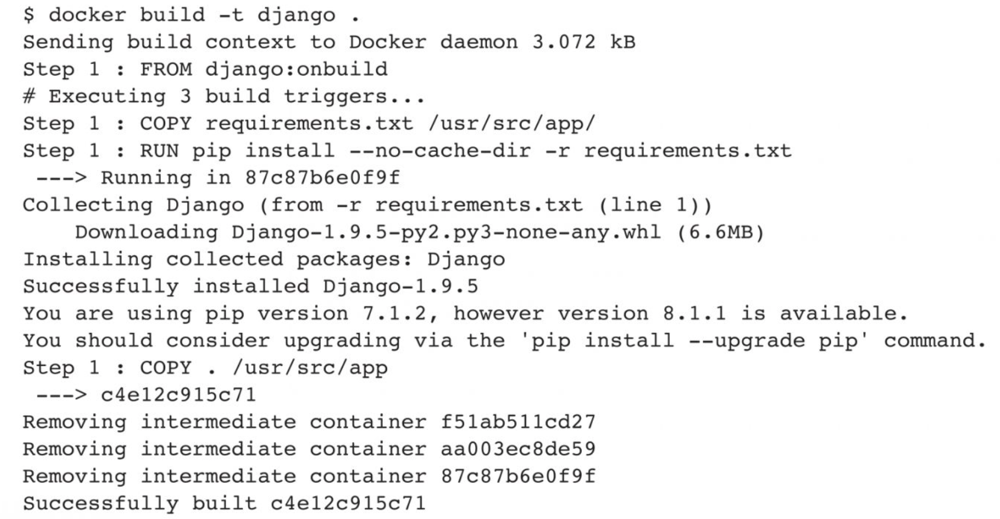
可见Django镜像构建成功，并生成相应的镜像。下面，用户可以使用docker[container]run命令运行此镜像，并得到相应的容器ID：
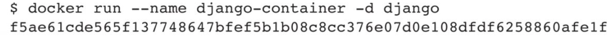
使用docker ps命令可见Django容器已暴露8000端口，但是没有绑定访问端口：
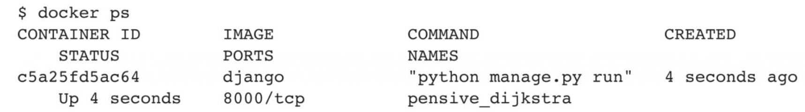
用户在使用docker[container]run时可以加入-P参数，自动分配端口（-p则绑定自定义端口）​：
```shell
docker run -P --name django-container -d django
```
再次使用docker ps命令可见Django容器不仅暴露8000端口，还映射到了本地端口32768：
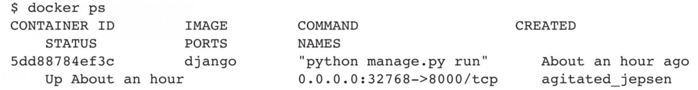
第四步，通过浏览器访问主机的32768端口来访问此Django服务，如图14-2所示。
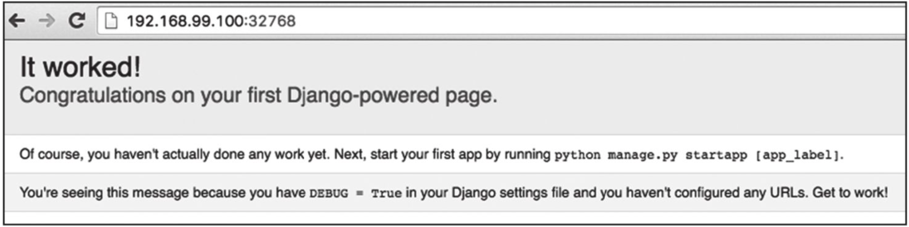
图14-2　通过32768端口访问此Django服务

还可以通过docker logs django-container命令查看日志。还可以使用docker[container]run的entrypoint进入容器，执行更多操作：
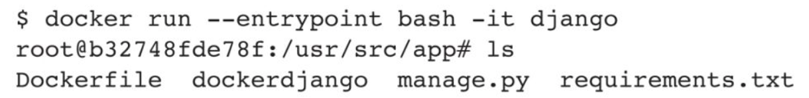
**2.使用Compose搭建Django应用**
Compose是一个定义和运行服务（多容器应用）的官方工具。用户可以通过一个Compose配置文件定义服务，然后使用up命令创建并启动服务。关于Compose的详细讲解，可参阅本书第四部分相关章节。
首先安装docker-compose：
```shell
pip install docker-compose
```
下面用户使用Docker Compose来配置和运行一个简单的Django/PostgreSQL应用。
第一步，用户需要创建一个Dockerfile，一个Python依赖文件，还有一个docker-compose.yml文件。
新建一个项目文件夹，例如命名为djangocompose，并在其根目录新建一个Dockerfile文件，文件内容如下：
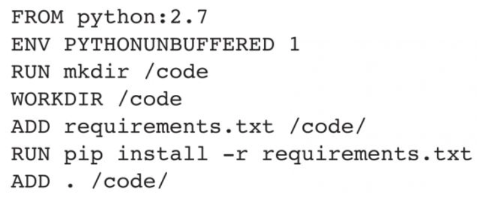
在项目文件夹的根目录新建一个requirements.txt文件，文件内容如下：
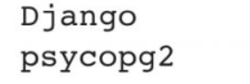
> [!NOTE] 注意
>psycopg2是Python与PostgreSQL的数据库连接池。

最后，在项目文件夹的根目录新建一个docker-compose.yml文件，内容如下：
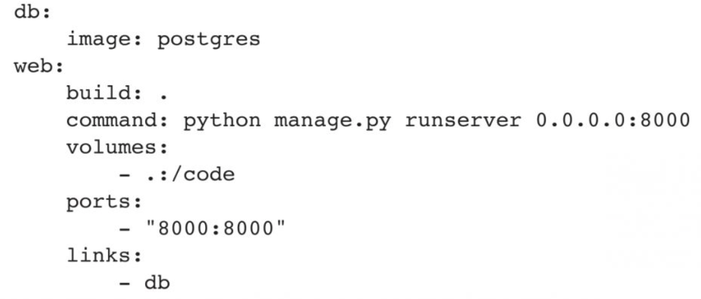
第二步，新建一个Django项目，在其中用docker-compose命令新建一个Django项目：
```shell
docker-compose run web django-admin.py startproject djangocompose
```
第三步，配置Django的数据库连接。
进入项目文件夹，编辑djangocompose/settings.py文件。设置DATABASES=...字段：
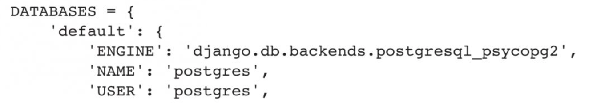
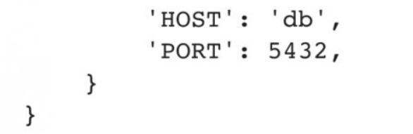
运行docker-compose up命令：
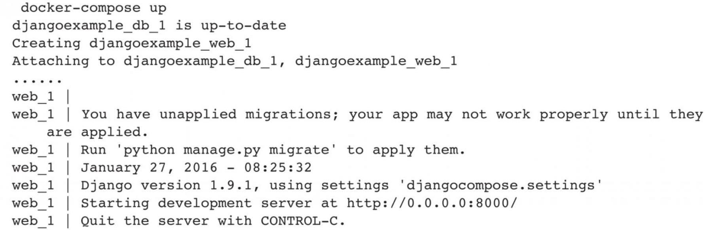
此时用户的Django应用已经开始运行了，访问容器的8000端口，即可看到运行效果，如图14-3所示。
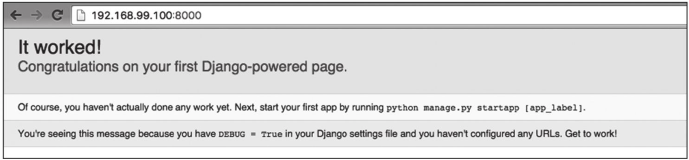
图14-3　运行效果
下面用户可以登录容器查看此Django应用的运行状态。
首先使用docker ps查看当前主机运行的容器：
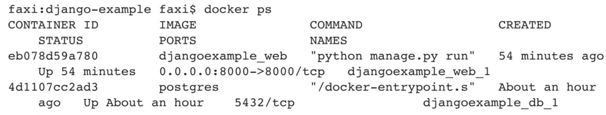
可见Web服务的容器ID是eb078d59a780，用户可以使用docker exec命令登录到容器的bash环境中：
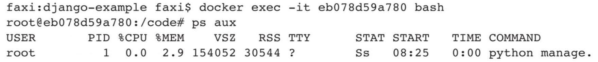
**3.使用Docker Hub镜像**
Django+uWSGI+Nginx的技术组合拥有优异的性能，也是常用的Django Web技术栈。下面用户使用Docker Hub上的dockerfiles/django-uwsgi-nginx镜像构建Django应用。
首先，使用docker pull命令获取镜像：
```shell
docker pull dockerfiles/django-uwsgi-nginx
```
然后，使用build命令构建名为django-uwsgi-nginx-image的Django镜像：
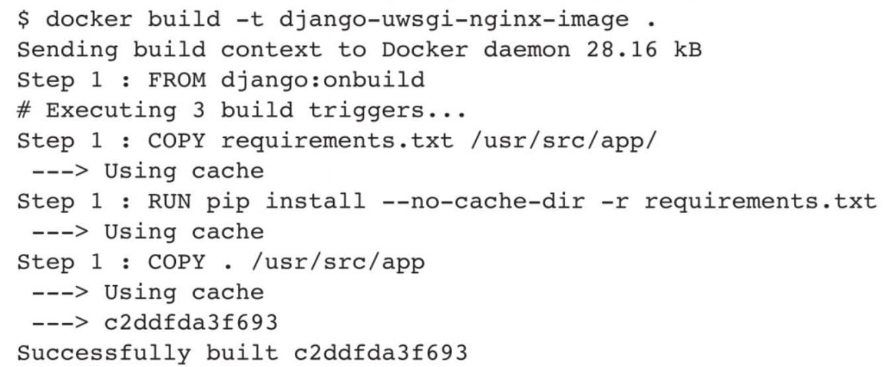
用户可以使用docker images查看镜像信息：
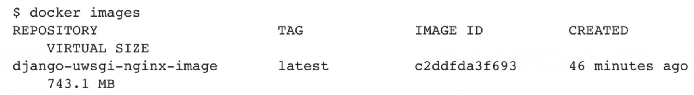
然后，构建并运行django-uwsgi-nginx-image镜像：
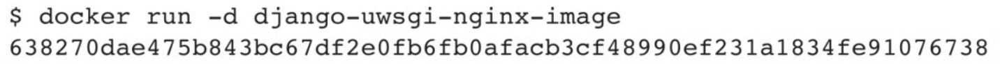
这里的-d参数表示后台运行容器，并打印出容器ID。用户可以使用docker ps-a查看所有容器：
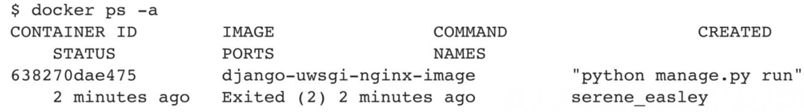
**4.自定义uWSGI+Nginx+Django镜像**
用户也可以通过本地编译自定义uWSGI+Nginx+Django镜像。
首先，新建Dockerfile文件，内容如下：
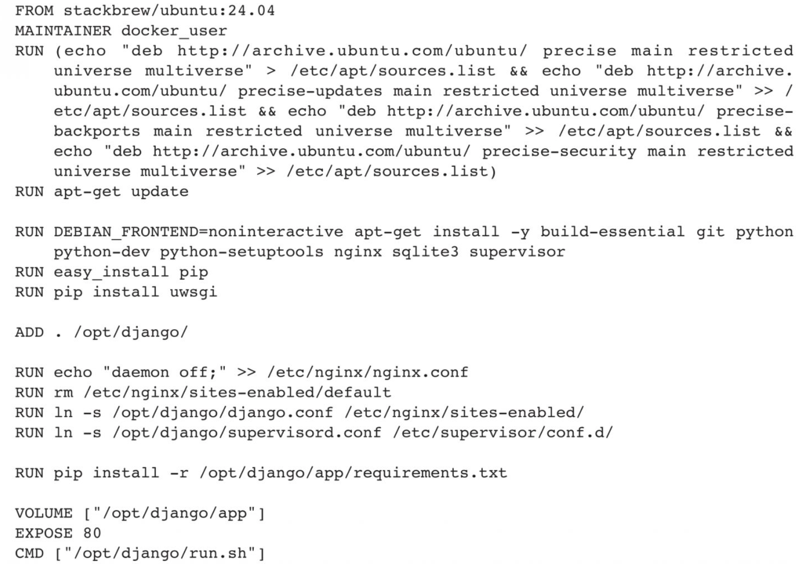
然后，在Dockerfile同级目录下新建app文件夹，内含requirements.txt文件，文件内容如下：

然后，新建Nginx配置文件django.conf，内容如下：

新建run.sh文件，内容如下：

新建supervisord.conf文件，内容如下：

新建uwsgi.ini文件，内容如下：

新建uwsgi_params文件，内容如下：

下面，用户可以使用docker create构建镜像，使用docker push将镜像提交至仓库，然后用户可以登录到生产环境，使用docker pull从仓库拉取此镜像，最后运行此镜像：
```shell
docker run -p 80 -d -e MODELE=myapp mbentley/django-uwsgi-nginx
```
目前容器内的默认卷地址是/opt/django/app，读者可以挂载特定的应用卷，例如：

至此，用户可以成功地在Nginx+uWSGI环境下运行Django应用了。
### 14.3.3 使用Flask
Flask是一个使用Python编写的轻量级Web应用框架，该框架基于Werkzeug WSGI工具箱和Jinja2模板引擎。Flask使用BSD授权，也被称为microframework，因为它仅仅使用简单的核心，使用extension来增加其他功能。

Flask的特色：
❑ 内置开发用服务器和debugger。
❑ 支持集成单元测试(unit testing)。
❑ 支持RESTful请求调度。
❑ 支持使用Jinja2模板引擎。
❑ 支持Secure Cookies（客户端sEssion）​。
❑ 与WSGI 1.0 100%兼容。
❑ 基于Unicode。
❑ 有详细的文件、教学手册。
❑ 与Google App Engine兼容。
❑ 可用Extensions增加其他功能。
Flask是目前广受欢迎的常用Python Web方案之一。
**1.使用Docker Hub镜像**
第一步，项目准备工作。构建Flask App目录：

run.py内容如下：

__init.py_内容如下：

第二步，获取Docker Hub的Flask镜像：
```shell
docker pull verdverm/flash
```
第三步，创建并运行Flask容器（Flask的App代码作为Docker数据卷）​：
```shell
docker run -d --name flask-app \
      -v /path/to/app/src:/src \
      -p 5000:5000 \
  verdverm/flask
```
**2.使用Compose构建Flask+MongoDB服务**
MongoDB是一个基于分布式文件存储的数据库，旨在为Web应用提供可扩展的高性能数据存储解决方案。MongoDB是介于关系数据库和非关系数据库之间的产品，是非关系数据库当中功能最丰富，最像关系数据库的。将Flask与MongoDB结合使用，是一种简单高效的Web服务架构，可以以较高的性能支撑图片服务等各种常见Web服务。
第一步，新建mongo-flask项目文件夹，并新建Flask框架的核心文件app.py，内容如下：

第二步，新建templates文件夹，放置Flask框架的前端模板文件index.html，内容如下：

第三步，回到项目根目录，新建requirements.txt文件，内容如下：

第四步，新建Dockerfile文件，内容如下：

第五步，新建docker-compose.yml文件，内容如下：

###  14.3.4 使用Sentry
Sentry是一个实时的事件日志和聚合平台，基于Django构建。Sentry可以将Python程序的所有异常自动记录下来，然后在一个好用的UI上呈现和搜索。处理异常是每个程序的必要部分，所以Sentry是Python后端系统常用的组件。

**使用Docker Hub镜像**
为了使用Sentry服务，用户需要按照以下步骤操作：
1)启动一个功能完整的Sentry实例；2)配置初始化用户；3)配置环境变量。
启动一个功能完整的Sentry实例的步骤如下。
首先，启动一个Redis容器：

之后，启动一个Postgres容器：

最后，生成一个新的密钥，供所有Sentry容器使用。SENTRY_SECRET_KEY环境变量即此密钥：

如果用户需要升级，可以使用以下命令：

现在用户可以启动Sentry服务：

默认配置需要一个Celery Beat（任务调度器）和Celery Worker（执行具体任务的工作进程）​，用户可以按需启动相应数量的Worker（工作进程）​（每个Worker独占名称）​。
启动Celery Beat和Celery Worker：

此时用户可以通过docker ps命令查看当前运行的容器：

用户可以使用标准的容器端口映射，在运行docker[container]run命令时添加-p8080:9000参数，然后打开浏览器输入http://localhost:8080或http://host-ip:8080，即可访问Sentry服务。
关于用Sentry配置初始化用户以及环境变量，可以参考Sentry官方镜像文档。
### 14.3.5 相关资源
❑ Python官网：https://www.python.org/ 。
 ❑ Python Dockerfile：https://github.com/docker-library/python/ 。
 ❑ Python官方镜像：https://registry.hub.docker.com/_/python/ 。
 ❑ PyPy官网：http://pypy.org/ 。 
 ❑ Django官网：https://www.djangoproject.com/ 。
 ❑ Flask官网：http://flask.pocoo.org/ 。
 ❑ uwsgi官方仓库：https://github.com/unbit/uwsgi 。
 ❑ Sentry官网：https://getsentry.com/welcome/ 。
## 14.4 JavaScript
JavaScript(JS)是主流浏览器上支持的脚本语言，这也是早期JavaScript的唯一用途。Node.js自2009年发布，使用Google Chrome浏览器的V8引擎。Node.js的出现，让服务端应用也可以基于JavaScript进行编写。它采用事件驱动，性能优异，同时还提供了很多系统级API，如文件操作、Socket、HTTP网络编程等，支持主流操作系统。Node.js应用通过非驻塞IO和异步事件将系统吞吐能力和效率最大化。

### 14.4.1 使用Node.js
Node.js是基于Chrome V8引擎的JavaScript运行时环境，可用于构建服务端应用程序。Node.js具有以下优点。

❑ 高性能：Node.js采用事件驱动、非阻塞I/O模型，能够处理大量并发连接，提高Web应用程序的响应速度和吞吐量。
❑ 跨平台：Node.js可在Windows、Linux、macOS等多个操作系统上运行，具有很好的跨平台兼容性。
❑ 易于学习和使用：Node.js的API简单易用，语法与前端JavaScript类似，容易上手学习。
❑ 强大的社区支持：Node.js拥有庞大的社区，有很多优秀的第三方模块和工具可供使用，且社区活跃度高。
❑ 可扩展性强：Node.js的模块化开发方式和NPM包管理工具，使得应用程序的开发和维护更加容易，可扩展性强。
❑ 同构渲染：Node.js可用于实现前后端同构渲染，提高Web应用程序的性能和SEO效果。
❑ 适用于实时通信：Node.js的Socket.IO库可用于构建实时通信应用程序，如聊天室、游戏等。
下面，笔者将简述如何使用Docker搭建和使用Node.js环境。
**1.使用官方镜像**
可以通过docker run命令直接使用官方镜像：

Node.js拥有3种官方镜像：node:<version>、node:<version>-alpine、node:<version>-slim。其中常用的是带有版本标签的，以及带有onbuild标签的Node镜像。
首先，在Node.js项目中新建一个Dockerfile：
```shell
FROM node:4-onbuild
EXPOSE 8888
```
然后，新建server.js文件，内容如下：

之后，通过npm init命令来新建Node项目必需的package.json文件：


下面使用docker build命令构建Node镜像：

用户可以通过docker images命令查看已创建的Node镜像：

最后，创建并运行Node容器：

此时可以使用浏览器查看到MyApp应用的服务页面。
首先，使用docker ps命令查看端口绑定情况：

也可以使用curl命令访问：
```shell
curl http://192.168.99.100:32771/
hello,node!
```
访问效果如图14-4所示。

图14-4　访问效果
如果出现无法访问等问题，可以使用entrypoint参数进入容器进行操作：

如果需要使用netstat等网络工具，可以在容器内使用以下命令进行安装：
```shell
apt-get update && apt-get install net-tools
```
如果需要查看容器日志，可以使用docker log命令：
```shell
docker logs <container id>
```
如果只需要运行单个Node脚本的容器，则无须通过Dockerfile构建镜像，可以使用以下指令：

也可以参考Node官方提供的最佳实践：https://github.com/nodejs/docker-node/blob/master/docs/BestPractices.md。
**2.使用alpine精简版Node镜像**
随着Docker官方提供基于alpine精简系统的各类镜像，这种平均大小只有10MB的镜像可以方便地应用于各种开发测试或生产环境中。读者可以在Node官方镜像页面查找所需版本，并使用docker run命令直接运行，进入Node环境。

若需查看官方镜像对应的Dockerfile，则可以进入Node的GitHub官方仓库nodejs/docker-node/20/alpine3.17/Dockerfile查看。
### 14.4.2 相关资源
❑ JavaScript入门：http://www.w3schools.com/js/ 。
❑ Node.js官网：http://www.nodejs.org/ 。
❑ Node.js官方镜像：https://hub.docker.com/_/node 。
## 14.5 Go
Go语言（也称Golang）是一个由Google主导研发的编程语言，于2009年推出。它的语法清晰明了，设计精良，拥有一些先进的特性，还有一个庞大的标准库。Go语言的基本设计理念是：编译效率、运行效率和开发效率要三者兼顾。使用Go进行开发，一方面有很多灵活的语法支持，另一方面可以媲美C/C++的运行和编译效率。此外，Go提供了轻量级的协程，支持大规模并发场景。

**1.使用官方镜像**
运行Go语言环境的最简单方法是使用官方Golang镜像。用户可以使用docker run命令直接启动Go语言的交互环境：
```shell
root@hostname:-# docker run -it golang /bin/bash
root@container:/go# go version
go version go1.20.3 linux/amd64
```
用户还可以将Go编译指令写入Dockerfile中，基于此Dockerfile构建自定义镜像。具体步骤如下。
第一步，新建项目文件夹，并在根目录新建Dockerfile：

可以通过build和run命令构建镜像，启动容器：
```shell
docker build -t my-golang-app
docker run -it --rm --name my-running-app my-golang-app
```
**2.Go项目容器化**
我们已经知道了如何运行一个Go语言的hello world容器。下面介绍如何将一个标准的Go语言项目容器化。首先，下载Golang官方提供的outyet示例项目：

示例项目搭建成功后，用户可以按照以下模板自定义项目的Dockerfile：


如果使用onbuild版本的基础镜像，那么复制源文件，构建与配置等过程就会自动完成，无须在Dockerfile中逐一配置：
```shell
FROM golang:onbuild
EXPOSE 8080
```
下面构建并运行此Golang项目。在outyet项目根目录中执行docker build命令，使用本地目录下的Dockerfile：

在构建过程中，Docker会从Docker Hub中获取Golang基础镜像，复制本地包文件，构建项目并给镜像打上outyet标签。下面，使用docker run命令运行此镜像：
```shell
docker run --publish 6060:8080 --name test --rm outyet
```
其中，--publish标签配置端口映射，将容器的8080端口映射至外部6060端口；其中，--name标签给容器命名，易于调用；其中，--rm标签配置运行状态，如果outyet服务退出，则删除镜像。
此时，用户的实例项目的容器已经在运行状态。打开浏览器访问http://localhost:6060/ 即可看到运行界面，如图14-5所示。

图14-5　运行界面

需要结束容器时，打开新的命令行窗口，输入docker stop test即可。如果需要了解更多Golang项目容器化细节，可以参考Golang官方提供的容器化指引：https://blog.golang.org/docker 。
### 14.5.1 Beego
Beego是一个使用Go思维来帮助开发者构建并开发Go应用程序的开源框架。Beego使用Go语言开发，思路来自Tornado，路由设计来源于Sinatra。

Beego框架具有以下特性。
❑ 简单化：支持RESTful、MVC模型，可以使用bee工具快速地开发应用，包括监控代码修改，进行热编译，自动化测试代码以及自动化打包部署。
❑ 智能化：支持智能路由、智能监控，可以监控QPS、内存消耗、CPU使用，以及goroutine的运行状况，让线上应用尽在掌握。
❑ 模块化：Beego内置了强大的模块，包括Session、缓存操作、日志记录、配置解析、性能监控、上下文操作、ORM模块、请求模拟等强大的模块，足以支撑任何应用。
❑ 高性能：Beego采用了Go原生的HTTP包来处理请求，goroutine的并发效率足以应付大流量的Web应用和API应用，目前已经应用于大量高并发的产品中。
**1.准备工作**
首先，下载并安装Beego：
```shell
go get github.com/astaxie/beego
```
然后，创建文件hello.go：
```go
package main
import "github.com/astaxie/beego"
func main() {
    beego.Run()
}
```
编译运行：
```shell
go build -o hello hello.go
./hello
```
打开浏览器并访问http://localhost:8080。至此，第一个Beego项目已经构建成功了。
**2.Beego项目容器化**
首先，新建Beego项目。用户可以使用bee命令行工具，也可以手动创建。
当前项目目录结构如下：

main.go文件代码为：


main_test.go文件代码为：

result.html文件代码为：

invalid-route.html文件代码为：

app.conf文件代码为：

编写Dockerfile，内容如下：


生成镜像文件：
```shell
docker build -t ma-image .
```
### 14.5.2 Gogs：基于Go的Git服务
Gogs的目标是打造一个简单、快速、轻松的方式来搭建自助Git服务。Gogs使用Go语言开发，能够通过独立的二进制分发，并且支持Go语言支持的所有平台，包括Linux、Mac OSX、Windows以及ARM平台。

Gogs的特性如下。
❑ 易安装：除了可以使用不同操作系统平台的二进制包外，还可以通过Docker或Vagrant以及包管理安装。
❑ 跨平台：任何支持Go语言的平台都可以运行Gogs，包括Windows、Mac、Linux以及ARM。
❑ 轻量级：一个廉价的树莓派的配置足以满足Gogs的最低系统硬件要求。
❑ 开源化：所有的代码都开源在GitHub上。
**使用官方镜像**
可以通过docker run命令直接使用Gogs官方镜像，同时通过参数定义端口以及卷：

可见容器已经正常启动，读者可以打开浏览器，通过容器的外网IP并加10880端口访问Gogs服务。
如果需要停止此镜像，可以使用docker stop与docker rm命令：
```shell
docker stop gogs; docker rm gogs
```
如果需要将数据持久化，可以先新建数据文件夹，然后将其作为数据卷挂载至Gogs容器中：

### 14.5.3 相关资源
❑ Go语言官网：https://golang.org 。
❑ Go官方镜像：https://registry.hub.docker.com/_/golang/ 。
❑ Google Go镜像：https://registry.hub.docker.com/u/google/golang/ 。
❑ Beego仓库：https://github.com/beego/beego 。
❑ Gogs官网：https://gogs.io/ 。
❑ Gogs官方镜像仓库：https://hub.docker.com/r/gogs/gogs/ 。
## 14.6 PHP
PHP（Hypertext Preprocessor，超文本预处理器）是一种通用开源脚本语言，语法吸收了C语言、Java和Perl的特点，利于学习，应用广泛，主要适用于Web开发领域。PHP执行效率比完全生成HTML标记的CGI要高许多；PHP还可以执行编译后代码，编译可以实现到加密和优化代码运行，使代码运行得更快。

下面，笔者将重点讲解PHP语言的Docker环境，并简述PHP主流MVC框架的Docker环境。
**1.使用官方镜像**
第一步，在PHP项目的根目录中新建一个Dockerfile：
```shell
FROM php:7.4-cli
COPY . /usr/src/myapp
WORKDIR /usr/src/myapp
CMD ["php","./your-script.php"]
```
新建hello.php文件：
```php
<?php
    echo "hello php\n"
?>
```
第二步，运行docker build命令构建镜像：

第三步，执行以下命令运行Docker镜像：
```shell
docker run -it --rm --name php-container php-image
hello php
```
如果需要运行简单的甚至单文件的PHP项目，那么每次都写Dockerfile会很麻烦。在这种情况下，可以用以下命令挂载PHP项目：
```shell
docker run -it --rm --name my-running-script -V "$(pwd)":/usr/src/myapp -w /usr/src/myapp php:5.6-cli php your-script.php
```
**2.配合Apache使用**
通常情况下，PHP项目需要和Apache HTTPD/Nginx一起运行。这样就需要PHP容器中内含Apache Web Server。可以使用带有Apache标签的镜像，如php:5.6-apache。
第一步，在PHP项目的根目录中新建一个Dockerfile，并使用Docker Hub官方的基础镜像：
```shell
FROM php:5.6-apache
COPY src/ /var/www/html/
```
其中，src/是当前包含所有PHP代码的目录。
第二步，使用此Dockerfile构建自定义镜像：
```shell
docker build -t my-php-app .
```
第三步，创建并运行此镜像：
```shell
docker run -it --rm --name my-running-app my-php-app
```
建议加入一个自定义的php.ini配置文件，将其复制到/usr/local/lib，这样可以对PHP项目做更多的定制化，如开启某些PHP插件，或者对PHP解释器进行一些安全/性能相关的配置。
添加方法很简单：
```shell
FROM php:5.6-apache
COPY config/php.ini /usr/local/lib/
COPY src/ /var/www/html/
```
> [!NOTE] 注意
>src/是当前存放PHP代码的文件夹，config/文件夹包含php.ini文件。

如果希望直接使用官方镜像运行PHP项目，可以执行以下命令：
```shell
docker run -it --rm --name my-apache-php-app -v "$(pwd)":/var/www/html php:5.6-apache
```
Docker Hub上的优质PHP镜像很多，笔者特别推荐tutum团队发布的系列镜像（包括apache-php）​，具体地址可以在Docker Hub中搜索php或者tutum php。
**3.定制镜像**
第一步，下载PHP官方基础镜像：

之后可以使用docker images命令查看PHP基础镜像是否安装完成：

命令结果显示，PHP 5.6.2已经安装完成（5.6.2即为目前最新的PHP官方镜像标签）​。
第二步，将在Docker中运行一个PHP容器，输出交互命令行(CLI)：
```shell
docker run -it docker/php
```
注意，以上命令中的docker/php是镜像名称，如果出现以下报错，则说明镜像名称写错，可以修正后重试：

如果镜像名称正确，可以看到PHP交互命令行：
```shell
Interactive shell
php >
```
可以使用PHP容器打印hello docker字符串：
```shell
docker run -it php echo 'hello docker!"
hello docker!
```
至此PHP容器已经可以正常运行。
第三步，使用PHP容器运行一个PHP代码文件。
首先，需要确定当前目录位置，笔者使用pwd命令，创建一个sample目录：
```shell
pwd
/home/core
mkdir sample
cd sample
```
新建一个PHP文件：
```shell
vi demo.php
```
此时会打开一个空文件，然后输入i进入Vim的编辑模式，输入如下代码：

下面，基于之前创建的SSHD镜像，构建一个能够方便地运行PHP业务代码的镜像：


run.sh文件的内容如下：

然后构建此镜像：

构建镜像成功后，运行此镜像：

查看是否启动成功：

使用49160端口可以打开PHP页面，使用49159端口可以打开SSH服务，此处打开PHP页面：
```shell
curl 127.0.0.1:49160/demo.php
Building Object.
Hello World!
```
还可以通过浏览器访问 http://[宿主机IP]:49160 来访问用户的示例程序，如图14-6所示。

图14-6　访问用户的示例程序

### 14.6.1 PHP常用框架
PHP MVC框架资源非常丰富。常用的Web解决方案中涉及Zend、Yii、CakePHP、ThinkPHP、CodeIgniter、Lavarel等。下面将阐述PHP常见框架项目的容器化方法。
**1.CakePHP**
CakePHP是Rails风格的全栈开源MVC框架，提供了完整的高级框架所需的所有组件，如脚手架（代码生成器）​、模板引擎、功能全面的ORM、完整的面向对象的封装（如CakeRequest、AppModel、AppController等）​。CakePHP社区完善，企业级使用者众多，是优秀的快速开发框架。

**使用官方镜像**
首先，下载Docker Hub镜像：
```shell
docker pull vcarl/cakephp
```
然后使用docker[container]run命令运行CakePHP容器：
```shell
docker run -d -p 80:80 -p 443:443 -v /path/to/project:/var/www/html /vcarl/apache
```
> [!NOTE] 注意
>/path/to/project不能指向app/文件夹内部，而应该指向项目根目录。

最后，打开浏览器，并打开localhost:80查看运行结果，如图14-7所示。

图14-7　打开浏览器查看运行结果

**2.Zend**
Zend Framework(ZF)是用PHP 5来开发Web程序和服务的开源框架。ZF用纯面向对象编码实现，它的组件结构独一无二，每个组件几乎不依靠其他组件。这样的松耦合(use-at-will)结构可以让开发者独立使用各种组件。Zend框架是PHP Web方案的常用选型之一，比较适合业务逻辑较复杂，并且对拓展性、稳定性要求较高的中大型Web项目。

使用ZF最简单的方式是安装Zend Server。Zend Server是针对关键Web业务的Web应用服务器，适合企业级解决方案。下面将介绍Zend Server及其容器化部署。
**使用Docker Hub镜像**
Zend Server在Docker Hub上以php-zendserver的名称标示。首先，下载ZendServer镜像：
```shell
docker pull php-zendserver
```
如果对Zend Server的版本有要求，可以在以上命令中加入Tag标签，以便在下一步的Dockerfile的FROM指令中明确Zend Server版本号。
创建并运行单个Zend Server容器：
```shell
docker run php-zendserver
```
如果需要执行自定义操作，可以自定义Dockerfile，生成自定义的镜像，步骤如下。
首先，修改Dockerfile，加入定制内容。在含有Dockerfile的根目录中执行以下语句构建镜像：
```shell
docker build . -t my-zenserver
```
然后，启动单个Zend Server容器：
```shell
docker run my-zenserver
```
如果需要搭建一个Zend Server集群，并在每个Zend集群节点都使用来自自定义镜像的Zend Server容器，那么可以在每个节点执行以下命令：

**14.6.2 相关资源**
❑ PHP官网：http://php.net/ 。
❑ PHP官方镜像：https://registry.hub.docker.com/_/php/ 。
❑ CakePHP官网：http://cakephp.org 。
❑ CakePHP镜像：https://registry.hub.docker.com/u/vcarl/cakephp 。
❑ Zend官网：http://framework.zend.com 。
❑ ZendServer官网：http://www.zend.com/en/products/server 。
❑ ZendServer官方镜像：https://registry.hub.docker.com/_/php-zendserver 。
## 14.7 Rust
Rust语言由Mozilla研发并于2014年9月首次发布。作为一种系统级编程语言，Rust设计核心致力于提供高性能、可靠性和生产力，它同样支持结构化编程、函数式编程和面向对象编程等多种编程范式。Rust是一种编译型语言，通过采用所有权机制来实现自动内存管理，并以此来确保内存安全。Rust目前托管于GitHub，官方软件包管理器为Cargo，编译器遵循MIT License和Apache License 2.0双重开源许可。

全球已有上百家公司在生产环境中采用Rust，以实现高效率、跨平台和低资源占用的目标。诸如微软、Firefox、Dropbox和Cloudflare等许多知名且深受欢迎的软件都采用了Rust。无论是初创公司还是大型企业，无论是嵌入式设备还是可扩展的Web服务，Rust都能完美适应。
Rust语言具备如下特性。
❑ 高性能：Rust具备惊人的运行速度和极高的内存利用率。由于没有运行时和垃圾回收机制，因此Rust可以应对高性能需求的服务，可在嵌入式设备上运行，并且与其他语言集成毫无难度。
❑ 可靠性：Rust的丰富类型系统和所有权模型确保了内存安全和线程安全，允许用户在编译期就消除各类错误。
❑ 工具栈：Rust有着出色的文档、友好的编译器和清晰的错误提示信息。此外，Rust还集成了一流的工具，包括包管理器和构建工具，智能的自动补全和类型检查的多编辑器支持，以及自动格式化代码等。
**1.使用官方镜像**
Docker Hub官方提供了Rust镜像，可以直接下载使用，如下所示：

下面新建main.rs文件，编写一个Rust程序：
```shell
fn main() {
    println:("Hello,world!")
}
```
将代码文件复制进Rust容器。通过rustc命令编译，执行生成的main程序：

Rust的官方软件包管理器名为Cargo。Cargo提供了一套全面的工具集，覆盖了从Rust项目的创建、构建、测试、运行到部署的全过程，为Rust项目的全生命周期管理提供了强有力的支持。更重要的是，Cargo与Rust语言及其编译器rustc紧密集成，形成了Rust编程的核心工具链。读者可以直接进入Rust环境，使用Cargo的各种命令进行操作。
下面将使用Cargo的build功能展示如何创建并运行一个Hello World程序：

Cargo.toml是Rust清单(manifest)文件。每个清单文件都由[package]​、​[dependency]等部分组成。​[package]部分定义了项目各类元信息，​[dependency]部分定义了项目依赖的配置：

下面通过cargo build构建Rust项目，并通过cargo run运行代码：

**2.使用自定义Dockerfile**
读者可以参考如下步骤构建自己的Rust镜像。
首先新建Rust项目文件夹，并新建Dockerfile，参考内容如下：
```shell
FROM rust:1.7
WORKDIR /usr/src/myapp
COPY ..
RUN cargo install --path
CMD ["myapp"]
```
新增/usr/src/myapp目录，并将上文的main.rc复制到myapp目录：

然后，通过docker build构建，docker run运行自定义镜像：
```shell
docker build -t my-rust-app .
docker run -it --rm --name my-running-app my-rust-app
```
此时将创建一个包含所有Rust工具的镜像，体积较大。
下面的镜像可以只保留编译好的二进制程序：

**3.相关资源**
❑ Rust官网：https://www.rust-lang.org 。
❑ Rust官方镜像：https://hub.docker.com/_/rust 。

## 14.8 本章小结
在本章中，笔者主要介绍了如何使用Docker搭建主流编程语言及其常用开发框架环境，包括C、C++、Java、Python、JavaScript、Go、PHP、Rust等。
一方面，读者可以很容易地从Docker Hub获取官方镜像并使用；另一方面，也可以基于基础镜像定制所需的镜像文件。通过这些实践案例，相信读者能学习到合理使用容器化方案的技巧，给开发和部署带来更多便利。