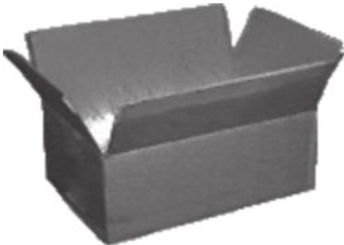
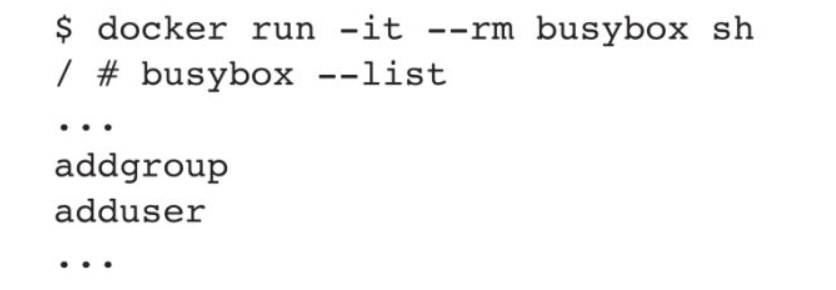
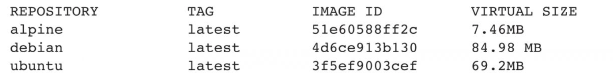
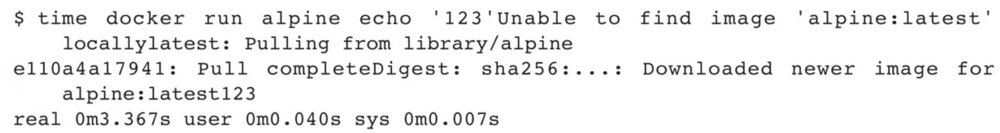
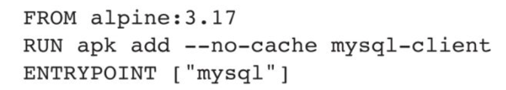
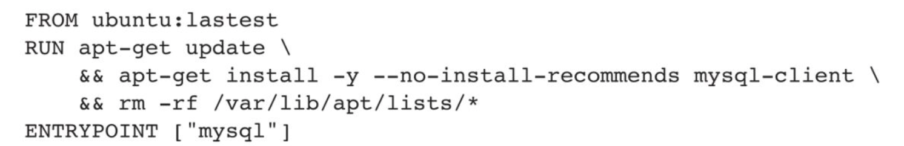
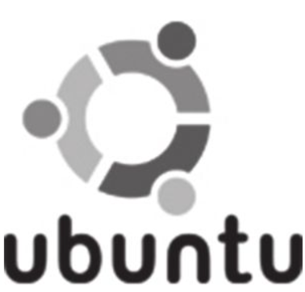
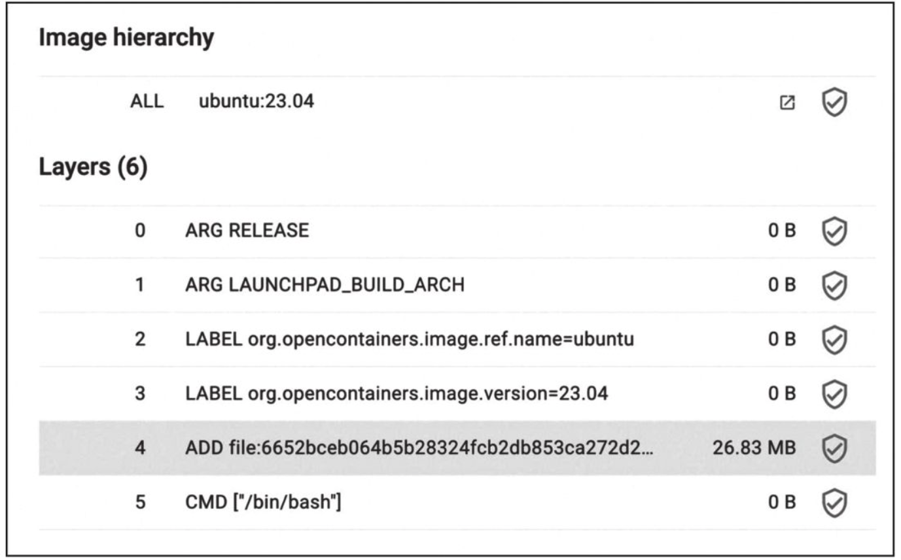
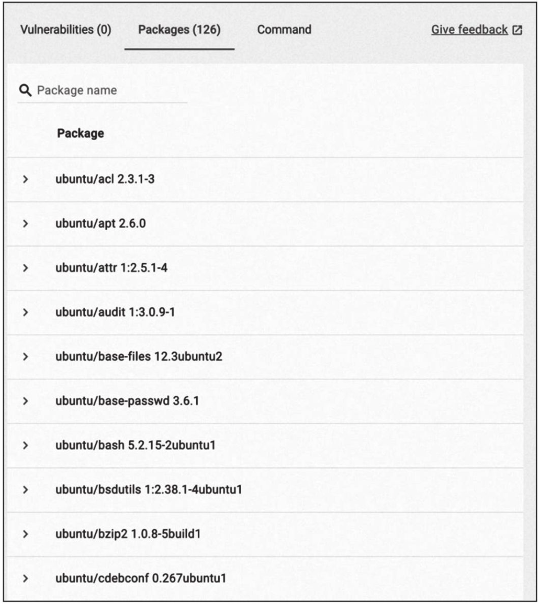

# 第二部分　实战案例
实战是检验技术的唯一标准。
通过第一部分的学习，相信读者已经掌握了Docker的核心概念和常用操作。
在第二部分，笔者将通过大量容器应用案例，更加深入地展示在生产实践中如何使用容器技术。
第10章介绍通过Docker运行典型的操作系统环境，包括BusyBox、Alpine、Ubuntu等。
第11章介绍利用Docker提供典型的Web服务，包括Apache、Nginx、Tomcat、Jetty、LAMP、CMS等流行的Web工具。
第12章将通过MySQL、MongoDB、Redis和Memcached等数据库典型示例，展示如何在容器中搭建和配置常见的数据库。
第13章介绍分布式处理和大数据平台的容器化应用，包括消息队列代表RabbitMQ、大数据平台Hadoop、Spark、Storm、Elasticsearch等。
第14章介绍主流编程语言的开发，包括C/C++、Java、Python、JavaScript、Go、PHP、Rust等语言，以及如何用Docker快速构建相应的编程开发环境。
接下来，在第15章将介绍公有云厂商的容器服务产品。
最后，在第16章会结合生产实践中的常见需求和问题进行探讨，分享容器实战中的一些思考。
通过第二部分的学习，读者将可以深入体验容器技术，更好地掌握Docker技巧。
# 第10章　操作系统
借助Docker技术，读者能够通过简洁的一行命令迅速获取各类Linux发行版的镜像，这是过去众多虚拟化技术难以实现的。尽管这些镜像体积极为精简，但它们仍能支持大部分完整Linux系统的功能。
在本章中，笔者将深入探讨如何利用Docker快速在本地运行诸如Busybox、Alpine和Ubuntu等操作系统。
## 10.1 BusyBox
BusyBox是一个集成了一百多个最常用Linux命令（如cat、echo、grep、mount、telnet等）的精简工具箱，磁盘大小在1～5MB，被誉为“Linux系统的瑞士军刀”​。

**1.使用官方镜像**
读者可以直接使用PusyBox的官方镜像启动容器，并运行busybox命令查看系统支持的命令：

读者可以使用docker images命令看到BusyBox镜像只有4.86MB大小，同时提供了基础的Linux指令集：

**2.相关资源**
❑ BusyBox官网：https://busybox.net/。
❑ BusyBox官方镜像：https://hub.docker.com/_/busybox/。
## 10.2 Alpine
作为一款轻量级的Linux发行版，Alpine操作系统专注于安全性、性能和资源效率。基于Musl libc和BusyBox构建的Alpine致力于缩减系统体积和降低运行时资源消耗。相较于BusyBox，Alpine功能更齐全，提供了包管理工具apk，以便用户轻松查询和安装软件包。Alpine Docker镜像继承了Alpine Linux发行版的诸多优势，其体积远小于其他镜像，仅约5MB（相较之下，Ubuntu系列镜像的大小接近200MB）​。

目前，Docker官方推荐将Alpine作为默认基础镜像环境，这将带来诸多好处，如加快镜像下载速度、提高镜像安全性、便捷地在主机之间切换以及减少磁盘空间占用等。
如下所示是官方镜像的大小比较，可以看到Alpine镜像在空间占用方面的显著优势：

**1.使用官方镜像**
由于镜像很小，下载时间几乎可以忽略，因此读者可以直接使用docker[container]run指令直接运行一个Alpine容器，并指定运行的指令，例如：

在本地没有提前拉取镜像的情况下，直接执行echo命令仅需要3s左右：

此轻量级镜像不仅使用起来更便捷，网络带宽压力也会相应减少。读者可以将Aplpine Linux作为基础镜像，以下Dockerfile将生成大约36MB大小的镜像：

而对于同样的需求，使用Ubuntu作为基础镜像，则需要生成大约145MB大小的镜像：

**2.迁移至Alpine基础镜像**
目前，大部分Docker官方镜像都已经支持Alpine作为基础镜像，可以很容易地进行迁移。例如：ubuntu/debian→alpine、python:3.7→python:3.7-alpine、ruby:2.6→ruby:2.6-alpine。
另外，如果使用Alpine镜像，安装软件包时可以使用apk工具，例如：
```shell
apk add --no-cache <package>
```
Alpine中软件安装包的名字可能会与其他发行版有所不同，读者可以在https://pkgs.alpinelinux.org/packages 网站搜索并确定安装包名称。如果需要的安装包不在主索引内，而在测试或社区索引中，则需要更新仓库列表，如下所示：

**3.相关资源**
❑ Apline官网：http://alpinelinux.org/。
❑ Apline官方仓库：https://github.com/alpinelinux。
❑ Apline官方镜像：https://hub.docker.com/_/alpine/。
## 10.3 Ubuntu
Ubuntu是一款基于Debian架构的Linux操作系统，应用领域广泛，覆盖从桌面到云计算等场景。作为最受欢迎的操作系统之一，Ubuntu很好地支持容器技术，包括Docker、Kubernetes等容器软件。Ubuntu的名字源于非洲南部的祖鲁语或豪萨语中的ubuntu一词，寓意着“人性”和“我的存在源于大家的存在”​，这体现了非洲传统文化中的“仁爱”价值观。

**1.使用官方镜像**
读者可以直接使用Docker Hub上的Ubuntu镜像快速启动容器：
```shell
docker run -it ubuntu bash
root@XX:/#
```
镜像包括了Ubuntu的最小安装，读者可以根据需要使用apt-get命令安装更多软件，例如在容器中安装vim软件：
```shell
root@XX:/# apt-get update;apt-get install -y vim
```
读者可以通过Docker Hub查看镜像中的文件及包信息，无须下载后再解析查看。例如，打开ubuntu:23.04的镜像页面，单击Layers，可见官方镜像的分层信息，如图10-1所示。

图10-1　官方镜像的分层信息

单击右侧的Packages（括号内为软件包个数）​，即可查看或搜索镜像内的软件包，如图10-2所示。

图10-2　镜像内的软件包

**2.相关资源**
❑ Ubuntu官网：https://ubuntu.com 。
❑ Ubuntu官方镜像：https://hub.docker.com/_/ubuntu/ 。
## 10.4 本章小结
本章讲解了如何下载和使用典型操作系统的镜像。
Docker Hub提供了官方镜像以及许多第三方Docker镜像。在选择合适的镜像时，读者应根据具体需求进行权衡。通常官方镜像体积较小，仅包含基本组件，非常适合作为基础镜像使用。精简的系统有助于实现更安全、稳定和高效的运行，同时便于个性化定制。一些第三方维护的应用镜像，如Quay.io提供的，也具有很高的质量。这些镜像通常针对特定应用进行了优化和配置。