# 第四章 操作Docker容器
容器是Docker的另一个核心概念。
简而言之，容器可以被理解为镜像的一个运行实例。它们之间的主要区别在于，镜像是静态的只读文件，而容器则包含运行时所需的可写文件层。此外，容器中的应用进程会处于运行状态。
相较于虚拟机模拟一整套操作系统（包括内核、应用运行态环境和其他系统环境）以及在操作系统上运行的应用，Docker容器更像是一个或一组独立运行的应用，以及它们所需的运行环境。
本章将详细介绍与容器相关的重要操作，包括创建容器、启动容器、终止容器、在容器内执行操作、删除容器以及通过导入或导出容器实现容器迁移等。
## 4.1 创建容器
本节主要介绍Docker容器的create、start、run、wait和logs子命令。
### 4.1.1 新建容器
可以使用docker create命令新建一个容器，例如：
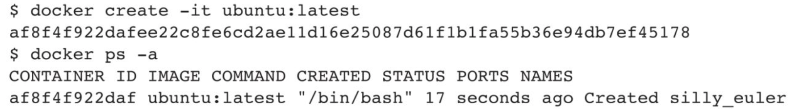
当使用docker create命令创建新容器时，容器将处于停止状态。要启动容器，可以使用docker start命令。
由于容器是Docker技术栈的核心组成部分，create以及后续的run命令都支持众多的命令选项，主要包括基本选项、高级选项，以及容器资源限制和安全保护相关选项，因此，读者应在实际操作中不断积累经验，以更好地掌握这些选项的使用方法。表4-1中显示了基本选项及对应描述。
表4-1　基本选项及对应描述
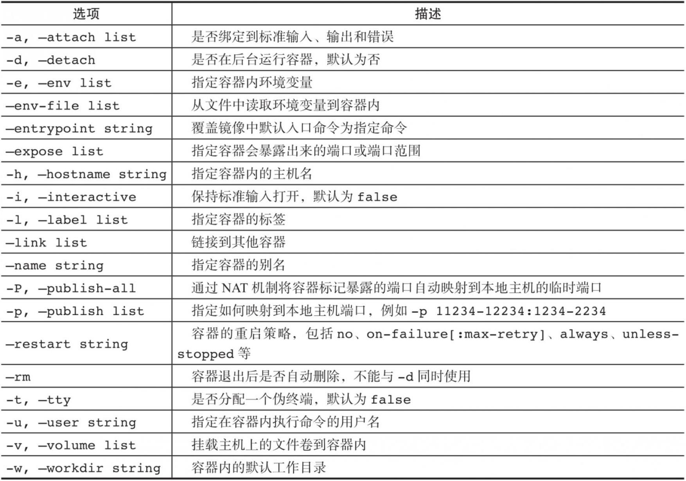
高级选项及描述如表4-2所示。
表4-2　高级选项及描述
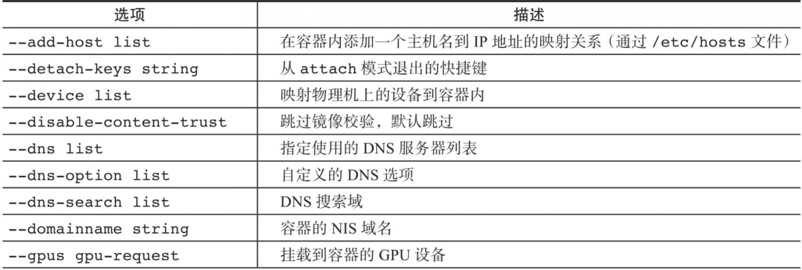
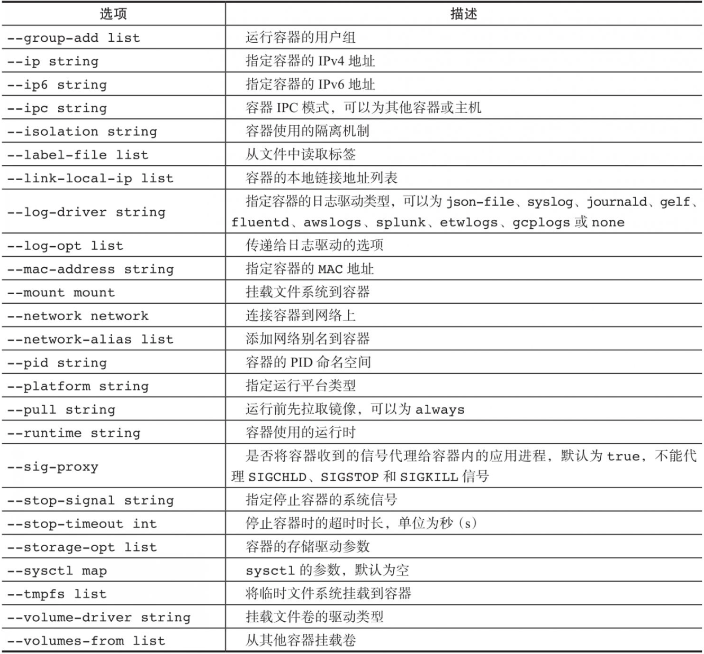
容器资源限制和安全保护的相关选项及描述如表4-3所示。
表4-3　容器资源限制和安全保护的相关选项及描述
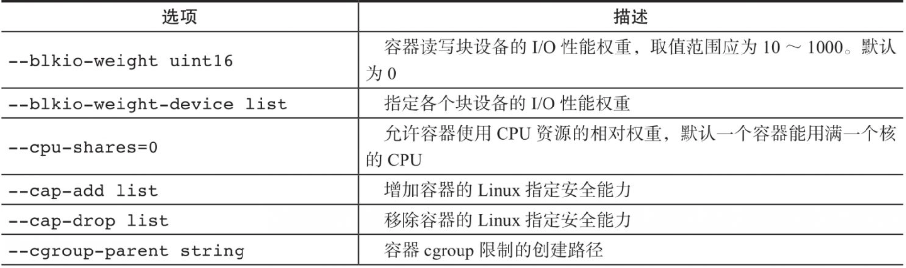
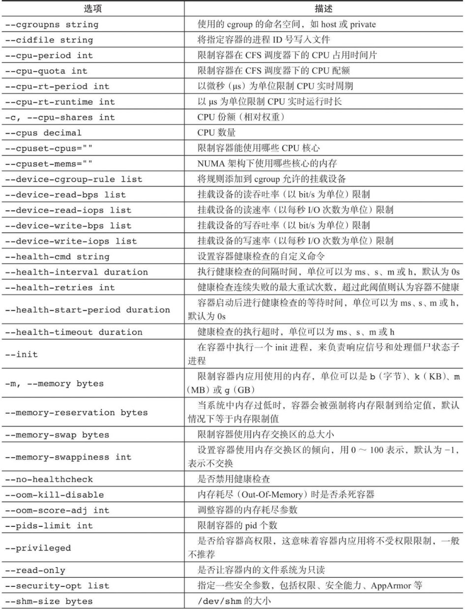
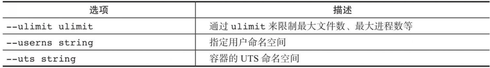
### 4.1.2 启动容器
使用docker start命令来启动一个已经创建的容器。例如，启动刚创建的Ubuntu容器：
```shell
docker start af8f4f922daf
```
此时，通过docker ps命令，可以查看到一个运行中的容器：
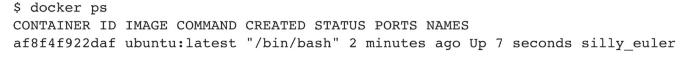
### 4.1.3 新建并启动容器
除了可以创建容器后通过start命令来启动容器，也可以直接新建并启动容器。所需要的命令主要为docker run，等价于先执行docker create命令，再执行docker start命令。
例如，下面的命令输出一个“Hello World”​，之后容器自动终止：
```shell
docker run ubuntu /bin/echo 'Hello world'
Hello world
```
这与在本地直接执行/bin/echo 'hello world'一样快。
在使用docker run命令创建并启动容器时，Docker会在后台执行以下标准操作：
❑ 检查本地是否存在指定的镜像，如果不存在，则从公共仓库下载。
❑ 基于镜像创建一个新容器，并启动它。
❑ 为容器分配一个文件系统，在只读镜像层外添加一层可读写层。
❑ 将宿主机的网桥接口桥接一个虚拟接口到容器内。
❑ 从网桥的地址池中为容器配置一个IP地址。
❑ 执行用户指定的应用程序。
❑ 应用程序执行完成后，容器将自动终止。
下面的命令将启动一个bash终端，允许用户在容器内进行交互：
```shell
docker run -it --rm ubuntu:24.04 /bin/bash
root@af8bae53bdd3：/#
```
其中，-t选项让Docker分配一个伪终端(pseudo-tty)并将它绑定到容器的标准输入上，-i则让容器的标准输入保持打开状态，--rm让容器退出后自动删除容器，一般跟随-it使用。更多的命令选项可以通过man docker-run命令查看。
在交互模式下，用户可以通过所创建的终端来输入命令，例如：
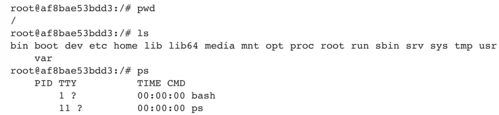
在容器内用ps命令查看进程，可以看到只运行了bash应用，并没有运行其他无关的进程。用户可以按Ctrl+D键或输入exit命令来退出容器：
```shell
root@af8bae53bdd3:/# exit
exit
```
对于所创建的bash容器，在用户使用exit命令退出bash进程之后，容器也会自动退出。这是因为对于容器来说，当其中的应用退出后，容器的使命完成，也就没有继续运行的必要了。
可以使用docker wait CONTAINER[CONTAINER...]子命令来等待容器退出，并输出退出的错误码，返回结果。某些时候，因为docker run命令无法正常执行，容器会出错直接退出，此时可以查看退出的错误码。
默认情况下，常见的错误代码包括：
❑ 125：Docker daemon执行出错，例如，指定了不支持的Docker命令参数。
❑ 126：所指定的命令无法执行，例如权限出错。
❑ 127：容器内命令无法找到。
命令执行出错后，会默认返回命令的退出错误码。
### 4.1.4 守护态运行
更多的时候，需要让Docker容器在后台以守护态(Daemonized)形式运行。此时，可以通过添加-d参数来实现。
例如，下面的命令会在后台运行容器：
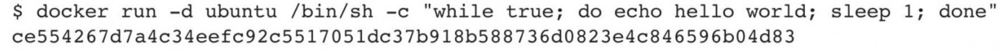
容器启动后会返回一个唯一的id，也可以通过docker ps或docker container ls命令来查看容器信息：
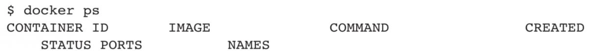
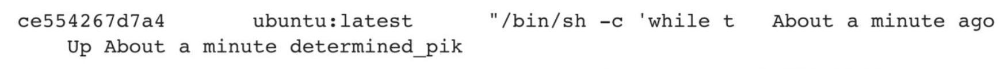
### 4.1.5 查看容器输出
要获取容器的输出信息，可以使用docker logs命令。支持的选项包括：
❑ --details：输出详细信息。
❑ -f,--follow：持续保持输出。
❑ --since string：输出从某个时间开始的日志。
❑ --tail string：输出最近的若干日志。
❑ -t,--timestamps：显示时间戳信息。
❑ --until string：输出某个时间之前的日志。
例如，查看某个容器的输出，可以使用以下命令：
```shell
docker logs ce554267d7a4
hello world
hello world
hello world
...
```
## 4.2 停止容器
本节主要介绍Docker容器的pause/unpause、stop和prune子命令。
**1.暂停容器**
可以使用docker pause CONTAINER[CONTAINER...]命令来暂停一个运行中的容器。例如，启动一个容器，并将其暂停：
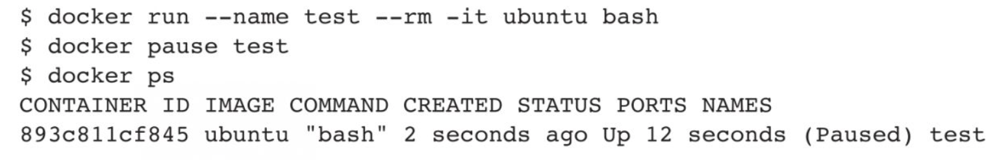
对于处于paused状态的容器，可以使用docker[container]unpauseCONTAINER[CONTAINER...]命令恢复到运行状态。
**2.终止容器**
可以使用docker stop命令来终止一个运行中的容器。该命令的格式为dockerstop[-t|--time[=10]​]​[CONTAINER...]​。
该命令会首先向容器发送SIGTERM信号，等待一段时间（默认10s超时）后，再发送SIGKILL信号来终止容器：
```shell
docker stop ce5
ce5
```
此时，执行docker prune命令，会自动清除所有处于停止状态的容器。还可以通过docker kill命令直接发送SIGKILL信号来强行终止容器。
当Docker容器中指定的应用终结时，容器也会自动终止。例如，对于只启动了一个终端的容器，用户通过exit命令或Ctrl+D来退出终端时，所创建的容器立刻终止，处于Stopped状态。
可以用docker ps-qa命令看到所有容器的ID。例如：
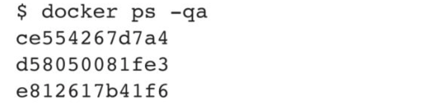
对于处于终止状态的容器，可以通过docker start命令重新启动：
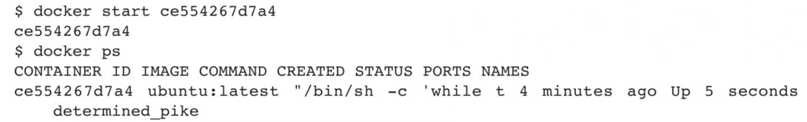
docker restart命令会将一个运行态的容器先终止，然后再重新启动：

## 4.3 进入容器
在使用-d参数时，容器启动后会进入后台，用户无法看到容器中的信息，也无法进行操作。
这时如果需要进入容器进行操作，推荐使用官方的attach或exec命令。
**1.attach命令**
attach是Docker自带的命令，命令格式为：
```shell
docker attach [--detach-keys[=[]]] [--o-stdin] [--sig-proxy[=true]] CONTAINER
```
这个命令支持三个主要选项：
❑ --detach-keys[ = [ ]​]​：指定退出attach模式的快捷键序列，默认是CTRL-P和CTRL-Q。
❑ --no-stdin=true|false：是否关闭标准输入，默认保持打开。
❑ --sig-proxy=true|false：是否将容器收到的系统信号代理（转发）给应用进程，默认为true。
下面的示例演示了如何使用该命令：

然而使用attach命令有时并不方便。当多个窗口同时进入同一个容器的时候，所有窗口都会同步显示。当某个窗口因命令而发生阻塞时，其他窗口也无法执行操作了。
**2.exec命令**
从Docker1.3.0版本起，可以直接使用exec命令在运行中的容器内执行给定指令。该命令的基本格式为：
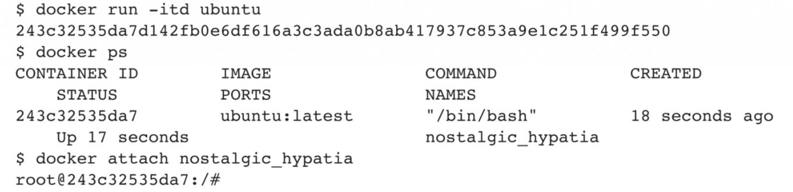
比较重要的参数有：
❑ -d,--detach：在容器中的后台执行命令。
❑ --detach-keys=""：指定将容器切回后台的按键。
❑ -e,--env=[​]​：指定环境变量列表。
❑ -i,--interactive=true|false：打开标准输入接受用户输入命令，默认为false。
❑ --privileged=true|false：是否给执行命令以高权限，默认为false。
❑ -t,--tty=true|false：分配伪终端，默认为false。
❑ -u,--user=""：执行命令的用户名或ID。
例如，进入刚创建的容器中，并启动一个bash：
```shell
docker exec -it 243c32535da7 /bin/bash
root@243c32535da7:/#
```
可以看到会打开一个新的bash终端，在不影响容器内其他应用的前提下，用户可以与容器进行交互。
注意，-it参数会保持容器的标准输入打开状态，并且为容器分配一个伪终端。
开启终端后，用户可以在容器中通过命令行进行操作，例如查看容器中的用户和进程信息：
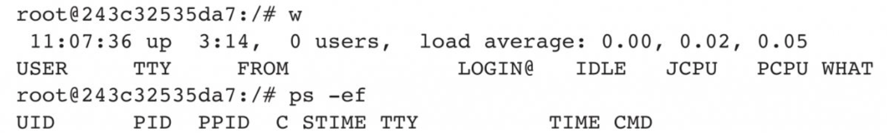
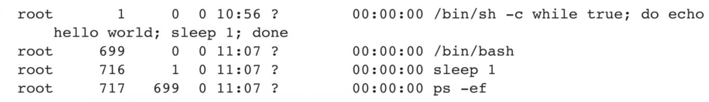
## 4.4 删除容器
可以使用docker rm命令来删除处于终止或退出状态的容器，命令格式为：
```shell
docker rm[-f|--force][-1|--link][-v|--volumes]CONTAINER[CONTAINER...]
```
主要支持的选项包括：
❑ -f,--force=false：是否强行终止并删除一个运行中的容器。
❑ -l,--link=false：删除容器的链接，但保留容器。
❑ -v,--volumes=false：删除容器挂载的数据卷。
例如，查看处于终止状态的容器并删除：
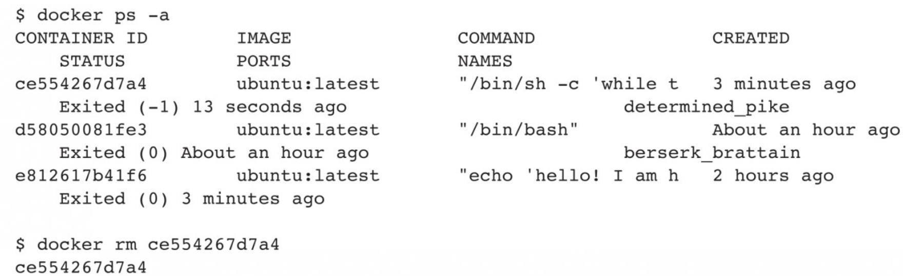
默认情况下，docker rm命令只能删除已经处于终止或退出状态的容器，并不能删除还处于运行状态的容器。
如果要直接删除一个运行中的容器，可以添加-f参数。Docker会先发送SIGKILL信号给容器，终止其中的应用，之后强行删除。
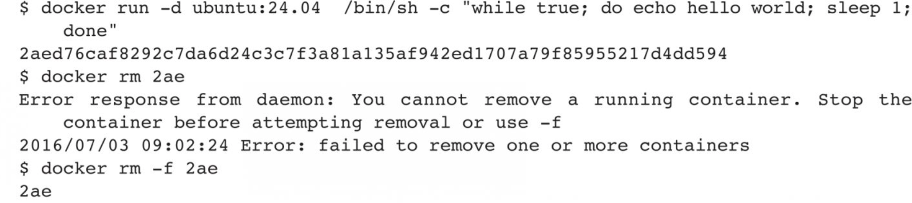
## 4.5 导入和导出容器
在某些情况下，可能需要将容器从一个系统迁移到另一个系统。这时，可以利用Docker提供的导入(import)和导出(export)功能来实现。
**1.导出容器**
导出容器是指导出一个已经创建的容器到一个文件，不管此时这个容器是否处于运行状态。可以使用docker export命令导出容器，该命令格式为：
```shell
docker export [-o|--output[=""]]CONTAINER
```
其中，可以通过-o选项来指定导出的tar文件名，也可以直接通过重定向来实现。
首先，查看所有容器，如下所示：
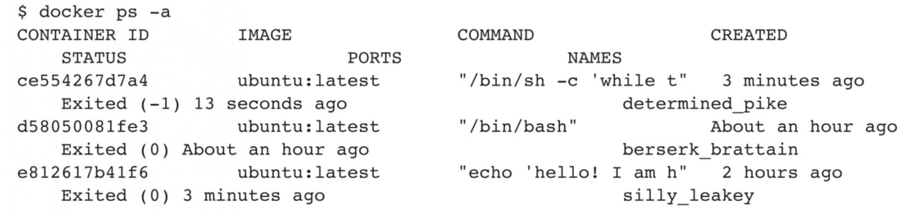
分别导出ce554267d7a4容器和e812617b41f6容器到文件test_for_run.tar和test_for_stop.tar：
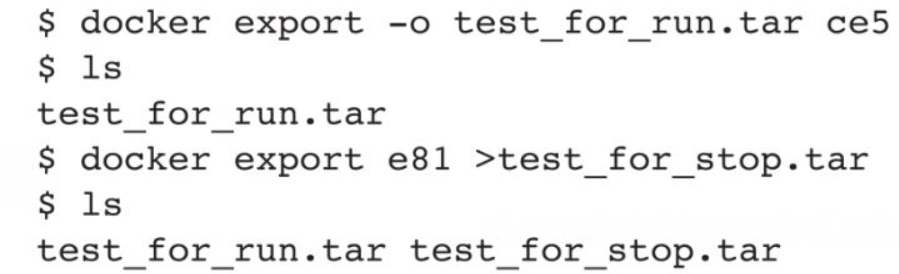
之后，可将导出的tar文件传输到其他机器上，然后再通过导入命令导入系统中，实现容器的迁移。
**2.导入容器**
导出的文件又可以通过docker import命令导入变成镜像，该命令格式为：
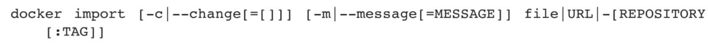
用户可以通过-c,--change=[​]选项在导入的同时执行对容器进行修改的Dockerfile指令（可参考后续相关章节）​。
下面将导出的test_for_run.tar文件导入系统中：
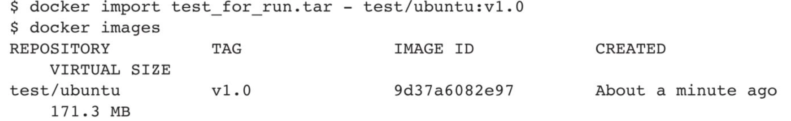
之前笔者介绍过使用docker load命令来导入镜像文件，这与docker import命令具有相似之处。
实际上，既可以使用docker load命令将镜像存储文件导入本地镜像库，也可以使用docker import命令将容器快照导入本地镜像库。
这两者之间的区别在于：容器快照文件会丢弃所有历史记录和元数据信息（仅保留当时的容器状态快照）​，而镜像存储文件会保存完整的记录，因此文件体积较大。另外，在从容器快照文件导入时，用户可以重新指定标签等元数据信息。
## 4.6 查看容器
本节主要介绍Docker容器的inspect、top和stats子命令，使用这些命令可以查看容器的状态信息。
**1.查看容器详情**
查看容器详情可以使用docker inspect[OPTIONS]NAME|ID[NAME|ID...]子命令。
例如，查看某容器的具体信息，会以JSON格式返回包括容器Id、创建时间、路径、状态、镜像、配置等在内的各项信息：
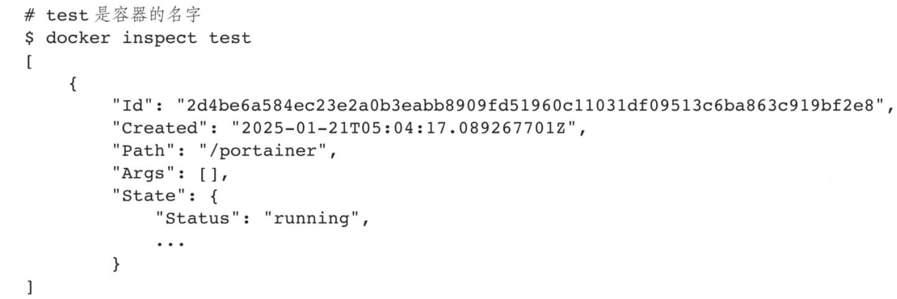
**2.查看容器内进程**
查看容器内进程可以使用docker[container]top[OPTIONS]CONTAINER[CONTAINER...]子命令。这个子命令类似于Linux系统中的top命令，会输出容器内的进程信息，包括PID、用户、时间、命令等。例如，查看test容器内的进程信息，命令如下：
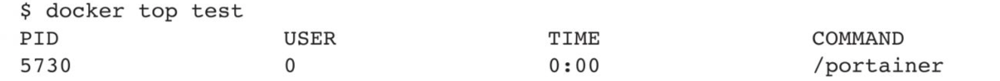
**3.查看统计信息**
查看统计信息可以使用docker[container]stats[OPTIONS]​[CONTAINER...]子命令，会显示CPU、内存、存储器、网络等使用情况的统计信息。
支持的选项包括：
❑ -a,--all：输出所有容器统计信息，默认仅运行中。
❑ --format string：格式化输出信息。
❑ --no-stream：不持续输出，默认会自动持续更新实时结果。
❑ --no-trunc：不截断输出信息。
例如，查看当前运行中容器的系统资源使用情况的统计信息：
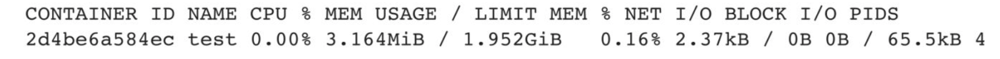
## 4.7 其他容器命令
本节主要介绍Docker容器的cp、diff、port和update子命令。
**1.复制文件**
cp命令支持在容器和主机之间复制文件，命令格式为：
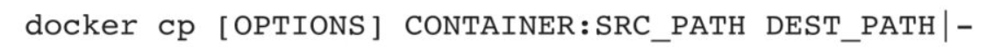
支持的选项包括：
❑ -a,--archive：打包模式，复制文件会带有原始的uid/gid信息；
❑ -L,--follow-link：跟随软链接。当原路径为软链接时，默认只复制链接信息，使用该选项会复制链接的目标内容。
例如，将本地的路径data复制到apache-test容器的/tmp路径下：
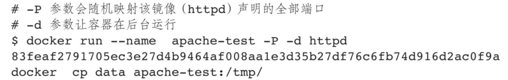
**2.查看变更**
diff命令用于查看容器内文件系统的变更，命令格式为：
```shell
docker diff CONTAINER
```
例如，查看apache-test容器内的数据修改：
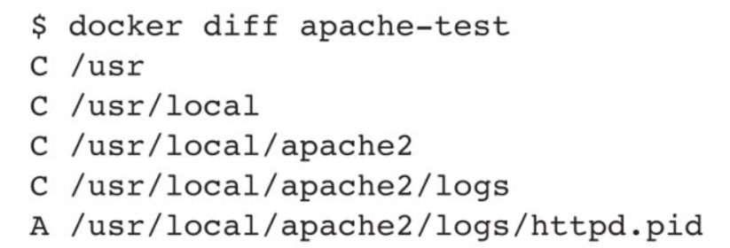
**3.查看端口映射**
port命令可以查看容器的端口映射情况，命令格式为：
```shell
docker port CONTAINER [PRIVATE_PORT/PROTO]
```
例如，查看apache-test容器的端口映射情况：
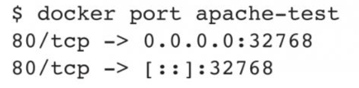
**4.更新配置**
update命令可以更新容器的一些运行时配置，主要是一些资源限制份额，命令格式为：
```shell
docker update [OPTIONS] CONTAINER [CONTAINER...]
```
支持的选项包括：
❑ --blkio-weight uint16：更新块I/O限制，有限制时取值为10～1000，默认为0，代表无限制。
❑ --cpu-period int：限制CPU调度器CFS(Completely Fair Scheduler)的使用时间，单位为微秒，最小值为1000。
❑ --cpu-quota int：限制CPU调度器CFS（Completely Fair Scheduler，完全公平调度器）的配额，单位为微秒，最小值为1000。
❑ --cpu-rt-period int：限制CPU调度器的实时周期，单位为微秒。
❑ --cpu-rt-runtime int：限制CPU调度器的实时运行时，单位为微秒。
❑ -c,--cpu-shares int：限制CPU的使用份额。
❑ --cpus decimal：限制CPU的个数。
❑ --cpuset-cpus string：允许使用的CPU核，如0～3,0,1。
❑ --cpuset-mems string：允许使用的内存块，如0～3,0,1。
❑ --kernel-memory bytes：限制使用的内核内存。
❑ -m,--memory bytes：限制使用的内存。
❑ --memory-reservation bytes：内存软限制。
❑ --memory-swap bytes：内存加上缓存区的限制，-1表示为对缓冲区无限制。
❑ --pids-limit int：调整容器的pid限制，-1表示无限制。
❑ --restart string：容器退出后的重启策略。
例如，限制总配额为1s，容器test所占用时间为10%，代码如下所示：
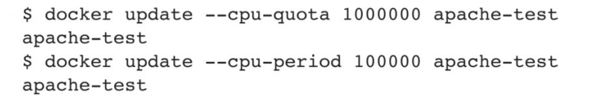
## 4.8 本章小结
容器是直接提供应用服务的组件，也是整个Docker技术栈中的核心概念。为了便于用户高效地管理容器的整个生命周期，Docker提供了丰富的命令，支持对容器的各项操作。读者可以通过docker container help命令查看Docker支持的各种容器操作子命令。
通过本章介绍的理论知识和示例，相信读者已经掌握了管理容器生命周期的各项操作命令。
在生产环境中，为了提高容器的可用性和安全性，一方面需要合理地使用资源限制参数来控制容器的资源消耗；另一方面，要设置合适的容器重启策略以自动重启已退出的容器。此外，用户还可以利用HAProxy甚至Kubernetes等辅助工具来实现对容器的更高级管理，以此避免故障造成的影响。